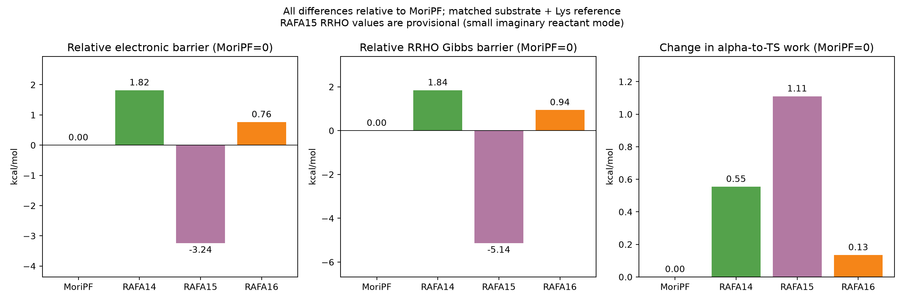

# MoriPF・RAFA14・RAFA15・RAFA16のIRC／反応力解析

GaussianのIRC（固有反応座標）計算ログから、フッ素置換位置が異なる4分子系の反応経路を比較するPythonプロジェクトです。エネルギー、反応力、原子間距離・角度、分子断片の質量重心（COM）、原子の力と運動を解析します。

**最新の結果：[4系解析の日本語summary](analysis4_force/outputs/reports/summary_ja.md)**

## 今回の比較でわかったこと

2026年10月17日に受領した `完成.zip` の16ログ（4系×IRC・反応物・生成物・TS）と、同じ計算条件で再計算された `LYS (1).LOG`（保存名 `Lys.log`）を解析しました。比較基準は **MoriPF＝0** です。

| 分子系 | ortho F数 | ΔΔE‡：MoriPFとの差 | ΔΔG‡：MoriPFとの差 | ΔG‡：分子＋Lys基準 |
|---|---:|---:|---:|---:|
| MoriPF | 2 | 0.000 | 0.000 | 14.083 |
| RAFA14 | 0 | +1.818 | +1.845 | 15.928 |
| RAFA15 | 1 | −3.245 | −5.141 | 8.943 |
| RAFA16 | 2 | +0.763 | +0.940 | 15.023 |

エネルギー単位はkcal/mol。ΔEは電子エネルギー、ΔGは298.15 K・1 atmのGaussian RRHO値です。RAFA15の反応物には微小虚振動があるため、この系のRRHO値は暫定として扱います。

ortho FのないRAFA14はMoriPFより高障壁ですが、RAFA15はMoriPFよりH···F接触が長いにもかかわらず低障壁で、接触距離だけでは4系の障壁差を説明できません。接触の相関は水素結合や安定化エネルギーの直接的な証明ではありません。

新しいLysはM06-2X/6-311++G(d,p)・SMD水のopt/freqで、正常終了・虚振動なしです。今回は分子＋Lysを基準とする絶対電子障壁・Gibbs障壁も計算しています。電子障壁が負の系もありますが、分離反応物基準の値であり、無障壁反応を意味しません。全系でGibbs障壁は正です。配座・標準状態・生成物対応の制限はsummaryに記載しています。



## ディレクトリ構成

| ディレクトリ | 内容 |
|---|---|
| `analysis4_force/` | 最新の4系解析、設定、検証コード |
| `analysis4_force/outputs/` | 4系のCSV、グラフ、方向を統一した解析用LOG、日本語summary |
| `data/completed_20261017/` | 今回の17入力ログの圧縮原本（`.gz`）とSHA-256 manifest |
| `base_analysis/` | 従来の2系の基礎解析。共通のIRC parserもここに保存 |
| `analysis2_force/` | 従来の2系の反応力解析。共通の構造・力の解析関数を再利用 |
| `src/` | 従来の基礎解析を起動する入口 |

従来の `analysis2_force/outputs/` はローカルに残し、Gitの追跡対象から除外しています。

## 実行方法

Pythonの仮想環境を有効化し、プロジェクトのルートで実行します。

```sh
python -m pip install -r requirements.txt
python analysis4_force/run_analysis.py
```

圧縮原本は自動展開され、SHA-256で照合されます。展開後のLOGはGitで追跡せず、元の内容を保持した `.gz` を保存しています。再実行時にDownloadsフォルダは不要です。

検証：

```sh
python -m unittest discover -s analysis4_force/tests -v
```

従来の2系解析の実行方法：

```sh
python src/run_analysis.py
python analysis2_force/run_analysis.py
```

後者は別途Downloads内の反応物・生成物ログを必要とします。[旧解析README](analysis2_force/README.md)を参照してください。

## IRCの方向とTS

C20–求核Nの距離が長い側から短い側へ進むように、各系の方向を検証しました。MoriPF・RAFA15・RAFA16は元のparser座標を反転し、RAFA14はそのまま使っています。RAFA16には小さな局所的伸長がありますが、端点間の方向は明瞭です。

`outputs/oriented_logs/` のLOGは、原本から抽出した座標・力・エネルギーの**解析用派生ファイル**です。新規Gaussian計算の出力ではありません。解析はこのファイルを読み直して実施します。実際のTS構造・エネルギーを対応するfreqログから読み込み、未収束で反応座標が欠けた末端点は除外します。

## 理論の参照元

Toro-Labbé, Gutiérrez-Oliva, Murray & Politzer (2009), “The reaction force and the transition region of a reaction,” *Journal of Molecular Modeling* **15**, 707–710. [DOI](https://doi.org/10.1007/s00894-008-0431-8)、[PubMed](https://pubmed.ncbi.nlm.nih.gov/19085021/)。

反応力は `F = −dE/dR`、論文の反応力定数は `κ = d²E/dR² = −dF/dR` です。旧解析のκは逆符号だったため、4系解析では論文の規約を図と `kappa_paper_*` 列に使用します。

構造変化の統計、原子・分子断片の力と運動の積、H···F接触の相関は本プロジェクトの追加解析です。

## 詳しい資料

- [4系の結果と解釈・制限](analysis4_force/outputs/reports/summary_ja.md)
- [4系解析の実装・出力ガイド](analysis4_force/README.md)
- [基礎解析の説明](base_analysis/README.md)
- [旧2系の実装記録](analysis2_force/README_ANALYSIS.md)
