# 図の見方：何を比較し、どこまで読み取れるか

この案内は `analysis4_force/outputs/figures/` にある全図を対象とする。計算結果を変えず、各図の目的、軸、点・線・色、解釈を説明する。

## 最初に見る順番

**図3・23 → 図14 → 図15・18 → 図19 → 図20・21 → 図22** の順に見ると、障壁の違い、着目する接触、指標の定義、他の原子・接触との比較を順に確認できる。

## 比べている原子

「アミン側」は置換ベンゼン環のC24上のF/Hと、選択したアミンH。「反対側」はC25上のF/HとクマリンのO21を指す。XはFまたはHをまとめて表す記号で、未知の原子ではない。

| 系 | アミン側の原子対 | 反対側の原子対 |
|---|---|---|
| MoriPF | F33···H46 | F29···O21 |
| RAFA14 | H57···H44 | H56···O21 |
| RAFA15 | F31···H44 | H56···O21 |
| RAFA16 | F31···H44 | F29···O21 |

RAFA14のアミン側はH···Hなので、4系をまとめて「F···H」と呼ばない。図4〜6・10〜13の旧指標には、上の固定位置とは別の「TSで最も近いF」を使うものがある。各図の説明を参照する。

## 混同しやすい3つの量

| 量 | 何を計算したか | 主な図 |
|---|---|---|
| 原子に割り当てた仕事 | 各原子の全方向の力と移動から−∫Fᵢ·drᵢを計算。ここでは系のエネルギーが上がる向きを正とする | 15・19・20 |
| 接触方向の力Q | 2原子に働く力の差を、2原子を結ぶ方向に取り出して半分にしたもの | 14・21右列 |
| 接触方向の仕事 | Qと2原子間距離qの変化から−∫Q dqを計算 | 18・21左列・22 |

式のFᵢは原子iに働く合計の力、rᵢはその座標、qは2原子間の距離を表す。e_abは原子aからbへ向かう単位ベクトル。

原子に働く力には分子全体の効果が含まれる。どの量も、特定の2原子間だけの相互作用エネルギーではない。「値が大きい」は、図で定義した力や仕事が大きいという意味で使う。

## 共通の記号と色

- ΔE‡：電子エネルギーによる活性化障壁。ΔG‡：熱・エントロピー補正を含むRRHOの自由エネルギー障壁。どちらも各系の基質＋LysからTSまでの差であり、MoriPFとの差ではない。
- R：IRC上の反応座標。R=0がTS。負から正へ反応が進む。Rは時刻でもC–N結合長そのものでもない。
- 共通区間：原則C–N 2.50→2.10 Å。全障壁ではなく、TSに至る前の一部分を集計している。区間を変えた比較は図16。
- mEh/Bohr：力の単位。1 mEh=0.001 Hartree。kcal/mol：仕事・エネルギーの単位。
- r：Pearson相関。±1に近いほど直線的な対応が強く、0に近いほど弱い。負の値は「指標が増える系ほど障壁が低い」ことを表す。Spearmanは順位の対応。
- 分子系を色分けする図では、青=MoriPF、緑=RAFA14、紫=RAFA15、橙=RAFA16。ただし図5・6・9・16・19・20・22などは色の意味が異なるので、それぞれの凡例を優先する。
- 対数目盛では同じ間隔が同じ差ではなく同じ倍率を表す。たとえば0.001→0.01と0.01→0.1は、どちらも10倍。

4系での相関は探索的な結果。RAFA15のΔG‡には反応物の微小虚振動による留保がある。機構の判断には、値の大きさと他の原子・接触との比較も合わせて見る。

## 「13候補」と「97候補」は何が違うか

各分子系の中で順位を調べるときは、その系で距離などの条件を満たす接触を数える。RAFA15の反対側を種類・距離で絞った比較では、指定接触を含めて13候補になる。

4系をまたいで相関を比べるときは、全4系で同じ位置に対応する接触だけを残す。そのため、各系の中での順位とは候補数が異なる。本文の「対照6個」は指定接触を除く数で、指定接触を含めると7候補。「対照96個」なら全97候補である。図21は各系の中での比較、図22は4系共通の接触の比較。

## 図ごとの説明

- [図01：反応経路に沿ったエネルギー・反応力・反応力定数](#fig01)
- [図02：活性化障壁と、αからTSまでのエネルギー上昇](#fig02)
- [図03：分離反応物を基準とする活性化障壁](#fig03)
- [図04：反応に伴う原子間距離と角度の変化](#fig04)
- [図05：注目した距離・角度は、他の距離・角度より大きく変化するか](#fig05)
- [図06：注目する原子に働く力と、他の原子に働く力の比較](#fig06)
- [図07：反応に伴う分子全体の双極子モーメントの変化](#fig07)
- [図08：原子の力と移動から、全体の反応力を再現できるか](#fig08)
- [図09：分子のどの部分が反応力に寄与しているか](#fig09)
- [図10：接触方向の力と、その距離が変化する向きの対応](#fig10)
- [図11：アミンHとすべてのFの距離を確認する](#fig11)
- [図12：C–N形成の進み具合とF···H距離、および障壁の比較](#fig12)
- [図13：分子の各部分が近づく動きを差し引いた距離変化](#fig13)
- [図14：同じortho位置で、両側の距離と接触方向の力を比べる](#fig14)
- [図15：両側の原子に割り当てた仕事と、活性化障壁の関係](#fig15)
- [図16：集計する区間やアミンHを変えても相関が保たれるか](#fig16)
- [図17：以前使っていた力の比率と、障壁の関係を残した補足図](#fig17)
- [図18：接触方向に限って計算した仕事と、障壁の関係](#fig18)
- [図19：どの原子が仕事の合計を占めているか](#fig19)
- [図20：指定した4原子の仕事は、全57原子の中で何番目に大きいか](#fig20)
- [図21：指定した接触の力・仕事を、同じ系の他の接触と比べる](#fig21)
- [図22：接触の値の大きさと、障壁との相関を同時に比べる](#fig22)
- [図23：E・G・TΔSを、IRCと両端準位の3通りの表示で比較する](#fig23)

## 図01：反応経路に沿ったエネルギー・反応力・反応力定数

上段は電子エネルギーΔE(R)、中段は反応力F=−dE/dR、下段は反応力定数κ=d²E/dR²を描いた。横軸は反応の進み具合を表すIRC座標Rで、左が反応物側、R=0がTS、右が生成物側。ΔEの単位はkcal/mol、FとκはそれぞれIRC座標で1回、2回微分した単位になる。

上段のゼロは各系の分離反応物（基質＋Lys）のエネルギーであり、MoriPFのTSではない。点はログから読み取った値、滑らかな実線は補間・平滑化した曲線。中段には有限差分から求めた点も示す。黒い縦破線はTS、その他の縦破線はFの極値から決めたα・γ。個別図は1系、比較図は4系を重ねている。

この図は障壁の高さと経路の形を読むためのもの。Fは分子全体のエネルギー勾配で、F···HやH···Oの間に働く力そのものではない。

対象ファイル：

- [01_MoriPF_energy_force_kappa.png](../figures/01_MoriPF_energy_force_kappa.png)
- [01_RAFA14_energy_force_kappa.png](../figures/01_RAFA14_energy_force_kappa.png)
- [01_RAFA15_energy_force_kappa.png](../figures/01_RAFA15_energy_force_kappa.png)
- [01_RAFA16_energy_force_kappa.png](../figures/01_RAFA16_energy_force_kappa.png)
- [01_four_systems_energy_force_kappa.png](../figures/01_four_systems_energy_force_kappa.png)

## 図02：活性化障壁と、αからTSまでのエネルギー上昇

横軸は4つの分子系、棒の高さはkcal/mol単位のエネルギー。左から電子エネルギーによる障壁ΔE‡、熱・エントロピー補正を含むRRHOの自由エネルギー障壁ΔG‡、α→TSの区間仕事を示す。棒上の数字が各値。

最初の2つは各系の分離反応物からTSまで、右端はIRC上のαからTSまでを比べており、出発点が異なる。RAFA15は全障壁が低くてもα→TSの上昇は大きい。この区間仕事を、そのまま全障壁や接触の結合エネルギーと解釈しない。

対象ファイル：

- [02_barriers_and_work.png](../figures/02_barriers_and_work.png)

## 図03：分離反応物を基準とする活性化障壁

左はΔE‡、右はΔG‡。横軸は分子系、縦軸はkcal/molで、棒の高さと数字は各系の障壁そのものを示す。図2の左・中央と同じ量を大きく表示した。

ΔE‡が負なのは、TSの電子エネルギーが分離した基質＋Lysより低いという意味。無障壁反応を意味しない。ΔG‡は全系で正である。RAFA15のΔG‡は反応物の小さな虚振動が残るため暫定値。

対象ファイル：

- [03_absolute_barriers.png](../figures/03_absolute_barriers.png)

## 図04：反応に伴う原子間距離と角度の変化

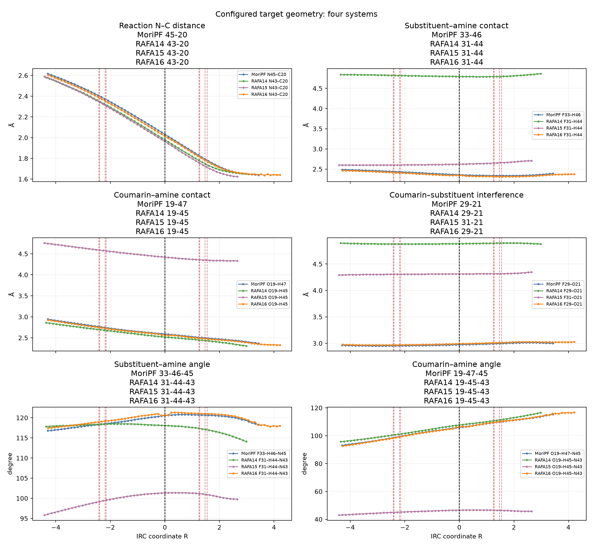

横軸はIRC座標R。上段左は形成中のC–N距離、上段右は選択したF···アミンH距離。中段左はクマリンO···アミンH距離、中段右は選択したF···クマリンO距離。下段は対応する2種類の接触角度。距離はÅ、角度は度で表示する。個別図は1系、比較図は4系。凡例の元素と数字が追跡した原子を表す。

ここでのFは旧解析で選んだ原子であり、RAFA15の反対側ベンゼンHを含まない。反対側のH/Fを同じ環位置で比べるには図14を見る。距離が短いことだけで水素結合や安定化の強さは決まらない。

対象ファイル：

- [04_MoriPF_geometry.png](../figures/04_MoriPF_geometry.png)
- [04_RAFA14_geometry.png](../figures/04_RAFA14_geometry.png)
- [04_RAFA15_geometry.png](../figures/04_RAFA15_geometry.png)
- [04_RAFA16_geometry.png](../figures/04_RAFA16_geometry.png)
- [04_four_systems_geometry.png](../figures/04_four_systems_geometry.png)

## 図05：注目した距離・角度は、他の距離・角度より大きく変化するか

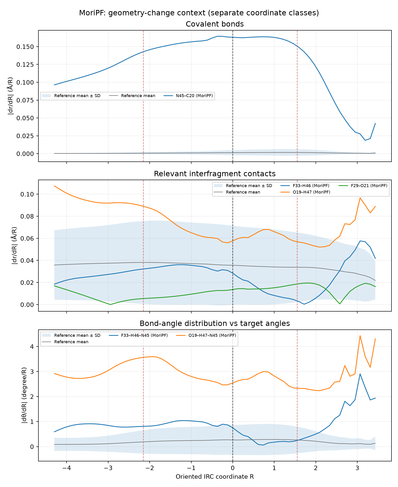

各分子系について、IRCに沿う距離・角度の変化率の絶対値を描いた。横軸はR。上段は共有結合長の変化率（Å/R）、中段は分子の各部分の間にある接触距離の変化率（Å/R）、下段は角度の変化率（度/R）。色付きの線は注目する距離・角度、灰色の線と帯はそれ以外の比較対象の平均と平均±標準偏差。

帯は信頼区間ではなく、比較対象間のばらつき。上に出る線は「構造変化が大きい」ことを表し、「相互作用が強い」ことを直接示さない。図20〜22とは比較対象も量も異なる。

対象ファイル：

- [05_MoriPF_geometry_context.png](../figures/05_MoriPF_geometry_context.png)
- [05_RAFA14_geometry_context.png](../figures/05_RAFA14_geometry_context.png)
- [05_RAFA15_geometry_context.png](../figures/05_RAFA15_geometry_context.png)
- [05_RAFA16_geometry_context.png](../figures/05_RAFA16_geometry_context.png)

## 図06：注目する原子に働く力と、他の原子に働く力の比較

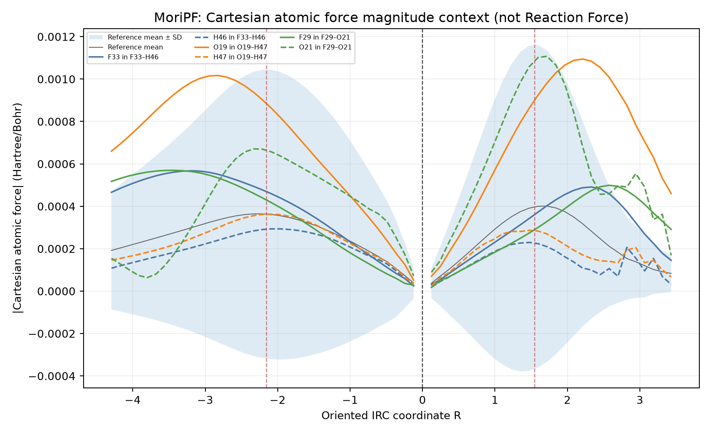

横軸はR、縦軸は各原子に働く力ベクトルの長さ（Hartree/Bohr）。色付きの実線・破線は、凡例に記した接触を構成する各原子の値を別々に示す。灰色の線・帯は、表示した原子を除く比較対象の平均と平均±標準偏差。同じ原子が複数の接触に登場する場合は線が重なる。

原子には分子全体から力が作用するため、この値は凡例の原子対だけの力ではない。また、TS付近で力が小さくなることは、接触が消えたことを意味しない。

対象ファイル：

- [06_MoriPF_atomic_force.png](../figures/06_MoriPF_atomic_force.png)
- [06_RAFA14_atomic_force.png](../figures/06_RAFA14_atomic_force.png)
- [06_RAFA15_atomic_force.png](../figures/06_RAFA15_atomic_force.png)
- [06_RAFA16_atomic_force.png](../figures/06_RAFA16_atomic_force.png)

## 図07：反応に伴う分子全体の双極子モーメントの変化

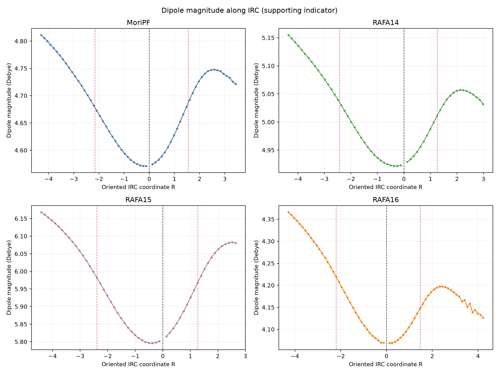

4つの小図はそれぞれ1つの分子系。横軸はR、縦軸は双極子モーメントの大きさ（Debye）。ログに値がある点を結んだもので、記録が少ない場合は経路全体を細かく追えているわけではない。

電荷の偏りや配向の変化を見る補助図。特定のF···HやH···Oの相互作用エネルギーを測った図ではない。

対象ファイル：

- [07_dipoles.png](../figures/07_dipoles.png)

## 図08：原子の力と移動から、全体の反応力を再現できるか

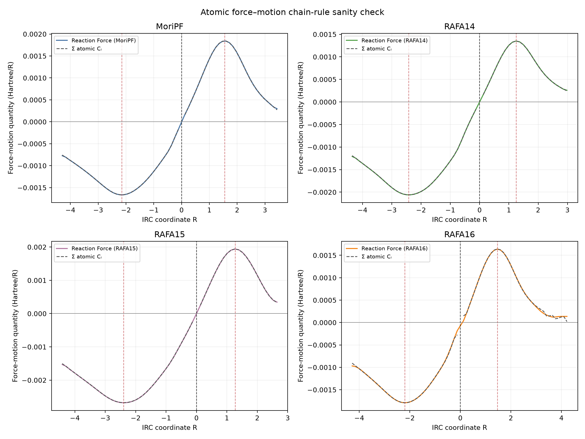

各小図で、横軸はR、縦軸はHartree/R。分子系の色の実線はエネルギーから求めた反応力−dE/dR、灰色の破線は全原子のFᵢ·drᵢ/dRを合計した値。2本が重なるほど、座標・力の対応と単位換算が整合している。

これは計算方法の確認用の図である。2本が一致しても、特定の接触が障壁を下げるという仮説が証明されたことにはならない。

対象ファイル：

- [08_force_motion_validation.png](../figures/08_force_motion_validation.png)

## 図09：分子のどの部分が反応力に寄与しているか

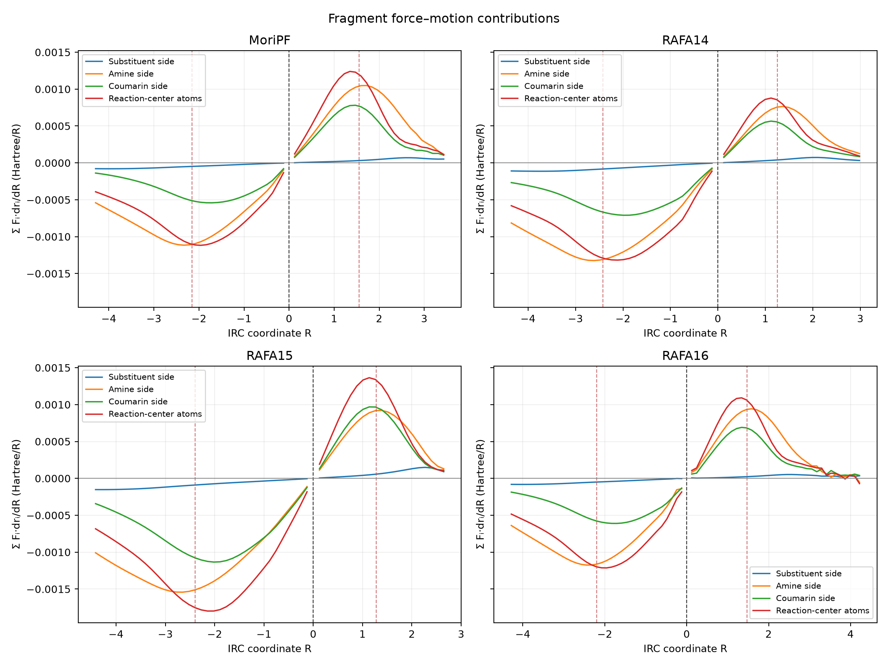

各小図が1系で、横軸はR、縦軸は各原子のFᵢ·drᵢ/dRを部分ごとに足した値（Hartree/R）。線の色は分子系ではなく、アミン、置換ベンゼン環、残りのクマリン側、反応中心の区別。

アミン・置換ベンゼン環・クマリン側の3群は原子が重ならないため合計できる。反応中心の線はこれらと原子が重なる参考値なので、4本全部を足してはいけない。縦軸は仕事を積分する前の量で、結合エネルギーではない。

対象ファイル：

- [09_fragment_contributions.png](../figures/09_fragment_contributions.png)

## 図10：接触方向の力と、その距離が変化する向きの対応

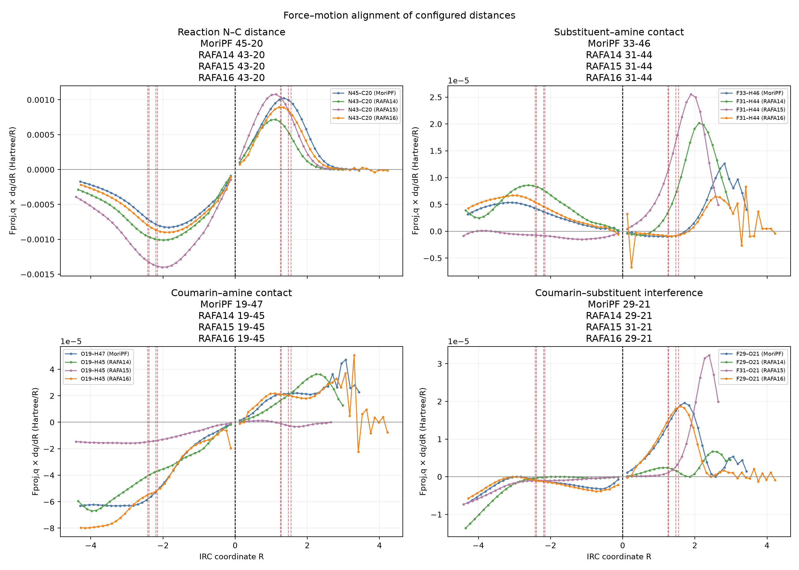

横軸はR、縦軸は接触方向の力Qと距離変化率dq/dRの積（Hartree/R）。4つの小図でC–N、選択したF···H、O···H、F···Oを示す。各線は1つの分子系。

値が正なら、原子に働く合計の力を接触方向へ取り出した成分と、距離が変わる向きが一致する。仕事として扱うときはこの値に負号を付けて積分する。この図のF···Oは旧解析のF限定の選択なので、RAFA15の反対側H···Oは図14・18で確認する。

対象ファイル：

- [10_force_motion_alignment.png](../figures/10_force_motion_alignment.png)

## 図11：アミンHとすべてのFの距離を確認する

各小図が1系。横軸はR、左縦軸はF···H距離（Å）。灰色の線はすべてのFと2つのアミンHの組合せ、色付きの線はTSで最短だった原子対を経路全体で追跡したもの。黒い破線は、その原子対のN–H···F角度を右縦軸（度）で示す。

途中で最短の原子対に切り替えてはいない。色付きの線が灰色の別の線より長くなる場合もある。近さと角度を確認する図であり、灰色の線の数や高い相関を水素結合の数・強さとは解釈しない。

対象ファイル：

- [11_NH_F_contacts.png](../figures/11_NH_F_contacts.png)

## 図12：C–N形成の進み具合とF···H距離、および障壁の比較

左：横軸は反応C–N距離、縦軸はTSで選んだF···H距離（ともにÅ）。1本の線は1系の経路で、C–Nが短くなる左向きが反応の進行方向。右：横軸はTSでのF···H距離（Å）、縦軸はΔE‡（kcal/mol）で、1点が1系。

右図は「F···Hが短い系ほど障壁が低いか」を調べる。RAFA15は接触が最短ではないのに障壁が低く、距離だけでは4系の順位を説明できない。

対象ファイル：

- [12_contact_vs_progress_and_barrier.png](../figures/12_contact_vs_progress_and_barrier.png)

## 図13：分子の各部分が近づく動きを差し引いた距離変化

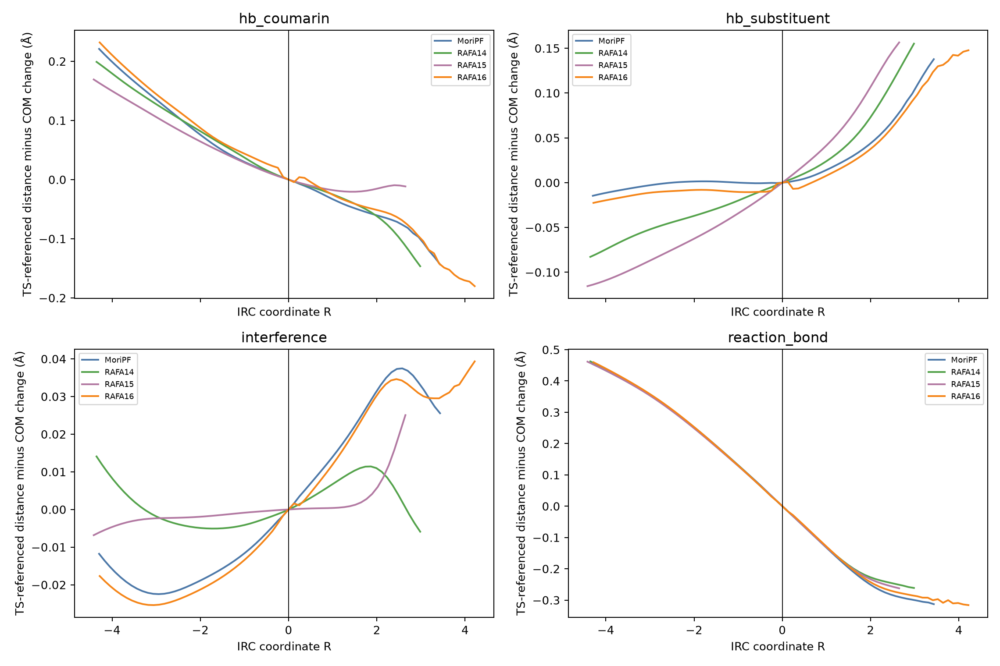

横軸はR、縦軸は [接触距離のTSからの変化] − [対応する部分の重心間距離のTSからの変化]（Å）。COMは質量中心（重心）の略。各小図はタイトルにある距離、線の色は分子系を表す。TSでは定義により0になる。

接触距離の変化が、部分全体の接近・離反だけで説明できるかを見るための補助量。正負はこの差の向きであり、引力・斥力の符号ではない。エネルギーをTS=0にする処理とも無関係。

対象ファイル：

- [13_COM_corrected_distances.png](../figures/13_COM_corrected_distances.png)

## 図14：同じortho位置で、両側の距離と接触方向の力を比べる

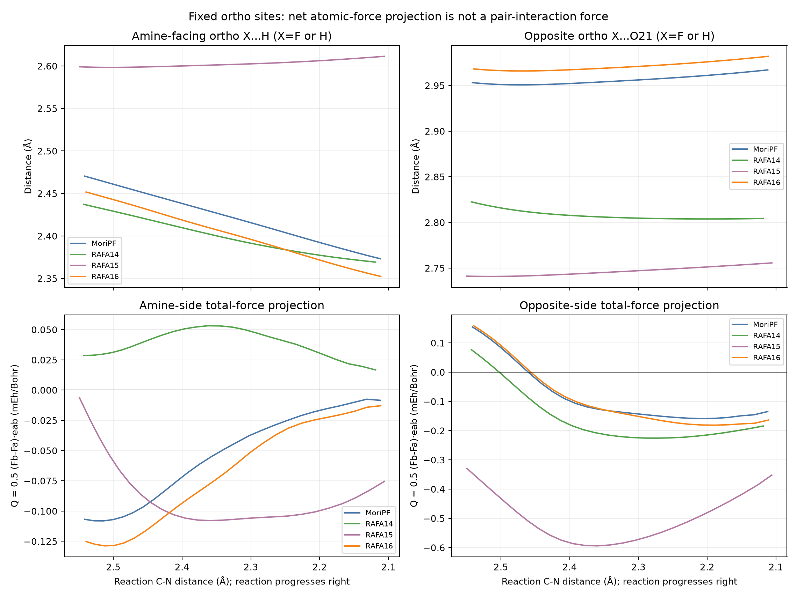

左列はアミン側の環置換原子X（FまたはH）···アミンH、右列は反対側のX···O21。上段は距離（Å）、下段は接触方向の力Q=½(F_b−F_a)·e_ab（mEh/Bohr）。横軸はC–N距離で、左から右へ短くなり、右向きが反応の進行方向。表示範囲はおおむね2.55→2.10 Å。線の色は4つの分子系。

Q<0は距離を縮める向き、Q>0は開く向きの成分。ただしQは原子に働く合計の力から作る値であり、その2原子の間だけの引力・斥力ではない。RAFA14の左列はH···Hで、F···Hではない。

対象ファイル：

- [14_two_sided_contacts.png](../figures/14_two_sided_contacts.png)

## 図15：両側の原子に割り当てた仕事と、活性化障壁の関係

1点が1つの分子系。左列の横軸はアミン側XとアミンHの仕事の合計、右列は反対側XとO21の仕事の合計（kcal/mol）。どちらもC–N 2.50→2.10 Åの間で−∫Fᵢ·drᵢを計算した。上段の縦軸はΔE‡、下段はΔG‡（kcal/mol）。点の色は分子系、rはPearson相関、Spearmanは順位相関を表す。

右列は、仕事が大きい系ほど障壁が低いという負の相関を示す。ただし横軸は経路の一部分の仕事で、縦軸は分離反応物からTSまでの全障壁。仕事の大きさをそのまま接触の安定化エネルギーには読み替えられない。この図だけでは、他の接触より特別な相関かどうかは分からない。

対象ファイル：

- [15_two_sided_barrier_correlations.png](../figures/15_two_sided_barrier_correlations.png)

## 図16：集計する区間やアミンHを変えても相関が保たれるか

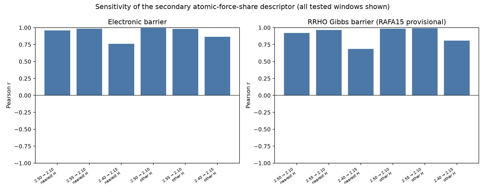

左はΔE‡、右はΔG‡とのPearson相関r。横軸の6条件は、3つのC–N距離区間と、2通りのアミンHの選び方の組合せ。丸はアミン側の原子仕事、四角は反対側の原子仕事、三角は以前の原子力の比率。ここでは色と記号は分子系ではなく指標を区別する。

rが+1または−1に近いほど直線的な対応が強く、0に近いほど弱い。線が平らなら条件を変えても相関があまり変わらない。ただし反対側の仕事の定義にはアミンHが含まれないため、Hを替えて同じ値になること自体は新しい検証ではない。

対象ファイル：

- [16_two_sided_sensitivity.png](../figures/16_two_sided_sensitivity.png)

## 図17：以前使っていた力の比率と、障壁の関係を残した補足図

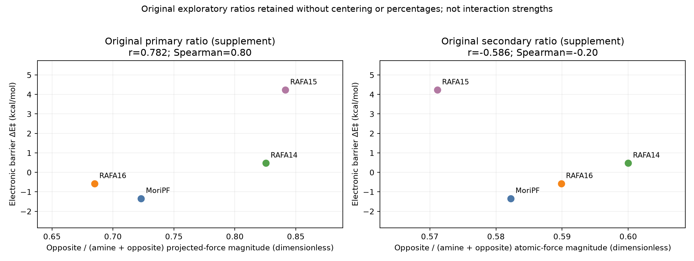

1点が1系、縦軸はΔE‡（kcal/mol）。左の横軸は両側の接触方向の力の大きさの合計に対する、反対側の割合。右は選択4原子の力ベクトルの長さの合計に対する、反対側2原子の割合。比率は0〜1の無次元値で、MoriPFとの差や百分率ではない。

右図には高い相関があるが、分母や原子の選び方に依存する。比較の履歴を残す補足図であり、現在の主な評価には単位のある仕事と、他の接触との比較を用いる。

対象ファイル：

- [17_dimensionless_share_supplement.png](../figures/17_dimensionless_share_supplement.png)

## 図18：接触方向に限って計算した仕事と、障壁の関係

1点が1系。左列はアミン側、右列は反対側の接触について、接触方向の力Qを距離変化に沿って積分した−∫Q dq（kcal/mol）を横軸に取る。上段はΔE‡、下段はΔG‡。集計区間はC–N 2.50→2.10 Å。

図15が2原子の全方向の力と移動を足した量なのに対し、図18は2原子を結ぶ方向の成分だけを使う。両者は別の量で、足し合わせない。反対側には負の相関があるが、横軸の値は0.01 kcal/mol未満であり、数kcal/molの障壁差をそのまま説明するエネルギーではない。

対象ファイル：

- [18_radial_work_barrier_correlations.png](../figures/18_radial_work_barrier_correlations.png)

## 図19：どの原子が仕事の合計を占めているか

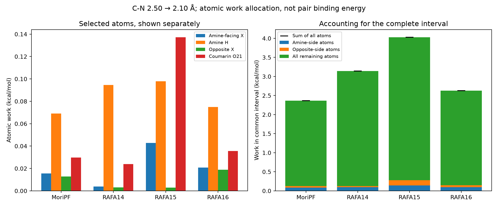

横軸は4系、縦軸は共通区間C–N 2.50→2.10 Åの仕事（kcal/mol）。左では、アミン側X、アミンH、反対側X、O21の4原子を別々の棒にした。左図の色は原子の役割を表す。右ではアミン側2原子、反対側2原子、残り53原子の仕事を積み上げ、黒い短線で全57原子の合計を示す。

RAFA15の反対側の仕事の大部分はHではなくO21に割り当てられる。また、選んだ4原子だけで全区間のエネルギー変化を担っているわけではない。積み上げ棒は原子ごとの配分であり、接触ごとの相互作用エネルギーの内訳ではない。

対象ファイル：

- [19_atomic_work_partition.png](../figures/19_atomic_work_partition.png)

## 図20：指定した4原子の仕事は、全57原子の中で何番目に大きいか

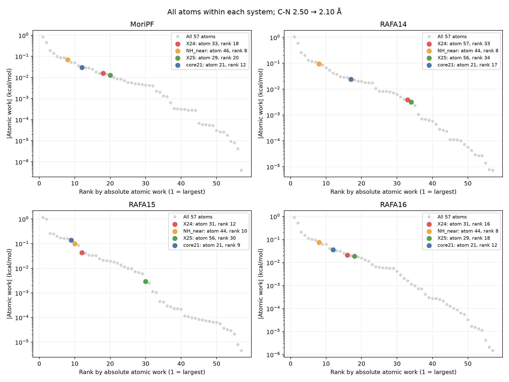

各小図が1系。1点が1原子で、横軸は仕事の絶対値が大きい順の順位（1位が最大）、縦軸は仕事の絶対値（kcal/mol、対数目盛）。灰色の点が全57原子で、着目する4原子を色付きで重ねる。赤=X24（アミン側F/H）、橙=NH_near（選択アミンH）、緑=X25（反対側F/H）、青=core21（O21）。ここでの色は分子系の色ではない。

左上にあるほど仕事が大きい。RAFA15ではO21が9位、反対側H56が30位で、H56自体が最大の寄与を持つわけではない。これは原子の順位であって、H56···O21という原子対の順位ではない。

対象ファイル：

- [20_all_atom_work_controls.png](../figures/20_all_atom_work_controls.png)

## 図21：指定した接触の力・仕事を、同じ系の他の接触と比べる

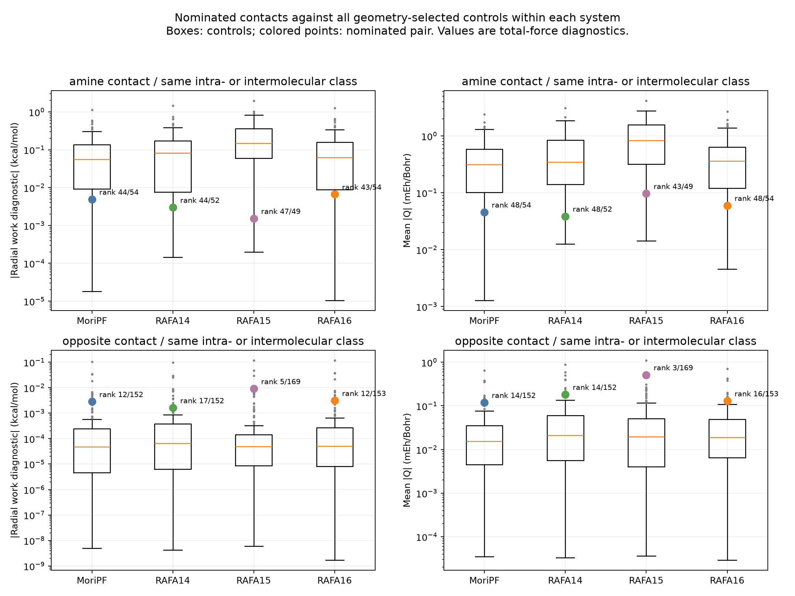

上段はアミン側の分子間接触、下段は反対側の分子内接触。左列は接触方向の仕事の絶対値（kcal/mol）、右列は接触方向の力の平均絶対値（mEh/Bohr）。横軸は分子系、縦軸は対数目盛。箱は比較対象の接触の分布、色付きの丸は指定接触。橙の横線は中央値、箱は25〜75パーセンタイル、ひげは第1四分位数−1.5×四分位範囲から第3四分位数＋1.5×四分位範囲までに入る最小・最大の値、外の灰色点はその範囲外の値で、計算失敗を意味しない。

rank 5/169なら、指定接触を含む169候補中で5番目に大きい。丸が箱より上にあるほど多くの接触より値が大きい。この図は広い比較対象を使っており、本文の「種類・距離を絞ると13候補中1位」とは母集団が異なる。どちらも力・仕事の指標の順位で、厳密な結合強度の順位ではない。

対象ファイル：

- [21_contact_strength_controls.png](../figures/21_contact_strength_controls.png)

## 図22：接触の値の大きさと、障壁との相関を同時に比べる

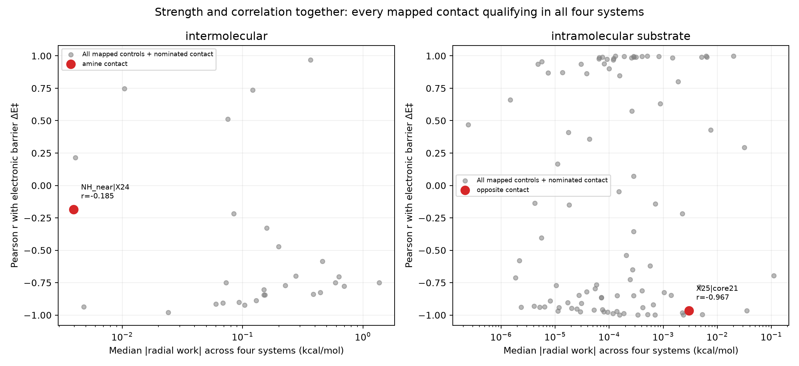

**1点が1つの原子対であり、分子系やIRCの1点ではない。** 4系すべてで対応を付けられ、接触条件を満たした原子対だけを示す。左は分子間、右は基質分子内。横軸は、その原子対の接触方向の仕事の絶対値を4系で集めた中央値（kcal/mol、対数目盛）。縦軸は、その原子対について4系の仕事とΔE‡から求めたPearson相関r。灰色が比較候補、赤が指定接触。

右ほど仕事の値が大きく、上端・下端に近いほど障壁との直線的な対応が強い。下側は負の相関なので「弱い相関」ではない。右図の赤点は比較的大きな仕事と強い負の相関を持つが、灰色点にも|r|が大きいものが多数ある。この図は「指定した接触だけが相関するか」を調べるもので、接触の実際の引力・斥力を描いたものではない。

対象ファイル：

- [22_contact_correlation_specificity.png](../figures/22_contact_correlation_specificity.png)

## 図23：E・G・TΔSを、IRCと両端準位の3通りの表示で比較する

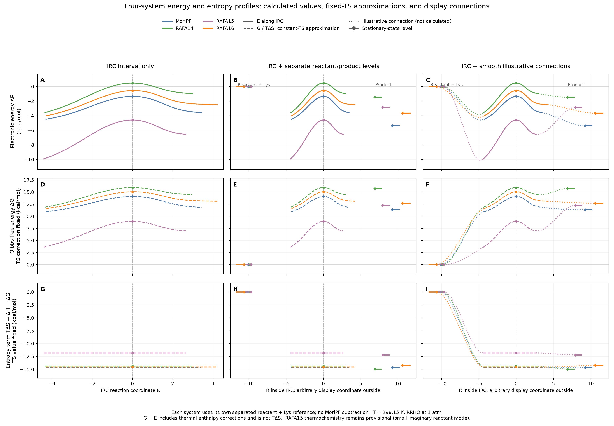

4分子系を4色で重ねた3×3の図。上から電子エネルギーΔE、自由エネルギーΔG、エントロピー項TΔS（すべてkcal/mol）。左列はIRC区間だけ、中央列はその両端に分離反応物（基質＋Lys）と生成物の横棒を加えたもの、右列は横棒とIRCを滑らかな点線でつないだもの。各行の縦軸の範囲は3列で共通。色は青=MoriPF、緑=RAFA14、紫=RAFA15、橙=RAFA16。

横軸は計算済み区間では元のIRC座標Rで、R=0の丸がTS。IRCの外に置いた横棒の横位置は表示用に決めたもので、計算された反応座標ではない。横棒側のひし形は反応物・生成物の準位を表す。すべて各系の分離反応物からの差で、MoriPFとの差ではない。反応物の横棒は全系で0になるため重なることがある。

上段の実線と小点はIRCの電子エネルギー。中段・下段の破線はTSの熱補正を全IRC点に固定した参考曲線である。この仮定によりGはEと同じ形になり、TΔSは水平になる。G・TΔSを直接計算したのはfreqのある反応物・TS・生成物で、IRC各点のfreqは存在しない。

右列の点線は、IRC末端でその傾きに、横棒で傾き0につながる表示用の3次Hermite曲線。計算済みIRCの位置・エネルギーは動かしていない。点線の谷・山は接続条件によって生じる形で、計算で得た中間体や障壁ではない。TΔSはΔH−ΔGであり、ΔE−ΔGとは異なる。

対象ファイル：

- [23_energy_entropy_profiles_3x3.png](../figures/23_energy_entropy_profiles_3x3.png)
