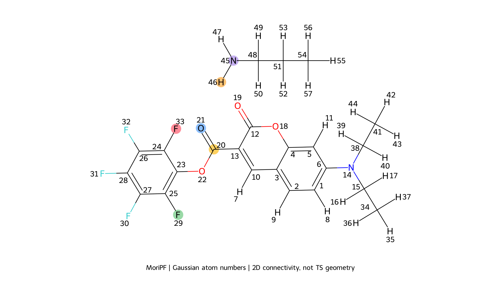
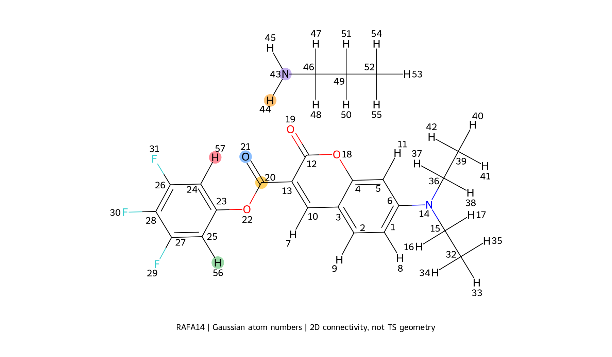
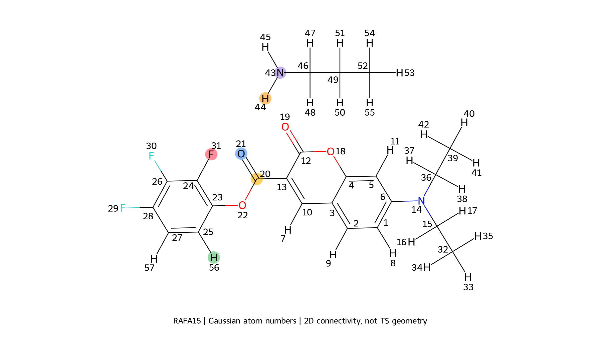
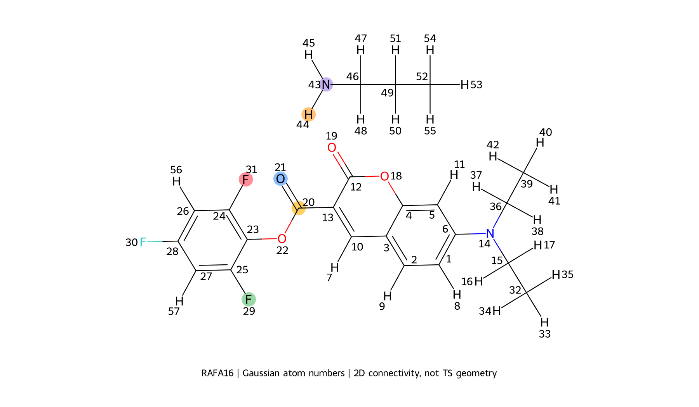

# 着目する原子・接触の順位と、比較対象の中身を調べた結果

作成日：2026-10-20（JST）。ΔG‡を説明指標にせず、原子の仕事・力と接触方向の仕事・力について、指定対象より上位のものを一つずつ同定した。新しいDFTは行っていない。

## 今回の確認方法

主区間はC–N 2.50→2.10 Å。指定した4原子（環のアミン側F/H、選択アミンH、反対側F/H、O21）は全57原子と比較した。指定した2接触は、従来と同じ分子内／分子間区分・距離・結合関係で選んだ比較対象と比べた。上位の原子・接触を都合よく除外せず、すべて残した。

比較候補は、元の分子内で直接結合する1–2対と、2本の結合でつながる1–3対を除き、区間内の最短距離が4.0 Å以下の対とした。1–4対は広い比較に含める。アミン側は分子間、反対側は基質分子内で比較する。種類・距離を絞る場合、アミン側はH···H/F/O/N、反対側はH/F···O/Nを残し、指定接触との平均距離差を±0.75 Å以内にする。形成中のC20–求核Nは元の分子間として広い比較に含まれるので、表では主反応の結合形成と明記した。

各原子の結合先を確認し、各原子対について、原子番号・元素・分子内の位置・最短結合経路・平均距離を記載した。H···O/N/Fについては、Hが結合する原子Dを特定してD–H···A角も調べた。さらに、これまで順位に使っていた力の絶対値に加え、符号付きの接触方向の力Qも既存の座標・力から計算した。

「上位」は定義した数値の絶対値が大きいことを意味する。原子の仕事、2原子の仕事の和、接触方向の仕事、力の平均絶対値は別の量として扱う。接触方向のQも、2原子間だけの力ではなく、両原子に働く全原子力の差から求める。

## 個別の全件一覧

- [MoriPF：番号付き構造式・着目対象・上位全件・直下3件](higher_ranked_controls_MoriPF_ja.md)
- [RAFA14：番号付き構造式・着目対象・上位全件・直下3件](higher_ranked_controls_RAFA14_ja.md)
- [RAFA15：番号付き構造式・着目対象・上位全件・直下3件](higher_ranked_controls_RAFA15_ja.md)
- [RAFA16：番号付き構造式・着目対象・上位全件・直下3件](higher_ranked_controls_RAFA16_ja.md)

## 仕事・接触方向の力の計算式

「指定接触の値」は、指定した原子対について、その表の見出しにある指標を計算した値を指す。いつも仕事という意味ではない。

| 表の指標 | 定義 | 単位 |
| --- | --- | --- |
| 原子の仕事 | 原子のエネルギー勾配とIRCに沿う変位の内積を積分 | kcal/mol |
| 2原子の仕事の合計 | 原子aの仕事＋原子bの仕事 | kcal/mol |
| 接触方向の仕事 | 下記の接触方向の力Qと、原子間距離の変化から計算 | kcal/mol |
| 接触方向の力の平均絶対値 | Qの絶対値を、共通C–N距離区間で平均 | mEh/Bohr |
| 符号付き平均Q | Qの符号を残して、同じ区間で平均 | mEh/Bohr |

### 1. 原子ごとの仕事

IRC座標を $R$、原子 $i$ の3次元座標を $\mathbf r_i(R)$、全系の電子エネルギーを $E$ とする。ログに記録された原子力は、エネルギー勾配の負である。

$$
\mathbf F_i=-\nabla_{\mathbf r_i}E
$$

この解析で「原子の仕事」と呼ぶ量は、次の線積分である。

$$
W_i
=\int_{R_0}^{R_1}\nabla_{\mathbf r_i}E\cdot
\frac{d\mathbf r_i}{dR}\,dR
=-\int_{R_0}^{R_1}\mathbf F_i\cdot
\frac{d\mathbf r_i}{dR}\,dR
$$

つまり、ユーザーのいう「IRCの動きに沿って、∂E/∂x・dxを積分する」に対応する。ただしx成分だけでなく、x・y・zの3成分を足す。ここでEは原子固有のエネルギーではなく、全系の電子エネルギーである。

**このWはエネルギー増加側を正にする符号で定義している。通常の「力がする仕事」∫F・drとは符号が逆。** 正ならその原子の変位に沿うエネルギー上昇への寄与、負なら低下への寄与を表す。連続的で整合した勾配と経路なら全原子の和は区間の電子エネルギー差になる。実際のログでは離散点・勾配精度・補間による残差がある。

集計前に全57原子を使って各IRC構造をTS構造へ剛体重ね合わせし、座標から並進・回転を除き、力ベクトルにも同じ回転を施している。原子別の内訳は、この座標系と経路に基づく分解である。

### 2. 原子対についての「仕事」は2種類ある

**2原子の仕事の合計**は単純に

$$
W_{ab}^{\mathrm{sum}}=W_a+W_b
$$

である。aとbに働く力は、それぞれ他の全原子の影響を含む。この和はa–b間の相互作用エネルギーではない。

一方、**接触方向の仕事**では、まず距離と方向を定義する。

$$
q_{ab}=\|\mathbf r_b-\mathbf r_a\|,
\qquad
\mathbf e_{ab}=\frac{\mathbf r_b-\mathbf r_a}{q_{ab}}
$$

接触方向の力Qは、両原子の全原子力の差を、この方向へ投影した量である。

$$
Q_{ab}=\frac12(\mathbf F_b-\mathbf F_a)\cdot\mathbf e_{ab}
$$

係数1/2は、2原子の幾何学的な中点を固定し、aを−e方向へdq/2、bを＋e方向へdq/2だけ動かして距離をdq伸ばす仮想変位に対応する。このとき、力がする仕事はQ dqになる。質量による重み付けはしていない。

実際のIRCに沿う距離変化を使って、

$$
W_{ab}^{\mathrm{rad}}
=-\int_{R_0}^{R_1}Q_{ab}(R)
\frac{dq_{ab}}{dR}\,dR,
\qquad
\frac{dq_{ab}}{dR}
=\mathbf e_{ab}\cdot
\left(\frac{d\mathbf r_b}{dR}-\frac{d\mathbf r_a}{dR}\right)
$$

と計算する。これは経路に沿った−∫Q dqであり、qが途中で増減しても、その符号を保って積分する。

この量は2原子の相対変位のうち、距離が伸縮する方向だけを取り出した診断量である。2原子が一緒に移動する成分や、原子対の向きが変わる成分は含めないため、一般に $W_{ab}^{\mathrm{rad}}\ne W_a+W_b$。また、Q自体が全原子力から作られているので、厳密なa–b相互作用エネルギーの分解でもない。

### 3. 「平均絶対値」と「符号付き平均Q」

平均の変数は、IRC座標Rではなく、反応点のC–N距離 $c$ である。主区間では反応が $c=2.50$ Åから $2.10$ Åへ進む。平均は正の積分幅で書くと次のようになる。

$$
\overline{|Q_{ab}|}
=\frac{1}{2.50-2.10}
\int_{2.10}^{2.50}|Q_{ab}(R(c))|\,dc
$$

$$
\overline{Q_{ab}}
=\frac{1}{2.50-2.10}
\int_{2.10}^{2.50}Q_{ab}(R(c))\,dc
$$

この2つは**力の平均値であり、仕事ではない**。C–N距離について均等に平均しており、時間平均でもIRC点の単純平均でもない。分母と積分の距離単位が相殺され、力の単位が残る。

- 平均絶対値：力の大きさの比較に使用。途中で正負が変わっても打ち消されない。
- 符号付き平均Q：正なら平均として原子対を開く方向、負なら縮める方向。正負が途中で混在すれば相殺される。

一般に $\overline{|Q|}\ne|\overline Q|$。今回のMoriPF・RAFA16の指定F···Hでは、表示精度内で平均絶対値と符号付き平均Qの大きさが一致し、平均Qは負だった。上位5対は平均Qが正だった。「上位の方が力は大きいが向きが異なる」という記述は、この2列を比較したものである。

**Qの符号は、aとbだけの引力・斥力を判定するものではない。** また、Qの符号と実際の距離変化dq/dRは別の量である。仕事の符号は−Q(dq/dR)の積で決まるので、平均Qが負という情報だけでは、仕事が正か負かも決まらない。

原子の力の平均大きさも同じC–N距離区間で $\|\mathbf F_i\|$ を平均する。これは接触方向への投影Qとは別の量である。

### 4. 数値計算と単位

座標の微分d r/dRはIRC離散点から有限差分（`numpy.gradient`）で求める。仕事はR方向で、区間内の計算点と線形補間した両端点を用いて台形積分する。Qの平均はC–N距離を等間隔にした501点へ線形補間し、平均絶対値では補間後に絶対値を取り、台形積分する。

長さは仕事計算時にBohrへ変換する（1 Bohr = 0.529177210903 Å）。力はHartree/Bohr、積分した仕事はHartreeとなり、1 Hartree = 627.509474 kcal/molで換算する。力の表は1000倍してmEh/Bohrで示す。

実装は `analysis4_force/contact_specificity.py` の `calculate_system()`（仕事・平均絶対値）と、`analysis4_force/higher_ranked_controls.py` の `enrich_pairs()` / `window_average()`（符号付き平均Q）。この節は計算済み指標の定義を記述したもので、数値や順位は変更していない。

## 原子仕事の合計と電子障壁に対する割合

原子の仕事の表には、全57原子と合計行を載せた。分母を明示して、次の2種類の割合を併記する。どちらも符号付きの仕事を使用し、絶対値にはしていない。

$$
p_i^{\mathrm{IRC}}=100\,\frac{W_i^{[2.50\to2.10]}}{E_{\mathrm{TS}}-E_{\mathrm{IRC,start}}},
\qquad
p_i^{\mathrm{window}}=100\,\frac{W_i^{[2.50\to2.10]}}{E_{c=2.10}-E_{c=2.50}}
$$

前者は「IRC反応物側端点→TSの電子障壁の何％を、この部分区間でその原子が担ったか」、後者は「積分区間の電子エネルギー上昇の何％をその原子が担ったか」を表す。分母は以下の実際のエネルギー差であり、仕事の合計を分母にして100%へ強制的に合わせてはいない。

**全原子の仕事の和が対応するのは、積分区間の電子エネルギー差。現在の2.50→2.10 Åの仕事を足しても、端点→TSの障壁全体にはならない。** 端点からTSまで同じ積分を行えば、その区間の電子障壁に対応する。自由エネルギー障壁ΔG‡や熱補正込みの障壁には対応しない。

| 分子系 | IRC端点→TSのΔE‡ / kcal/mol | 積分区間ΔE / kcal/mol | 全57原子の仕事ΣW / kcal/mol | 積分残差ΣW−区間ΔE / kcal/mol | ΣW／IRC端点→TSのΔE‡ / % | ΣW／区間ΔE / % | 分離反応物＋Lys→TSのΔE‡ / kcal/mol |
| --- | --- | --- | --- | --- | --- | --- | --- |
| MoriPF | 3.14438 | 2.36667 | 2.3657 | -0.000963131 | 75.2359 | 99.9593 | -1.34204 |
| RAFA14 | 4.05333 | 3.14762 | 3.14505 | -0.00256794 | 77.5916 | 99.9184 | 0.475896 |
| RAFA15 | 5.34085 | 4.03116 | 4.02947 | -0.00169931 | 75.4462 | 99.9578 | -4.5869 |
| RAFA16 | 3.43123 | 2.62759 | 2.62683 | -0.000760076 | 76.5565 | 99.9711 | -0.57884 |

IRC端点は分離反応物の最適化構造とは異なる。したがって、端点→TSの障壁が分離反応物基準の障壁を必ず過小評価するとは限らない。今回、分離反応物基準のΔE‡はMoriPF・RAFA15・RAFA16で負であり、上の割合の分母には使用していない。負の原子仕事はエネルギー低下への寄与で、その割合も負になる。全原子の割合の和と100%の差は、区間の不足と積分残差を区別して読む。

[全57原子×4系×3区間の割合CSV](../csv/atomic_work_barrier_percentages.csv) · [合計・分母・残差の監査CSV](../csv/atomic_work_barrier_percentage_audit.csv)

## 分子系を横に並べた仕事の比較（和集合）

共通のC–N距離2.50→2.10 Åについて、符号付きの仕事をMoriPF・RAFA14・RAFA15・RAFA16の列に並べた。MoriPFとの差には換算していない。★が着目対象。各セルには仕事と実際の原子番号を、詳細説明列には各系の候補内での絶対値順位／候補数と選択理由を示す。正の仕事はエネルギー上昇側、負は低下側の寄与であり、正負を区別して比較する。

各系で「上位全件＋着目対象＋直下3件」を選び、その**和集合**を表の行にした。他系ではもっと下位になる行も削除せず、元の仕事と順位を示す。行の順は選択元の系での最も小さい順位を基準にした表示順で、4系共通の順位ではない。

対応は既存の位置ラベルに従う。F→Hの置換も同じ環位置として並べる。選択アミンHは各系のTSで環のアミン側F/Hに近いHであり、同じ役割としての対応である。アルキル基の等価Hは個体対応が確定していないため、原子番号が同じでも別系のHと同じ行には結び付けない。該当行を系固有の行として残し、他系を「—」にする（ゼロではない）。

### 対応する原子の仕事

4つの着目原子それぞれについて選択した行を、さらに4系で和集合にした。順位の母集団は各系の全57原子。各系での全57原子・合計・障壁に対する割合は後続の個別表にある。

| 対応する原子 | MoriPF：原子の仕事 / kcal/mol | RAFA14：原子の仕事 / kcal/mol | RAFA15：原子の仕事 / kcal/mol | RAFA16：原子の仕事 / kcal/mol | 詳細説明 |
| --- | --- | --- | --- | --- | --- |
| 求核アミンN | 0.832509（N45） | 1.03812（N43） | 1.17308（N43） | 0.914692（N43） | MoriPF：1/57位；着目原子の少なくとも1つより上位。求核剤アミンN ／ RAFA14：1/57位；着目原子の少なくとも1つより上位。求核剤アミンN ／ RAFA15：1/57位；着目原子の少なくとも1つより上位。求核剤アミンN ／ RAFA16：1/57位；着目原子の少なくとも1つより上位。求核剤アミンN |
| C20 | 0.454498（C20） | 0.597784（C20） | 0.979538（C20） | 0.513782（C20） | MoriPF：2/57位；着目原子の少なくとも1つより上位。求核攻撃を受ける反応カルボニルC ／ RAFA14：2/57位；着目原子の少なくとも1つより上位。求核攻撃を受ける反応カルボニルC ／ RAFA15：2/57位；着目原子の少なくとも1つより上位。求核攻撃を受ける反応カルボニルC ／ RAFA16：2/57位；着目原子の少なくとも1つより上位。求核攻撃を受ける反応カルボニルC |
| 求核剤のN隣接CH₂ | 0.189026（C48） | 0.257667（C46） | 0.24539（C46） | 0.206055（C46） | MoriPF：3/57位；着目原子の少なくとも1つより上位。求核剤のN隣接CH2 ／ RAFA14：3/57位；着目原子の少なくとも1つより上位。求核剤のN隣接CH2 ／ RAFA15：4/57位；着目原子の少なくとも1つより上位。求核剤のN隣接CH2 ／ RAFA16：3/57位；着目原子の少なくとも1つより上位。求核剤のN隣接CH2 |
| 求核剤の中央CH₂ | 0.141451（C51） | 0.202549（C49） | 0.257869（C49） | 0.151551（C49） | MoriPF：4/57位；着目原子の少なくとも1つより上位。求核剤アルキル鎖の中央CH2 ／ RAFA14：4/57位；着目原子の少なくとも1つより上位。求核剤アルキル鎖の中央CH2 ／ RAFA15：3/57位；着目原子の少なくとも1つより上位。求核剤アルキル鎖の中央CH2 ／ RAFA16：4/57位；着目原子の少なくとも1つより上位。求核剤アルキル鎖の中央CH2 |
| もう一方のアミンH | 0.0996553（H47） | 0.117902（H45） | 0.16972（H45） | 0.110199（H45） | MoriPF：5/57位；着目原子の少なくとも1つより上位。もう一方のアミンN–H ／ RAFA14：6/57位；着目原子の少なくとも1つより上位。もう一方のアミンN–H ／ RAFA15：6/57位；着目原子の少なくとも1つより上位。もう一方のアミンN–H ／ RAFA16：5/57位；着目原子の少なくとも1つより上位。もう一方のアミンN–H |
| C13 | 0.0878492（C13） | 0.133335（C13） | 0.200012（C13） | 0.102286（C13） | MoriPF：6/57位；着目原子の少なくとも1つより上位。反応C20に結合するクマリン骨格C ／ RAFA14：5/57位；着目原子の少なくとも1つより上位。反応C20に結合するクマリン骨格C ／ RAFA15：5/57位；着目原子の少なくとも1つより上位。反応C20に結合するクマリン骨格C ／ RAFA16：6/57位；着目原子の少なくとも1つより上位。反応C20に結合するクマリン骨格C |
| 求核剤の末端CH₃ | 0.0876677（C54） | 0.111232（C52） | 0.159153（C52） | 0.0922103（C52） | MoriPF：7/57位；着目原子の少なくとも1つより上位。求核剤アルキル鎖の末端CH3 ／ RAFA14：7/57位；着目原子の少なくとも1つより上位。求核剤アルキル鎖の末端CH3 ／ RAFA15：8/57位；着目原子の少なくとも1つより上位。求核剤アルキル鎖の末端CH3 ／ RAFA16：7/57位；着目原子の少なくとも1つより上位。求核剤アルキル鎖の末端CH3 |
| O22 | 0.0499631（O22） | 0.0859318（O22） | 0.162309（O22） | 0.0617531（O22） | MoriPF：10/57位；着目原子の少なくとも1つより上位。C20と置換ベンゼンC23をつなぐエステルO ／ RAFA14：9/57位；着目原子の少なくとも1つより上位。C20と置換ベンゼンC23をつなぐエステルO ／ RAFA15：7/57位；着目原子の少なくとも1つより上位。C20と置換ベンゼンC23をつなぐエステルO ／ RAFA16：9/57位；着目原子の少なくとも1つより上位。C20と置換ベンゼンC23をつなぐエステルO |
| **★ 選択アミンH** | **★ 0.0690206**（H46） | **★ 0.0945811**（H44） | **★ 0.0978649**（H44） | **★ 0.0749908**（H44） | MoriPF：8/57位；着目対象。TSでX24に近い方のアミンN–H ／ RAFA14：8/57位；着目対象。TSでX24に近い方のアミンN–H ／ RAFA15：10/57位；着目対象。TSでX24に近い方のアミンN–H ／ RAFA16：8/57位；着目対象。TSでX24に近い方のアミンN–H |
| O19 | 0.0525778（O19） | 0.0675848（O19） | 0.013635（O19） | 0.0614863（O19） | MoriPF：9/57位；着目原子の少なくとも1つより上位。クマリンのラクトンカルボニルO ／ RAFA14：10/57位；着目原子の少なくとも1つより上位。クマリンのラクトンカルボニルO ／ RAFA15：23/57位；着目原子の少なくとも1つより上位。クマリンのラクトンカルボニルO ／ RAFA16：10/57位；着目原子の少なくとも1つより上位。クマリンのラクトンカルボニルO |
| **★ O21** | **★ 0.0298387**（O21） | **★ 0.0239114**（O21） | **★ 0.137244**（O21） | **★ 0.0356022**（O21） | MoriPF：12/57位；着目対象。反応カルボニルC20のO ／ RAFA14：17/57位；着目対象。反応カルボニルC20のO ／ RAFA15：9/57位；着目対象。反応カルボニルC20のO ／ RAFA16：12/57位；着目対象。反応カルボニルC20のO |
| C10 | 0.0360405（C10） | 0.0541142（C10） | 0.0850673（C10） | 0.0404017（C10） | MoriPF：11/57位；着目原子の少なくとも1つより上位。クマリン不飽和部C ／ RAFA14：11/57位；着目原子の少なくとも1つより上位。クマリン不飽和部C ／ RAFA15：11/57位；着目原子の少なくとも1つより上位。クマリン不飽和部C ／ RAFA16：11/57位；着目原子の少なくとも1つより上位。クマリン不飽和部C |
| **★ アミン側ortho F/H** | **★ 0.0156109**（F33） | **★ 0.00381192**（H57） | **★ 0.0427993**（F31） | **★ 0.0207225**（F31） | MoriPF：18/57位；着目対象。置換ベンゼンC24上のアミン側ortho F ／ RAFA14：33/57位；着目対象。置換ベンゼンC24上のアミン側ortho H ／ RAFA15：12/57位；着目対象。置換ベンゼンC24上のアミン側ortho F ／ RAFA16：16/57位；着目対象。置換ベンゼンC24上のアミン側ortho F |
| C12 | 0.0279942（C12） | 0.0416402（C12） | 0.0244007（C12） | 0.0328177（C12） | MoriPF：14/57位；着目原子の少なくとも1つより上位。クマリンのラクトンカルボニルC ／ RAFA14：12/57位；着目原子の少なくとも1つより上位。クマリンのラクトンカルボニルC ／ RAFA15：17/57位；着目原子の少なくとも1つより上位。クマリンのラクトンカルボニルC ／ RAFA16：13/57位；着目原子の少なくとも1つより上位。クマリンのラクトンカルボニルC |
| MoriPFのH53（個体対応未確定） | 0.0289056（H53） | —（原子の個体対応未確定） | —（原子の個体対応未確定） | —（原子の個体対応未確定） | MoriPF：13/57位；着目原子の少なくとも1つより上位。C51（求核剤アルキル鎖の中央CH2）上のH ／ RAFA14：同じ原子と保証できないため比較しない ／ RAFA15：同じ原子と保証できないため比較しない ／ RAFA16：同じ原子と保証できないため比較しない |
| RAFA14のH51（個体対応未確定） | —（原子の個体対応未確定） | 0.0372306（H51） | —（原子の個体対応未確定） | —（原子の個体対応未確定） | MoriPF：同じ原子と保証できないため比較しない ／ RAFA14：13/57位；着目原子の少なくとも1つより上位。C49（求核剤アルキル鎖の中央CH2）上のH ／ RAFA15：同じ原子と保証できないため比較しない ／ RAFA16：同じ原子と保証できないため比較しない |
| RAFA15のH51（個体対応未確定） | —（原子の個体対応未確定） | —（原子の個体対応未確定） | 0.0411672（H51） | —（原子の個体対応未確定） | MoriPF：同じ原子と保証できないため比較しない ／ RAFA14：同じ原子と保証できないため比較しない ／ RAFA15：13/57位；着目原子の少なくとも1つより上位。C49（求核剤アルキル鎖の中央CH2）上のH ／ RAFA16：同じ原子と保証できないため比較しない |
| RAFA14のH54（個体対応未確定） | —（原子の個体対応未確定） | 0.0303906（H54） | —（原子の個体対応未確定） | —（原子の個体対応未確定） | MoriPF：同じ原子と保証できないため比較しない ／ RAFA14：14/57位；着目原子の少なくとも1つより上位。C52（求核剤アルキル鎖の末端CH3）上のH ／ RAFA15：同じ原子と保証できないため比較しない ／ RAFA16：同じ原子と保証できないため比較しない |
| RAFA15のH50（個体対応未確定） | —（原子の個体対応未確定） | —（原子の個体対応未確定） | 0.0337667（H50） | —（原子の個体対応未確定） | MoriPF：同じ原子と保証できないため比較しない ／ RAFA14：同じ原子と保証できないため比較しない ／ RAFA15：14/57位；着目原子の少なくとも1つより上位。C49（求核剤アルキル鎖の中央CH2）上のH ／ RAFA16：同じ原子と保証できないため比較しない |
| RAFA16のH51（個体対応未確定） | —（原子の個体対応未確定） | —（原子の個体対応未確定） | —（原子の個体対応未確定） | 0.0312003（H51） | MoriPF：同じ原子と保証できないため比較しない ／ RAFA14：同じ原子と保証できないため比較しない ／ RAFA15：同じ原子と保証できないため比較しない ／ RAFA16：14/57位；着目原子の少なくとも1つより上位。C49（求核剤アルキル鎖の中央CH2）上のH |
| MoriPFのH56（個体対応未確定） | 0.0242793（H56） | —（原子の個体対応未確定） | —（原子の個体対応未確定） | —（原子の個体対応未確定） | MoriPF：15/57位；着目原子の少なくとも1つより上位。C54（求核剤アルキル鎖の末端CH3）上のH ／ RAFA14：同じ原子と保証できないため比較しない ／ RAFA15：同じ原子と保証できないため比較しない ／ RAFA16：同じ原子と保証できないため比較しない |
| RAFA16のH54（個体対応未確定） | —（原子の個体対応未確定） | —（原子の個体対応未確定） | —（原子の個体対応未確定） | 0.0256188（H54） | MoriPF：同じ原子と保証できないため比較しない ／ RAFA14：同じ原子と保証できないため比較しない ／ RAFA15：同じ原子と保証できないため比較しない ／ RAFA16：15/57位；着目原子の少なくとも1つより上位。C52（求核剤アルキル鎖の末端CH3）上のH |
| C23 | 0.00999126（C23） | 0.0285363（C23） | 0.0331781（C23） | 0.0129043（C23） | MoriPF：21/57位；最下位の着目原子の直下3件（境界同値を含む）。O22につながる置換ベンゼンipso C ／ RAFA14：15/57位；着目原子の少なくとも1つより上位。O22につながる置換ベンゼンipso C ／ RAFA15：15/57位；着目原子の少なくとも1つより上位。O22につながる置換ベンゼンipso C ／ RAFA16：21/57位；最下位の着目原子の直下3件（境界同値を含む）。O22につながる置換ベンゼンipso C |
| MoriPFのH52（個体対応未確定） | 0.0181558（H52） | —（原子の個体対応未確定） | —（原子の個体対応未確定） | —（原子の個体対応未確定） | MoriPF：16/57位；着目原子の少なくとも1つより上位。C51（求核剤アルキル鎖の中央CH2）上のH ／ RAFA14：同じ原子と保証できないため比較しない ／ RAFA15：同じ原子と保証できないため比較しない ／ RAFA16：同じ原子と保証できないため比較しない |
| RAFA14のH50（個体対応未確定） | —（原子の個体対応未確定） | 0.0282061（H50） | —（原子の個体対応未確定） | —（原子の個体対応未確定） | MoriPF：同じ原子と保証できないため比較しない ／ RAFA14：16/57位；着目原子の少なくとも1つより上位。C49（求核剤アルキル鎖の中央CH2）上のH ／ RAFA15：同じ原子と保証できないため比較しない ／ RAFA16：同じ原子と保証できないため比較しない |
| RAFA15のH54（個体対応未確定） | —（原子の個体対応未確定） | —（原子の個体対応未確定） | 0.0327502（H54） | —（原子の個体対応未確定） | MoriPF：同じ原子と保証できないため比較しない ／ RAFA14：同じ原子と保証できないため比較しない ／ RAFA15：16/57位；着目原子の少なくとも1つより上位。C52（求核剤アルキル鎖の末端CH3）上のH ／ RAFA16：同じ原子と保証できないため比較しない |
| MoriPFのH49（個体対応未確定） | 0.0158196（H49） | —（原子の個体対応未確定） | —（原子の個体対応未確定） | —（原子の個体対応未確定） | MoriPF：17/57位；着目原子の少なくとも1つより上位。C48（求核剤のN隣接CH2）上のH ／ RAFA14：同じ原子と保証できないため比較しない ／ RAFA15：同じ原子と保証できないため比較しない ／ RAFA16：同じ原子と保証できないため比較しない |
| RAFA16のH50（個体対応未確定） | —（原子の個体対応未確定） | —（原子の個体対応未確定） | —（原子の個体対応未確定） | 0.0194524（H50） | MoriPF：同じ原子と保証できないため比較しない ／ RAFA14：同じ原子と保証できないため比較しない ／ RAFA15：同じ原子と保証できないため比較しない ／ RAFA16：17/57位；着目原子の少なくとも1つより上位。C49（求核剤アルキル鎖の中央CH2）上のH |
| **★ 反対側ortho F/H** | **★ 0.012798**（F29） | **★ 0.00314581**（H56） | **★ 0.00290557**（H56） | **★ 0.0187642**（F29） | MoriPF：20/57位；着目対象。置換ベンゼンC25上の反対側ortho F ／ RAFA14：34/57位；着目対象。置換ベンゼンC25上の反対側ortho H ／ RAFA15：30/57位；着目対象。置換ベンゼンC25上の反対側ortho H ／ RAFA16：18/57位；着目対象。置換ベンゼンC25上の反対側ortho F |
| C25 | 0.00849804（C25） | 0.0227144（C25） | 0.0211179（C25） | 0.0113396（C25） | MoriPF：22/57位；最下位の着目原子の直下3件（境界同値を含む）。反対側ortho C ／ RAFA14：18/57位；着目原子の少なくとも1つより上位。反対側ortho C ／ RAFA15：18/57位；着目原子の少なくとも1つより上位。反対側ortho C ／ RAFA16：22/57位；他系で選ばれたため併記。反対側ortho C |
| MoriPFのH50（個体対応未確定） | 0.0141938（H50） | —（原子の個体対応未確定） | —（原子の個体対応未確定） | —（原子の個体対応未確定） | MoriPF：19/57位；着目原子の少なくとも1つより上位。C48（求核剤のN隣接CH2）上のH ／ RAFA14：同じ原子と保証できないため比較しない ／ RAFA15：同じ原子と保証できないため比較しない ／ RAFA16：同じ原子と保証できないため比較しない |
| RAFA14のH48（個体対応未確定） | —（原子の個体対応未確定） | 0.0205685（H48） | —（原子の個体対応未確定） | —（原子の個体対応未確定） | MoriPF：同じ原子と保証できないため比較しない ／ RAFA14：19/57位；着目原子の少なくとも1つより上位。C46（求核剤のN隣接CH2）上のH ／ RAFA15：同じ原子と保証できないため比較しない ／ RAFA16：同じ原子と保証できないため比較しない |
| RAFA16のH47（個体対応未確定） | —（原子の個体対応未確定） | —（原子の個体対応未確定） | —（原子の個体対応未確定） | 0.0175108（H47） | MoriPF：同じ原子と保証できないため比較しない ／ RAFA14：同じ原子と保証できないため比較しない ／ RAFA15：同じ原子と保証できないため比較しない ／ RAFA16：19/57位；最下位の着目原子の直下3件（境界同値を含む）。C46（求核剤のN隣接CH2）上のH |
| C24 | 0.00467723（C24） | 0.0198345（C24） | 0.0204033（C24） | 0.00550363（C24） | MoriPF：29/57位；他系で選ばれたため併記。アミン側ortho C ／ RAFA14：20/57位；着目原子の少なくとも1つより上位。アミン側ortho C ／ RAFA15：19/57位；着目原子の少なくとも1つより上位。アミン側ortho C ／ RAFA16：29/57位；他系で選ばれたため併記。アミン側ortho C |
| RAFA15のH47（個体対応未確定） | —（原子の個体対応未確定） | —（原子の個体対応未確定） | 0.0192052（H47） | —（原子の個体対応未確定） | MoriPF：同じ原子と保証できないため比較しない ／ RAFA14：同じ原子と保証できないため比較しない ／ RAFA15：20/57位；着目原子の少なくとも1つより上位。C46（求核剤のN隣接CH2）上のH ／ RAFA16：同じ原子と保証できないため比較しない |
| RAFA16のH48（個体対応未確定） | —（原子の個体対応未確定） | —（原子の個体対応未確定） | —（原子の個体対応未確定） | 0.0155356（H48） | MoriPF：同じ原子と保証できないため比較しない ／ RAFA14：同じ原子と保証できないため比較しない ／ RAFA15：同じ原子と保証できないため比較しない ／ RAFA16：20/57位；最下位の着目原子の直下3件（境界同値を含む）。C46（求核剤のN隣接CH2）上のH |
| meta位26のF/H | 0.00405321（F32） | 0.0182688（F31） | 0.017685（F30） | 0.000246827（H56） | MoriPF：32/57位；他系で選ばれたため併記。置換ベンゼンC26上のmeta F ／ RAFA14：21/57位；着目原子の少なくとも1つより上位。置換ベンゼンC26上のmeta F ／ RAFA15：21/57位；着目原子の少なくとも1つより上位。置換ベンゼンC26上のmeta F ／ RAFA16：42/57位；他系で選ばれたため併記。置換ベンゼンC26上のmeta H |
| RAFA14のH47（個体対応未確定） | —（原子の個体対応未確定） | 0.0174989（H47） | —（原子の個体対応未確定） | —（原子の個体対応未確定） | MoriPF：同じ原子と保証できないため比較しない ／ RAFA14：22/57位；着目原子の少なくとも1つより上位。C46（求核剤のN隣接CH2）上のH ／ RAFA15：同じ原子と保証できないため比較しない ／ RAFA16：同じ原子と保証できないため比較しない |
| H7 | 0.00581061（H7） | 0.00831952（H7） | 0.0161945（H7） | 0.00648438（H7） | MoriPF：25/57位；他系で選ばれたため併記。C10（クマリン不飽和部C）上のH ／ RAFA14：25/57位；着目原子の少なくとも1つより上位。C10（クマリン不飽和部C）上のH ／ RAFA15：22/57位；着目原子の少なくとも1つより上位。C10（クマリン不飽和部C）上のH ／ RAFA16：24/57位；他系で選ばれたため併記。C10（クマリン不飽和部C）上のH |
| meta位27のF/H | 0.00830655（F30） | 0.0173535（F29） | 0.000428418（H57） | 0.000710312（H57） | MoriPF：23/57位；最下位の着目原子の直下3件（境界同値を含む）。置換ベンゼンC27上のmeta F ／ RAFA14：23/57位；着目原子の少なくとも1つより上位。置換ベンゼンC27上のmeta F ／ RAFA15：35/57位；他系で選ばれたため併記。置換ベンゼンC27上のmeta H ／ RAFA16：37/57位；他系で選ばれたため併記。置換ベンゼンC27上のmeta H |
| RAFA15のH48（個体対応未確定） | —（原子の個体対応未確定） | —（原子の個体対応未確定） | 0.0115265（H48） | —（原子の個体対応未確定） | MoriPF：同じ原子と保証できないため比較しない ／ RAFA14：同じ原子と保証できないため比較しない ／ RAFA15：24/57位；着目原子の少なくとも1つより上位。C46（求核剤のN隣接CH2）上のH ／ RAFA16：同じ原子と保証できないため比較しない |
| O18 | 0.0070585（O18） | 0.0104819（O18） | 0.00247912（O18） | 0.00815111（O18） | MoriPF：24/57位；他系で選ばれたため併記。クマリンの環内O ／ RAFA14：24/57位；着目原子の少なくとも1つより上位。クマリンの環内O ／ RAFA15：31/57位；最下位の着目原子の直下3件（境界同値を含む）。クマリンの環内O ／ RAFA16：23/57位；他系で選ばれたため併記。クマリンの環内O |
| RAFA15のH53（個体対応未確定） | —（原子の個体対応未確定） | —（原子の個体対応未確定） | 0.00985311（H53） | —（原子の個体対応未確定） | MoriPF：同じ原子と保証できないため比較しない ／ RAFA14：同じ原子と保証できないため比較しない ／ RAFA15：25/57位；着目原子の少なくとも1つより上位。C52（求核剤アルキル鎖の末端CH3）上のH ／ RAFA16：同じ原子と保証できないため比較しない |
| C3 | 0.00499452（C3） | 0.00822376（C3） | 0.000296794（C3） | 0.00577837（C3） | MoriPF：27/57位；他系で選ばれたため併記。クマリン縮合部C ／ RAFA14：26/57位；着目原子の少なくとも1つより上位。クマリン縮合部C ／ RAFA15：36/57位；他系で選ばれたため併記。クマリン縮合部C ／ RAFA16：26/57位；他系で選ばれたため併記。クマリン縮合部C |
| C26 | 0.00204745（C26） | 0.00709948（C26） | 0.00952932（C26） | 0.00201856（C26） | MoriPF：34/57位；他系で選ばれたため併記。置換ベンゼンmeta C ／ RAFA14：29/57位；着目原子の少なくとも1つより上位。置換ベンゼンmeta C ／ RAFA15：26/57位；着目原子の少なくとも1つより上位。置換ベンゼンmeta C ／ RAFA16：32/57位；他系で選ばれたため併記。置換ベンゼンmeta C |
| para位のF/H | -0.00123855（F31） | -0.000284264（F30） | -0.00730868（F29） | -0.00113744（F30） | MoriPF：36/57位；他系で選ばれたため併記。置換ベンゼンC28上のpara F ／ RAFA14：42/57位；他系で選ばれたため併記。置換ベンゼンC28上のpara F ／ RAFA15：27/57位；着目原子の少なくとも1つより上位。置換ベンゼンC28上のpara F ／ RAFA16：34/57位；他系で選ばれたため併記。置換ベンゼンC28上のpara F |
| C2 | 0.00490058（C2） | 0.00813257（C2） | -0.000228214（C2） | 0.00576633（C2） | MoriPF：28/57位；他系で選ばれたため併記。クマリン縮合ベンゼン環C ／ RAFA14：27/57位；着目原子の少なくとも1つより上位。クマリン縮合ベンゼン環C ／ RAFA15：39/57位；他系で選ばれたため併記。クマリン縮合ベンゼン環C ／ RAFA16：27/57位；他系で選ばれたため併記。クマリン縮合ベンゼン環C |
| RAFA15のH55（個体対応未確定） | —（原子の個体対応未確定） | —（原子の個体対応未確定） | 0.00664265（H55） | —（原子の個体対応未確定） | MoriPF：同じ原子と保証できないため比較しない ／ RAFA14：同じ原子と保証できないため比較しない ／ RAFA15：28/57位；着目原子の少なくとも1つより上位。C52（求核剤アルキル鎖の末端CH3）上のH ／ RAFA16：同じ原子と保証できないため比較しない |
| C27 | 0.00432902（C27） | 0.00784787（C27） | 0.00598129（C27） | 0.00552943（C27） | MoriPF：30/57位；他系で選ばれたため併記。置換ベンゼンmeta C ／ RAFA14：28/57位；着目原子の少なくとも1つより上位。置換ベンゼンmeta C ／ RAFA15：29/57位；着目原子の少なくとも1つより上位。置換ベンゼンmeta C ／ RAFA16：28/57位；他系で選ばれたため併記。置換ベンゼンmeta C |
| RAFA14のH55（個体対応未確定） | —（原子の個体対応未確定） | 0.0063503（H55） | —（原子の個体対応未確定） | —（原子の個体対応未確定） | MoriPF：同じ原子と保証できないため比較しない ／ RAFA14：30/57位；着目原子の少なくとも1つより上位。C52（求核剤アルキル鎖の末端CH3）上のH ／ RAFA15：同じ原子と保証できないため比較しない ／ RAFA16：同じ原子と保証できないため比較しない |
| RAFA14のH53（個体対応未確定） | —（原子の個体対応未確定） | 0.00499039（H53） | —（原子の個体対応未確定） | —（原子の個体対応未確定） | MoriPF：同じ原子と保証できないため比較しない ／ RAFA14：31/57位；着目原子の少なくとも1つより上位。C52（求核剤アルキル鎖の末端CH3）上のH ／ RAFA15：同じ原子と保証できないため比較しない ／ RAFA16：同じ原子と保証できないため比較しない |
| C1 | 0.00223384（C1） | 0.0040639（C1） | -0.000229301（C1） | 0.00289211（C1） | MoriPF：33/57位；他系で選ばれたため併記。クマリン縮合ベンゼン環C ／ RAFA14：32/57位；着目原子の少なくとも1つより上位。クマリン縮合ベンゼン環C ／ RAFA15：38/57位；他系で選ばれたため併記。クマリン縮合ベンゼン環C ／ RAFA16：31/57位；他系で選ばれたため併記。クマリン縮合ベンゼン環C |
| N14 | -0.000307924（N14） | -7.31697e-05（N14） | 0.00114152（N14） | -0.000215467（N14） | MoriPF：41/57位；他系で選ばれたため併記。基質のジアルキルアミノN ／ RAFA14：49/57位；他系で選ばれたため併記。基質のジアルキルアミノN ／ RAFA15：32/57位；最下位の着目原子の直下3件（境界同値を含む）。基質のジアルキルアミノN ／ RAFA16：43/57位；他系で選ばれたため併記。基質のジアルキルアミノN |
| C5 | -5.29129e-05（C5） | 0.000111232（C5） | 0.00104523（C5） | 3.25441e-05（C5） | MoriPF：49/57位；他系で選ばれたため併記。クマリン縮合ベンゼン環C ／ RAFA14：46/57位；他系で選ばれたため併記。クマリン縮合ベンゼン環C ／ RAFA15：33/57位；最下位の着目原子の直下3件（境界同値を含む）。クマリン縮合ベンゼン環C ／ RAFA16：50/57位；他系で選ばれたため併記。クマリン縮合ベンゼン環C |
| C4 | 0.00135109（C4） | 0.0023301（C4） | -5.64483e-05（C4） | 0.00160595（C4） | MoriPF：35/57位；他系で選ばれたため併記。環内O18に結合するクマリン環C ／ RAFA14：35/57位；最下位の着目原子の直下3件（境界同値を含む）。環内O18に結合するクマリン環C ／ RAFA15：51/57位；他系で選ばれたため併記。環内O18に結合するクマリン環C ／ RAFA16：33/57位；他系で選ばれたため併記。環内O18に結合するクマリン環C |
| H9 | 0.000643238（H9） | 0.00104794（H9） | 9.42169e-05（H9） | 0.000731597（H9） | MoriPF：37/57位；他系で選ばれたため併記。C2（クマリン縮合ベンゼン環C）上のH ／ RAFA14：36/57位；最下位の着目原子の直下3件（境界同値を含む）。C2（クマリン縮合ベンゼン環C）上のH ／ RAFA15：44/57位；他系で選ばれたため併記。C2（クマリン縮合ベンゼン環C）上のH ／ RAFA16：36/57位；他系で選ばれたため併記。C2（クマリン縮合ベンゼン環C）上のH |
| 基質アミノ置換基のN隣接CH₂（枝2） | 0.000283452（C38） | 0.000712228（C36） | 0.000110298（C36） | 0.000270724（C36） | MoriPF：42/57位；他系で選ばれたため併記。基質アミノ置換基のN隣接CH2（枝2） ／ RAFA14：37/57位；最下位の着目原子の直下3件（境界同値を含む）。基質アミノ置換基のN隣接CH2（枝2） ／ RAFA15：42/57位；他系で選ばれたため併記。基質アミノ置換基のN隣接CH2（枝2） ／ RAFA16：41/57位；他系で選ばれたため併記。基質アミノ置換基のN隣接CH2（枝2） |

### アミン側の接触方向の仕事

#### 種類・平均距離を絞った比較

他系で候補条件を外れる場合も、対応する原子対の計算値は掲載し、順位を「条件外」とする。原子の対応が確定しない場合とは区別する。

| 対応する接触 | MoriPF：接触方向の仕事 / kcal/mol | RAFA14：接触方向の仕事 / kcal/mol | RAFA15：接触方向の仕事 / kcal/mol | RAFA16：接触方向の仕事 / kcal/mol | 詳細説明 |
| --- | --- | --- | --- | --- | --- |
| 選択アミンH ··· O22 | 0.145582（O22···H46） | 0.230351（O22···H44） | 0.260735（O22···H44） | 0.168296（O22···H44） | MoriPF：1/8位；着目接触より上位 ／ RAFA14：1/8位；着目接触より上位 ／ RAFA15：2/9位；着目接触より上位 ／ RAFA16：1/8位；着目接触より上位 |
| もう一方のアミンH ··· O22 | 0.0993961（O22···H47） | 0.142478（O22···H45） | 0.391981（O22···H45） | 0.117287（O22···H45） | MoriPF：条件外・順位なし；種類・平均距離の条件外 ／ RAFA14：条件外・順位なし；種類・平均距離の条件外 ／ RAFA15：1/9位；着目接触より上位 ／ RAFA16：条件外・順位なし；種類・平均距離の条件外 |
| もう一方のアミンH ··· O19 | 0.0655271（O19···H47） | 0.0681788（O19···H45） | 0.0218669（O19···H45） | 0.0718573（O19···H45） | MoriPF：2/8位；着目接触より上位 ／ RAFA14：2/8位；着目接触より上位 ／ RAFA15：条件外・順位なし；候補条件外（距離・結合関係） ／ RAFA16：2/8位；着目接触より上位 |
| MoriPFのH50（個体対応未確定） ··· O21 | 0.035855（O21···H50） | —（原子の個体対応未確定） | —（原子の個体対応未確定） | —（原子の個体対応未確定） | MoriPF：3/8位；着目接触より上位 ／ RAFA14：同じ原子と保証できないため比較しない ／ RAFA15：同じ原子と保証できないため比較しない ／ RAFA16：同じ原子と保証できないため比較しない |
| 選択アミンH ··· O21 | 0.0934736（O21···H46） | 0.101704（O21···H44） | 0.235091（O21···H44） | 0.106578（O21···H44） | MoriPF：条件外・順位なし；種類・平均距離の条件外 ／ RAFA14：条件外・順位なし；種類・平均距離の条件外 ／ RAFA15：3/9位；着目接触より上位 ／ RAFA16：条件外・順位なし；種類・平均距離の条件外 |
| RAFA14のH48（個体対応未確定） ··· O21 | —（原子の個体対応未確定） | 0.0294026（O21···H48） | —（原子の個体対応未確定） | —（原子の個体対応未確定） | MoriPF：同じ原子と保証できないため比較しない ／ RAFA14：3/8位；着目接触より上位 ／ RAFA15：同じ原子と保証できないため比較しない ／ RAFA16：同じ原子と保証できないため比較しない |
| RAFA16のH48（個体対応未確定） ··· O21 | —（原子の個体対応未確定） | —（原子の個体対応未確定） | —（原子の個体対応未確定） | 0.04101（O21···H48） | MoriPF：同じ原子と保証できないため比較しない ／ RAFA14：同じ原子と保証できないため比較しない ／ RAFA15：同じ原子と保証できないため比較しない ／ RAFA16：3/8位；着目接触より上位 |
| MoriPFのH52（個体対応未確定） ··· アミン側ortho F/H | 0.0122521（F33···H52） | —（原子の個体対応未確定） | —（原子の個体対応未確定） | —（原子の個体対応未確定） | MoriPF：4/8位；着目接触より上位 ／ RAFA14：同じ原子と保証できないため比較しない ／ RAFA15：同じ原子と保証できないため比較しない ／ RAFA16：同じ原子と保証できないため比較しない |
| もう一方のアミンH ··· H7 | 0.0487664（H7···H47） | 0.0574874（H7···H45） | 0.105585（H7···H45） | 0.0555215（H7···H45） | MoriPF：条件外・順位なし；候補条件外（距離・結合関係） ／ RAFA14：条件外・順位なし；候補条件外（距離・結合関係） ／ RAFA15：4/9位；着目接触より上位 ／ RAFA16：条件外・順位なし；候補条件外（距離・結合関係） |
| RAFA14のH47（個体対応未確定） ··· O21 | —（原子の個体対応未確定） | 0.0103581（O21···H47） | —（原子の個体対応未確定） | —（原子の個体対応未確定） | MoriPF：同じ原子と保証できないため比較しない ／ RAFA14：4/8位；着目接触より上位 ／ RAFA15：同じ原子と保証できないため比較しない ／ RAFA16：同じ原子と保証できないため比較しない |
| RAFA16のH50（個体対応未確定） ··· アミン側ortho F/H | —（原子の個体対応未確定） | —（原子の個体対応未確定） | —（原子の個体対応未確定） | 0.0145521（F31···H50） | MoriPF：同じ原子と保証できないため比較しない ／ RAFA14：同じ原子と保証できないため比較しない ／ RAFA15：同じ原子と保証できないため比較しない ／ RAFA16：4/8位；着目接触より上位 |
| MoriPFのH49（個体対応未確定） ··· O21 | 0.0112152（O21···H49） | —（原子の個体対応未確定） | —（原子の個体対応未確定） | —（原子の個体対応未確定） | MoriPF：5/8位；着目接触より上位 ／ RAFA14：同じ原子と保証できないため比較しない ／ RAFA15：同じ原子と保証できないため比較しない ／ RAFA16：同じ原子と保証できないため比較しない |
| **★ 選択アミンH ··· アミン側ortho F/H** | **★ -0.00490808**（F33···H46） | **★ 0.00299599**（H44···H57） | **★ 0.00152599**（F31···H44） | **★ -0.00664926**（F31···H44） | MoriPF：6/8位；着目対象 ／ RAFA14：5/8位；着目対象 ／ RAFA15：9/9位；着目対象 ／ RAFA16：6/8位；着目対象 |
| RAFA15のH47（個体対応未確定） ··· O21 | —（原子の個体対応未確定） | —（原子の個体対応未確定） | 0.063531（O21···H47） | —（原子の個体対応未確定） | MoriPF：同じ原子と保証できないため比較しない ／ RAFA14：同じ原子と保証できないため比較しない ／ RAFA15：5/9位；着目接触より上位 ／ RAFA16：同じ原子と保証できないため比較しない |
| RAFA16のH47（個体対応未確定） ··· O21 | —（原子の個体対応未確定） | —（原子の個体対応未確定） | —（原子の個体対応未確定） | 0.012159（O21···H47） | MoriPF：同じ原子と保証できないため比較しない ／ RAFA14：同じ原子と保証できないため比較しない ／ RAFA15：同じ原子と保証できないため比較しない ／ RAFA16：5/8位；着目接触より上位 |
| RAFA14のH47（個体対応未確定） ··· アミン側ortho F/H | —（原子の個体対応未確定） | 0.00274812（H47···H57） | —（原子の個体対応未確定） | —（原子の個体対応未確定） | MoriPF：同じ原子と保証できないため比較しない ／ RAFA14：6/8位；着目接触の直下3件（境界同値を含む） ／ RAFA15：同じ原子と保証できないため比較しない ／ RAFA16：同じ原子と保証できないため比較しない |
| RAFA15のH48（個体対応未確定） ··· O19 | —（原子の個体対応未確定） | —（原子の個体対応未確定） | 0.00820508（O19···H48） | —（原子の個体対応未確定） | MoriPF：同じ原子と保証できないため比較しない ／ RAFA14：同じ原子と保証できないため比較しない ／ RAFA15：6/9位；着目接触より上位 ／ RAFA16：同じ原子と保証できないため比較しない |
| MoriPFのH49（個体対応未確定） ··· アミン側ortho F/H | 0.00194818（F33···H49） | —（原子の個体対応未確定） | —（原子の個体対応未確定） | —（原子の個体対応未確定） | MoriPF：7/8位；着目接触の直下3件（境界同値を含む） ／ RAFA14：同じ原子と保証できないため比較しない ／ RAFA15：同じ原子と保証できないため比較しない ／ RAFA16：同じ原子と保証できないため比較しない |
| もう一方のアミンH ··· アミン側ortho F/H | -0.00495227（F33···H47） | 0.00040994（H45···H57） | -0.00323838（F31···H45） | -0.00632509（F31···H45） | MoriPF：条件外・順位なし；種類・平均距離の条件外 ／ RAFA14：条件外・順位なし；種類・平均距離の条件外 ／ RAFA15：7/9位；着目接触より上位 ／ RAFA16：条件外・順位なし；種類・平均距離の条件外 |
| RAFA16のH47（個体対応未確定） ··· アミン側ortho F/H | —（原子の個体対応未確定） | —（原子の個体対応未確定） | —（原子の個体対応未確定） | 0.00195784（F31···H47） | MoriPF：同じ原子と保証できないため比較しない ／ RAFA14：同じ原子と保証できないため比較しない ／ RAFA15：同じ原子と保証できないため比較しない ／ RAFA16：7/8位；着目接触の直下3件（境界同値を含む） |
| アミン側ortho F/H ··· 求核アミンN | 0.0220177（F33···N45） | 0.00196223（N43···H57） | 0.0709176（F31···N43） | 0.0261257（F31···N43） | MoriPF：条件外・順位なし；種類・平均距離の条件外 ／ RAFA14：7/8位；着目接触の直下3件（境界同値を含む） ／ RAFA15：条件外・順位なし；種類・平均距離の条件外 ／ RAFA16：条件外・順位なし；種類・平均距離の条件外 |
| MoriPFのH50（個体対応未確定） ··· O19 | 1.80612e-05（O19···H50） | —（原子の個体対応未確定） | —（原子の個体対応未確定） | —（原子の個体対応未確定） | MoriPF：8/8位；着目接触の直下3件（境界同値を含む） ／ RAFA14：同じ原子と保証できないため比較しない ／ RAFA15：同じ原子と保証できないため比較しない ／ RAFA16：同じ原子と保証できないため比較しない |
| RAFA14のH48（個体対応未確定） ··· O19 | —（原子の個体対応未確定） | 0.000861192（O19···H48） | —（原子の個体対応未確定） | —（原子の個体対応未確定） | MoriPF：同じ原子と保証できないため比較しない ／ RAFA14：8/8位；着目接触の直下3件（境界同値を含む） ／ RAFA15：同じ原子と保証できないため比較しない ／ RAFA16：同じ原子と保証できないため比較しない |
| RAFA15のH47（個体対応未確定） ··· O19 | —（原子の個体対応未確定） | —（原子の個体対応未確定） | 0.00307877（O19···H47） | —（原子の個体対応未確定） | MoriPF：同じ原子と保証できないため比較しない ／ RAFA14：同じ原子と保証できないため比較しない ／ RAFA15：8/9位；着目接触より上位 ／ RAFA16：同じ原子と保証できないため比較しない |
| RAFA16のH48（個体対応未確定） ··· O19 | —（原子の個体対応未確定） | —（原子の個体対応未確定） | —（原子の個体対応未確定） | -2.776e-05（O19···H48） | MoriPF：同じ原子と保証できないため比較しない ／ RAFA14：同じ原子と保証できないため比較しない ／ RAFA15：同じ原子と保証できないため比較しない ／ RAFA16：8/8位；着目接触の直下3件（境界同値を含む） |

#### 分子内／分子間の区分を合わせた広い比較

他系で候補条件を外れる場合も、対応する原子対の計算値は掲載し、順位を「条件外」とする。原子の対応が確定しない場合とは区別する。

広い比較の和集合を開く

| 対応する接触 | MoriPF：接触方向の仕事 / kcal/mol | RAFA14：接触方向の仕事 / kcal/mol | RAFA15：接触方向の仕事 / kcal/mol | RAFA16：接触方向の仕事 / kcal/mol | 詳細説明 |
| --- | --- | --- | --- | --- | --- |
| 求核アミンN ··· C20 | 1.13847（C20···N45） | 1.46492（C20···N43） | 1.97337（C20···N43） | 1.2648（C20···N43） | MoriPF：1/54位；着目接触より上位 ／ RAFA14：1/52位；着目接触より上位 ／ RAFA15：1/49位；着目接触より上位 ／ RAFA16：1/54位；着目接触より上位 |
| もう一方のアミンH ··· C20 | 0.584097（C20···H47） | 0.740045（C20···H45） | 1.02657（C20···H45） | 0.658363（C20···H45） | MoriPF：2/54位；着目接触より上位 ／ RAFA14：2/52位；着目接触より上位 ／ RAFA15：2/49位；着目接触より上位 ／ RAFA16：2/54位；着目接触より上位 |
| 選択アミンH ··· C20 | 0.476117（C20···H46） | 0.647915（C20···H44） | 0.915234（C20···H44） | 0.529551（C20···H44） | MoriPF：4/54位；着目接触より上位 ／ RAFA14：4/52位；着目接触より上位 ／ RAFA15：3/49位；着目接触より上位 ／ RAFA16：4/54位；着目接触より上位 |
| 求核アミンN ··· O21 | 0.540754（O21···N45） | 0.655449（O21···N43） | 0.797554（O21···N43） | 0.602425（O21···N43） | MoriPF：3/54位；着目接触より上位 ／ RAFA14：3/52位；着目接触より上位 ／ RAFA15：5/49位；着目接触より上位 ／ RAFA16：3/54位；着目接触より上位 |
| 求核アミンN ··· C13 | 0.307734（C13···N45） | 0.435258（C13···N43） | 0.823582（C13···N43） | 0.338767（C13···N43） | MoriPF：8/54位；着目接触より上位 ／ RAFA14：7/52位；着目接触より上位 ／ RAFA15：4/49位；着目接触より上位 ／ RAFA16：8/54位；着目接触より上位 |
| 求核アミンN ··· O22 | 0.390811（O22···N45） | 0.48429（O22···N43） | 0.549437（O22···N43） | 0.438404（O22···N43） | MoriPF：5/54位；着目接触より上位 ／ RAFA14：5/52位；着目接触より上位 ／ RAFA15：7/49位；着目接触より上位 ／ RAFA16：5/54位；着目接触より上位 |
| 求核剤のN隣接CH₂ ··· C20 | 0.364937（C20···C48） | 0.482331（C20···C46） | 0.793717（C20···C46） | 0.401336（C20···C46） | MoriPF：6/54位；着目接触より上位 ／ RAFA14：6/52位；着目接触より上位 ／ RAFA15：6/49位；着目接触より上位 ／ RAFA16：6/54位；着目接触より上位 |
| 求核アミンN ··· C23 | 0.34706（C23···N45） | 0.383787（C23···N43） | 0.178856（C23···N43） | 0.39148（C23···N43） | MoriPF：7/54位；着目接触より上位 ／ RAFA14：8/52位；着目接触より上位 ／ RAFA15：23/49位；着目接触より上位 ／ RAFA16：7/54位；着目接触より上位 |
| 求核アミンN ··· C12 | 0.0685257（C12···N45） | 0.115021（C12···N43） | 0.491738（C12···N43） | 0.071698（C12···N43） | MoriPF：23/54位；着目接触より上位 ／ RAFA14：20/52位；着目接触より上位 ／ RAFA15：8/49位；着目接触より上位 ／ RAFA16：25/54位；着目接触より上位 |
| もう一方のアミンH ··· C13 | 0.22552（C13···H47） | 0.298001（C13···H45） | 0.382898（C13···H45） | 0.256305（C13···H45） | MoriPF：9/54位；着目接触より上位 ／ RAFA14：9/52位；着目接触より上位 ／ RAFA15：11/49位；着目接触より上位 ／ RAFA16：9/54位；着目接触より上位 |
| 求核アミンN ··· O19 | 0.0464877（O19···N45） | 0.0737347（O19···N43） | 0.422328（O19···N43） | 0.0459466（O19···N43） | MoriPF：29/54位；着目接触より上位 ／ RAFA14：28/52位；着目接触より上位 ／ RAFA15：9/49位；着目接触より上位 ／ RAFA16：29/54位；着目接触より上位 |
| もう一方のアミンH ··· O22 | 0.0993961（O22···H47） | 0.142478（O22···H45） | 0.391981（O22···H45） | 0.117287（O22···H45） | MoriPF：18/54位；着目接触より上位 ／ RAFA14：17/52位；着目接触より上位 ／ RAFA15：10/49位；着目接触より上位 ／ RAFA16：18/54位；着目接触より上位 |
| 求核アミンN ··· C10 | 0.179937（C10···N45） | 0.25258（C10···N43） | 0.381（C10···N43） | 0.199544（C10···N43） | MoriPF：10/54位；着目接触より上位 ／ RAFA14：10/52位；着目接触より上位 ／ RAFA15：12/49位；着目接触より上位 ／ RAFA16：10/54位；着目接触より上位 |
| MoriPFのH50（個体対応未確定） ··· C20 | 0.175701（C20···H50） | —（原子の個体対応未確定） | —（原子の個体対応未確定） | —（原子の個体対応未確定） | MoriPF：11/54位；着目接触より上位 ／ RAFA14：同じ原子と保証できないため比較しない ／ RAFA15：同じ原子と保証できないため比較しない ／ RAFA16：同じ原子と保証できないため比較しない |
| 選択アミンH ··· O22 | 0.145582（O22···H46） | 0.230351（O22···H44） | 0.260735（O22···H44） | 0.168296（O22···H44） | MoriPF：13/54位；着目接触より上位 ／ RAFA14：11/52位；着目接触より上位 ／ RAFA15：16/49位；着目接触より上位 ／ RAFA16：13/54位；着目接触より上位 |
| RAFA16のH48（個体対応未確定） ··· C20 | —（原子の個体対応未確定） | —（原子の個体対応未確定） | —（原子の個体対応未確定） | 0.194（C20···H48） | MoriPF：同じ原子と保証できないため比較しない ／ RAFA14：同じ原子と保証できないため比較しない ／ RAFA15：同じ原子と保証できないため比較しない ／ RAFA16：11/54位；着目接触より上位 |
| RAFA14のH48（個体対応未確定） ··· C20 | —（原子の個体対応未確定） | 0.205893（C20···H48） | —（原子の個体対応未確定） | —（原子の個体対応未確定） | MoriPF：同じ原子と保証できないため比較しない ／ RAFA14：12/52位；着目接触より上位 ／ RAFA15：同じ原子と保証できないため比較しない ／ RAFA16：同じ原子と保証できないため比較しない |
| 求核アミンN ··· C24 | 0.149857（C24···N45） | 0.093399（C24···N43） | 0.000198788（C24···N43） | 0.170294（C24···N43） | MoriPF：12/54位；着目接触より上位 ／ RAFA14：23/52位；着目接触より上位 ／ RAFA15：49/49位；着目接触の直下3件（境界同値を含む） ／ RAFA16：12/54位；着目接触より上位 |
| 選択アミンH ··· C13 | 0.12105（C13···H46） | 0.185011（C13···H44） | 0.190718（C13···H44） | 0.132991（C13···H44） | MoriPF：17/54位；着目接触より上位 ／ RAFA14：13/52位；着目接触より上位 ／ RAFA15：22/49位；着目接触より上位 ／ RAFA16：17/54位；着目接触より上位 |
| RAFA15のH48（個体対応未確定） ··· C20 | —（原子の個体対応未確定） | —（原子の個体対応未確定） | 0.36016（C20···H48） | —（原子の個体対応未確定） | MoriPF：同じ原子と保証できないため比較しない ／ RAFA14：同じ原子と保証できないため比較しない ／ RAFA15：13/49位；着目接触より上位 ／ RAFA16：同じ原子と保証できないため比較しない |
| もう一方のアミンH ··· C10 | 0.124011（C10···H47） | 0.159617（C10···H45） | 0.238466（C10···H45） | 0.14032（C10···H45） | MoriPF：16/54位；着目接触より上位 ／ RAFA14：14/52位；着目接触より上位 ／ RAFA15：17/49位；着目接触より上位 ／ RAFA16：16/54位；着目接触より上位 |
| もう一方のアミンH ··· O21 | 0.136745（O21···H47） | 0.142744（O21···H45） | 0.190824（O21···H45） | 0.158844（O21···H45） | MoriPF：14/54位；着目接触より上位 ／ RAFA14：16/52位；着目接触より上位 ／ RAFA15：21/49位；着目接触より上位 ／ RAFA16：14/54位；着目接触より上位 |
| RAFA15のH47（個体対応未確定） ··· C20 | —（原子の個体対応未確定） | —（原子の個体対応未確定） | 0.322669（C20···H47） | —（原子の個体対応未確定） | MoriPF：同じ原子と保証できないため比較しない ／ RAFA14：同じ原子と保証できないため比較しない ／ RAFA15：14/49位；着目接触より上位 ／ RAFA16：同じ原子と保証できないため比較しない |
| 求核剤のN隣接CH₂ ··· C13 | 0.0529354（C13···C48） | 0.0791875（C13···C46） | 0.307793（C13···C46） | 0.0576549（C13···C46） | MoriPF：28/54位；着目接触より上位 ／ RAFA14：27/52位；着目接触より上位 ／ RAFA15：15/49位；着目接触より上位 ／ RAFA16：28/54位；着目接触より上位 |
| 求核剤のN隣接CH₂ ··· O21 | 0.135157（O21···C48） | 0.156551（O21···C46） | 0.226212（O21···C46） | 0.149805（O21···C46） | MoriPF：15/54位；着目接触より上位 ／ RAFA14：15/52位；着目接触より上位 ／ RAFA15：19/49位；着目接触より上位 ／ RAFA16：15/54位；着目接触より上位 |
| 選択アミンH ··· O21 | 0.0934736（O21···H46） | 0.101704（O21···H44） | 0.235091（O21···H44） | 0.106578（O21···H44） | MoriPF：19/54位；着目接触より上位 ／ RAFA14：22/52位；着目接触より上位 ／ RAFA15：18/49位；着目接触より上位 ／ RAFA16：19/54位；着目接触より上位 |
| RAFA14のH47（個体対応未確定） ··· C20 | —（原子の個体対応未確定） | 0.139062（C20···H47） | —（原子の個体対応未確定） | —（原子の個体対応未確定） | MoriPF：同じ原子と保証できないため比較しない ／ RAFA14：18/52位；着目接触より上位 ／ RAFA15：同じ原子と保証できないため比較しない ／ RAFA16：同じ原子と保証できないため比較しない |
| 選択アミンH ··· C10 | 0.0810018（C10···H46） | 0.124829（C10···H44） | 0.0919664（C10···H44） | 0.0878089（C10···H44） | MoriPF：21/54位；着目接触より上位 ／ RAFA14：19/52位；着目接触より上位 ／ RAFA15：条件外・順位なし；候補条件外（距離・結合関係） ／ RAFA16：21/54位；着目接触より上位 |
| MoriPFのH49（個体対応未確定） ··· C20 | 0.090671（C20···H49） | —（原子の個体対応未確定） | —（原子の個体対応未確定） | —（原子の個体対応未確定） | MoriPF：20/54位；着目接触より上位 ／ RAFA14：同じ原子と保証できないため比較しない ／ RAFA15：同じ原子と保証できないため比較しない ／ RAFA16：同じ原子と保証できないため比較しない |
| RAFA16のH47（個体対応未確定） ··· C20 | —（原子の個体対応未確定） | —（原子の個体対応未確定） | —（原子の個体対応未確定） | 0.0986916（C20···H47） | MoriPF：同じ原子と保証できないため比較しない ／ RAFA14：同じ原子と保証できないため比較しない ／ RAFA15：同じ原子と保証できないため比較しない ／ RAFA16：20/54位；着目接触より上位 |
| 求核アミンN ··· H7 | 0.189042（H7···N45） | 0.243089（H7···N43） | 0.22203（H7···N43） | 0.211328（H7···N43） | MoriPF：条件外・順位なし；候補条件外（距離・結合関係） ／ RAFA14：条件外・順位なし；候補条件外（距離・結合関係） ／ RAFA15：20/49位；着目接触より上位 ／ RAFA16：条件外・順位なし；候補条件外（距離・結合関係） |
| 選択アミンH ··· C23 | 0.064098（C23···H46） | 0.105142（C23···H44） | 0.0748477（C23···H44） | 0.0757246（C23···H44） | MoriPF：25/54位；着目接触より上位 ／ RAFA14：21/52位；着目接触より上位 ／ RAFA15：33/49位；着目接触より上位 ／ RAFA16：23/54位；着目接触より上位 |
| もう一方のアミンH ··· C12 | 0.0710337（C12···H47） | 0.0890712（C12···H45） | 0.0892443（C12···H45） | 0.0794117（C12···H45） | MoriPF：22/54位；着目接触より上位 ／ RAFA14：24/52位；着目接触より上位 ／ RAFA15：31/49位；着目接触より上位 ／ RAFA16：22/54位；着目接触より上位 |
| もう一方のアミンH ··· O19 | 0.0655271（O19···H47） | 0.0681788（O19···H45） | 0.0218669（O19···H45） | 0.0718573（O19···H45） | MoriPF：24/54位；着目接触より上位 ／ RAFA14：29/52位；着目接触より上位 ／ RAFA15：条件外・順位なし；候補条件外（距離・結合関係） ／ RAFA16：24/54位；着目接触より上位 |
| 求核剤のN隣接CH₂ ··· C12 | 0.00550311（C12···C48） | 0.00969852（C12···C46） | 0.16146（C12···C46） | 0.00549309（C12···C46） | MoriPF：条件外・順位なし；候補条件外（距離・結合関係） ／ RAFA14：条件外・順位なし；候補条件外（距離・結合関係） ／ RAFA15：24/49位；着目接触より上位 ／ RAFA16：条件外・順位なし；候補条件外（距離・結合関係） |
| RAFA15のH48（個体対応未確定） ··· C13 | —（原子の個体対応未確定） | —（原子の個体対応未確定） | 0.133495（C13···H48） | —（原子の個体対応未確定） | MoriPF：同じ原子と保証できないため比較しない ／ RAFA14：同じ原子と保証できないため比較しない ／ RAFA15：25/49位；着目接触より上位 ／ RAFA16：同じ原子と保証できないため比較しない |
| 求核剤のN隣接CH₂ ··· O22 | 0.0563907（O22···C48） | 0.0843308（O22···C46） | 0.127837（O22···C46） | 0.0616398（O22···C46） | MoriPF：27/54位；着目接触より上位 ／ RAFA14：25/52位；着目接触より上位 ／ RAFA15：28/49位；着目接触より上位 ／ RAFA16：27/54位；着目接触より上位 |
| 求核剤のN隣接CH₂ ··· C10 | 0.0312993（C10···C48） | 0.0483915（C10···C46） | 0.131207（C10···C46） | 0.0342052（C10···C46） | MoriPF：条件外・順位なし；候補条件外（距離・結合関係） ／ RAFA14：条件外・順位なし；候補条件外（距離・結合関係） ／ RAFA15：26/49位；着目接触より上位 ／ RAFA16：条件外・順位なし；候補条件外（距離・結合関係） |
| 求核剤のN隣接CH₂ ··· C23 | 0.0622017（C23···C48） | 0.0826677（C23···C46） | 0.0261947（C23···C46） | 0.0689978（C23···C46） | MoriPF：26/54位；着目接触より上位 ／ RAFA14：26/52位；着目接触より上位 ／ RAFA15：条件外・順位なし；候補条件外（距離・結合関係） ／ RAFA16：26/54位；着目接触より上位 |
| 求核剤のN隣接CH₂ ··· O19 | 0.00430654（O19···C48） | 0.00529835（O19···C46） | 0.128989（O19···C46） | 0.00389499（O19···C46） | MoriPF：45/54位；着目接触の直下3件（境界同値を含む） ／ RAFA14：41/52位；着目接触より上位 ／ RAFA15：27/49位；着目接触より上位 ／ RAFA16：46/54位；着目接触の直下3件（境界同値を含む） |
| もう一方のアミンH ··· H7 | 0.0487664（H7···H47） | 0.0574874（H7···H45） | 0.105585（H7···H45） | 0.0555215（H7···H45） | MoriPF：条件外・順位なし；候補条件外（距離・結合関係） ／ RAFA14：条件外・順位なし；候補条件外（距離・結合関係） ／ RAFA15：29/49位；着目接触より上位 ／ RAFA16：条件外・順位なし；候補条件外（距離・結合関係） |
| 選択アミンH ··· H7 | 0.037295（H7···H46） | 0.0548814（H7···H44） | 0.0306464（H7···H44） | 0.0401688（H7···H44） | MoriPF：30/54位；着目接触より上位 ／ RAFA14：条件外・順位なし；候補条件外（距離・結合関係） ／ RAFA15：条件外・順位なし；候補条件外（距離・結合関係） ／ RAFA16：31/54位；着目接触より上位 |
| もう一方のアミンH ··· C23 | 0.0490593（C23···H47） | 0.0651936（C23···H45） | 0.100936（C23···H45） | 0.0590032（C23···H45） | MoriPF：条件外・順位なし；候補条件外（距離・結合関係） ／ RAFA14：条件外・順位なし；候補条件外（距離・結合関係） ／ RAFA15：30/49位；着目接触より上位 ／ RAFA16：条件外・順位なし；候補条件外（距離・結合関係） |
| RAFA14のH48（個体対応未確定） ··· O21 | —（原子の個体対応未確定） | 0.0294026（O21···H48） | —（原子の個体対応未確定） | —（原子の個体対応未確定） | MoriPF：同じ原子と保証できないため比較しない ／ RAFA14：30/52位；着目接触より上位 ／ RAFA15：同じ原子と保証できないため比較しない ／ RAFA16：同じ原子と保証できないため比較しない |
| RAFA16のH48（個体対応未確定） ··· O21 | —（原子の個体対応未確定） | —（原子の個体対応未確定） | —（原子の個体対応未確定） | 0.04101（O21···H48） | MoriPF：同じ原子と保証できないため比較しない ／ RAFA14：同じ原子と保証できないため比較しない ／ RAFA15：同じ原子と保証できないため比較しない ／ RAFA16：30/54位；着目接触より上位 |
| MoriPFのH50（個体対応未確定） ··· O21 | 0.035855（O21···H50） | —（原子の個体対応未確定） | —（原子の個体対応未確定） | —（原子の個体対応未確定） | MoriPF：31/54位；着目接触より上位 ／ RAFA14：同じ原子と保証できないため比較しない ／ RAFA15：同じ原子と保証できないため比較しない ／ RAFA16：同じ原子と保証できないため比較しない |
| 選択アミンH ··· C12 | 0.0151538（C12···H46） | 0.0241098（C12···H44） | 0.0413553（C12···H44） | 0.0155677（C12···H44） | MoriPF：36/54位；着目接触より上位 ／ RAFA14：31/52位；着目接触より上位 ／ RAFA15：条件外・順位なし；候補条件外（距離・結合関係） ／ RAFA16：36/54位；着目接触より上位 |
| 選択アミンH ··· C25 | 0.0690977（C25···H46） | 0.114854（C25···H44） | 0.0814884（C25···H44） | 0.0812345（C25···H44） | MoriPF：条件外・順位なし；候補条件外（距離・結合関係） ／ RAFA14：条件外・順位なし；候補条件外（距離・結合関係） ／ RAFA15：32/49位；着目接触より上位 ／ RAFA16：条件外・順位なし；候補条件外（距離・結合関係） |
| RAFA14のH47（個体対応未確定） ··· C25 | —（原子の個体対応未確定） | 0.0205324（C25···H47） | —（原子の個体対応未確定） | —（原子の個体対応未確定） | MoriPF：同じ原子と保証できないため比較しない ／ RAFA14：32/52位；着目接触より上位 ／ RAFA15：同じ原子と保証できないため比較しない ／ RAFA16：同じ原子と保証できないため比較しない |
| アミン側ortho F/H ··· 求核剤の中央CH₂ | 0.0322079（F33···C51） | 0.0358926（C49···H57） | 0.111342（F31···C49） | 0.0348022（F31···C49） | MoriPF：32/54位；着目接触より上位 ／ RAFA14：条件外・順位なし；候補条件外（距離・結合関係） ／ RAFA15：条件外・順位なし；候補条件外（距離・結合関係） ／ RAFA16：32/54位；着目接触より上位 |
| RAFA14のH48（個体対応未確定） ··· C13 | —（原子の個体対応未確定） | 0.0170221（C13···H48） | —（原子の個体対応未確定） | —（原子の個体対応未確定） | MoriPF：同じ原子と保証できないため比較しない ／ RAFA14：33/52位；着目接触より上位 ／ RAFA15：同じ原子と保証できないため比較しない ／ RAFA16：同じ原子と保証できないため比較しない |
| 求核剤のN隣接CH₂ ··· C24 | 0.0264468（C24···C48） | 0.01478（C24···C46） | 0.00123524（C24···C46） | 0.0289037（C24···C46） | MoriPF：33/54位；着目接触より上位 ／ RAFA14：34/52位；着目接触より上位 ／ RAFA15：条件外・順位なし；候補条件外（距離・結合関係） ／ RAFA16：33/54位；着目接触より上位 |
| アミン側ortho F/H ··· 求核アミンN | 0.0220177（F33···N45） | 0.00196223（N43···H57） | 0.0709176（F31···N43） | 0.0261257（F31···N43） | MoriPF：34/54位；着目接触より上位 ／ RAFA14：47/52位；着目接触の直下3件（境界同値を含む） ／ RAFA15：34/49位；着目接触より上位 ／ RAFA16：34/54位；着目接触より上位 |
| MoriPFのH50（個体対応未確定） ··· C13 | 0.0168408（C13···H50） | —（原子の個体対応未確定） | —（原子の個体対応未確定） | —（原子の個体対応未確定） | MoriPF：35/54位；着目接触より上位 ／ RAFA14：同じ原子と保証できないため比較しない ／ RAFA15：同じ原子と保証できないため比較しない ／ RAFA16：同じ原子と保証できないため比較しない |
| RAFA14のH47（個体対応未確定） ··· O21 | —（原子の個体対応未確定） | 0.0103581（O21···H47） | —（原子の個体対応未確定） | —（原子の個体対応未確定） | MoriPF：同じ原子と保証できないため比較しない ／ RAFA14：35/52位；着目接触より上位 ／ RAFA15：同じ原子と保証できないため比較しない ／ RAFA16：同じ原子と保証できないため比較しない |
| RAFA15のH47（個体対応未確定） ··· C13 | —（原子の個体対応未確定） | —（原子の個体対応未確定） | 0.0665394（C13···H47） | —（原子の個体対応未確定） | MoriPF：同じ原子と保証できないため比較しない ／ RAFA14：同じ原子と保証できないため比較しない ／ RAFA15：35/49位；着目接触より上位 ／ RAFA16：同じ原子と保証できないため比較しない |
| RAFA16のH48（個体対応未確定） ··· C13 | —（原子の個体対応未確定） | —（原子の個体対応未確定） | —（原子の個体対応未確定） | 0.0186783（C13···H48） | MoriPF：同じ原子と保証できないため比較しない ／ RAFA14：同じ原子と保証できないため比較しない ／ RAFA15：同じ原子と保証できないため比較しない ／ RAFA16：35/54位；着目接触より上位 |
| 選択アミンH ··· O19 | 0.00923205（O19···H46） | 0.00803086（O19···H44） | 0.00337194（O19···H44） | 0.00889077（O19···H44） | MoriPF：40/54位；着目接触より上位 ／ RAFA14：36/52位；着目接触より上位 ／ RAFA15：条件外・順位なし；候補条件外（距離・結合関係） ／ RAFA16：40/54位；着目接触より上位 |
| RAFA15のH47（個体対応未確定） ··· O21 | —（原子の個体対応未確定） | —（原子の個体対応未確定） | 0.063531（O21···H47） | —（原子の個体対応未確定） | MoriPF：同じ原子と保証できないため比較しない ／ RAFA14：同じ原子と保証できないため比較しない ／ RAFA15：36/49位；着目接触より上位 ／ RAFA16：同じ原子と保証できないため比較しない |
| 選択アミンH ··· C24 | 0.0129018（C24···H46） | 0.0079833（C24···H44） | -0.000653533（C24···H44） | 0.0146583（C24···H44） | MoriPF：37/54位；着目接触より上位 ／ RAFA14：37/52位；着目接触より上位 ／ RAFA15：48/49位；着目接触の直下3件（境界同値を含む） ／ RAFA16：37/54位；着目接触より上位 |
| RAFA15のH48（個体対応未確定） ··· C10 | —（原子の個体対応未確定） | —（原子の個体対応未確定） | 0.0473057（C10···H48） | —（原子の個体対応未確定） | MoriPF：同じ原子と保証できないため比較しない ／ RAFA14：同じ原子と保証できないため比較しない ／ RAFA15：37/49位；着目接触より上位 ／ RAFA16：同じ原子と保証できないため比較しない |
| MoriPFのH52（個体対応未確定） ··· アミン側ortho F/H | 0.0122521（F33···H52） | —（原子の個体対応未確定） | —（原子の個体対応未確定） | —（原子の個体対応未確定） | MoriPF：38/54位；着目接触より上位 ／ RAFA14：同じ原子と保証できないため比較しない ／ RAFA15：同じ原子と保証できないため比較しない ／ RAFA16：同じ原子と保証できないため比較しない |
| RAFA14のH48（個体対応未確定） ··· O22 | —（原子の個体対応未確定） | 0.00785701（O22···H48） | —（原子の個体対応未確定） | —（原子の個体対応未確定） | MoriPF：同じ原子と保証できないため比較しない ／ RAFA14：38/52位；着目接触より上位 ／ RAFA15：同じ原子と保証できないため比較しない ／ RAFA16：同じ原子と保証できないため比較しない |
| RAFA15のH48（個体対応未確定） ··· O21 | —（原子の個体対応未確定） | —（原子の個体対応未確定） | 0.0456888（O21···H48） | —（原子の個体対応未確定） | MoriPF：同じ原子と保証できないため比較しない ／ RAFA14：同じ原子と保証できないため比較しない ／ RAFA15：38/49位；着目接触より上位 ／ RAFA16：同じ原子と保証できないため比較しない |
| RAFA16のH50（個体対応未確定） ··· アミン側ortho F/H | —（原子の個体対応未確定） | —（原子の個体対応未確定） | —（原子の個体対応未確定） | 0.0145521（F31···H50） | MoriPF：同じ原子と保証できないため比較しない ／ RAFA14：同じ原子と保証できないため比較しない ／ RAFA15：同じ原子と保証できないため比較しない ／ RAFA16：38/54位；着目接触より上位 |
| MoriPFのH49（個体対応未確定） ··· O21 | 0.0112152（O21···H49） | —（原子の個体対応未確定） | —（原子の個体対応未確定） | —（原子の個体対応未確定） | MoriPF：39/54位；着目接触より上位 ／ RAFA14：同じ原子と保証できないため比較しない ／ RAFA15：同じ原子と保証できないため比較しない ／ RAFA16：同じ原子と保証できないため比較しない |
| RAFA14のH50（個体対応未確定） ··· アミン側ortho F/H | —（原子の個体対応未確定） | 0.00754776（H50···H57） | —（原子の個体対応未確定） | —（原子の個体対応未確定） | MoriPF：同じ原子と保証できないため比較しない ／ RAFA14：39/52位；着目接触より上位 ／ RAFA15：同じ原子と保証できないため比較しない ／ RAFA16：同じ原子と保証できないため比較しない |
| RAFA15のH48（個体対応未確定） ··· C12 | —（原子の個体対応未確定） | —（原子の個体対応未確定） | 0.0310199（C12···H48） | —（原子の個体対応未確定） | MoriPF：同じ原子と保証できないため比較しない ／ RAFA14：同じ原子と保証できないため比較しない ／ RAFA15：39/49位；着目接触より上位 ／ RAFA16：同じ原子と保証できないため比較しない |
| RAFA16のH47（個体対応未確定） ··· O21 | —（原子の個体対応未確定） | —（原子の個体対応未確定） | —（原子の個体対応未確定） | 0.012159（O21···H47） | MoriPF：同じ原子と保証できないため比較しない ／ RAFA14：同じ原子と保証できないため比較しない ／ RAFA15：同じ原子と保証できないため比較しない ／ RAFA16：39/54位；着目接触より上位 |
| RAFA14のH47（個体対応未確定） ··· C23 | —（原子の個体対応未確定） | 0.00607332（C23···H47） | —（原子の個体対応未確定） | —（原子の個体対応未確定） | MoriPF：同じ原子と保証できないため比較しない ／ RAFA14：40/52位；着目接触より上位 ／ RAFA15：同じ原子と保証できないため比較しない ／ RAFA16：同じ原子と保証できないため比較しない |
| RAFA15のH47（個体対応未確定） ··· C12 | —（原子の個体対応未確定） | —（原子の個体対応未確定） | 0.0162735（C12···H47） | —（原子の個体対応未確定） | MoriPF：同じ原子と保証できないため比較しない ／ RAFA14：同じ原子と保証できないため比較しない ／ RAFA15：40/49位；着目接触より上位 ／ RAFA16：同じ原子と保証できないため比較しない |
| MoriPFのH49（個体対応未確定） ··· C25 | 0.00773311（C25···H49） | —（原子の個体対応未確定） | —（原子の個体対応未確定） | —（原子の個体対応未確定） | MoriPF：41/54位；着目接触より上位 ／ RAFA14：同じ原子と保証できないため比較しない ／ RAFA15：同じ原子と保証できないため比較しない ／ RAFA16：同じ原子と保証できないため比較しない |
| RAFA15のH48（個体対応未確定） ··· O18 | —（原子の個体対応未確定） | —（原子の個体対応未確定） | -0.0090725（O18···H48） | —（原子の個体対応未確定） | MoriPF：同じ原子と保証できないため比較しない ／ RAFA14：同じ原子と保証できないため比較しない ／ RAFA15：41/49位；着目接触より上位 ／ RAFA16：同じ原子と保証できないため比較しない |
| RAFA16のH47（個体対応未確定） ··· C25 | —（原子の個体対応未確定） | —（原子の個体対応未確定） | —（原子の個体対応未確定） | 0.00867957（C25···H47） | MoriPF：同じ原子と保証できないため比較しない ／ RAFA14：同じ原子と保証できないため比較しない ／ RAFA15：同じ原子と保証できないため比較しない ／ RAFA16：41/54位；着目接触より上位 |
| MoriPFのH50（個体対応未確定） ··· O22 | 0.00591735（O22···H50） | —（原子の個体対応未確定） | —（原子の個体対応未確定） | —（原子の個体対応未確定） | MoriPF：42/54位；着目接触より上位 ／ RAFA14：同じ原子と保証できないため比較しない ／ RAFA15：同じ原子と保証できないため比較しない ／ RAFA16：同じ原子と保証できないため比較しない |
| RAFA14のH47（個体対応未確定） ··· O22 | —（原子の個体対応未確定） | 0.00466339（O22···H47） | —（原子の個体対応未確定） | —（原子の個体対応未確定） | MoriPF：同じ原子と保証できないため比較しない ／ RAFA14：42/52位；着目接触より上位 ／ RAFA15：同じ原子と保証できないため比較しない ／ RAFA16：同じ原子と保証できないため比較しない |
| RAFA15のH48（個体対応未確定） ··· O19 | —（原子の個体対応未確定） | —（原子の個体対応未確定） | 0.00820508（O19···H48） | —（原子の個体対応未確定） | MoriPF：同じ原子と保証できないため比較しない ／ RAFA14：同じ原子と保証できないため比較しない ／ RAFA15：42/49位；着目接触より上位 ／ RAFA16：同じ原子と保証できないため比較しない |
| RAFA16のH48（個体対応未確定） ··· O22 | —（原子の個体対応未確定） | —（原子の個体対応未確定） | —（原子の個体対応未確定） | 0.00669867（O22···H48） | MoriPF：同じ原子と保証できないため比較しない ／ RAFA14：同じ原子と保証できないため比較しない ／ RAFA15：同じ原子と保証できないため比較しない ／ RAFA16：42/54位；着目接触より上位 |
| **★ 選択アミンH ··· アミン側ortho F/H** | **★ -0.00490808**（F33···H46） | **★ 0.00299599**（H44···H57） | **★ 0.00152599**（F31···H44） | **★ -0.00664926**（F31···H44） | MoriPF：44/54位；着目対象 ／ RAFA14：44/52位；着目対象 ／ RAFA15：47/49位；着目対象 ／ RAFA16：43/54位；着目対象 |
| もう一方のアミンH ··· アミン側ortho F/H | -0.00495227（F33···H47） | 0.00040994（H45···H57） | -0.00323838（F31···H45） | -0.00632509（F31···H45） | MoriPF：43/54位；着目接触より上位 ／ RAFA14：50/52位；直下3件より下位 ／ RAFA15：43/49位；着目接触より上位 ／ RAFA16：44/54位；着目接触の直下3件（境界同値を含む） |
| もう一方のアミンH ··· O18 | -0.00421334（O18···H47） | -0.00453882（O18···H45） | 0.00582295（O18···H45） | -0.00513522（O18···H45） | MoriPF：46/54位；着目接触の直下3件（境界同値を含む） ／ RAFA14：43/52位；着目接触より上位 ／ RAFA15：条件外・順位なし；候補条件外（距離・結合関係） ／ RAFA16：45/54位；着目接触の直下3件（境界同値を含む） |
| RAFA15のH47（個体対応未確定） ··· O19 | —（原子の個体対応未確定） | —（原子の個体対応未確定） | 0.00307877（O19···H47） | —（原子の個体対応未確定） | MoriPF：同じ原子と保証できないため比較しない ／ RAFA14：同じ原子と保証できないため比較しない ／ RAFA15：44/49位；着目接触より上位 ／ RAFA16：同じ原子と保証できないため比較しない |
| 選択アミンH ··· C26 | 0.00768802（C26···H46） | -0.00102626（C26···H44） | -0.00252285（C26···H44） | 0.00736076（C26···H44） | MoriPF：条件外・順位なし；候補条件外（距離・結合関係） ／ RAFA14：条件外・順位なし；候補条件外（距離・結合関係） ／ RAFA15：45/49位；着目接触より上位 ／ RAFA16：条件外・順位なし；候補条件外（距離・結合関係） |
| RAFA14のH47（個体対応未確定） ··· アミン側ortho F/H | —（原子の個体対応未確定） | 0.00274812（H47···H57） | —（原子の個体対応未確定） | —（原子の個体対応未確定） | MoriPF：同じ原子と保証できないため比較しない ／ RAFA14：45/52位；着目接触の直下3件（境界同値を含む） ／ RAFA15：同じ原子と保証できないため比較しない ／ RAFA16：同じ原子と保証できないため比較しない |
| もう一方のアミンH ··· C24 | 0.00563353（C24···H47） | -0.0030184（C24···H45） | 0.0022196（C24···H45） | 0.00661458（C24···H45） | MoriPF：条件外・順位なし；候補条件外（距離・結合関係） ／ RAFA14：条件外・順位なし；候補条件外（距離・結合関係） ／ RAFA15：46/49位；着目接触より上位 ／ RAFA16：条件外・順位なし；候補条件外（距離・結合関係） |
| アミン側ortho F/H ··· 求核剤のN隣接CH₂ | 0.00188252（F33···C48） | -0.00197271（C46···H57） | 0.0128848（F31···C46） | 0.00201551（F31···C46） | MoriPF：49/54位；直下3件より下位 ／ RAFA14：46/52位；着目接触の直下3件（境界同値を含む） ／ RAFA15：条件外・順位なし；候補条件外（距離・結合関係） ／ RAFA16：48/54位；直下3件より下位 |
| MoriPFのH49（個体対応未確定） ··· C23 | 0.00195997（C23···H49） | —（原子の個体対応未確定） | —（原子の個体対応未確定） | —（原子の個体対応未確定） | MoriPF：47/54位；着目接触の直下3件（境界同値を含む） ／ RAFA14：同じ原子と保証できないため比較しない ／ RAFA15：同じ原子と保証できないため比較しない ／ RAFA16：同じ原子と保証できないため比較しない |

### 反対側の接触方向の仕事

#### 種類・平均距離を絞った比較

他系で候補条件を外れる場合も、対応する原子対の計算値は掲載し、順位を「条件外」とする。原子の対応が確定しない場合とは区別する。

| 対応する接触 | MoriPF：接触方向の仕事 / kcal/mol | RAFA14：接触方向の仕事 / kcal/mol | RAFA15：接触方向の仕事 / kcal/mol | RAFA16：接触方向の仕事 / kcal/mol | 詳細説明 |
| --- | --- | --- | --- | --- | --- |
| **★ 反対側ortho F/H ··· O21** | **★ 0.00283647**（O21···F29） | **★ -0.00162221**（O21···H56） | **★ 0.00908524**（O21···H56） | **★ 0.00311402**（O21···F29） | MoriPF：2/13位；着目対象 ／ RAFA14：3/13位；着目対象 ／ RAFA15：1/13位；着目対象 ／ RAFA16：2/13位；着目対象 |
| 反対側ortho F/H ··· O22 | 0.00448437（O22···F29） | 0.0019646（O22···H56） | 0.00558572（O22···H56） | 0.00484679（O22···F29） | MoriPF：1/13位；着目接触より上位 ／ RAFA14：2/13位；着目接触より上位 ／ RAFA15：3/13位；着目接触の直下3件（境界同値を含む） ／ RAFA16：1/13位；着目接触より上位 |
| H7 ··· O22 | -0.00210884（H7···O22） | -0.00356314（H7···O22） | 8.49079e-05（H7···O22） | -0.00258647（H7···O22） | MoriPF：4/13位；着目接触の直下3件（境界同値を含む） ／ RAFA14：1/13位；着目接触より上位 ／ RAFA15：8/13位；直下3件より下位 ／ RAFA16：3/13位；着目接触の直下3件（境界同値を含む） |
| アミン側ortho F/H ··· O22 | 0.00223244（O22···F33） | -0.000282445（O22···H57） | 0.00633732（O22···F31） | 0.00224844（O22···F31） | MoriPF：3/13位；着目接触の直下3件（境界同値を含む） ／ RAFA14：5/13位；着目接触の直下3件（境界同値を含む） ／ RAFA15：2/13位；着目接触の直下3件（境界同値を含む） ／ RAFA16：4/13位；着目接触の直下3件（境界同値を含む） |
| RAFA15のH34（個体対応未確定） ··· N14 | —（原子の個体対応未確定） | —（原子の個体対応未確定） | 0.000162666（N14···H34） | —（原子の個体対応未確定） | MoriPF：同じ原子と保証できないため比較しない ／ RAFA14：同じ原子と保証できないため比較しない ／ RAFA15：4/13位；着目接触の直下3件（境界同値を含む） ／ RAFA16：同じ原子と保証できないため比較しない |
| H11 ··· O18 | 0.000442432（H11···O18） | 0.00067749（H11···O18） | 4.29776e-05（H11···O18） | 0.000575353（H11···O18） | MoriPF：5/13位；着目接触の直下3件（境界同値を含む） ／ RAFA14：4/13位；着目接触の直下3件（境界同値を含む） ／ RAFA15：11/13位；直下3件より下位 ／ RAFA16：5/13位；着目接触の直下3件（境界同値を含む） |
| H8 ··· N14 | -0.000124524（H8···N14） | -0.000234582（H8···N14） | 6.11572e-05（H8···N14） | -0.000187279（H8···N14） | MoriPF：6/13位；直下3件より下位 ／ RAFA14：6/13位；着目接触の直下3件（境界同値を含む） ／ RAFA15：9/13位；直下3件より下位 ／ RAFA16：6/13位；直下3件より下位 |

#### 分子内／分子間の区分を合わせた広い比較

他系で候補条件を外れる場合も、対応する原子対の計算値は掲載し、順位を「条件外」とする。原子の対応が確定しない場合とは区別する。

広い比較の和集合を開く

| 対応する接触 | MoriPF：接触方向の仕事 / kcal/mol | RAFA14：接触方向の仕事 / kcal/mol | RAFA15：接触方向の仕事 / kcal/mol | RAFA16：接触方向の仕事 / kcal/mol | 詳細説明 |
| --- | --- | --- | --- | --- | --- |
| 反対側ortho F/H ··· C20 | 0.105158（C20···F29） | 0.0974158（C20···H56） | 0.117967（C20···H56） | 0.116427（C20···F29） | MoriPF：1/152位；着目接触より上位 ／ RAFA14：1/152位；着目接触より上位 ／ RAFA15：1/169位；着目接触より上位 ／ RAFA16：1/153位；着目接触より上位 |
| アミン側ortho F/H ··· C20 | 0.0345604（C20···F33） | 0.0282619（C20···H57） | 0.0474226（C20···F31） | 0.0362735（C20···F31） | MoriPF：2/152位；着目接触より上位 ／ RAFA14：3/152位；着目接触より上位 ／ RAFA15：2/169位；着目接触より上位 ／ RAFA16：3/153位；着目接触より上位 |
| C20 ··· C25 | 0.0331459（C20···C25） | 0.0295327（C20···C25） | 0.0298194（C20···C25） | 0.037542（C20···C25） | MoriPF：3/152位；着目接触より上位 ／ RAFA14：2/152位；着目接触より上位 ／ RAFA15：3/169位；着目接触より上位 ／ RAFA16：2/153位；着目接触より上位 |
| H7 ··· C20 | 0.018618（H7···C20） | 0.0252946（H7···C20） | 0.00247206（H7···C20） | 0.0215002（H7···C20） | MoriPF：4/152位；着目接触より上位 ／ RAFA14：4/152位；着目接触より上位 ／ RAFA15：14/169位；直下3件より下位 ／ RAFA16：4/153位；着目接触より上位 |
| C20 ··· C24 | 0.00541022（C20···C24） | 0.00368614（C20···C24） | 0.00987585（C20···C24） | 0.00510686（C20···C24） | MoriPF：8/152位；着目接触より上位 ／ RAFA14：11/152位；着目接触より上位 ／ RAFA15：4/169位；着目接触より上位 ／ RAFA16：9/153位；着目接触より上位 |
| **★ 反対側ortho F/H ··· O21** | **★ 0.00283647**（O21···F29） | **★ -0.00162221**（O21···H56） | **★ 0.00908524**（O21···H56） | **★ 0.00311402**（O21···F29） | MoriPF：12/152位；着目対象 ／ RAFA14：17/152位；着目対象 ／ RAFA15：5/169位；着目対象 ／ RAFA16：12/153位；着目対象 |
| C3 ··· C20 | 0.0067409（C3···C20） | 0.00880311（C3···C20） | 0.00752511（C3···C20） | 0.0075108（C3···C20） | MoriPF：5/152位；着目接触より上位 ／ RAFA14：5/152位；着目接触より上位 ／ RAFA15：6/169位；着目接触の直下3件（境界同値を含む） ／ RAFA16：5/153位；着目接触より上位 |
| C12 ··· O22 | 0.0059543（C12···O22） | 0.00752855（C12···O22） | 0.00127009（C12···O22） | 0.00689107（C12···O22） | MoriPF：6/152位；着目接触より上位 ／ RAFA14：7/152位；着目接触より上位 ／ RAFA15：20/169位；直下3件より下位 ／ RAFA16：6/153位；着目接触より上位 |
| O19 ··· C20 | 0.00563499（O19···C20） | 0.0085164（O19···C20） | 0.00145398（O19···C20） | 0.00678192（O19···C20） | MoriPF：7/152位；着目接触より上位 ／ RAFA14：6/152位；着目接触より上位 ／ RAFA15：18/169位；直下3件より下位 ／ RAFA16：7/153位；着目接触より上位 |
| アミン側ortho F/H ··· O22 | 0.00223244（O22···F33） | -0.000282445（O22···H57） | 0.00633732（O22···F31） | 0.00224844（O22···F31） | MoriPF：13/152位；着目接触の直下3件（境界同値を含む） ／ RAFA14：44/152位；直下3件より下位 ／ RAFA15：7/169位；着目接触の直下3件（境界同値を含む） ／ RAFA16：15/153位；着目接触の直下3件（境界同値を含む） |
| O19 ··· O21 | 0.00499629（O19···O21） | 0.00718702（O19···O21） | 0.00149052（O19···O21） | 0.00528792（O19···O21） | MoriPF：10/152位；着目接触より上位 ／ RAFA14：8/152位；着目接触より上位 ／ RAFA15：17/169位；直下3件より下位 ／ RAFA16：8/153位；着目接触より上位 |
| O21 ··· C23 | 0.000207213（O21···C23） | 0.00180112（O21···C23） | 0.00627234（O21···C23） | 0.000270263（O21···C23） | MoriPF：43/152位；直下3件より下位 ／ RAFA14：16/152位；着目接触より上位 ／ RAFA15：8/169位；着目接触の直下3件（境界同値を含む） ／ RAFA16：39/153位；直下3件より下位 |
| 反対側ortho F/H ··· C13 | 0.00534155（C13···F29） | 0.00365883（C13···H56） | 0.00658154（C13···H56） | 0.00503604（C13···F29） | MoriPF：9/152位；着目接触より上位 ／ RAFA14：条件外・順位なし；候補条件外（距離・結合関係） ／ RAFA15：条件外・順位なし；候補条件外（距離・結合関係） ／ RAFA16：10/153位；着目接触より上位 |
| O21 ··· C24 | 2.73079e-05（O21···C24） | 0.00487908（O21···C24） | 0.00440594（O21···C24） | 7.88656e-05（O21···C24） | MoriPF：86/152位；直下3件より下位 ／ RAFA14：9/152位；着目接触より上位 ／ RAFA15：13/169位；直下3件より下位 ／ RAFA16：66/153位；直下3件より下位 |
| C10 ··· O21 | 0.00155317（C10···O21） | 0.00377403（C10···O21） | 0.00128048（C10···O21） | 0.00221973（C10···O21） | MoriPF：15/152位；着目接触の直下3件（境界同値を含む） ／ RAFA14：10/152位；着目接触より上位 ／ RAFA15：19/169位；直下3件より下位 ／ RAFA16：16/153位；直下3件より下位 |
| 反対側ortho F/H ··· O22 | 0.00448437（O22···F29） | 0.0019646（O22···H56） | 0.00558572（O22···H56） | 0.00484679（O22···F29） | MoriPF：11/152位；着目接触より上位 ／ RAFA14：15/152位；着目接触より上位 ／ RAFA15：10/169位；直下3件より下位 ／ RAFA16：11/153位；着目接触より上位 |
| H7 ··· O22 | -0.00210884（H7···O22） | -0.00356314（H7···O22） | 8.49079e-05（H7···O22） | -0.00258647（H7···O22） | MoriPF：14/152位；着目接触の直下3件（境界同値を含む） ／ RAFA14：12/152位；着目接触より上位 ／ RAFA15：67/169位；直下3件より下位 ／ RAFA16：14/153位；着目接触の直下3件（境界同値を含む） |
| アミン側ortho F/H ··· meta位26のF/H | 1.63551e-05（F32···F33） | -0.00255253（F31···H57） | 0.000456809（F30···F31） | -2.73009e-05（F31···H56） | MoriPF：93/152位；直下3件より下位 ／ RAFA14：13/152位；着目接触より上位 ／ RAFA15：26/169位；直下3件より下位 ／ RAFA16：91/153位；直下3件より下位 |
| 反対側ortho F/H ··· H7 | 0.00114442（H7···F29） | 0.000519998（H7···H56） | 2.83238e-06（H7···H56） | 0.00260267（H7···F29） | MoriPF：18/152位；直下3件より下位 ／ RAFA14：条件外・順位なし；候補条件外（距離・結合関係） ／ RAFA15：条件外・順位なし；候補条件外（距離・結合関係） ／ RAFA16：13/153位；着目接触の直下3件（境界同値を含む） |
| H9 ··· C10 | 0.00136779（H9···C10） | 0.00205349（H9···C10） | 0.000684319（H9···C10） | 0.00159998（H9···C10） | MoriPF：17/152位；直下3件より下位 ／ RAFA14：14/152位；着目接触より上位 ／ RAFA15：24/169位；直下3件より下位 ／ RAFA16：17/153位；直下3件より下位 |
| C12 ··· O21 | 0.0013829（C12···O21） | 0.00142083（C12···O21） | 0.00179653（C12···O21） | 0.00122462（C12···O21） | MoriPF：16/152位；直下3件より下位 ／ RAFA14：18/152位；着目接触の直下3件（境界同値を含む） ／ RAFA15：16/169位；直下3件より下位 ／ RAFA16：19/153位；直下3件より下位 |
| RAFA14のH37（個体対応未確定） ··· C2 | —（原子の個体対応未確定） | 0.00123305（C2···H37） | —（原子の個体対応未確定） | —（原子の個体対応未確定） | MoriPF：同じ原子と保証できないため比較しない ／ RAFA14：19/152位；着目接触の直下3件（境界同値を含む） ／ RAFA15：同じ原子と保証できないため比較しない ／ RAFA16：同じ原子と保証できないため比較しない |
| RAFA14のH37（個体対応未確定） ··· C1 | —（原子の個体対応未確定） | 0.00115585（C1···H37） | —（原子の個体対応未確定） | —（原子の個体対応未確定） | MoriPF：同じ原子と保証できないため比較しない ／ RAFA14：20/152位；着目接触の直下3件（境界同値を含む） ／ RAFA15：同じ原子と保証できないため比較しない ／ RAFA16：同じ原子と保証できないため比較しない |

[横並び表の全セルと選択理由CSV](../csv/cross_system_work_union.csv) · [各系の選択集合と和集合の監査JSON](cross_system_work_union_audit.json)

[各原子・接触の散布図（ΔG‡と仕事）と4系の棒グラフ](cross_system_work_comparison_ja.md#work-plots)

このまとめの後半に、4系すべての番号付き構造式と比較表を掲載した。各系の個別ページにも同じ表を置いた。★が着目対象で、上位だけでなく指定対象自身と直下3件も同じ表に載せた。広い比較の表は折りたたんである。

## 1. 原子の仕事で上位なのは、主反応と求核剤の動きを担う原子だった

全4系で原子仕事の1位は求核剤N、2位は反応C20だった。その後には求核剤のアルキルC、もう一方のアミンH、C20に結合するクマリン骨格C13などが並ぶ。したがって、指定F/HやO21より仕事が大きい原子の多くは、反応中心や求核剤全体の移動・変形に関係する原子である。補助接触がこれらすべてを上回る必要はない。

RAFA15のO21を例に、上位8原子・O21自身・直下3原子を示す。4系の全指定原子と力の表は後半に掲載した。

| 順位 | 原子 | 原子の仕事 / kcal/mol | 原子仕事／IRC端点→TSのΔE‡ / % | 原子仕事／区間ΔE / % | 位置・役割 |
| --- | --- | --- | --- | --- | --- |
| 1 | N43 | 1.17308 | 21.9642 | 29.1002 | 求核剤アミンN |
| 2 | C20 | 0.979538 | 18.3405 | 24.2991 | 求核攻撃を受ける反応カルボニルC |
| 3 | C49 | 0.257869 | 4.82824 | 6.39688 | 求核剤アルキル鎖の中央CH2 |
| 4 | C46 | 0.24539 | 4.59459 | 6.08732 | 求核剤のN隣接CH2 |
| 5 | C13 | 0.200012 | 3.74495 | 4.96164 | 反応C20に結合するクマリン骨格C |
| 6 | H45 | 0.16972 | 3.17778 | 4.2102 | もう一方のアミンN–H |
| 7 | O22 | 0.162309 | 3.03901 | 4.02635 | C20と置換ベンゼンC23をつなぐエステルO |
| 8 | C52 | 0.159153 | 2.97992 | 3.94806 | 求核剤アルキル鎖の末端CH3 |
| 9 | **★ O21** | 0.137244 | 2.56971 | 3.40458 | 反応カルボニルC20のO |
| 10 | H44 | 0.0978649 | 1.83239 | 2.42771 | TSでX24に近い方のアミンN–H |
| 11 | C10 | 0.0850673 | 1.59277 | 2.11024 | クマリン不飽和部C |
| 12 | F31 | 0.0427993 | 0.801359 | 1.06171 | 置換ベンゼンC24上のアミン側ortho F |

2原子の仕事を足した指標では、仕事の大きいNやC20などと組み合わせた多くの対が上位になる。これは、その組合せの相互作用が強いことを直接示さない。個別表では、2原子それぞれの仕事も併記し、どちらが和を担うかを確認できるようにした。

## 2. 反対側の接触を4系で比較する

まず4系について、広い比較の順位と、その上位にある原子対の内訳を示す。原子対を一つずつ確認する表は後半にあり、指定接触と直下3件も含めている。

| 分子系 | 指定接触 | 接触方向の仕事（kcal/mol） | 順位／候補数 | 上位のうちC20を含む対の数 | 上位のうちC20を含まない対の数 | C20を含まない上位対 |
| --- | --- | --- | --- | --- | --- | --- |
| MoriPF | O21···F29 | 0.00283647 | 12/152 | 7 | 4 | C12···O22、C13···F29、O19···O21、O22···F29 |
| RAFA14 | O21···H56 | -0.00162221 | 17/152 | 7 | 9 | H7···O22、H9···C10、C10···O21、C12···O22、O19···O21、O21···C23、O21···C24、O22···H56、F31···H57 |
| RAFA15 | O21···H56 | 0.00908524 | 5/169 | 4 | 0 | なし |
| RAFA16 | O21···F29 | 0.00311402 | 12/153 | 7 | 4 | C12···O22、C13···F29、O19···O21、O22···F29 |

| 分子系 | 指定接触 | 接触方向の力の平均絶対値（mEh/Bohr） | 順位／候補数 | 上位のうちC20を含む対の数 | 上位のうちC20を含まない対の数 | C20を含まない上位対 |
| --- | --- | --- | --- | --- | --- | --- |
| MoriPF | O21···F29 | 0.119227 | 14/152 | 7 | 6 | H7···F29、H9···C10、C12···O22、C13···F29、O19···O21、O22···F29 |
| RAFA14 | O21···H56 | 0.182389 | 14/152 | 5 | 8 | H9···C10、C12···O22、O19···O21、O22···H56、O22···H57、C25···H57、F29···H56、F31···H57 |
| RAFA15 | O21···H56 | 0.513777 | 3/169 | 2 | 0 | なし |
| RAFA16 | O21···F29 | 0.129816 | 16/153 | 7 | 8 | H7···O18、H7···F29、H9···C10、C12···O22、C13···F29、O19···O21、O22···F29、F29···H57 |

MoriPF・RAFA16では、仕事の上位にC20を含まない対も4つあり、どちらもC12···O22、C13···F29、O19···O21、O22···F29だった。RAFA14でもO22···H56などの骨格内近接が上位にある。**「指定接触より上位はすべてC20を含む」という特徴はRAFA15に限られる。** 反対側のH/F···O21を、4系すべてで一律に主要な接触と呼ぶことはできない。

### RAFA15の反対側H56···O21を詳しく見る

反対側の指定接触O21···H56は、接触方向の仕事が0.009085 kcal/mol、力の平均絶対値が0.513777 mEh/Bohr。広い基質分子内の比較では、それぞれ169候補中5位、3位だった。

### 接触方向の仕事：上位4対・指定接触・直下3対

| 順位 | 原子対 | 接触方向の仕事（kcal/mol） | 平均距離 / Å | 結合関係 | 原子の位置 |
| --- | --- | --- | --- | --- | --- |
| 1 | C20···H56 | 0.117967 | 3.005 | 4結合離れ（1–5） | 求核攻撃を受ける反応カルボニルC ＋ 置換ベンゼンC25上の反対側ortho H |
| 2 | C20···F31 | 0.0474226 | 3.679 | 4結合離れ（1–5） | 求核攻撃を受ける反応カルボニルC ＋ 置換ベンゼンC24上のアミン側ortho F |
| 3 | C20···C25 | 0.0298194 | 3.081 | 3結合離れ（1–4） | 求核攻撃を受ける反応カルボニルC ＋ 反対側ortho C |
| 4 | C20···C24 | 0.00987585 | 3.394 | 3結合離れ（1–4） | 求核攻撃を受ける反応カルボニルC ＋ アミン側ortho C |
| 5 | **★ O21···H56** | 0.00908524 | 2.747 | 5結合離れ（1–6） | 反応カルボニルC20のO ＋ 置換ベンゼンC25上の反対側ortho H |
| 6 | C3···C20 | 0.00752511 | 3.795 | 3結合離れ（1–4） | クマリン縮合部C ＋ 求核攻撃を受ける反応カルボニルC |
| 7 | O22···F31 | 0.00633732 | 2.724 | 3結合離れ（1–4） | C20と置換ベンゼンC23をつなぐエステルO ＋ 置換ベンゼンC24上のアミン側ortho F |
| 8 | O21···C23 | 0.00627234 | 2.698 | 3結合離れ（1–4） | 反応カルボニルC20のO ＋ O22につながる置換ベンゼンipso C |

### 接触方向の力：上位2対・指定接触・直下3対

| 順位 | 原子対 | 接触方向の力の平均絶対値（mEh/Bohr） | 平均距離 / Å | 結合関係 | 原子の位置 |
| --- | --- | --- | --- | --- | --- |
| 1 | C20···H56 | 1.10124 | 3.005 | 4結合離れ（1–5） | 求核攻撃を受ける反応カルボニルC ＋ 置換ベンゼンC25上の反対側ortho H |
| 2 | C20···F31 | 0.530286 | 3.679 | 4結合離れ（1–5） | 求核攻撃を受ける反応カルボニルC ＋ 置換ベンゼンC24上のアミン側ortho F |
| 3 | **★ O21···H56** | 0.513777 | 2.747 | 5結合離れ（1–6） | 反応カルボニルC20のO ＋ 置換ベンゼンC25上の反対側ortho H |
| 4 | O22···H56 | 0.489051 | 2.660 | 3結合離れ（1–4） | C20と置換ベンゼンC23をつなぐエステルO ＋ 置換ベンゼンC25上の反対側ortho H |
| 5 | C20···C25 | 0.475338 | 3.081 | 3結合離れ（1–4） | 求核攻撃を受ける反応カルボニルC ＋ 反対側ortho C |
| 6 | H7···F31 | 0.308762 | 3.779 | 7結合離れ（1–8） | C10（クマリン不飽和部C）上のH ＋ 置換ベンゼンC24上のアミン側ortho F |

上位にあるのは、C20とortho置換原子または環Cの組合せである。C20は求核攻撃を受ける反応点なので、その全原子力が複数の方向に投影されている可能性がある。これらを「H56···O21より強い独立した非共有結合」と呼ぶのは適切ではない。

この中身を踏まえると、**H56···O21が全体5位・3位であることは、その接触を軽視する理由にはならない**。従来の種類・距離を絞った13候補では、仕事・力ともに1位という結果も維持される。一方で、この数値だけでH···Oの安定化エネルギーを決めることはできない。平均C–H···O角は約90.4°であり、直線的な水素結合の配置とも異なる。

## 3. アミン側F···Hより上位の接触は、力の向きまで同じではなかった

Q<0は距離を縮める向き、Q>0は開く向きの全原子力の射影である。力の大きさだけの順位は両方向を区別しない。

まず、指定したアミン側接触の符号を示す。

| 分子系 | 指定原子対 | 接触方向の力の平均絶対値 / mEh/Bohr | 接触方向の力の符号付き平均Q / mEh/Bohr | 平均D–H···A角 / ° |
| --- | --- | --- | --- | --- |
| MoriPF | F33···H46 | 0.0456488 | -0.0456488 | 118.952 |
| RAFA14 | H44···H57 | 0.0385756 | 0.0385756 | — |
| RAFA15 | F31···H44 | 0.0967671 | -0.0967671 | 99.4255 |
| RAFA16 | F31···H44 | 0.0597148 | -0.0597148 | 119.49 |

Fを含むMoriPF・RAFA15・RAFA16では、指定接触の平均Qは負だった。RAFA14の指定接触はF···HではなくH···Hで、平均Qは正だった。この違いは、平均絶対値だけの順位では表せない。

以下は、種類・距離を絞った比較における上位全件・指定接触・直下3件である。★が指定接触で、順位はこの絞った候補内のもの。

### MoriPF

| 順位 | 原子対 | 接触の種類 | 平均距離 / Å | 平均D–H···A角 / ° | 接触方向の力の平均絶対値 / mEh/Bohr | 接触方向の力の符号付き平均Q / mEh/Bohr |
| --- | --- | --- | --- | --- | --- | --- |
| 1 | O22···H46 | N–H···O接触 | 2.687 | 80.597 | 0.415131 | 0.415131 |
| 2 | O21···H50 | C–H···O接触 | 2.782 | 88.0179 | 0.274316 | 0.274316 |
| 3 | O19···H47 | N–H···O接触 | 2.710 | 100.907 | 0.225521 | 0.225521 |
| 4 | O21···H49 | C–H···O接触 | 2.714 | 91.5402 | 0.218534 | 0.218534 |
| 5 | F33···H52 | C–H···F接触 | 3.095 | 113.383 | 0.102287 | 0.102287 |
| 6 | **★ F33···H46** | N–H···F接触 | 2.415 | 118.952 | 0.0456488 | -0.0456488 |
| 7 | F33···H49 | C–H···F接触 | 2.622 | 110.958 | 0.0451501 | -0.0451501 |
| 8 | O19···H50 | C–H···O接触 | 3.013 | 113.495 | 0.0297573 | 0.00991008 |

### RAFA14

| 順位 | 原子対 | 接触の種類 | 平均距離 / Å | 平均D–H···A角 / ° | 接触方向の力の平均絶対値 / mEh/Bohr | 接触方向の力の符号付き平均Q / mEh/Bohr |
| --- | --- | --- | --- | --- | --- | --- |
| 1 | O22···H44 | N–H···O接触 | 2.702 | 79.6695 | 0.618755 | 0.618755 |
| 2 | N43···H57 | C–H···N接触 | 3.088 | 103.355 | 0.346125 | 0.346125 |
| 3 | O21···H48 | C–H···O接触 | 2.690 | 91.3945 | 0.263213 | 0.263213 |
| 4 | O19···H45 | N–H···O接触 | 2.672 | 101.532 | 0.24881 | 0.24881 |
| 5 | O21···H47 | C–H···O接触 | 2.755 | 87.979 | 0.184687 | 0.184687 |
| 6 | O19···H48 | C–H···O接触 | 2.944 | 114.191 | 0.0489559 | -0.0394033 |
| 7 | **★ H44···H57** | H···H近接 | 2.394 | — | 0.0385756 | 0.0385756 |
| 8 | H47···H57 | H···H近接 | 2.895 | — | 0.0367056 | -0.0367056 |

### RAFA15

| 順位 | 原子対 | 接触の種類 | 平均距離 / Å | 平均D–H···A角 / ° | 接触方向の力の平均絶対値 / mEh/Bohr | 接触方向の力の符号付き平均Q / mEh/Bohr |
| --- | --- | --- | --- | --- | --- | --- |
| 1 | O22···H45 | N–H···O接触 | 2.940 | 66.2165 | 0.975688 | 0.975688 |
| 2 | O22···H44 | N–H···O接触 | 2.933 | 66.6112 | 0.879769 | 0.879769 |
| 3 | O21···H44 | N–H···O接触 | 2.947 | 69.2322 | 0.719048 | 0.719048 |
| 4 | O21···H47 | C–H···O接触 | 2.773 | 105.534 | 0.70587 | 0.70587 |
| 5 | H7···H45 | H···H近接 | 3.139 | — | 0.265911 | 0.265911 |
| 6 | F31···H45 | N–H···F接触 | 2.655 | 96.404 | 0.108108 | -0.108108 |
| 7 | **★ F31···H44** | N–H···F接触 | 2.603 | 99.4255 | 0.0967671 | -0.0967671 |
| 8 | O19···H48 | C–H···O接触 | 3.055 | 102.173 | 0.0806411 | 0.0806411 |
| 9 | O19···H47 | C–H···O接触 | 2.962 | 107.656 | 0.0261867 | 0.0259869 |

### RAFA16

| 順位 | 原子対 | 接触の種類 | 平均距離 / Å | 平均D–H···A角 / ° | 接触方向の力の平均絶対値 / mEh/Bohr | 接触方向の力の符号付き平均Q / mEh/Bohr |
| --- | --- | --- | --- | --- | --- | --- |
| 1 | O22···H44 | N–H···O接触 | 2.674 | 81.1033 | 0.480436 | 0.480436 |
| 2 | O21···H48 | C–H···O接触 | 2.768 | 88.1487 | 0.312762 | 0.312762 |
| 3 | O19···H45 | N–H···O接触 | 2.704 | 100.311 | 0.251616 | 0.251616 |
| 4 | O21···H47 | C–H···O接触 | 2.703 | 91.5574 | 0.242925 | 0.242925 |
| 5 | F31···H50 | C–H···F接触 | 3.108 | 112.906 | 0.12417 | 0.12417 |
| 6 | **★ F31···H44** | N–H···F接触 | 2.396 | 119.49 | 0.0597148 | -0.0597148 |
| 7 | F31···H47 | C–H···F接触 | 2.609 | 111.249 | 0.0447201 | -0.0447201 |
| 8 | O19···H48 | C–H···O接触 | 2.986 | 113.648 | 0.0296966 | 0.000973844 |

MoriPFとRAFA16では、この絞った比較で上位にある5対はすべて平均Qが正で、指定F···Hの負のQとは向きが異なる。N–H···OやC–H···Oという元素の組合せでも、この結果から「F···Hより強い水素結合」とは結論できない。

RAFA15では上位6対のうち、負のQを示すのは**同じF31ともう一方のアミンH45**の接触だった。指定F31···H44は平均距離2.603 Å、平均絶対値0.096767、平均角99.4°。F31···H45は距離2.655 Åと少し長いが、平均絶対値0.108108、平均角96.4°だった。いずれも直線的なN–H···F配置ではないが、Fの影響を追う際に片方のHだけに限定すると情報を落とす可能性がある。既存の「TSで近いHを固定する」定義は変更せず、もう一方も別の候補として示した。

RAFA15で値の大きいN–H···O候補の平均角は約66〜69°で、平均Qは正だった。これらは単純な水素結合強度の競合相手として扱うより、アミンと反応部位の配向・変形を含む量として検討する方がよい。

## 4. ここから指標をどう考え直すか

**以前の「アミン側F···Hは力の順位が低いので、強い接触という根拠が弱い」という評価は、比較対象の役割と力の向きを区別しておらず、粗すぎた。** 上位の中には主反応の結合形成、骨格内の1–4近接、距離を開く向きの大きな成分が含まれていた。

次の評価では、全候補を残したまま、少なくとも①反応C20・求核Nを直接含む対、②骨格内の1–4対、③それ以外の接触を区別する必要がある。また、Qの正負を平均絶対値にまとめず、縮める向き・開く向きの成分を別々に見る方が今回の仮説に対応する。

今回のCSVには、共通区間での平均 max(−Q,0) と平均 max(Q,0) も併記した。単位はmEh/Bohrで、両者の和が従来の平均絶対値、開く成分−縮める成分が平均Qになる。**これは今回の確認を受けて追加した記述用の分解であり、独立した検証やペア間の引力・斥力の分解ではない。** この新しい量で有利な候補だけを残した順位や、障壁に合う指標の選別は行っていない。

現在優先して追う対象は、アミン側では **Fと2つのN–Hそれぞれの接触**、反対側では **H/F···O21と、それより上位のC20を含む対、O22···H/Fなどの骨格内近接**である。距離・角度・符号付きQ・接触方向の仕事を同じC–N軸で追えば、Fがアミンの配置を保つ方向に働くという仮説と、単に反応中心の全体的な変形を拾っている可能性を、具体的な対照を使って比較できる。

## 原子番号の意味についての補足

旧説明で「クマリンO」とまとめていたO21は、結合関係では**反応カルボニルC20に結合するO**である。クマリン環内のOはO18、ラクトンのカルボニルOはO19、C20と置換ベンゼンC23をつなぐOはO22。この区別を各行の説明に反映した。結合グラフは反応物側IRC端点の距離に基づく既存の推定を使用し、形成中のC20–求核Nは元の分子間として別に識別している。原子の位置・結合先は確認できるが、各近接に独立した相互作用があることまで確認したわけではない。

## 4系すべての構造式と比較表

以下は共通C–N区間2.50→2.10 Åでの比較。原子は仕事と力の2指標、接触は2原子の仕事の合計・接触方向の仕事・接触方向の力の3指標を、各系について示す。

### MoriPF

#### 原子番号付きの構造式

数字は各系のGaussianログと表で使用した原子番号。たとえば20は反応C20、21はそのカルボニルO21を示す。炭素は通常の骨格式で表し、各頂点のそばに番号を付けた。Hも省略せず、全57原子の番号を表示している。

色付きの丸は、黄＝反応C20、紫＝求核剤N、赤＝環のアミン側F/H、橙＝選択アミンH、緑＝反対側F/H、青＝O21。色は比較対象を見つける目印で、相互作用の強さを表さない。

基質と求核剤の結合関係を示す2次元構造式であり、TSでの距離・配向を再現した図ではない。形成中のC20–Nや非共有接触は共有結合として結んでいない。F/Hやアミンの番号は系ごとに異なるため、該当する系の図で確認する。

[拡大可能なSVG](../figures/24_MoriPF_numbered_structure.svg) · [原子番号順を保持したMOLファイル](../structures/MoriPF_numbered.mol)

#### 原子の仕事・力：着目する4原子と、その前後

この系の割合の分母：IRC端点→TSのΔE‡ = 3.144381 kcal/mol、積分区間ΔE = 2.366668 kcal/mol。

★が着目原子。仕事は全57原子と合計を示す。力は着目4原子の上位すべてと直下3件を含む範囲を示す。順位は絶対値の降順で、仕事と割合には符号を残す。割合の分母はIRC端点→TSの電子障壁と、C–N 2.50→2.10 Åの区間エネルギー差である。

原子の仕事（kcal/mol）：上位・着目原子・下位を開く

| 順位 | 原子 | 原子の仕事（kcal/mol） | 原子仕事／IRC端点→TSのΔE‡ / % | 原子仕事／区間ΔE / % | 位置・役割 | 直接結合する原子 |
| --- | --- | --- | --- | --- | --- | --- |
| 1 | N45 | 0.832509 | 26.4761 | 35.1764 | 求核剤アミンN | H46, H47, C48 |
| 2 | C20 | 0.454498 | 14.4543 | 19.2041 | 求核攻撃を受ける反応カルボニルC | C13, O21, O22 |
| 3 | C48 | 0.189026 | 6.01154 | 7.987 | 求核剤のN隣接CH2 | N45, H49, H50, C51 |
| 4 | C51 | 0.141451 | 4.49853 | 5.9768 | 求核剤アルキル鎖の中央CH2 | C48, H52, H53, C54 |
| 5 | H47 | 0.0996553 | 3.16931 | 4.21078 | もう一方のアミンN–H | N45 |
| 6 | C13 | 0.0878492 | 2.79385 | 3.71194 | 反応C20に結合するクマリン骨格C | C10, C12, C20 |
| 7 | C54 | 0.0876677 | 2.78808 | 3.70427 | 求核剤アルキル鎖の末端CH3 | C51, H55, H56, H57 |
| 8 | **★ H46** | **0.0690206** | 2.19505 | 2.91636 | TSでX24に近い方のアミンN–H | N45 |
| 9 | O19 | 0.0525778 | 1.67212 | 2.2216 | クマリンのラクトンカルボニルO | C12 |
| 10 | O22 | 0.0499631 | 1.58896 | 2.11111 | C20と置換ベンゼンC23をつなぐエステルO | C20, C23 |
| 11 | C10 | 0.0360405 | 1.14619 | 1.52284 | クマリン不飽和部C | C3, H7, C13 |
| 12 | **★ O21** | **0.0298387** | 0.948952 | 1.26079 | 反応カルボニルC20のO | C20 |
| 13 | H53 | 0.0289056 | 0.919278 | 1.22136 | C51（求核剤アルキル鎖の中央CH2）上のH | C51 |
| 14 | C12 | 0.0279942 | 0.890294 | 1.18285 | クマリンのラクトンカルボニルC | C13, O18, O19 |
| 15 | H56 | 0.0242793 | 0.772148 | 1.02588 | C54（求核剤アルキル鎖の末端CH3）上のH | C54 |
| 16 | H52 | 0.0181558 | 0.577406 | 0.767147 | C51（求核剤アルキル鎖の中央CH2）上のH | C51 |
| 17 | H49 | 0.0158196 | 0.503107 | 0.668433 | C48（求核剤のN隣接CH2）上のH | C48 |
| 18 | **★ F33** | **0.0156109** | 0.496469 | 0.659614 | 置換ベンゼンC24上のアミン側ortho F | C24 |
| 19 | H50 | 0.0141938 | 0.451401 | 0.599736 | C48（求核剤のN隣接CH2）上のH | C48 |
| 20 | **★ F29** | **0.012798** | 0.407012 | 0.54076 | 置換ベンゼンC25上の反対側ortho F | C25 |
| 21 | C23 | 0.00999126 | 0.31775 | 0.422166 | O22につながる置換ベンゼンipso C | O22, C24, C25 |
| 22 | C25 | 0.00849804 | 0.270261 | 0.359072 | 反対側ortho C | C23, C27, F29 |
| 23 | F30 | 0.00830655 | 0.264171 | 0.350981 | 置換ベンゼンC27上のmeta F | C27 |
| 24 | O18 | 0.0070585 | 0.22448 | 0.298246 | クマリンの環内O | C4, C12 |
| 25 | H7 | 0.00581061 | 0.184793 | 0.245518 | C10（クマリン不飽和部C）上のH | C10 |
| 26 | H57 | 0.00569949 | 0.181259 | 0.240823 | C54（求核剤アルキル鎖の末端CH3）上のH | C54 |
| 27 | C3 | 0.00499452 | 0.158839 | 0.211036 | クマリン縮合部C | C2, C4, C10 |
| 28 | C2 | 0.00490058 | 0.155852 | 0.207067 | クマリン縮合ベンゼン環C | C1, C3, H9 |
| 29 | C24 | 0.00467723 | 0.148749 | 0.197629 | アミン側ortho C | C23, C26, F33 |
| 30 | C27 | 0.00432902 | 0.137675 | 0.182916 | 置換ベンゼンmeta C | C25, C28, F30 |
| 31 | H55 | 0.00421773 | 0.134136 | 0.178214 | C54（求核剤アルキル鎖の末端CH3）上のH | C54 |
| 32 | F32 | 0.00405321 | 0.128903 | 0.171262 | 置換ベンゼンC26上のmeta F | C26 |
| 33 | C1 | 0.00223384 | 0.0710422 | 0.0943875 | クマリン縮合ベンゼン環C | C2, C6, H8 |
| 34 | C26 | 0.00204745 | 0.0651147 | 0.086512 | 置換ベンゼンmeta C | C24, C28, F32 |
| 35 | C4 | 0.00135109 | 0.0429685 | 0.0570884 | 環内O18に結合するクマリン環C | C3, C5, O18 |
| 36 | F31 | -0.00123855 | -0.0393893 | -0.0523331 | 置換ベンゼンC28上のpara F | C28 |
| 37 | H9 | 0.000643238 | 0.0204567 | 0.027179 | C2（クマリン縮合ベンゼン環C）上のH | C2 |
| 38 | C34 | -0.000332244 | -0.0105663 | -0.0140385 | 基質アミノ置換基の末端CH3（枝1） | C15, H35, H36, H37 |
| 39 | H8 | 0.000323897 | 0.0103008 | 0.0136858 | C1（クマリン縮合ベンゼン環C）上のH | C1 |
| 40 | C41 | 0.000313284 | 0.00996328 | 0.0132373 | 基質アミノ置換基の末端CH3（枝2） | C38, H42, H43, H44 |
| 41 | N14 | -0.000307924 | -0.00979284 | -0.0130109 | 基質のジアルキルアミノN | C6, C15, C38 |
| 42 | C38 | 0.000283452 | 0.00901454 | 0.0119768 | 基質アミノ置換基のN隣接CH2（枝2） | N14, H39, H40, C41 |
| 43 | C15 | -0.000280261 | -0.00891307 | -0.011842 | 基質アミノ置換基のN隣接CH2 | N14, H16, H17, C34 |
| 44 | C28 | 0.000277625 | 0.00882925 | 0.0117306 | 置換ベンゼンpara C | C26, C27, F31 |
| 45 | C6 | -6.77256e-05 | -0.00215386 | -0.00286164 | 置換アミノN14に結合する環C | C1, C5, N14 |
| 46 | H43 | 6.00195e-05 | 0.00190879 | 0.00253603 | C41（基質アミノ置換基の末端CH3（枝2））上のH | C41 |
| 47 | H40 | 5.82132e-05 | 0.00185134 | 0.00245971 | C38（基質アミノ置換基のN隣接CH2（枝2））上のH | C38 |
| 48 | H39 | 5.45496e-05 | 0.00173483 | 0.00230491 | C38（基質アミノ置換基のN隣接CH2（枝2））上のH | C38 |
| 49 | C5 | -5.29129e-05 | -0.00168278 | -0.00223575 | クマリン縮合ベンゼン環C | C4, C6, H11 |
| 50 | H36 | -3.06156e-05 | -0.000973662 | -0.00129362 | C34（基質アミノ置換基の末端CH3（枝1））上のH | C34 |
| 51 | H17 | -2.61624e-05 | -0.000832037 | -0.00110545 | C15（基質アミノ置換基のN隣接CH2）上のH | C15 |
| 52 | H42 | 2.57097e-05 | 0.00081764 | 0.00108633 | C41（基質アミノ置換基の末端CH3（枝2））上のH | C41 |
| 53 | H35 | -1.83222e-05 | -0.000582696 | -0.000774176 | C34（基質アミノ置換基の末端CH3（枝1））上のH | C34 |
| 54 | H44 | 9.21745e-06 | 0.00029314 | 0.00038947 | C41（基質アミノ置換基の末端CH3（枝2））上のH | C41 |
| 55 | H37 | -7.98922e-06 | -0.000254079 | -0.000337572 | C34（基質アミノ置換基の末端CH3（枝1））上のH | C34 |
| 56 | H16 | -4.16068e-06 | -0.000132321 | -0.000175803 | C15（基質アミノ置換基のN隣接CH2）上のH | C15 |
| 57 | H11 | -4.01937e-07 | -1.27827e-05 | -1.69833e-05 | C5（クマリン縮合ベンゼン環C）上のH | C5 |
| — | **全57原子の合計** | 2.3657 | 75.2359 | 99.9593 | C–N 2.50→2.10 Åの積分 | — |

原子に働く力の平均大きさ（mEh/Bohr）：上位・着目原子・下位を開く

| 順位 | 原子 | 原子に働く力の平均大きさ（mEh/Bohr） | 位置・役割 | 直接結合する原子 |
| --- | --- | --- | --- | --- |
| 1 | N45 | 3.08038 | 求核剤アミンN | H46, H47, C48 |
| 2 | C20 | 1.94938 | 求核攻撃を受ける反応カルボニルC | C13, O21, O22 |
| 3 | C48 | 1.37172 | 求核剤のN隣接CH2 | N45, H49, H50, C51 |
| 4 | C51 | 1.20908 | 求核剤アルキル鎖の中央CH2 | C48, H52, H53, C54 |
| 5 | C54 | 0.91376 | 求核剤アルキル鎖の末端CH3 | C51, H55, H56, H57 |
| 6 | C13 | 0.82847 | 反応C20に結合するクマリン骨格C | C10, C12, C20 |
| 7 | O19 | 0.693226 | クマリンのラクトンカルボニルO | C12 |
| 8 | O22 | 0.691145 | C20と置換ベンゼンC23をつなぐエステルO | C20, C23 |
| 9 | **★ O21** | **0.517879** | 反応カルボニルC20のO | C20 |
| 10 | C10 | 0.494959 | クマリン不飽和部C | C3, H7, C13 |
| 11 | C12 | 0.437636 | クマリンのラクトンカルボニルC | C13, O18, O19 |
| 12 | **★ F33** | **0.370248** | 置換ベンゼンC24上のアミン側ortho F | C24 |
| 13 | **★ F29** | **0.33094** | 置換ベンゼンC25上の反対側ortho F | C25 |
| 14 | O18 | 0.318577 | クマリンの環内O | C4, C12 |
| 15 | F30 | 0.312844 | 置換ベンゼンC27上のmeta F | C27 |
| 16 | H47 | 0.282952 | もう一方のアミンN–H | N45 |
| 17 | **★ H46** | **0.238784** | TSでX24に近い方のアミンN–H | N45 |
| 18 | C23 | 0.234783 | O22につながる置換ベンゼンipso C | O22, C24, C25 |
| 19 | F32 | 0.220426 | 置換ベンゼンC26上のmeta F | C26 |
| 20 | C25 | 0.219712 | 反対側ortho C | C23, C27, F29 |

#### 接触の仕事・力：着目する接触と、その前後

表ごとに指定接触を★で示し、上位すべて・指定接触・直下3件を同じ表に並べた。同値が境界にある場合は同値の行も残す。下位候補が3件未満なら残りをすべて示す。順位は各表の比較条件の中で付けたもの。Q̄の負は距離を縮める向き、正は開く向きで、2原子間だけの引力・斥力を示すものではない。

##### アミン側：★ F33···H46

**2原子の仕事の合計（kcal/mol）**

種類・距離を絞った比較：指定接触は3/8位。

| 順位 | 原子対 | 2原子の仕事の合計（kcal/mol） | 平均原子間距離 / Å | 接触方向の力の符号付き平均Q / mEh/Bohr | 種類・結合関係 | 原子の位置 | 個別の読み方 |
| --- | --- | --- | --- | --- | --- | --- | --- |
| 1 | O19···H47 | 0.152233 | 2.710 | 0.225521 | N–H···O接触／分子間 | クマリンのラクトンカルボニルO ＋ もう一方のアミンN–H | O19の仕事=0.0525778 kcal/mol、H47の仕事=0.0996553 kcal/mol。N45–H47···O19の共通区間平均角は100.9°。距離・角度だけで水素結合とは断定しない |
| 2 | O22···H46 | 0.118984 | 2.687 | 0.415131 | N–H···O接触／分子間 | C20と置換ベンゼンC23をつなぐエステルO ＋ TSでX24に近い方のアミンN–H | O22の仕事=0.0499631 kcal/mol、H46の仕事=0.0690206 kcal/mol。N45–H46···O22の共通区間平均角は80.6°。距離・角度だけで水素結合とは断定しない |
| 3 | **★ F33···H46** | **0.0846315** | 2.415 | -0.0456488 | N–H···F接触／分子間 | 置換ベンゼンC24上のアミン側ortho F ＋ TSでX24に近い方のアミンN–H | F33の仕事=0.0156109 kcal/mol、H46の仕事=0.0690206 kcal/mol。N45–H46···F33の共通区間平均角は119.0°。距離・角度だけで水素結合とは断定しない |
| 4 | O19···H50 | 0.0667716 | 3.013 | 0.00991008 | C–H···O接触／分子間 | クマリンのラクトンカルボニルO ＋ C48（求核剤のN隣接CH2）上のH | O19の仕事=0.0525778 kcal/mol、H50の仕事=0.0141938 kcal/mol。C48–H50···O19の共通区間平均角は113.5°。距離・角度だけで水素結合とは断定しない |
| 5 | O21···H49 | 0.0456583 | 2.714 | 0.218534 | C–H···O接触／分子間 | 反応カルボニルC20のO ＋ C48（求核剤のN隣接CH2）上のH | O21の仕事=0.0298387 kcal/mol、H49の仕事=0.0158196 kcal/mol。C48–H49···O21の共通区間平均角は91.5°。距離・角度だけで水素結合とは断定しない |
| 6 | O21···H50 | 0.0440324 | 2.782 | 0.274316 | C–H···O接触／分子間 | 反応カルボニルC20のO ＋ C48（求核剤のN隣接CH2）上のH | O21の仕事=0.0298387 kcal/mol、H50の仕事=0.0141938 kcal/mol。C48–H50···O21の共通区間平均角は88.0°。距離・角度だけで水素結合とは断定しない |

分子内／分子間の区分を合わせた広い比較：指定接触は39/54位（上位全件・指定接触・直下3件）

| 順位 | 原子対 | 2原子の仕事の合計（kcal/mol） | 平均原子間距離 / Å | 接触方向の力の符号付き平均Q / mEh/Bohr | 種類・結合関係 | 原子の位置 | 個別の読み方 |
| --- | --- | --- | --- | --- | --- | --- | --- |
| 1 | C20···N45 | 1.28701 | 2.300 | 2.40043 | 形成中のC20–求核N結合／分子間 | 求核攻撃を受ける反応カルボニルC ＋ 求核剤アミンN | C20の仕事=0.454498 kcal/mol、N45の仕事=0.832509 kcal/mol。主反応の結合形成を直接含むため、補助接触との大小を分けて読む |
| 2 | C13···N45 | 0.920358 | 2.789 | 1.25596 | C···N近接／分子間 | 反応C20に結合するクマリン骨格C ＋ 求核剤アミンN | C13の仕事=0.0878492 kcal/mol、N45の仕事=0.832509 kcal/mol。求核Nの全原子力がこの対にも投影される |
| 3 | O19···N45 | 0.885086 | 3.069 | 0.472797 | O···N近接／分子間 | クマリンのラクトンカルボニルO ＋ 求核剤アミンN | O19の仕事=0.0525778 kcal/mol、N45の仕事=0.832509 kcal/mol。求核Nの全原子力がこの対にも投影される |
| 4 | O22···N45 | 0.882472 | 2.714 | 1.4667 | O···N近接／分子間 | C20と置換ベンゼンC23をつなぐエステルO ＋ 求核剤アミンN | O22の仕事=0.0499631 kcal/mol、N45の仕事=0.832509 kcal/mol。求核Nの全原子力がこの対にも投影される |
| 5 | C10···N45 | 0.868549 | 3.752 | 0.960906 | C···N近接／分子間 | クマリン不飽和部C ＋ 求核剤アミンN | C10の仕事=0.0360405 kcal/mol、N45の仕事=0.832509 kcal/mol。求核Nの全原子力がこの対にも投影される |
| 6 | O21···N45 | 0.862347 | 2.800 | 1.72489 | O···N近接／分子間 | 反応カルボニルC20のO ＋ 求核剤アミンN | O21の仕事=0.0298387 kcal/mol、N45の仕事=0.832509 kcal/mol。求核Nの全原子力がこの対にも投影される |
| 7 | C12···N45 | 0.860503 | 3.138 | 0.586002 | C···N近接／分子間 | クマリンのラクトンカルボニルC ＋ 求核剤アミンN | C12の仕事=0.0279942 kcal/mol、N45の仕事=0.832509 kcal/mol。求核Nの全原子力がこの対にも投影される |
| 8 | F33···N45 | 0.848119 | 3.041 | 0.334056 | F···N近接／分子間 | 置換ベンゼンC24上のアミン側ortho F ＋ 求核剤アミンN | F33の仕事=0.0156109 kcal/mol、N45の仕事=0.832509 kcal/mol。求核Nの全原子力がこの対にも投影される |
| 9 | C23···N45 | 0.8425 | 3.440 | 1.36217 | C···N近接／分子間 | O22につながる置換ベンゼンipso C ＋ 求核剤アミンN | C23の仕事=0.00999126 kcal/mol、N45の仕事=0.832509 kcal/mol。求核Nの全原子力がこの対にも投影される |
| 10 | C24···N45 | 0.837186 | 3.587 | 0.904193 | C···N近接／分子間 | アミン側ortho C ＋ 求核剤アミンN | C24の仕事=0.00467723 kcal/mol、N45の仕事=0.832509 kcal/mol。求核Nの全原子力がこの対にも投影される |
| 11 | C20···C48 | 0.643524 | 3.030 | 1.29846 | C···C近接／分子間 | 求核攻撃を受ける反応カルボニルC ＋ 求核剤のN隣接CH2 | C20の仕事=0.454498 kcal/mol、C48の仕事=0.189026 kcal/mol。反応C20の全原子力がこの対にも投影される |
| 12 | C20···H47 | 0.554154 | 2.897 | 1.05583 | C···H近接／分子間 | 求核攻撃を受ける反応カルボニルC ＋ もう一方のアミンN–H | C20の仕事=0.454498 kcal/mol、H47の仕事=0.0996553 kcal/mol。反応C20の全原子力がこの対にも投影される |
| 13 | C20···H46 | 0.523519 | 2.788 | 1.00089 | C···H近接／分子間 | 求核攻撃を受ける反応カルボニルC ＋ TSでX24に近い方のアミンN–H | C20の仕事=0.454498 kcal/mol、H46の仕事=0.0690206 kcal/mol。反応C20の全原子力がこの対にも投影される |
| 14 | C20···H49 | 0.470318 | 2.956 | 0.710244 | C···H近接／分子間 | 求核攻撃を受ける反応カルボニルC ＋ C48（求核剤のN隣接CH2）上のH | C20の仕事=0.454498 kcal/mol、H49の仕事=0.0158196 kcal/mol。反応C20の全原子力がこの対にも投影される |
| 15 | C20···H50 | 0.468692 | 3.158 | 0.797644 | C···H近接／分子間 | 求核攻撃を受ける反応カルボニルC ＋ C48（求核剤のN隣接CH2）上のH | C20の仕事=0.454498 kcal/mol、H50の仕事=0.0141938 kcal/mol。反応C20の全原子力がこの対にも投影される |
| 16 | C13···C48 | 0.276875 | 3.888 | 0.494908 | C···C近接／分子間 | 反応C20に結合するクマリン骨格C ＋ 求核剤のN隣接CH2 | C13の仕事=0.0878492 kcal/mol、C48の仕事=0.189026 kcal/mol。骨格・配向変化を含む全原子力の投影であり、この対だけの相互作用ではない |
| 17 | O19···C48 | 0.241604 | 3.592 | 0.129019 | O···C近接／分子間 | クマリンのラクトンカルボニルO ＋ 求核剤のN隣接CH2 | O19の仕事=0.0525778 kcal/mol、C48の仕事=0.189026 kcal/mol。骨格・配向変化を含む全原子力の投影であり、この対だけの相互作用ではない |
| 18 | O22···C48 | 0.238989 | 3.507 | 0.529676 | O···C近接／分子間 | C20と置換ベンゼンC23をつなぐエステルO ＋ 求核剤のN隣接CH2 | O22の仕事=0.0499631 kcal/mol、C48の仕事=0.189026 kcal/mol。骨格・配向変化を含む全原子力の投影であり、この対だけの相互作用ではない |
| 19 | O21···C48 | 0.218864 | 2.954 | 0.820648 | O···C近接／分子間 | 反応カルボニルC20のO ＋ 求核剤のN隣接CH2 | O21の仕事=0.0298387 kcal/mol、C48の仕事=0.189026 kcal/mol。骨格・配向変化を含む全原子力の投影であり、この対だけの相互作用ではない |
| 20 | F33···C48 | 0.204637 | 3.183 | 0.0859807 | C···F近接／分子間 | 置換ベンゼンC24上のアミン側ortho F ＋ 求核剤のN隣接CH2 | F33の仕事=0.0156109 kcal/mol、C48の仕事=0.189026 kcal/mol。骨格・配向変化を含む全原子力の投影であり、この対だけの相互作用ではない |
| 21 | C23···C48 | 0.199017 | 3.749 | 0.528923 | C···C近接／分子間 | O22につながる置換ベンゼンipso C ＋ 求核剤のN隣接CH2 | C23の仕事=0.00999126 kcal/mol、C48の仕事=0.189026 kcal/mol。骨格・配向変化を含む全原子力の投影であり、この対だけの相互作用ではない |
| 22 | C24···C48 | 0.193703 | 3.621 | 0.343758 | C···C近接／分子間 | アミン側ortho C ＋ 求核剤のN隣接CH2 | C24の仕事=0.00467723 kcal/mol、C48の仕事=0.189026 kcal/mol。骨格・配向変化を含む全原子力の投影であり、この対だけの相互作用ではない |
| 23 | C13···H47 | 0.187504 | 2.907 | 0.527481 | C···H近接／分子間 | 反応C20に結合するクマリン骨格C ＋ もう一方のアミンN–H | C13の仕事=0.0878492 kcal/mol、H47の仕事=0.0996553 kcal/mol。骨格・配向変化を含む全原子力の投影であり、この対だけの相互作用ではない |
| 24 | F33···C51 | 0.157062 | 3.670 | 0.388431 | C···F近接／分子間 | 置換ベンゼンC24上のアミン側ortho F ＋ 求核剤アルキル鎖の中央CH2 | F33の仕事=0.0156109 kcal/mol、C51の仕事=0.141451 kcal/mol。骨格・配向変化を含む全原子力の投影であり、この対だけの相互作用ではない |
| 25 | C13···H46 | 0.15687 | 3.268 | 0.411417 | C···H近接／分子間 | 反応C20に結合するクマリン骨格C ＋ TSでX24に近い方のアミンN–H | C13の仕事=0.0878492 kcal/mol、H46の仕事=0.0690206 kcal/mol。骨格・配向変化を含む全原子力の投影であり、この対だけの相互作用ではない |
| 26 | O19···H47 | 0.152233 | 2.710 | 0.225521 | N–H···O接触／分子間 | クマリンのラクトンカルボニルO ＋ もう一方のアミンN–H | O19の仕事=0.0525778 kcal/mol、H47の仕事=0.0996553 kcal/mol。N45–H47···O19の共通区間平均角は100.9°。距離・角度だけで水素結合とは断定しない |
| 27 | O22···H47 | 0.149618 | 3.499 | 0.302718 | N–H···O接触／分子間 | C20と置換ベンゼンC23をつなぐエステルO ＋ もう一方のアミンN–H | O22の仕事=0.0499631 kcal/mol、H47の仕事=0.0996553 kcal/mol。N45–H47···O22の共通区間平均角は33.8°。距離・角度だけで水素結合とは断定しない |
| 28 | C10···H47 | 0.135696 | 3.847 | 0.355461 | C···H近接／分子間 | クマリン不飽和部C ＋ もう一方のアミンN–H | C10の仕事=0.0360405 kcal/mol、H47の仕事=0.0996553 kcal/mol。骨格・配向変化を含む全原子力の投影であり、この対だけの相互作用ではない |
| 29 | O21···H47 | 0.129494 | 3.419 | 0.362319 | N–H···O接触／分子間 | 反応カルボニルC20のO ＋ もう一方のアミンN–H | O21の仕事=0.0298387 kcal/mol、H47の仕事=0.0996553 kcal/mol。N45–H47···O21の共通区間平均角は45.3°。距離・角度だけで水素結合とは断定しない |
| 30 | C12···H47 | 0.12765 | 2.845 | 0.219276 | C···H近接／分子間 | クマリンのラクトンカルボニルC ＋ もう一方のアミンN–H | C12の仕事=0.0279942 kcal/mol、H47の仕事=0.0996553 kcal/mol。骨格・配向変化を含む全原子力の投影であり、この対だけの相互作用ではない |
| 31 | O19···H46 | 0.121598 | 3.989 | 0.0650499 | N–H···O接触／分子間 | クマリンのラクトンカルボニルO ＋ TSでX24に近い方のアミンN–H | O19の仕事=0.0525778 kcal/mol、H46の仕事=0.0690206 kcal/mol。N45–H46···O19の共通区間平均角は21.9°。距離・角度だけで水素結合とは断定しない |
| 32 | O22···H46 | 0.118984 | 2.687 | 0.415131 | N–H···O接触／分子間 | C20と置換ベンゼンC23をつなぐエステルO ＋ TSでX24に近い方のアミンN–H | O22の仕事=0.0499631 kcal/mol、H46の仕事=0.0690206 kcal/mol。N45–H46···O22の共通区間平均角は80.6°。距離・角度だけで水素結合とは断定しない |
| 33 | F33···H47 | 0.115266 | 3.960 | -0.0642839 | N–H···F接触／分子間 | 置換ベンゼンC24上のアミン側ortho F ＋ もう一方のアミンN–H | F33の仕事=0.0156109 kcal/mol、H47の仕事=0.0996553 kcal/mol。N45–H47···F33の共通区間平均角は22.0°。距離・角度だけで水素結合とは断定しない |
| 34 | O18···H47 | 0.106714 | 3.807 | -0.0234486 | N–H···O接触／分子間 | クマリンの環内O ＋ もう一方のアミンN–H | O18の仕事=0.0070585 kcal/mol、H47の仕事=0.0996553 kcal/mol。N45–H47···O18の共通区間平均角は111.7°。距離・角度だけで水素結合とは断定しない |
| 35 | C10···H46 | 0.105061 | 3.936 | 0.307401 | C···H近接／分子間 | クマリン不飽和部C ＋ TSでX24に近い方のアミンN–H | C10の仕事=0.0360405 kcal/mol、H46の仕事=0.0690206 kcal/mol。骨格・配向変化を含む全原子力の投影であり、この対だけの相互作用ではない |
| 36 | C13···H50 | 0.102043 | 3.905 | 0.250056 | C···H近接／分子間 | 反応C20に結合するクマリン骨格C ＋ C48（求核剤のN隣接CH2）上のH | C13の仕事=0.0878492 kcal/mol、H50の仕事=0.0141938 kcal/mol。骨格・配向変化を含む全原子力の投影であり、この対だけの相互作用ではない |
| 37 | O21···H46 | 0.0988593 | 3.476 | 0.316201 | N–H···O接触／分子間 | 反応カルボニルC20のO ＋ TSでX24に近い方のアミンN–H | O21の仕事=0.0298387 kcal/mol、H46の仕事=0.0690206 kcal/mol。N45–H46···O21の共通区間平均角は41.7°。距離・角度だけで水素結合とは断定しない |
| 38 | C12···H46 | 0.0970149 | 3.868 | 0.0909634 | C···H近接／分子間 | クマリンのラクトンカルボニルC ＋ TSでX24に近い方のアミンN–H | C12の仕事=0.0279942 kcal/mol、H46の仕事=0.0690206 kcal/mol。骨格・配向変化を含む全原子力の投影であり、この対だけの相互作用ではない |
| 39 | **★ F33···H46** | **0.0846315** | 2.415 | -0.0456488 | N–H···F接触／分子間 | 置換ベンゼンC24上のアミン側ortho F ＋ TSでX24に近い方のアミンN–H | F33の仕事=0.0156109 kcal/mol、H46の仕事=0.0690206 kcal/mol。N45–H46···F33の共通区間平均角は119.0°。距離・角度だけで水素結合とは断定しない |
| 40 | C23···H46 | 0.0790119 | 3.348 | 0.209613 | C···H近接／分子間 | O22につながる置換ベンゼンipso C ＋ TSでX24に近い方のアミンN–H | C23の仕事=0.00999126 kcal/mol、H46の仕事=0.0690206 kcal/mol。骨格・配向変化を含む全原子力の投影であり、この対だけの相互作用ではない |
| 41 | H7···H46 | 0.0748313 | 4.061 | 0.120504 | H···H近接／分子間 | C10（クマリン不飽和部C）上のH ＋ TSでX24に近い方のアミンN–H | H7の仕事=0.00581061 kcal/mol、H46の仕事=0.0690206 kcal/mol。水素結合の供与体–受容体対ではない |
| 42 | C24···H46 | 0.0736979 | 3.248 | 0.0625395 | C···H近接／分子間 | アミン側ortho C ＋ TSでX24に近い方のアミンN–H | C24の仕事=0.00467723 kcal/mol、H46の仕事=0.0690206 kcal/mol。骨格・配向変化を含む全原子力の投影であり、この対だけの相互作用ではない |

**接触方向の仕事（kcal/mol）**

種類・距離を絞った比較：指定接触は6/8位。

| 順位 | 原子対 | 接触方向の仕事（kcal/mol） | 平均原子間距離 / Å | 接触方向の力の符号付き平均Q / mEh/Bohr | 種類・結合関係 | 原子の位置 | 個別の読み方 |
| --- | --- | --- | --- | --- | --- | --- | --- |
| 1 | O22···H46 | 0.145582 | 2.687 | 0.415131 | N–H···O接触／分子間 | C20と置換ベンゼンC23をつなぐエステルO ＋ TSでX24に近い方のアミンN–H | N45–H46···O22の共通区間平均角は80.6°。距離・角度だけで水素結合とは断定しない |
| 2 | O19···H47 | 0.0655271 | 2.710 | 0.225521 | N–H···O接触／分子間 | クマリンのラクトンカルボニルO ＋ もう一方のアミンN–H | N45–H47···O19の共通区間平均角は100.9°。距離・角度だけで水素結合とは断定しない |
| 3 | O21···H50 | 0.035855 | 2.782 | 0.274316 | C–H···O接触／分子間 | 反応カルボニルC20のO ＋ C48（求核剤のN隣接CH2）上のH | C48–H50···O21の共通区間平均角は88.0°。距離・角度だけで水素結合とは断定しない |
| 4 | F33···H52 | 0.0122521 | 3.095 | 0.102287 | C–H···F接触／分子間 | 置換ベンゼンC24上のアミン側ortho F ＋ C51（求核剤アルキル鎖の中央CH2）上のH | C51–H52···F33の共通区間平均角は113.4°。距離・角度だけで水素結合とは断定しない |
| 5 | O21···H49 | 0.0112152 | 2.714 | 0.218534 | C–H···O接触／分子間 | 反応カルボニルC20のO ＋ C48（求核剤のN隣接CH2）上のH | C48–H49···O21の共通区間平均角は91.5°。距離・角度だけで水素結合とは断定しない |
| 6 | **★ F33···H46** | **-0.00490808** | 2.415 | -0.0456488 | N–H···F接触／分子間 | 置換ベンゼンC24上のアミン側ortho F ＋ TSでX24に近い方のアミンN–H | N45–H46···F33の共通区間平均角は119.0°。距離・角度だけで水素結合とは断定しない |
| 7 | F33···H49 | 0.00194818 | 2.622 | -0.0451501 | C–H···F接触／分子間 | 置換ベンゼンC24上のアミン側ortho F ＋ C48（求核剤のN隣接CH2）上のH | C48–H49···F33の共通区間平均角は111.0°。距離・角度だけで水素結合とは断定しない |
| 8 | O19···H50 | 1.80612e-05 | 3.013 | 0.00991008 | C–H···O接触／分子間 | クマリンのラクトンカルボニルO ＋ C48（求核剤のN隣接CH2）上のH | C48–H50···O19の共通区間平均角は113.5°。距離・角度だけで水素結合とは断定しない |

分子内／分子間の区分を合わせた広い比較：指定接触は44/54位（上位全件・指定接触・直下3件）

| 順位 | 原子対 | 接触方向の仕事（kcal/mol） | 平均原子間距離 / Å | 接触方向の力の符号付き平均Q / mEh/Bohr | 種類・結合関係 | 原子の位置 | 個別の読み方 |
| --- | --- | --- | --- | --- | --- | --- | --- |
| 1 | C20···N45 | 1.13847 | 2.300 | 2.40043 | 形成中のC20–求核N結合／分子間 | 求核攻撃を受ける反応カルボニルC ＋ 求核剤アミンN | 主反応の結合形成を直接含むため、補助接触との大小を分けて読む |
| 2 | C20···H47 | 0.584097 | 2.897 | 1.05583 | C···H近接／分子間 | 求核攻撃を受ける反応カルボニルC ＋ もう一方のアミンN–H | 反応C20の全原子力がこの対にも投影される |
| 3 | O21···N45 | 0.540754 | 2.800 | 1.72489 | O···N近接／分子間 | 反応カルボニルC20のO ＋ 求核剤アミンN | 求核Nの全原子力がこの対にも投影される |
| 4 | C20···H46 | 0.476117 | 2.788 | 1.00089 | C···H近接／分子間 | 求核攻撃を受ける反応カルボニルC ＋ TSでX24に近い方のアミンN–H | 反応C20の全原子力がこの対にも投影される |
| 5 | O22···N45 | 0.390811 | 2.714 | 1.4667 | O···N近接／分子間 | C20と置換ベンゼンC23をつなぐエステルO ＋ 求核剤アミンN | 求核Nの全原子力がこの対にも投影される |
| 6 | C20···C48 | 0.364937 | 3.030 | 1.29846 | C···C近接／分子間 | 求核攻撃を受ける反応カルボニルC ＋ 求核剤のN隣接CH2 | 反応C20の全原子力がこの対にも投影される |
| 7 | C23···N45 | 0.34706 | 3.440 | 1.36217 | C···N近接／分子間 | O22につながる置換ベンゼンipso C ＋ 求核剤アミンN | 求核Nの全原子力がこの対にも投影される |
| 8 | C13···N45 | 0.307734 | 2.789 | 1.25596 | C···N近接／分子間 | 反応C20に結合するクマリン骨格C ＋ 求核剤アミンN | 求核Nの全原子力がこの対にも投影される |
| 9 | C13···H47 | 0.22552 | 2.907 | 0.527481 | C···H近接／分子間 | 反応C20に結合するクマリン骨格C ＋ もう一方のアミンN–H | 骨格・配向変化を含む全原子力の投影であり、この対だけの相互作用ではない |
| 10 | C10···N45 | 0.179937 | 3.752 | 0.960906 | C···N近接／分子間 | クマリン不飽和部C ＋ 求核剤アミンN | 求核Nの全原子力がこの対にも投影される |
| 11 | C20···H50 | 0.175701 | 3.158 | 0.797644 | C···H近接／分子間 | 求核攻撃を受ける反応カルボニルC ＋ C48（求核剤のN隣接CH2）上のH | 反応C20の全原子力がこの対にも投影される |
| 12 | C24···N45 | 0.149857 | 3.587 | 0.904193 | C···N近接／分子間 | アミン側ortho C ＋ 求核剤アミンN | 求核Nの全原子力がこの対にも投影される |
| 13 | O22···H46 | 0.145582 | 2.687 | 0.415131 | N–H···O接触／分子間 | C20と置換ベンゼンC23をつなぐエステルO ＋ TSでX24に近い方のアミンN–H | N45–H46···O22の共通区間平均角は80.6°。距離・角度だけで水素結合とは断定しない |
| 14 | O21···H47 | 0.136745 | 3.419 | 0.362319 | N–H···O接触／分子間 | 反応カルボニルC20のO ＋ もう一方のアミンN–H | N45–H47···O21の共通区間平均角は45.3°。距離・角度だけで水素結合とは断定しない |
| 15 | O21···C48 | 0.135157 | 2.954 | 0.820648 | O···C近接／分子間 | 反応カルボニルC20のO ＋ 求核剤のN隣接CH2 | 骨格・配向変化を含む全原子力の投影であり、この対だけの相互作用ではない |
| 16 | C10···H47 | 0.124011 | 3.847 | 0.355461 | C···H近接／分子間 | クマリン不飽和部C ＋ もう一方のアミンN–H | 骨格・配向変化を含む全原子力の投影であり、この対だけの相互作用ではない |
| 17 | C13···H46 | 0.12105 | 3.268 | 0.411417 | C···H近接／分子間 | 反応C20に結合するクマリン骨格C ＋ TSでX24に近い方のアミンN–H | 骨格・配向変化を含む全原子力の投影であり、この対だけの相互作用ではない |
| 18 | O22···H47 | 0.0993961 | 3.499 | 0.302718 | N–H···O接触／分子間 | C20と置換ベンゼンC23をつなぐエステルO ＋ もう一方のアミンN–H | N45–H47···O22の共通区間平均角は33.8°。距離・角度だけで水素結合とは断定しない |
| 19 | O21···H46 | 0.0934736 | 3.476 | 0.316201 | N–H···O接触／分子間 | 反応カルボニルC20のO ＋ TSでX24に近い方のアミンN–H | N45–H46···O21の共通区間平均角は41.7°。距離・角度だけで水素結合とは断定しない |
| 20 | C20···H49 | 0.090671 | 2.956 | 0.710244 | C···H近接／分子間 | 求核攻撃を受ける反応カルボニルC ＋ C48（求核剤のN隣接CH2）上のH | 反応C20の全原子力がこの対にも投影される |
| 21 | C10···H46 | 0.0810018 | 3.936 | 0.307401 | C···H近接／分子間 | クマリン不飽和部C ＋ TSでX24に近い方のアミンN–H | 骨格・配向変化を含む全原子力の投影であり、この対だけの相互作用ではない |
| 22 | C12···H47 | 0.0710337 | 2.845 | 0.219276 | C···H近接／分子間 | クマリンのラクトンカルボニルC ＋ もう一方のアミンN–H | 骨格・配向変化を含む全原子力の投影であり、この対だけの相互作用ではない |
| 23 | C12···N45 | 0.0685257 | 3.138 | 0.586002 | C···N近接／分子間 | クマリンのラクトンカルボニルC ＋ 求核剤アミンN | 求核Nの全原子力がこの対にも投影される |
| 24 | O19···H47 | 0.0655271 | 2.710 | 0.225521 | N–H···O接触／分子間 | クマリンのラクトンカルボニルO ＋ もう一方のアミンN–H | N45–H47···O19の共通区間平均角は100.9°。距離・角度だけで水素結合とは断定しない |
| 25 | C23···H46 | 0.064098 | 3.348 | 0.209613 | C···H近接／分子間 | O22につながる置換ベンゼンipso C ＋ TSでX24に近い方のアミンN–H | 骨格・配向変化を含む全原子力の投影であり、この対だけの相互作用ではない |
| 26 | C23···C48 | 0.0622017 | 3.749 | 0.528923 | C···C近接／分子間 | O22につながる置換ベンゼンipso C ＋ 求核剤のN隣接CH2 | 骨格・配向変化を含む全原子力の投影であり、この対だけの相互作用ではない |
| 27 | O22···C48 | 0.0563907 | 3.507 | 0.529676 | O···C近接／分子間 | C20と置換ベンゼンC23をつなぐエステルO ＋ 求核剤のN隣接CH2 | 骨格・配向変化を含む全原子力の投影であり、この対だけの相互作用ではない |
| 28 | C13···C48 | 0.0529354 | 3.888 | 0.494908 | C···C近接／分子間 | 反応C20に結合するクマリン骨格C ＋ 求核剤のN隣接CH2 | 骨格・配向変化を含む全原子力の投影であり、この対だけの相互作用ではない |
| 29 | O19···N45 | 0.0464877 | 3.069 | 0.472797 | O···N近接／分子間 | クマリンのラクトンカルボニルO ＋ 求核剤アミンN | 求核Nの全原子力がこの対にも投影される |
| 30 | H7···H46 | 0.037295 | 4.061 | 0.120504 | H···H近接／分子間 | C10（クマリン不飽和部C）上のH ＋ TSでX24に近い方のアミンN–H | 水素結合の供与体–受容体対ではない |
| 31 | O21···H50 | 0.035855 | 2.782 | 0.274316 | C–H···O接触／分子間 | 反応カルボニルC20のO ＋ C48（求核剤のN隣接CH2）上のH | C48–H50···O21の共通区間平均角は88.0°。距離・角度だけで水素結合とは断定しない |
| 32 | F33···C51 | 0.0322079 | 3.670 | 0.388431 | C···F近接／分子間 | 置換ベンゼンC24上のアミン側ortho F ＋ 求核剤アルキル鎖の中央CH2 | 骨格・配向変化を含む全原子力の投影であり、この対だけの相互作用ではない |
| 33 | C24···C48 | 0.0264468 | 3.621 | 0.343758 | C···C近接／分子間 | アミン側ortho C ＋ 求核剤のN隣接CH2 | 骨格・配向変化を含む全原子力の投影であり、この対だけの相互作用ではない |
| 34 | F33···N45 | 0.0220177 | 3.041 | 0.334056 | F···N近接／分子間 | 置換ベンゼンC24上のアミン側ortho F ＋ 求核剤アミンN | 求核Nの全原子力がこの対にも投影される |
| 35 | C13···H50 | 0.0168408 | 3.905 | 0.250056 | C···H近接／分子間 | 反応C20に結合するクマリン骨格C ＋ C48（求核剤のN隣接CH2）上のH | 骨格・配向変化を含む全原子力の投影であり、この対だけの相互作用ではない |
| 36 | C12···H46 | 0.0151538 | 3.868 | 0.0909634 | C···H近接／分子間 | クマリンのラクトンカルボニルC ＋ TSでX24に近い方のアミンN–H | 骨格・配向変化を含む全原子力の投影であり、この対だけの相互作用ではない |
| 37 | C24···H46 | 0.0129018 | 3.248 | 0.0625395 | C···H近接／分子間 | アミン側ortho C ＋ TSでX24に近い方のアミンN–H | 骨格・配向変化を含む全原子力の投影であり、この対だけの相互作用ではない |
| 38 | F33···H52 | 0.0122521 | 3.095 | 0.102287 | C–H···F接触／分子間 | 置換ベンゼンC24上のアミン側ortho F ＋ C51（求核剤アルキル鎖の中央CH2）上のH | C51–H52···F33の共通区間平均角は113.4°。距離・角度だけで水素結合とは断定しない |
| 39 | O21···H49 | 0.0112152 | 2.714 | 0.218534 | C–H···O接触／分子間 | 反応カルボニルC20のO ＋ C48（求核剤のN隣接CH2）上のH | C48–H49···O21の共通区間平均角は91.5°。距離・角度だけで水素結合とは断定しない |
| 40 | O19···H46 | 0.00923205 | 3.989 | 0.0650499 | N–H···O接触／分子間 | クマリンのラクトンカルボニルO ＋ TSでX24に近い方のアミンN–H | N45–H46···O19の共通区間平均角は21.9°。距離・角度だけで水素結合とは断定しない |
| 41 | C25···H49 | 0.00773311 | 3.971 | 0.101411 | C···H近接／分子間 | 反対側ortho C ＋ C48（求核剤のN隣接CH2）上のH | 骨格・配向変化を含む全原子力の投影であり、この対だけの相互作用ではない |
| 42 | O22···H50 | 0.00591735 | 3.997 | 0.106975 | C–H···O接触／分子間 | C20と置換ベンゼンC23をつなぐエステルO ＋ C48（求核剤のN隣接CH2）上のH | C48–H50···O22の共通区間平均角は56.1°。距離・角度だけで水素結合とは断定しない |
| 43 | F33···H47 | -0.00495227 | 3.960 | -0.0642839 | N–H···F接触／分子間 | 置換ベンゼンC24上のアミン側ortho F ＋ もう一方のアミンN–H | N45–H47···F33の共通区間平均角は22.0°。距離・角度だけで水素結合とは断定しない |
| 44 | **★ F33···H46** | **-0.00490808** | 2.415 | -0.0456488 | N–H···F接触／分子間 | 置換ベンゼンC24上のアミン側ortho F ＋ TSでX24に近い方のアミンN–H | N45–H46···F33の共通区間平均角は119.0°。距離・角度だけで水素結合とは断定しない |
| 45 | O19···C48 | 0.00430654 | 3.592 | 0.129019 | O···C近接／分子間 | クマリンのラクトンカルボニルO ＋ 求核剤のN隣接CH2 | 骨格・配向変化を含む全原子力の投影であり、この対だけの相互作用ではない |
| 46 | O18···H47 | -0.00421334 | 3.807 | -0.0234486 | N–H···O接触／分子間 | クマリンの環内O ＋ もう一方のアミンN–H | N45–H47···O18の共通区間平均角は111.7°。距離・角度だけで水素結合とは断定しない |
| 47 | C23···H49 | 0.00195997 | 3.036 | 0.0589588 | C···H近接／分子間 | O22につながる置換ベンゼンipso C ＋ C48（求核剤のN隣接CH2）上のH | 骨格・配向変化を含む全原子力の投影であり、この対だけの相互作用ではない |

**接触方向の力の平均絶対値（mEh/Bohr）**

種類・距離を絞った比較：指定接触は6/8位。

| 順位 | 原子対 | 接触方向の力の平均絶対値（mEh/Bohr） | 平均原子間距離 / Å | 接触方向の力の符号付き平均Q / mEh/Bohr | 種類・結合関係 | 原子の位置 | 個別の読み方 |
| --- | --- | --- | --- | --- | --- | --- | --- |
| 1 | O22···H46 | 0.415131 | 2.687 | 0.415131 | N–H···O接触／分子間 | C20と置換ベンゼンC23をつなぐエステルO ＋ TSでX24に近い方のアミンN–H | N45–H46···O22の共通区間平均角は80.6°。距離・角度だけで水素結合とは断定しない |
| 2 | O21···H50 | 0.274316 | 2.782 | 0.274316 | C–H···O接触／分子間 | 反応カルボニルC20のO ＋ C48（求核剤のN隣接CH2）上のH | C48–H50···O21の共通区間平均角は88.0°。距離・角度だけで水素結合とは断定しない |
| 3 | O19···H47 | 0.225521 | 2.710 | 0.225521 | N–H···O接触／分子間 | クマリンのラクトンカルボニルO ＋ もう一方のアミンN–H | N45–H47···O19の共通区間平均角は100.9°。距離・角度だけで水素結合とは断定しない |
| 4 | O21···H49 | 0.218534 | 2.714 | 0.218534 | C–H···O接触／分子間 | 反応カルボニルC20のO ＋ C48（求核剤のN隣接CH2）上のH | C48–H49···O21の共通区間平均角は91.5°。距離・角度だけで水素結合とは断定しない |
| 5 | F33···H52 | 0.102287 | 3.095 | 0.102287 | C–H···F接触／分子間 | 置換ベンゼンC24上のアミン側ortho F ＋ C51（求核剤アルキル鎖の中央CH2）上のH | C51–H52···F33の共通区間平均角は113.4°。距離・角度だけで水素結合とは断定しない |
| 6 | **★ F33···H46** | **0.0456488** | 2.415 | -0.0456488 | N–H···F接触／分子間 | 置換ベンゼンC24上のアミン側ortho F ＋ TSでX24に近い方のアミンN–H | N45–H46···F33の共通区間平均角は119.0°。距離・角度だけで水素結合とは断定しない |
| 7 | F33···H49 | 0.0451501 | 2.622 | -0.0451501 | C–H···F接触／分子間 | 置換ベンゼンC24上のアミン側ortho F ＋ C48（求核剤のN隣接CH2）上のH | C48–H49···F33の共通区間平均角は111.0°。距離・角度だけで水素結合とは断定しない |
| 8 | O19···H50 | 0.0297573 | 3.013 | 0.00991008 | C–H···O接触／分子間 | クマリンのラクトンカルボニルO ＋ C48（求核剤のN隣接CH2）上のH | C48–H50···O19の共通区間平均角は113.5°。距離・角度だけで水素結合とは断定しない |

分子内／分子間の区分を合わせた広い比較：指定接触は48/54位（上位全件・指定接触・直下3件）

| 順位 | 原子対 | 接触方向の力の平均絶対値（mEh/Bohr） | 平均原子間距離 / Å | 接触方向の力の符号付き平均Q / mEh/Bohr | 種類・結合関係 | 原子の位置 | 個別の読み方 |
| --- | --- | --- | --- | --- | --- | --- | --- |
| 1 | C20···N45 | 2.40043 | 2.300 | 2.40043 | 形成中のC20–求核N結合／分子間 | 求核攻撃を受ける反応カルボニルC ＋ 求核剤アミンN | 主反応の結合形成を直接含むため、補助接触との大小を分けて読む |
| 2 | O21···N45 | 1.72489 | 2.800 | 1.72489 | O···N近接／分子間 | 反応カルボニルC20のO ＋ 求核剤アミンN | 求核Nの全原子力がこの対にも投影される |
| 3 | O22···N45 | 1.4667 | 2.714 | 1.4667 | O···N近接／分子間 | C20と置換ベンゼンC23をつなぐエステルO ＋ 求核剤アミンN | 求核Nの全原子力がこの対にも投影される |
| 4 | C23···N45 | 1.36217 | 3.440 | 1.36217 | C···N近接／分子間 | O22につながる置換ベンゼンipso C ＋ 求核剤アミンN | 求核Nの全原子力がこの対にも投影される |
| 5 | C20···C48 | 1.29846 | 3.030 | 1.29846 | C···C近接／分子間 | 求核攻撃を受ける反応カルボニルC ＋ 求核剤のN隣接CH2 | 反応C20の全原子力がこの対にも投影される |
| 6 | C13···N45 | 1.25596 | 2.789 | 1.25596 | C···N近接／分子間 | 反応C20に結合するクマリン骨格C ＋ 求核剤アミンN | 求核Nの全原子力がこの対にも投影される |
| 7 | C20···H47 | 1.05583 | 2.897 | 1.05583 | C···H近接／分子間 | 求核攻撃を受ける反応カルボニルC ＋ もう一方のアミンN–H | 反応C20の全原子力がこの対にも投影される |
| 8 | C20···H46 | 1.00089 | 2.788 | 1.00089 | C···H近接／分子間 | 求核攻撃を受ける反応カルボニルC ＋ TSでX24に近い方のアミンN–H | 反応C20の全原子力がこの対にも投影される |
| 9 | C10···N45 | 0.960906 | 3.752 | 0.960906 | C···N近接／分子間 | クマリン不飽和部C ＋ 求核剤アミンN | 求核Nの全原子力がこの対にも投影される |
| 10 | C24···N45 | 0.904193 | 3.587 | 0.904193 | C···N近接／分子間 | アミン側ortho C ＋ 求核剤アミンN | 求核Nの全原子力がこの対にも投影される |
| 11 | O21···C48 | 0.820648 | 2.954 | 0.820648 | O···C近接／分子間 | 反応カルボニルC20のO ＋ 求核剤のN隣接CH2 | 骨格・配向変化を含む全原子力の投影であり、この対だけの相互作用ではない |
| 12 | C20···H50 | 0.797644 | 3.158 | 0.797644 | C···H近接／分子間 | 求核攻撃を受ける反応カルボニルC ＋ C48（求核剤のN隣接CH2）上のH | 反応C20の全原子力がこの対にも投影される |
| 13 | C20···H49 | 0.710244 | 2.956 | 0.710244 | C···H近接／分子間 | 求核攻撃を受ける反応カルボニルC ＋ C48（求核剤のN隣接CH2）上のH | 反応C20の全原子力がこの対にも投影される |
| 14 | C12···N45 | 0.586002 | 3.138 | 0.586002 | C···N近接／分子間 | クマリンのラクトンカルボニルC ＋ 求核剤アミンN | 求核Nの全原子力がこの対にも投影される |
| 15 | O22···C48 | 0.529676 | 3.507 | 0.529676 | O···C近接／分子間 | C20と置換ベンゼンC23をつなぐエステルO ＋ 求核剤のN隣接CH2 | 骨格・配向変化を含む全原子力の投影であり、この対だけの相互作用ではない |
| 16 | C23···C48 | 0.528923 | 3.749 | 0.528923 | C···C近接／分子間 | O22につながる置換ベンゼンipso C ＋ 求核剤のN隣接CH2 | 骨格・配向変化を含む全原子力の投影であり、この対だけの相互作用ではない |
| 17 | C13···H47 | 0.527481 | 2.907 | 0.527481 | C···H近接／分子間 | 反応C20に結合するクマリン骨格C ＋ もう一方のアミンN–H | 骨格・配向変化を含む全原子力の投影であり、この対だけの相互作用ではない |
| 18 | C13···C48 | 0.494908 | 3.888 | 0.494908 | C···C近接／分子間 | 反応C20に結合するクマリン骨格C ＋ 求核剤のN隣接CH2 | 骨格・配向変化を含む全原子力の投影であり、この対だけの相互作用ではない |
| 19 | O19···N45 | 0.472797 | 3.069 | 0.472797 | O···N近接／分子間 | クマリンのラクトンカルボニルO ＋ 求核剤アミンN | 求核Nの全原子力がこの対にも投影される |
| 20 | O22···H46 | 0.415131 | 2.687 | 0.415131 | N–H···O接触／分子間 | C20と置換ベンゼンC23をつなぐエステルO ＋ TSでX24に近い方のアミンN–H | N45–H46···O22の共通区間平均角は80.6°。距離・角度だけで水素結合とは断定しない |
| 21 | C13···H46 | 0.411417 | 3.268 | 0.411417 | C···H近接／分子間 | 反応C20に結合するクマリン骨格C ＋ TSでX24に近い方のアミンN–H | 骨格・配向変化を含む全原子力の投影であり、この対だけの相互作用ではない |
| 22 | F33···C51 | 0.388431 | 3.670 | 0.388431 | C···F近接／分子間 | 置換ベンゼンC24上のアミン側ortho F ＋ 求核剤アルキル鎖の中央CH2 | 骨格・配向変化を含む全原子力の投影であり、この対だけの相互作用ではない |
| 23 | O21···H47 | 0.362319 | 3.419 | 0.362319 | N–H···O接触／分子間 | 反応カルボニルC20のO ＋ もう一方のアミンN–H | N45–H47···O21の共通区間平均角は45.3°。距離・角度だけで水素結合とは断定しない |
| 24 | C10···H47 | 0.355461 | 3.847 | 0.355461 | C···H近接／分子間 | クマリン不飽和部C ＋ もう一方のアミンN–H | 骨格・配向変化を含む全原子力の投影であり、この対だけの相互作用ではない |
| 25 | C24···C48 | 0.343758 | 3.621 | 0.343758 | C···C近接／分子間 | アミン側ortho C ＋ 求核剤のN隣接CH2 | 骨格・配向変化を含む全原子力の投影であり、この対だけの相互作用ではない |
| 26 | F33···N45 | 0.334056 | 3.041 | 0.334056 | F···N近接／分子間 | 置換ベンゼンC24上のアミン側ortho F ＋ 求核剤アミンN | 求核Nの全原子力がこの対にも投影される |
| 27 | O21···H46 | 0.316201 | 3.476 | 0.316201 | N–H···O接触／分子間 | 反応カルボニルC20のO ＋ TSでX24に近い方のアミンN–H | N45–H46···O21の共通区間平均角は41.7°。距離・角度だけで水素結合とは断定しない |
| 28 | C10···H46 | 0.307401 | 3.936 | 0.307401 | C···H近接／分子間 | クマリン不飽和部C ＋ TSでX24に近い方のアミンN–H | 骨格・配向変化を含む全原子力の投影であり、この対だけの相互作用ではない |
| 29 | O22···H47 | 0.302718 | 3.499 | 0.302718 | N–H···O接触／分子間 | C20と置換ベンゼンC23をつなぐエステルO ＋ もう一方のアミンN–H | N45–H47···O22の共通区間平均角は33.8°。距離・角度だけで水素結合とは断定しない |
| 30 | O21···H50 | 0.274316 | 2.782 | 0.274316 | C–H···O接触／分子間 | 反応カルボニルC20のO ＋ C48（求核剤のN隣接CH2）上のH | C48–H50···O21の共通区間平均角は88.0°。距離・角度だけで水素結合とは断定しない |
| 31 | C13···H50 | 0.250056 | 3.905 | 0.250056 | C···H近接／分子間 | 反応C20に結合するクマリン骨格C ＋ C48（求核剤のN隣接CH2）上のH | 骨格・配向変化を含む全原子力の投影であり、この対だけの相互作用ではない |
| 32 | O19···H47 | 0.225521 | 2.710 | 0.225521 | N–H···O接触／分子間 | クマリンのラクトンカルボニルO ＋ もう一方のアミンN–H | N45–H47···O19の共通区間平均角は100.9°。距離・角度だけで水素結合とは断定しない |
| 33 | C12···H47 | 0.219276 | 2.845 | 0.219276 | C···H近接／分子間 | クマリンのラクトンカルボニルC ＋ もう一方のアミンN–H | 骨格・配向変化を含む全原子力の投影であり、この対だけの相互作用ではない |
| 34 | O21···H49 | 0.218534 | 2.714 | 0.218534 | C–H···O接触／分子間 | 反応カルボニルC20のO ＋ C48（求核剤のN隣接CH2）上のH | C48–H49···O21の共通区間平均角は91.5°。距離・角度だけで水素結合とは断定しない |
| 35 | C23···H46 | 0.209613 | 3.348 | 0.209613 | C···H近接／分子間 | O22につながる置換ベンゼンipso C ＋ TSでX24に近い方のアミンN–H | 骨格・配向変化を含む全原子力の投影であり、この対だけの相互作用ではない |
| 36 | O22···H49 | 0.132199 | 3.181 | 0.132199 | C–H···O接触／分子間 | C20と置換ベンゼンC23をつなぐエステルO ＋ C48（求核剤のN隣接CH2）上のH | C48–H49···O22の共通区間平均角は98.1°。距離・角度だけで水素結合とは断定しない |
| 37 | O19···C48 | 0.129019 | 3.592 | 0.129019 | O···C近接／分子間 | クマリンのラクトンカルボニルO ＋ 求核剤のN隣接CH2 | 骨格・配向変化を含む全原子力の投影であり、この対だけの相互作用ではない |
| 38 | H7···H46 | 0.120504 | 4.061 | 0.120504 | H···H近接／分子間 | C10（クマリン不飽和部C）上のH ＋ TSでX24に近い方のアミンN–H | 水素結合の供与体–受容体対ではない |
| 39 | O22···H50 | 0.106975 | 3.997 | 0.106975 | C–H···O接触／分子間 | C20と置換ベンゼンC23をつなぐエステルO ＋ C48（求核剤のN隣接CH2）上のH | C48–H50···O22の共通区間平均角は56.1°。距離・角度だけで水素結合とは断定しない |
| 40 | F33···H52 | 0.102287 | 3.095 | 0.102287 | C–H···F接触／分子間 | 置換ベンゼンC24上のアミン側ortho F ＋ C51（求核剤アルキル鎖の中央CH2）上のH | C51–H52···F33の共通区間平均角は113.4°。距離・角度だけで水素結合とは断定しない |
| 41 | C25···H49 | 0.101411 | 3.971 | 0.101411 | C···H近接／分子間 | 反対側ortho C ＋ C48（求核剤のN隣接CH2）上のH | 骨格・配向変化を含む全原子力の投影であり、この対だけの相互作用ではない |
| 42 | C12···H46 | 0.0909634 | 3.868 | 0.0909634 | C···H近接／分子間 | クマリンのラクトンカルボニルC ＋ TSでX24に近い方のアミンN–H | 骨格・配向変化を含む全原子力の投影であり、この対だけの相互作用ではない |
| 43 | F33···C48 | 0.0859807 | 3.183 | 0.0859807 | C···F近接／分子間 | 置換ベンゼンC24上のアミン側ortho F ＋ 求核剤のN隣接CH2 | 骨格・配向変化を含む全原子力の投影であり、この対だけの相互作用ではない |
| 44 | O19···H46 | 0.0650499 | 3.989 | 0.0650499 | N–H···O接触／分子間 | クマリンのラクトンカルボニルO ＋ TSでX24に近い方のアミンN–H | N45–H46···O19の共通区間平均角は21.9°。距離・角度だけで水素結合とは断定しない |
| 45 | F33···H47 | 0.0642839 | 3.960 | -0.0642839 | N–H···F接触／分子間 | 置換ベンゼンC24上のアミン側ortho F ＋ もう一方のアミンN–H | N45–H47···F33の共通区間平均角は22.0°。距離・角度だけで水素結合とは断定しない |
| 46 | C24···H46 | 0.0625395 | 3.248 | 0.0625395 | C···H近接／分子間 | アミン側ortho C ＋ TSでX24に近い方のアミンN–H | 骨格・配向変化を含む全原子力の投影であり、この対だけの相互作用ではない |
| 47 | C23···H49 | 0.0589588 | 3.036 | 0.0589588 | C···H近接／分子間 | O22につながる置換ベンゼンipso C ＋ C48（求核剤のN隣接CH2）上のH | 骨格・配向変化を含む全原子力の投影であり、この対だけの相互作用ではない |
| 48 | **★ F33···H46** | **0.0456488** | 2.415 | -0.0456488 | N–H···F接触／分子間 | 置換ベンゼンC24上のアミン側ortho F ＋ TSでX24に近い方のアミンN–H | N45–H46···F33の共通区間平均角は119.0°。距離・角度だけで水素結合とは断定しない |
| 49 | F33···H49 | 0.0451501 | 2.622 | -0.0451501 | C–H···F接触／分子間 | 置換ベンゼンC24上のアミン側ortho F ＋ C48（求核剤のN隣接CH2）上のH | C48–H49···F33の共通区間平均角は111.0°。距離・角度だけで水素結合とは断定しない |
| 50 | O19···H50 | 0.0297573 | 3.013 | 0.00991008 | C–H···O接触／分子間 | クマリンのラクトンカルボニルO ＋ C48（求核剤のN隣接CH2）上のH | C48–H50···O19の共通区間平均角は113.5°。距離・角度だけで水素結合とは断定しない |
| 51 | C12···H50 | 0.0296112 | 3.756 | 0.0276694 | C···H近接／分子間 | クマリンのラクトンカルボニルC ＋ C48（求核剤のN隣接CH2）上のH | 骨格・配向変化を含む全原子力の投影であり、この対だけの相互作用ではない |

##### 反対側：★ O21···F29

**2原子の仕事の合計（kcal/mol）**

種類・距離を絞った比較：指定接触は4/13位。

| 順位 | 原子対 | 2原子の仕事の合計（kcal/mol） | 平均原子間距離 / Å | 接触方向の力の符号付き平均Q / mEh/Bohr | 種類・結合関係 | 原子の位置 | 個別の読み方 |
| --- | --- | --- | --- | --- | --- | --- | --- |
| 1 | O22···F33 | 0.0655739 | 2.750 | 0.0978346 | F···O近接（水素を含まない）／3結合離れ（1–4） | C20と置換ベンゼンC23をつなぐエステルO ＋ 置換ベンゼンC24上のアミン側ortho F | O22の仕事=0.0499631 kcal/mol、F33の仕事=0.0156109 kcal/mol。1–4の骨格内近接で、独立した非共有結合の強さとは扱わない。この分類や力の大きさだけではF–Oの斥力を判定できない |
| 2 | O22···F29 | 0.0627611 | 2.740 | -0.150937 | F···O近接（水素を含まない）／3結合離れ（1–4） | C20と置換ベンゼンC23をつなぐエステルO ＋ 置換ベンゼンC25上の反対側ortho F | O22の仕事=0.0499631 kcal/mol、F29の仕事=0.012798 kcal/mol。1–4の骨格内近接で、独立した非共有結合の強さとは扱わない。この分類や力の大きさだけではF–Oの斥力を判定できない |
| 3 | H7···O22 | 0.0557737 | 2.397 | -0.0723623 | C–H···O接触／4結合離れ（1–5） | C10（クマリン不飽和部C）上のH ＋ C20と置換ベンゼンC23をつなぐエステルO | H7の仕事=0.00581061 kcal/mol、O22の仕事=0.0499631 kcal/mol。C10–H7···O22の共通区間平均角は95.7°。距離・角度だけで水素結合とは断定しない |
| 4 | **★ O21···F29** | **0.0426367** | 2.957 | -0.110803 | F···O近接（水素を含まない）／5結合離れ（1–6） | 反応カルボニルC20のO ＋ 置換ベンゼンC25上の反対側ortho F | O21の仕事=0.0298387 kcal/mol、F29の仕事=0.012798 kcal/mol。この分類や力の大きさだけではF–Oの斥力を判定できない |
| 5 | H11···O18 | 0.0070581 | 2.568 | 0.0701437 | C–H···O接触／3結合離れ（1–4） | C5（クマリン縮合ベンゼン環C）上のH ＋ クマリンの環内O | H11の仕事=-4.01937e-07 kcal/mol、O18の仕事=0.0070585 kcal/mol。1–4の骨格内近接で、独立した非共有結合の強さとは扱わない。C5–H11···O18の共通区間平均角は66.5°。距離・角度だけで水素結合とは断定しない |
| 6 | N14···H36 | -0.00033854 | 2.906 | 0.0092883 | C–H···N接触／3結合離れ（1–4） | 基質のジアルキルアミノN ＋ C34（基質アミノ置換基の末端CH3（枝1））上のH | N14の仕事=-0.000307924 kcal/mol、H36の仕事=-3.06156e-05 kcal/mol。1–4の骨格内近接で、独立した非共有結合の強さとは扱わない。C34–H36···N14の共通区間平均角は59.9°。距離・角度だけで水素結合とは断定しない |
| 7 | N14···H35 | -0.000326246 | 2.783 | -0.00806273 | C–H···N接触／3結合離れ（1–4） | 基質のジアルキルアミノN ＋ C34（基質アミノ置換基の末端CH3（枝1））上のH | N14の仕事=-0.000307924 kcal/mol、H35の仕事=-1.83222e-05 kcal/mol。1–4の骨格内近接で、独立した非共有結合の強さとは扱わない。C34–H35···N14の共通区間平均角は65.9°。距離・角度だけで水素結合とは断定しない |

分子内／分子間の区分を合わせた広い比較：指定接触は26/152位（上位全件・指定接触・直下3件）

| 順位 | 原子対 | 2原子の仕事の合計（kcal/mol） | 平均原子間距離 / Å | 接触方向の力の符号付き平均Q / mEh/Bohr | 種類・結合関係 | 原子の位置 | 個別の読み方 |
| --- | --- | --- | --- | --- | --- | --- | --- |
| 1 | O19···C20 | 0.507076 | 2.887 | 0.110658 | O···C近接／3結合離れ（1–4） | クマリンのラクトンカルボニルO ＋ 求核攻撃を受ける反応カルボニルC | O19の仕事=0.0525778 kcal/mol、C20の仕事=0.454498 kcal/mol。反応C20の全原子力がこの対にも投影される。1–4の骨格内近接で、独立した非共有結合の強さとは扱わない |
| 2 | C20···F33 | 0.470109 | 3.628 | 0.355095 | C···F近接／4結合離れ（1–5） | 求核攻撃を受ける反応カルボニルC ＋ 置換ベンゼンC24上のアミン側ortho F | C20の仕事=0.454498 kcal/mol、F33の仕事=0.0156109 kcal/mol。反応C20の全原子力がこの対にも投影される |
| 3 | C20···F29 | 0.467296 | 3.050 | -0.651926 | C···F近接／4結合離れ（1–5） | 求核攻撃を受ける反応カルボニルC ＋ 置換ベンゼンC25上の反対側ortho F | C20の仕事=0.454498 kcal/mol、F29の仕事=0.012798 kcal/mol。反応C20の全原子力がこの対にも投影される |
| 4 | C20···C25 | 0.462996 | 3.050 | -0.380219 | C···C近接／3結合離れ（1–4） | 求核攻撃を受ける反応カルボニルC ＋ 反対側ortho C | C20の仕事=0.454498 kcal/mol、C25の仕事=0.00849804 kcal/mol。反応C20の全原子力がこの対にも投影される。1–4の骨格内近接で、独立した非共有結合の強さとは扱わない |
| 5 | O18···C20 | 0.461557 | 3.747 | -0.0575582 | O···C近接／3結合離れ（1–4） | クマリンの環内O ＋ 求核攻撃を受ける反応カルボニルC | O18の仕事=0.0070585 kcal/mol、C20の仕事=0.454498 kcal/mol。反応C20の全原子力がこの対にも投影される。1–4の骨格内近接で、独立した非共有結合の強さとは扱わない |
| 6 | H7···C20 | 0.460309 | 2.704 | -0.373673 | H···C近接／3結合離れ（1–4） | C10（クマリン不飽和部C）上のH ＋ 求核攻撃を受ける反応カルボニルC | H7の仕事=0.00581061 kcal/mol、C20の仕事=0.454498 kcal/mol。反応C20の全原子力がこの対にも投影される。1–4の骨格内近接で、独立した非共有結合の強さとは扱わない |
| 7 | C3···C20 | 0.459493 | 3.793 | -0.167342 | C···C近接／3結合離れ（1–4） | クマリン縮合部C ＋ 求核攻撃を受ける反応カルボニルC | C3の仕事=0.00499452 kcal/mol、C20の仕事=0.454498 kcal/mol。反応C20の全原子力がこの対にも投影される。1–4の骨格内近接で、独立した非共有結合の強さとは扱わない |
| 8 | C20···C24 | 0.459176 | 3.351 | 0.153696 | C···C近接／3結合離れ（1–4） | 求核攻撃を受ける反応カルボニルC ＋ アミン側ortho C | C20の仕事=0.454498 kcal/mol、C24の仕事=0.00467723 kcal/mol。反応C20の全原子力がこの対にも投影される。1–4の骨格内近接で、独立した非共有結合の強さとは扱わない |
| 9 | C13···F29 | 0.100647 | 3.994 | -0.132507 | C···F近接／5結合離れ（1–6） | 反応C20に結合するクマリン骨格C ＋ 置換ベンゼンC25上の反対側ortho F | C13の仕事=0.0878492 kcal/mol、F29の仕事=0.012798 kcal/mol。骨格・配向変化を含む全原子力の投影であり、この対だけの相互作用ではない |
| 10 | C13···C23 | 0.0978404 | 3.616 | -0.0255117 | C···C近接／3結合離れ（1–4） | 反応C20に結合するクマリン骨格C ＋ O22につながる置換ベンゼンipso C | C13の仕事=0.0878492 kcal/mol、C23の仕事=0.00999126 kcal/mol。1–4の骨格内近接で、独立した非共有結合の強さとは扱わない |
| 11 | C2···C13 | 0.0927498 | 3.720 | -0.0241441 | C···C近接／3結合離れ（1–4） | クマリン縮合ベンゼン環C ＋ 反応C20に結合するクマリン骨格C | C2の仕事=0.00490058 kcal/mol、C13の仕事=0.0878492 kcal/mol。1–4の骨格内近接で、独立した非共有結合の強さとは扱わない |
| 12 | C4···C13 | 0.0892003 | 2.783 | -0.0185031 | C···C近接／3結合離れ（1–4） | 環内O18に結合するクマリン環C ＋ 反応C20に結合するクマリン骨格C | C4の仕事=0.00135109 kcal/mol、C13の仕事=0.0878492 kcal/mol。1–4の骨格内近接で、独立した非共有結合の強さとは扱わない |
| 13 | C10···O19 | 0.0886183 | 3.575 | -0.00232107 | C···O近接／3結合離れ（1–4） | クマリン不飽和部C ＋ クマリンのラクトンカルボニルO | C10の仕事=0.0360405 kcal/mol、O19の仕事=0.0525778 kcal/mol。1–4の骨格内近接で、独立した非共有結合の強さとは扱わない |
| 14 | C10···O22 | 0.0860036 | 2.728 | 0.0113206 | C···O近接／3結合離れ（1–4） | クマリン不飽和部C ＋ C20と置換ベンゼンC23をつなぐエステルO | C10の仕事=0.0360405 kcal/mol、O22の仕事=0.0499631 kcal/mol。1–4の骨格内近接で、独立した非共有結合の強さとは扱わない |
| 15 | O19···O21 | 0.0824165 | 2.925 | -0.152073 | O···O近接／4結合離れ（1–5） | クマリンのラクトンカルボニルO ＋ 反応カルボニルC20のO | O19の仕事=0.0525778 kcal/mol、O21の仕事=0.0298387 kcal/mol。骨格・配向変化を含む全原子力の投影であり、この対だけの相互作用ではない |
| 16 | C12···O22 | 0.0779573 | 3.683 | -0.171975 | C···O近接／3結合離れ（1–4） | クマリンのラクトンカルボニルC ＋ C20と置換ベンゼンC23をつなぐエステルO | C12の仕事=0.0279942 kcal/mol、O22の仕事=0.0499631 kcal/mol。1–4の骨格内近接で、独立した非共有結合の強さとは扱わない |
| 17 | C10···O21 | 0.0658791 | 3.520 | 0.086152 | C···O近接／3結合離れ（1–4） | クマリン不飽和部C ＋ 反応カルボニルC20のO | C10の仕事=0.0360405 kcal/mol、O21の仕事=0.0298387 kcal/mol。1–4の骨格内近接で、独立した非共有結合の強さとは扱わない |
| 18 | O22···F33 | 0.0655739 | 2.750 | 0.0978346 | F···O近接（水素を含まない）／3結合離れ（1–4） | C20と置換ベンゼンC23をつなぐエステルO ＋ 置換ベンゼンC24上のアミン側ortho F | O22の仕事=0.0499631 kcal/mol、F33の仕事=0.0156109 kcal/mol。1–4の骨格内近接で、独立した非共有結合の強さとは扱わない。この分類や力の大きさだけではF–Oの斥力を判定できない |
| 19 | O22···F29 | 0.0627611 | 2.740 | -0.150937 | F···O近接（水素を含まない）／3結合離れ（1–4） | C20と置換ベンゼンC23をつなぐエステルO ＋ 置換ベンゼンC25上の反対側ortho F | O22の仕事=0.0499631 kcal/mol、F29の仕事=0.012798 kcal/mol。1–4の骨格内近接で、独立した非共有結合の強さとは扱わない。この分類や力の大きさだけではF–Oの斥力を判定できない |
| 20 | C12···O21 | 0.0578329 | 2.972 | -0.0650232 | C···O近接／3結合離れ（1–4） | クマリンのラクトンカルボニルC ＋ 反応カルボニルC20のO | C12の仕事=0.0279942 kcal/mol、O21の仕事=0.0298387 kcal/mol。1–4の骨格内近接で、独立した非共有結合の強さとは扱わない |
| 21 | H7···O22 | 0.0557737 | 2.397 | -0.0723623 | C–H···O接触／4結合離れ（1–5） | C10（クマリン不飽和部C）上のH ＋ C20と置換ベンゼンC23をつなぐエステルO | H7の仕事=0.00581061 kcal/mol、O22の仕事=0.0499631 kcal/mol。C10–H7···O22の共通区間平均角は95.7°。距離・角度だけで水素結合とは断定しない |
| 22 | O22···C27 | 0.0542921 | 3.658 | -0.0611972 | O···C近接／3結合離れ（1–4） | C20と置換ベンゼンC23をつなぐエステルO ＋ 置換ベンゼンmeta C | O22の仕事=0.0499631 kcal/mol、C27の仕事=0.00432902 kcal/mol。1–4の骨格内近接で、独立した非共有結合の強さとは扱わない |
| 23 | C4···O19 | 0.0539289 | 3.474 | -0.00184682 | C···O近接／3結合離れ（1–4） | 環内O18に結合するクマリン環C ＋ クマリンのラクトンカルボニルO | C4の仕事=0.00135109 kcal/mol、O19の仕事=0.0525778 kcal/mol。1–4の骨格内近接で、独立した非共有結合の強さとは扱わない |
| 24 | O22···C26 | 0.0520105 | 3.658 | 0.0422214 | O···C近接／3結合離れ（1–4） | C20と置換ベンゼンC23をつなぐエステルO ＋ 置換ベンゼンmeta C | O22の仕事=0.0499631 kcal/mol、C26の仕事=0.00204745 kcal/mol。1–4の骨格内近接で、独立した非共有結合の強さとは扱わない |
| 25 | C10···O18 | 0.043099 | 2.766 | -0.0449348 | C···O近接／3結合離れ（1–4） | クマリン不飽和部C ＋ クマリンの環内O | C10の仕事=0.0360405 kcal/mol、O18の仕事=0.0070585 kcal/mol。1–4の骨格内近接で、独立した非共有結合の強さとは扱わない |
| 26 | **★ O21···F29** | **0.0426367** | 2.957 | -0.110803 | F···O近接（水素を含まない）／5結合離れ（1–6） | 反応カルボニルC20のO ＋ 置換ベンゼンC25上の反対側ortho F | O21の仕事=0.0298387 kcal/mol、F29の仕事=0.012798 kcal/mol。この分類や力の大きさだけではF–Oの斥力を判定できない |
| 27 | O21···C23 | 0.0398299 | 2.630 | -0.0275985 | O···C近接／3結合離れ（1–4） | 反応カルボニルC20のO ＋ O22につながる置換ベンゼンipso C | O21の仕事=0.0298387 kcal/mol、C23の仕事=0.00999126 kcal/mol。1–4の骨格内近接で、独立した非共有結合の強さとは扱わない |
| 28 | O21···C25 | 0.0383367 | 2.978 | -0.0508335 | O···C近接／4結合離れ（1–5） | 反応カルボニルC20のO ＋ 反対側ortho C | O21の仕事=0.0298387 kcal/mol、C25の仕事=0.00849804 kcal/mol。骨格・配向変化を含む全原子力の投影であり、この対だけの相互作用ではない |
| 29 | C1···C10 | 0.0382743 | 3.747 | -0.0513069 | C···C近接／3結合離れ（1–4） | クマリン縮合ベンゼン環C ＋ クマリン不飽和部C | C1の仕事=0.00223384 kcal/mol、C10の仕事=0.0360405 kcal/mol。1–4の骨格内近接で、独立した非共有結合の強さとは扱わない |

**接触方向の仕事（kcal/mol）**

種類・距離を絞った比較：指定接触は2/13位。

| 順位 | 原子対 | 接触方向の仕事（kcal/mol） | 平均原子間距離 / Å | 接触方向の力の符号付き平均Q / mEh/Bohr | 種類・結合関係 | 原子の位置 | 個別の読み方 |
| --- | --- | --- | --- | --- | --- | --- | --- |
| 1 | O22···F29 | 0.00448437 | 2.740 | -0.150937 | F···O近接（水素を含まない）／3結合離れ（1–4） | C20と置換ベンゼンC23をつなぐエステルO ＋ 置換ベンゼンC25上の反対側ortho F | 1–4の骨格内近接で、独立した非共有結合の強さとは扱わない。この分類や力の大きさだけではF–Oの斥力を判定できない |
| 2 | **★ O21···F29** | **0.00283647** | 2.957 | -0.110803 | F···O近接（水素を含まない）／5結合離れ（1–6） | 反応カルボニルC20のO ＋ 置換ベンゼンC25上の反対側ortho F | この分類や力の大きさだけではF–Oの斥力を判定できない |
| 3 | O22···F33 | 0.00223244 | 2.750 | 0.0978346 | F···O近接（水素を含まない）／3結合離れ（1–4） | C20と置換ベンゼンC23をつなぐエステルO ＋ 置換ベンゼンC24上のアミン側ortho F | 1–4の骨格内近接で、独立した非共有結合の強さとは扱わない。この分類や力の大きさだけではF–Oの斥力を判定できない |
| 4 | H7···O22 | -0.00210884 | 2.397 | -0.0723623 | C–H···O接触／4結合離れ（1–5） | C10（クマリン不飽和部C）上のH ＋ C20と置換ベンゼンC23をつなぐエステルO | C10–H7···O22の共通区間平均角は95.7°。距離・角度だけで水素結合とは断定しない |
| 5 | H11···O18 | 0.000442432 | 2.568 | 0.0701437 | C–H···O接触／3結合離れ（1–4） | C5（クマリン縮合ベンゼン環C）上のH ＋ クマリンの環内O | 1–4の骨格内近接で、独立した非共有結合の強さとは扱わない。C5–H11···O18の共通区間平均角は66.5°。距離・角度だけで水素結合とは断定しない |

分子内／分子間の区分を合わせた広い比較：指定接触は12/152位（上位全件・指定接触・直下3件）

| 順位 | 原子対 | 接触方向の仕事（kcal/mol） | 平均原子間距離 / Å | 接触方向の力の符号付き平均Q / mEh/Bohr | 種類・結合関係 | 原子の位置 | 個別の読み方 |
| --- | --- | --- | --- | --- | --- | --- | --- |
| 1 | C20···F29 | 0.105158 | 3.050 | -0.651926 | C···F近接／4結合離れ（1–5） | 求核攻撃を受ける反応カルボニルC ＋ 置換ベンゼンC25上の反対側ortho F | 反応C20の全原子力がこの対にも投影される |
| 2 | C20···F33 | 0.0345604 | 3.628 | 0.355095 | C···F近接／4結合離れ（1–5） | 求核攻撃を受ける反応カルボニルC ＋ 置換ベンゼンC24上のアミン側ortho F | 反応C20の全原子力がこの対にも投影される |
| 3 | C20···C25 | 0.0331459 | 3.050 | -0.380219 | C···C近接／3結合離れ（1–4） | 求核攻撃を受ける反応カルボニルC ＋ 反対側ortho C | 反応C20の全原子力がこの対にも投影される。1–4の骨格内近接で、独立した非共有結合の強さとは扱わない |
| 4 | H7···C20 | 0.018618 | 2.704 | -0.373673 | H···C近接／3結合離れ（1–4） | C10（クマリン不飽和部C）上のH ＋ 求核攻撃を受ける反応カルボニルC | 反応C20の全原子力がこの対にも投影される。1–4の骨格内近接で、独立した非共有結合の強さとは扱わない |
| 5 | C3···C20 | 0.0067409 | 3.793 | -0.167342 | C···C近接／3結合離れ（1–4） | クマリン縮合部C ＋ 求核攻撃を受ける反応カルボニルC | 反応C20の全原子力がこの対にも投影される。1–4の骨格内近接で、独立した非共有結合の強さとは扱わない |
| 6 | C12···O22 | 0.0059543 | 3.683 | -0.171975 | C···O近接／3結合離れ（1–4） | クマリンのラクトンカルボニルC ＋ C20と置換ベンゼンC23をつなぐエステルO | 1–4の骨格内近接で、独立した非共有結合の強さとは扱わない |
| 7 | O19···C20 | 0.00563499 | 2.887 | 0.110658 | O···C近接／3結合離れ（1–4） | クマリンのラクトンカルボニルO ＋ 求核攻撃を受ける反応カルボニルC | 反応C20の全原子力がこの対にも投影される。1–4の骨格内近接で、独立した非共有結合の強さとは扱わない |
| 8 | C20···C24 | 0.00541022 | 3.351 | 0.153696 | C···C近接／3結合離れ（1–4） | 求核攻撃を受ける反応カルボニルC ＋ アミン側ortho C | 反応C20の全原子力がこの対にも投影される。1–4の骨格内近接で、独立した非共有結合の強さとは扱わない |
| 9 | C13···F29 | 0.00534155 | 3.994 | -0.132507 | C···F近接／5結合離れ（1–6） | 反応C20に結合するクマリン骨格C ＋ 置換ベンゼンC25上の反対側ortho F | 骨格・配向変化を含む全原子力の投影であり、この対だけの相互作用ではない |
| 10 | O19···O21 | 0.00499629 | 2.925 | -0.152073 | O···O近接／4結合離れ（1–5） | クマリンのラクトンカルボニルO ＋ 反応カルボニルC20のO | 骨格・配向変化を含む全原子力の投影であり、この対だけの相互作用ではない |
| 11 | O22···F29 | 0.00448437 | 2.740 | -0.150937 | F···O近接（水素を含まない）／3結合離れ（1–4） | C20と置換ベンゼンC23をつなぐエステルO ＋ 置換ベンゼンC25上の反対側ortho F | 1–4の骨格内近接で、独立した非共有結合の強さとは扱わない。この分類や力の大きさだけではF–Oの斥力を判定できない |
| 12 | **★ O21···F29** | **0.00283647** | 2.957 | -0.110803 | F···O近接（水素を含まない）／5結合離れ（1–6） | 反応カルボニルC20のO ＋ 置換ベンゼンC25上の反対側ortho F | この分類や力の大きさだけではF–Oの斥力を判定できない |
| 13 | O22···F33 | 0.00223244 | 2.750 | 0.0978346 | F···O近接（水素を含まない）／3結合離れ（1–4） | C20と置換ベンゼンC23をつなぐエステルO ＋ 置換ベンゼンC24上のアミン側ortho F | 1–4の骨格内近接で、独立した非共有結合の強さとは扱わない。この分類や力の大きさだけではF–Oの斥力を判定できない |
| 14 | H7···O22 | -0.00210884 | 2.397 | -0.0723623 | C–H···O接触／4結合離れ（1–5） | C10（クマリン不飽和部C）上のH ＋ C20と置換ベンゼンC23をつなぐエステルO | C10–H7···O22の共通区間平均角は95.7°。距離・角度だけで水素結合とは断定しない |
| 15 | C10···O21 | 0.00155317 | 3.520 | 0.086152 | C···O近接／3結合離れ（1–4） | クマリン不飽和部C ＋ 反応カルボニルC20のO | 1–4の骨格内近接で、独立した非共有結合の強さとは扱わない |

**接触方向の力の平均絶対値（mEh/Bohr）**

種類・距離を絞った比較：指定接触は2/13位。

| 順位 | 原子対 | 接触方向の力の平均絶対値（mEh/Bohr） | 平均原子間距離 / Å | 接触方向の力の符号付き平均Q / mEh/Bohr | 種類・結合関係 | 原子の位置 | 個別の読み方 |
| --- | --- | --- | --- | --- | --- | --- | --- |
| 1 | O22···F29 | 0.150937 | 2.740 | -0.150937 | F···O近接（水素を含まない）／3結合離れ（1–4） | C20と置換ベンゼンC23をつなぐエステルO ＋ 置換ベンゼンC25上の反対側ortho F | 1–4の骨格内近接で、独立した非共有結合の強さとは扱わない。この分類や力の大きさだけではF–Oの斥力を判定できない |
| 2 | **★ O21···F29** | **0.119227** | 2.957 | -0.110803 | F···O近接（水素を含まない）／5結合離れ（1–6） | 反応カルボニルC20のO ＋ 置換ベンゼンC25上の反対側ortho F | この分類や力の大きさだけではF–Oの斥力を判定できない |
| 3 | O22···F33 | 0.100534 | 2.750 | 0.0978346 | F···O近接（水素を含まない）／3結合離れ（1–4） | C20と置換ベンゼンC23をつなぐエステルO ＋ 置換ベンゼンC24上のアミン側ortho F | 1–4の骨格内近接で、独立した非共有結合の強さとは扱わない。この分類や力の大きさだけではF–Oの斥力を判定できない |
| 4 | H7···O22 | 0.0723623 | 2.397 | -0.0723623 | C–H···O接触／4結合離れ（1–5） | C10（クマリン不飽和部C）上のH ＋ C20と置換ベンゼンC23をつなぐエステルO | C10–H7···O22の共通区間平均角は95.7°。距離・角度だけで水素結合とは断定しない |
| 5 | H11···O18 | 0.0701437 | 2.568 | 0.0701437 | C–H···O接触／3結合離れ（1–4） | C5（クマリン縮合ベンゼン環C）上のH ＋ クマリンの環内O | 1–4の骨格内近接で、独立した非共有結合の強さとは扱わない。C5–H11···O18の共通区間平均角は66.5°。距離・角度だけで水素結合とは断定しない |

分子内／分子間の区分を合わせた広い比較：指定接触は14/152位（上位全件・指定接触・直下3件）

| 順位 | 原子対 | 接触方向の力の平均絶対値（mEh/Bohr） | 平均原子間距離 / Å | 接触方向の力の符号付き平均Q / mEh/Bohr | 種類・結合関係 | 原子の位置 | 個別の読み方 |
| --- | --- | --- | --- | --- | --- | --- | --- |
| 1 | C20···F29 | 0.651926 | 3.050 | -0.651926 | C···F近接／4結合離れ（1–5） | 求核攻撃を受ける反応カルボニルC ＋ 置換ベンゼンC25上の反対側ortho F | 反応C20の全原子力がこの対にも投影される |
| 2 | C20···C25 | 0.380219 | 3.050 | -0.380219 | C···C近接／3結合離れ（1–4） | 求核攻撃を受ける反応カルボニルC ＋ 反対側ortho C | 反応C20の全原子力がこの対にも投影される。1–4の骨格内近接で、独立した非共有結合の強さとは扱わない |
| 3 | H7···C20 | 0.373673 | 2.704 | -0.373673 | H···C近接／3結合離れ（1–4） | C10（クマリン不飽和部C）上のH ＋ 求核攻撃を受ける反応カルボニルC | 反応C20の全原子力がこの対にも投影される。1–4の骨格内近接で、独立した非共有結合の強さとは扱わない |
| 4 | C20···F33 | 0.355095 | 3.628 | 0.355095 | C···F近接／4結合離れ（1–5） | 求核攻撃を受ける反応カルボニルC ＋ 置換ベンゼンC24上のアミン側ortho F | 反応C20の全原子力がこの対にも投影される |
| 5 | C12···O22 | 0.171975 | 3.683 | -0.171975 | C···O近接／3結合離れ（1–4） | クマリンのラクトンカルボニルC ＋ C20と置換ベンゼンC23をつなぐエステルO | 1–4の骨格内近接で、独立した非共有結合の強さとは扱わない |
| 6 | C3···C20 | 0.167342 | 3.793 | -0.167342 | C···C近接／3結合離れ（1–4） | クマリン縮合部C ＋ 求核攻撃を受ける反応カルボニルC | 反応C20の全原子力がこの対にも投影される。1–4の骨格内近接で、独立した非共有結合の強さとは扱わない |
| 7 | C20···C24 | 0.153696 | 3.351 | 0.153696 | C···C近接／3結合離れ（1–4） | 求核攻撃を受ける反応カルボニルC ＋ アミン側ortho C | 反応C20の全原子力がこの対にも投影される。1–4の骨格内近接で、独立した非共有結合の強さとは扱わない |
| 8 | O19···O21 | 0.152073 | 2.925 | -0.152073 | O···O近接／4結合離れ（1–5） | クマリンのラクトンカルボニルO ＋ 反応カルボニルC20のO | 骨格・配向変化を含む全原子力の投影であり、この対だけの相互作用ではない |
| 9 | O22···F29 | 0.150937 | 2.740 | -0.150937 | F···O近接（水素を含まない）／3結合離れ（1–4） | C20と置換ベンゼンC23をつなぐエステルO ＋ 置換ベンゼンC25上の反対側ortho F | 1–4の骨格内近接で、独立した非共有結合の強さとは扱わない。この分類や力の大きさだけではF–Oの斥力を判定できない |
| 10 | H7···F29 | 0.146012 | 3.802 | 0.146012 | C–H···F接触／7結合離れ（1–8） | C10（クマリン不飽和部C）上のH ＋ 置換ベンゼンC25上の反対側ortho F | C10–H7···F29の共通区間平均角は106.3°。距離・角度だけで水素結合とは断定しない |
| 11 | H9···C10 | 0.144127 | 2.730 | -0.144127 | H···C近接／3結合離れ（1–4） | C2（クマリン縮合ベンゼン環C）上のH ＋ クマリン不飽和部C | 1–4の骨格内近接で、独立した非共有結合の強さとは扱わない |
| 12 | C13···F29 | 0.132657 | 3.994 | -0.132507 | C···F近接／5結合離れ（1–6） | 反応C20に結合するクマリン骨格C ＋ 置換ベンゼンC25上の反対側ortho F | 骨格・配向変化を含む全原子力の投影であり、この対だけの相互作用ではない |
| 13 | O19···C20 | 0.131337 | 2.887 | 0.110658 | O···C近接／3結合離れ（1–4） | クマリンのラクトンカルボニルO ＋ 求核攻撃を受ける反応カルボニルC | 反応C20の全原子力がこの対にも投影される。1–4の骨格内近接で、独立した非共有結合の強さとは扱わない |
| 14 | **★ O21···F29** | **0.119227** | 2.957 | -0.110803 | F···O近接（水素を含まない）／5結合離れ（1–6） | 反応カルボニルC20のO ＋ 置換ベンゼンC25上の反対側ortho F | この分類や力の大きさだけではF–Oの斥力を判定できない |
| 15 | H7···O18 | 0.117212 | 3.850 | -0.117212 | C–H···O接触／4結合離れ（1–5） | C10（クマリン不飽和部C）上のH ＋ クマリンの環内O | C10–H7···O18の共通区間平均角は0.9°。距離・角度だけで水素結合とは断定しない |
| 16 | H7···C12 | 0.10698 | 3.435 | -0.10698 | H···C近接／3結合離れ（1–4） | C10（クマリン不飽和部C）上のH ＋ クマリンのラクトンカルボニルC | 1–4の骨格内近接で、独立した非共有結合の強さとは扱わない |
| 17 | O22···F33 | 0.100534 | 2.750 | 0.0978346 | F···O近接（水素を含まない）／3結合離れ（1–4） | C20と置換ベンゼンC23をつなぐエステルO ＋ 置換ベンゼンC24上のアミン側ortho F | 1–4の骨格内近接で、独立した非共有結合の強さとは扱わない。この分類や力の大きさだけではF–Oの斥力を判定できない |

### RAFA14

#### 原子番号付きの構造式

数字は各系のGaussianログと表で使用した原子番号。たとえば20は反応C20、21はそのカルボニルO21を示す。炭素は通常の骨格式で表し、各頂点のそばに番号を付けた。Hも省略せず、全57原子の番号を表示している。

色付きの丸は、黄＝反応C20、紫＝求核剤N、赤＝環のアミン側F/H、橙＝選択アミンH、緑＝反対側F/H、青＝O21。色は比較対象を見つける目印で、相互作用の強さを表さない。

基質と求核剤の結合関係を示す2次元構造式であり、TSでの距離・配向を再現した図ではない。形成中のC20–Nや非共有接触は共有結合として結んでいない。F/Hやアミンの番号は系ごとに異なるため、該当する系の図で確認する。

[拡大可能なSVG](../figures/24_RAFA14_numbered_structure.svg) · [原子番号順を保持したMOLファイル](../structures/RAFA14_numbered.mol)

#### 原子の仕事・力：着目する4原子と、その前後

この系の割合の分母：IRC端点→TSのΔE‡ = 4.053335 kcal/mol、積分区間ΔE = 3.147617 kcal/mol。

★が着目原子。仕事は全57原子と合計を示す。力は着目4原子の上位すべてと直下3件を含む範囲を示す。順位は絶対値の降順で、仕事と割合には符号を残す。割合の分母はIRC端点→TSの電子障壁と、C–N 2.50→2.10 Åの区間エネルギー差である。

原子の仕事（kcal/mol）：上位・着目原子・下位を開く

| 順位 | 原子 | 原子の仕事（kcal/mol） | 原子仕事／IRC端点→TSのΔE‡ / % | 原子仕事／区間ΔE / % | 位置・役割 | 直接結合する原子 |
| --- | --- | --- | --- | --- | --- | --- |
| 1 | N43 | 1.03812 | 25.6115 | 32.9811 | 求核剤アミンN | H44, H45, C46 |
| 2 | C20 | 0.597784 | 14.748 | 18.9917 | 求核攻撃を受ける反応カルボニルC | C13, O21, O22 |
| 3 | C46 | 0.257667 | 6.35691 | 8.18609 | 求核剤のN隣接CH2 | N43, H47, H48, C49 |
| 4 | C49 | 0.202549 | 4.9971 | 6.43501 | 求核剤アルキル鎖の中央CH2 | C46, H50, H51, C52 |
| 5 | C13 | 0.133335 | 3.28952 | 4.23607 | 反応C20に結合するクマリン骨格C | C10, C12, C20 |
| 6 | H45 | 0.117902 | 2.90876 | 3.74575 | もう一方のアミンN–H | N43 |
| 7 | C52 | 0.111232 | 2.74421 | 3.53385 | 求核剤アルキル鎖の末端CH3 | C49, H53, H54, H55 |
| 8 | **★ H44** | **0.0945811** | 2.33341 | 3.00485 | TSでX24に近い方のアミンN–H | N43 |
| 9 | O22 | 0.0859318 | 2.12003 | 2.73006 | C20と置換ベンゼンC23をつなぐエステルO | C20, C23 |
| 10 | O19 | 0.0675848 | 1.66739 | 2.14717 | クマリンのラクトンカルボニルO | C12 |
| 11 | C10 | 0.0541142 | 1.33505 | 1.71921 | クマリン不飽和部C | C3, H7, C13 |
| 12 | C12 | 0.0416402 | 1.02731 | 1.32291 | クマリンのラクトンカルボニルC | C13, O18, O19 |
| 13 | H51 | 0.0372306 | 0.918518 | 1.18282 | C49（求核剤アルキル鎖の中央CH2）上のH | C49 |
| 14 | H54 | 0.0303906 | 0.749769 | 0.965513 | C52（求核剤アルキル鎖の末端CH3）上のH | C52 |
| 15 | C23 | 0.0285363 | 0.70402 | 0.9066 | O22につながる置換ベンゼンipso C | O22, C24, C25 |
| 16 | H50 | 0.0282061 | 0.695873 | 0.896108 | C49（求核剤アルキル鎖の中央CH2）上のH | C49 |
| 17 | **★ O21** | **0.0239114** | 0.589919 | 0.759667 | 反応カルボニルC20のO | C20 |
| 18 | C25 | 0.0227144 | 0.560387 | 0.721637 | 反対側ortho C | C23, C27, H56 |
| 19 | H48 | 0.0205685 | 0.507446 | 0.653462 | C46（求核剤のN隣接CH2）上のH | C46 |
| 20 | C24 | 0.0198345 | 0.489338 | 0.630144 | アミン側ortho C | C23, C26, H57 |
| 21 | F31 | 0.0182688 | 0.45071 | 0.580401 | 置換ベンゼンC26上のmeta F | C26 |
| 22 | H47 | 0.0174989 | 0.431715 | 0.55594 | C46（求核剤のN隣接CH2）上のH | C46 |
| 23 | F29 | 0.0173535 | 0.42813 | 0.551323 | 置換ベンゼンC27上のmeta F | C27 |
| 24 | O18 | 0.0104819 | 0.258598 | 0.333009 | クマリンの環内O | C4, C12 |
| 25 | H7 | 0.00831952 | 0.205251 | 0.264312 | C10（クマリン不飽和部C）上のH | C10 |
| 26 | C3 | 0.00822376 | 0.202889 | 0.261269 | クマリン縮合部C | C2, C4, C10 |
| 27 | C2 | 0.00813257 | 0.200639 | 0.258372 | クマリン縮合ベンゼン環C | C1, C3, H9 |
| 28 | C27 | 0.00784787 | 0.193615 | 0.249328 | 置換ベンゼンmeta C | C25, C28, F29 |
| 29 | C26 | 0.00709948 | 0.175152 | 0.225551 | 置換ベンゼンmeta C | C24, C28, F31 |
| 30 | H55 | 0.0063503 | 0.156669 | 0.201749 | C52（求核剤アルキル鎖の末端CH3）上のH | C52 |
| 31 | H53 | 0.00499039 | 0.123118 | 0.158545 | C52（求核剤アルキル鎖の末端CH3）上のH | C52 |
| 32 | C1 | 0.0040639 | 0.100261 | 0.129111 | クマリン縮合ベンゼン環C | C2, C6, H8 |
| 33 | **★ H57** | **0.00381192** | 0.0940441 | 0.121105 | 置換ベンゼンC24上のアミン側ortho H | C24 |
| 34 | **★ H56** | **0.00314581** | 0.0776104 | 0.0999426 | 置換ベンゼンC25上の反対側ortho H | C25 |
| 35 | C4 | 0.0023301 | 0.057486 | 0.0740275 | 環内O18に結合するクマリン環C | C3, C5, O18 |
| 36 | H9 | 0.00104794 | 0.0258538 | 0.0332931 | C2（クマリン縮合ベンゼン環C）上のH | C2 |
| 37 | C36 | 0.000712228 | 0.0175714 | 0.0226275 | 基質アミノ置換基のN隣接CH2（枝2） | N14, H37, H38, C39 |
| 38 | C39 | 0.000683233 | 0.0168561 | 0.0217064 | 基質アミノ置換基の末端CH3（枝2） | C36, H40, H41, H42 |
| 39 | C28 | 0.000625392 | 0.0154291 | 0.0198687 | 置換ベンゼンpara C | C26, C27, F30 |
| 40 | H8 | 0.000578455 | 0.0142711 | 0.0183776 | C1（クマリン縮合ベンゼン環C）上のH | C1 |
| 41 | C32 | -0.000441428 | -0.0108905 | -0.0140242 | 基質アミノ置換基の末端CH3（枝1） | C15, H33, H34, H35 |
| 42 | F30 | -0.000284264 | -0.0070131 | -0.0090311 | 置換ベンゼンC28上のpara F | C28 |
| 43 | C6 | 0.000254836 | 0.00628707 | 0.00809616 | 置換アミノN14に結合する環C | C1, C5, N14 |
| 44 | C15 | -0.000231369 | -0.00570812 | -0.00735062 | 基質アミノ置換基のN隣接CH2 | N14, H16, H17, C32 |
| 45 | H38 | 0.000112509 | 0.00277572 | 0.00357442 | C36（基質アミノ置換基のN隣接CH2（枝2））上のH | C36 |
| 46 | C5 | 0.000111232 | 0.0027442 | 0.00353384 | クマリン縮合ベンゼン環C | C4, C6, H11 |
| 47 | H41 | 0.00010929 | 0.00269629 | 0.00347214 | C39（基質アミノ置換基の末端CH3（枝2））上のH | C39 |
| 48 | H37 | 0.000100815 | 0.00248721 | 0.0032029 | C36（基質アミノ置換基のN隣接CH2（枝2））上のH | C36 |
| 49 | N14 | -7.31697e-05 | -0.00180517 | -0.00232461 | 基質のジアルキルアミノN | C6, C15, C36 |
| 50 | H40 | 5.65527e-05 | 0.00139521 | 0.00179668 | C39（基質アミノ置換基の末端CH3（枝2））上のH | C39 |
| 51 | H34 | -4.3111e-05 | -0.00106359 | -0.00136964 | C32（基質アミノ置換基の末端CH3（枝1））上のH | C32 |
| 52 | H42 | 2.92668e-05 | 0.000722042 | 0.000929807 | C39（基質アミノ置換基の末端CH3（枝2））上のH | C39 |
| 53 | H33 | -2.66108e-05 | -0.000656517 | -0.000845428 | C32（基質アミノ置換基の末端CH3（枝1））上のH | C32 |
| 54 | H17 | -2.6518e-05 | -0.000654228 | -0.00084248 | C15（基質アミノ置換基のN隣接CH2）上のH | C15 |
| 55 | H35 | -1.37037e-05 | -0.000338085 | -0.000435368 | C32（基質アミノ置換基の末端CH3（枝1））上のH | C32 |
| 56 | H16 | 7.83224e-06 | 0.00019323 | 0.000248831 | C15（基質アミノ置換基のN隣接CH2）上のH | C15 |
| 57 | H11 | 7.34075e-06 | 0.000181104 | 0.000233216 | C5（クマリン縮合ベンゼン環C）上のH | C5 |
| — | **全57原子の合計** | 3.14505 | 77.5916 | 99.9184 | C–N 2.50→2.10 Åの積分 | — |

原子に働く力の平均大きさ（mEh/Bohr）：上位・着目原子・下位を開く

| 順位 | 原子 | 原子に働く力の平均大きさ（mEh/Bohr） | 位置・役割 | 直接結合する原子 |
| --- | --- | --- | --- | --- |
| 1 | N43 | 3.8955 | 求核剤アミンN | H44, H45, C46 |
| 2 | C20 | 2.54387 | 求核攻撃を受ける反応カルボニルC | C13, O21, O22 |
| 3 | C46 | 1.8146 | 求核剤のN隣接CH2 | N43, H47, H48, C49 |
| 4 | C49 | 1.63141 | 求核剤アルキル鎖の中央CH2 | C46, H50, H51, C52 |
| 5 | C52 | 1.1718 | 求核剤アルキル鎖の末端CH3 | C49, H53, H54, H55 |
| 6 | C13 | 1.1645 | 反応C20に結合するクマリン骨格C | C10, C12, C20 |
| 7 | O22 | 1.04225 | C20と置換ベンゼンC23をつなぐエステルO | C20, C23 |
| 8 | O19 | 0.902352 | クマリンのラクトンカルボニルO | C12 |
| 9 | C10 | 0.693971 | クマリン不飽和部C | C3, H7, C13 |
| 10 | C12 | 0.61286 | クマリンのラクトンカルボニルC | C13, O18, O19 |
| 11 | F31 | 0.563666 | 置換ベンゼンC26上のmeta F | C26 |
| 12 | F29 | 0.524921 | 置換ベンゼンC27上のmeta F | C27 |
| 13 | **★ O21** | **0.510105** | 反応カルボニルC20のO | C20 |
| 14 | C23 | 0.488563 | O22につながる置換ベンゼンipso C | O22, C24, C25 |
| 15 | C25 | 0.429251 | 反対側ortho C | C23, C27, H56 |
| 16 | C24 | 0.417485 | アミン側ortho C | C23, C26, H57 |
| 17 | O18 | 0.413353 | クマリンの環内O | C4, C12 |
| 18 | H45 | 0.35047 | もう一方のアミンN–H | N43 |
| 19 | **★ H44** | **0.314718** | TSでX24に近い方のアミンN–H | N43 |
| 20 | C2 | 0.275289 | クマリン縮合ベンゼン環C | C1, C3, H9 |
| 21 | F30 | 0.271181 | 置換ベンゼンC28上のpara F | C28 |
| 22 | C3 | 0.269987 | クマリン縮合部C | C2, C4, C10 |
| 23 | C26 | 0.248305 | 置換ベンゼンmeta C | C24, C28, F31 |
| 24 | C27 | 0.241411 | 置換ベンゼンmeta C | C25, C28, F29 |
| 25 | C1 | 0.213375 | クマリン縮合ベンゼン環C | C2, C6, H8 |
| 26 | H51 | 0.196901 | C49（求核剤アルキル鎖の中央CH2）上のH | C49 |
| 27 | C4 | 0.179882 | 環内O18に結合するクマリン環C | C3, C5, O18 |
| 28 | H50 | 0.172316 | C49（求核剤アルキル鎖の中央CH2）上のH | C49 |
| 29 | H54 | 0.170771 | C52（求核剤アルキル鎖の末端CH3）上のH | C52 |
| 30 | H48 | 0.146564 | C46（求核剤のN隣接CH2）上のH | C46 |
| 31 | H47 | 0.137063 | C46（求核剤のN隣接CH2）上のH | C46 |
| 32 | C5 | 0.121695 | クマリン縮合ベンゼン環C | C4, C6, H11 |
| 33 | C6 | 0.110292 | 置換アミノN14に結合する環C | C1, C5, N14 |
| 34 | N14 | 0.0952011 | 基質のジアルキルアミノN | C6, C15, C36 |
| 35 | C36 | 0.0904232 | 基質アミノ置換基のN隣接CH2（枝2） | N14, H37, H38, C39 |
| 36 | C39 | 0.0902227 | 基質アミノ置換基の末端CH3（枝2） | C36, H40, H41, H42 |
| 37 | H7 | 0.0823791 | C10（クマリン不飽和部C）上のH | C10 |
| 38 | C15 | 0.0769221 | 基質アミノ置換基のN隣接CH2 | N14, H16, H17, C32 |
| 39 | H55 | 0.0748271 | C52（求核剤アルキル鎖の末端CH3）上のH | C52 |
| 40 | H53 | 0.070147 | C52（求核剤アルキル鎖の末端CH3）上のH | C52 |
| 41 | C32 | 0.0701404 | 基質アミノ置換基の末端CH3（枝1） | C15, H33, H34, H35 |
| 42 | **★ H57** | **0.0575893** | 置換ベンゼンC24上のアミン側ortho H | C24 |
| 43 | **★ H56** | **0.0483366** | 置換ベンゼンC25上の反対側ortho H | C25 |
| 44 | C28 | 0.0367439 | 置換ベンゼンpara C | C26, C27, F30 |
| 45 | H9 | 0.0267435 | C2（クマリン縮合ベンゼン環C）上のH | C2 |
| 46 | H8 | 0.0229059 | C1（クマリン縮合ベンゼン環C）上のH | C1 |

#### 接触の仕事・力：着目する接触と、その前後

表ごとに指定接触を★で示し、上位すべて・指定接触・直下3件を同じ表に並べた。同値が境界にある場合は同値の行も残す。下位候補が3件未満なら残りをすべて示す。順位は各表の比較条件の中で付けたもの。Q̄の負は距離を縮める向き、正は開く向きで、2原子間だけの引力・斥力を示すものではない。

##### アミン側：★ H44···H57

**2原子の仕事の合計（kcal/mol）**

種類・距離を絞った比較：指定接触は4/8位。

| 順位 | 原子対 | 2原子の仕事の合計（kcal/mol） | 平均原子間距離 / Å | 接触方向の力の符号付き平均Q / mEh/Bohr | 種類・結合関係 | 原子の位置 | 個別の読み方 |
| --- | --- | --- | --- | --- | --- | --- | --- |
| 1 | N43···H57 | 1.04193 | 3.088 | 0.346125 | C–H···N接触／分子間 | 求核剤アミンN ＋ 置換ベンゼンC24上のアミン側ortho H | N43の仕事=1.03812 kcal/mol、H57の仕事=0.00381192 kcal/mol。求核Nの全原子力がこの対にも投影される。C24–H57···N43の共通区間平均角は103.4°。距離・角度だけで水素結合とは断定しない |
| 2 | O19···H45 | 0.185487 | 2.672 | 0.24881 | N–H···O接触／分子間 | クマリンのラクトンカルボニルO ＋ もう一方のアミンN–H | O19の仕事=0.0675848 kcal/mol、H45の仕事=0.117902 kcal/mol。N43–H45···O19の共通区間平均角は101.5°。距離・角度だけで水素結合とは断定しない |
| 3 | O22···H44 | 0.180513 | 2.702 | 0.618755 | N–H···O接触／分子間 | C20と置換ベンゼンC23をつなぐエステルO ＋ TSでX24に近い方のアミンN–H | O22の仕事=0.0859318 kcal/mol、H44の仕事=0.0945811 kcal/mol。N43–H44···O22の共通区間平均角は79.7°。距離・角度だけで水素結合とは断定しない |
| 4 | **★ H44···H57** | **0.098393** | 2.394 | 0.0385756 | H···H近接／分子間 | TSでX24に近い方のアミンN–H ＋ 置換ベンゼンC24上のアミン側ortho H | H44の仕事=0.0945811 kcal/mol、H57の仕事=0.00381192 kcal/mol。水素結合の供与体–受容体対ではない |
| 5 | O19···H48 | 0.0881533 | 2.944 | -0.0394033 | C–H···O接触／分子間 | クマリンのラクトンカルボニルO ＋ C46（求核剤のN隣接CH2）上のH | O19の仕事=0.0675848 kcal/mol、H48の仕事=0.0205685 kcal/mol。C46–H48···O19の共通区間平均角は114.2°。距離・角度だけで水素結合とは断定しない |
| 6 | O21···H48 | 0.0444799 | 2.690 | 0.263213 | C–H···O接触／分子間 | 反応カルボニルC20のO ＋ C46（求核剤のN隣接CH2）上のH | O21の仕事=0.0239114 kcal/mol、H48の仕事=0.0205685 kcal/mol。C46–H48···O21の共通区間平均角は91.4°。距離・角度だけで水素結合とは断定しない |
| 7 | O21···H47 | 0.0414103 | 2.755 | 0.184687 | C–H···O接触／分子間 | 反応カルボニルC20のO ＋ C46（求核剤のN隣接CH2）上のH | O21の仕事=0.0239114 kcal/mol、H47の仕事=0.0174989 kcal/mol。C46–H47···O21の共通区間平均角は88.0°。距離・角度だけで水素結合とは断定しない |

分子内／分子間の区分を合わせた広い比較：指定接触は42/52位（上位全件・指定接触・直下3件）

| 順位 | 原子対 | 2原子の仕事の合計（kcal/mol） | 平均原子間距離 / Å | 接触方向の力の符号付き平均Q / mEh/Bohr | 種類・結合関係 | 原子の位置 | 個別の読み方 |
| --- | --- | --- | --- | --- | --- | --- | --- |
| 1 | C20···N43 | 1.6359 | 2.300 | 3.0885 | 形成中のC20–求核N結合／分子間 | 求核攻撃を受ける反応カルボニルC ＋ 求核剤アミンN | C20の仕事=0.597784 kcal/mol、N43の仕事=1.03812 kcal/mol。主反応の結合形成を直接含むため、補助接触との大小を分けて読む |
| 2 | C13···N43 | 1.17145 | 2.803 | 1.69198 | C···N近接／分子間 | 反応C20に結合するクマリン骨格C ＋ 求核剤アミンN | C13の仕事=0.133335 kcal/mol、N43の仕事=1.03812 kcal/mol。求核Nの全原子力がこの対にも投影される |
| 3 | O22···N43 | 1.12405 | 2.711 | 1.84991 | O···N近接／分子間 | C20と置換ベンゼンC23をつなぐエステルO ＋ 求核剤アミンN | O22の仕事=0.0859318 kcal/mol、N43の仕事=1.03812 kcal/mol。求核Nの全原子力がこの対にも投影される |
| 4 | O19···N43 | 1.1057 | 3.043 | 0.689893 | O···N近接／分子間 | クマリンのラクトンカルボニルO ＋ 求核剤アミンN | O19の仕事=0.0675848 kcal/mol、N43の仕事=1.03812 kcal/mol。求核Nの全原子力がこの対にも投影される |
| 5 | C10···N43 | 1.09223 | 3.790 | 1.28922 | C···N近接／分子間 | クマリン不飽和部C ＋ 求核剤アミンN | C10の仕事=0.0541142 kcal/mol、N43の仕事=1.03812 kcal/mol。求核Nの全原子力がこの対にも投影される |
| 6 | C12···N43 | 1.07976 | 3.143 | 0.870002 | C···N近接／分子間 | クマリンのラクトンカルボニルC ＋ 求核剤アミンN | C12の仕事=0.0416402 kcal/mol、N43の仕事=1.03812 kcal/mol。求核Nの全原子力がこの対にも投影される |
| 7 | C23···N43 | 1.06666 | 3.374 | 1.6161 | C···N近接／分子間 | O22につながる置換ベンゼンipso C ＋ 求核剤アミンN | C23の仕事=0.0285363 kcal/mol、N43の仕事=1.03812 kcal/mol。求核Nの全原子力がこの対にも投影される |
| 8 | O21···N43 | 1.06203 | 2.784 | 2.14838 | O···N近接／分子間 | 反応カルボニルC20のO ＋ 求核剤アミンN | O21の仕事=0.0239114 kcal/mol、N43の仕事=1.03812 kcal/mol。求核Nの全原子力がこの対にも投影される |
| 9 | C24···N43 | 1.05795 | 3.501 | 0.813359 | C···N近接／分子間 | アミン側ortho C ＋ 求核剤アミンN | C24の仕事=0.0198345 kcal/mol、N43の仕事=1.03812 kcal/mol。求核Nの全原子力がこの対にも投影される |
| 10 | N43···H57 | 1.04193 | 3.088 | 0.346125 | C–H···N接触／分子間 | 求核剤アミンN ＋ 置換ベンゼンC24上のアミン側ortho H | N43の仕事=1.03812 kcal/mol、H57の仕事=0.00381192 kcal/mol。求核Nの全原子力がこの対にも投影される。C24–H57···N43の共通区間平均角は103.4°。距離・角度だけで水素結合とは断定しない |
| 11 | C20···C46 | 0.855451 | 3.029 | 1.69398 | C···C近接／分子間 | 求核攻撃を受ける反応カルボニルC ＋ 求核剤のN隣接CH2 | C20の仕事=0.597784 kcal/mol、C46の仕事=0.257667 kcal/mol。反応C20の全原子力がこの対にも投影される |
| 12 | C20···H45 | 0.715686 | 2.891 | 1.37409 | C···H近接／分子間 | 求核攻撃を受ける反応カルボニルC ＋ もう一方のアミンN–H | C20の仕事=0.597784 kcal/mol、H45の仕事=0.117902 kcal/mol。反応C20の全原子力がこの対にも投影される |
| 13 | C20···H44 | 0.692366 | 2.799 | 1.31367 | C···H近接／分子間 | 求核攻撃を受ける反応カルボニルC ＋ TSでX24に近い方のアミンN–H | C20の仕事=0.597784 kcal/mol、H44の仕事=0.0945811 kcal/mol。反応C20の全原子力がこの対にも投影される |
| 14 | C20···H48 | 0.618353 | 3.103 | 1.00789 | C···H近接／分子間 | 求核攻撃を受ける反応カルボニルC ＋ C46（求核剤のN隣接CH2）上のH | C20の仕事=0.597784 kcal/mol、H48の仕事=0.0205685 kcal/mol。反応C20の全原子力がこの対にも投影される |
| 15 | C20···H47 | 0.615283 | 3.002 | 0.929757 | C···H近接／分子間 | 求核攻撃を受ける反応カルボニルC ＋ C46（求核剤のN隣接CH2）上のH | C20の仕事=0.597784 kcal/mol、H47の仕事=0.0174989 kcal/mol。反応C20の全原子力がこの対にも投影される |
| 16 | C13···C46 | 0.391002 | 3.885 | 0.680688 | C···C近接／分子間 | 反応C20に結合するクマリン骨格C ＋ 求核剤のN隣接CH2 | C13の仕事=0.133335 kcal/mol、C46の仕事=0.257667 kcal/mol。骨格・配向変化を含む全原子力の投影であり、この対だけの相互作用ではない |
| 17 | O22···C46 | 0.343599 | 3.528 | 0.733114 | O···C近接／分子間 | C20と置換ベンゼンC23をつなぐエステルO ＋ 求核剤のN隣接CH2 | O22の仕事=0.0859318 kcal/mol、C46の仕事=0.257667 kcal/mol。骨格・配向変化を含む全原子力の投影であり、この対だけの相互作用ではない |
| 18 | O19···C46 | 0.325252 | 3.536 | 0.154441 | O···C近接／分子間 | クマリンのラクトンカルボニルO ＋ 求核剤のN隣接CH2 | O19の仕事=0.0675848 kcal/mol、C46の仕事=0.257667 kcal/mol。骨格・配向変化を含む全原子力の投影であり、この対だけの相互作用ではない |
| 19 | C23···C46 | 0.286203 | 3.714 | 0.689881 | C···C近接／分子間 | O22につながる置換ベンゼンipso C ＋ 求核剤のN隣接CH2 | C23の仕事=0.0285363 kcal/mol、C46の仕事=0.257667 kcal/mol。骨格・配向変化を含む全原子力の投影であり、この対だけの相互作用ではない |
| 20 | O21···C46 | 0.281578 | 2.929 | 0.989698 | O···C近接／分子間 | 反応カルボニルC20のO ＋ 求核剤のN隣接CH2 | O21の仕事=0.0239114 kcal/mol、C46の仕事=0.257667 kcal/mol。骨格・配向変化を含む全原子力の投影であり、この対だけの相互作用ではない |
| 21 | C24···C46 | 0.277501 | 3.671 | 0.292783 | C···C近接／分子間 | アミン側ortho C ＋ 求核剤のN隣接CH2 | C24の仕事=0.0198345 kcal/mol、C46の仕事=0.257667 kcal/mol。骨格・配向変化を含む全原子力の投影であり、この対だけの相互作用ではない |
| 22 | C46···H57 | 0.261479 | 3.431 | 0.0970876 | C···H近接／分子間 | 求核剤のN隣接CH2 ＋ 置換ベンゼンC24上のアミン側ortho H | C46の仕事=0.257667 kcal/mol、H57の仕事=0.00381192 kcal/mol。骨格・配向変化を含む全原子力の投影であり、この対だけの相互作用ではない |
| 23 | C13···H45 | 0.251237 | 2.906 | 0.712177 | C···H近接／分子間 | 反応C20に結合するクマリン骨格C ＋ もう一方のアミンN–H | C13の仕事=0.133335 kcal/mol、H45の仕事=0.117902 kcal/mol。骨格・配向変化を含む全原子力の投影であり、この対だけの相互作用ではない |
| 24 | C13···H44 | 0.227916 | 3.310 | 0.571309 | C···H近接／分子間 | 反応C20に結合するクマリン骨格C ＋ TSでX24に近い方のアミンN–H | C13の仕事=0.133335 kcal/mol、H44の仕事=0.0945811 kcal/mol。骨格・配向変化を含む全原子力の投影であり、この対だけの相互作用ではない |
| 25 | O22···H45 | 0.203834 | 3.480 | 0.451539 | N–H···O接触／分子間 | C20と置換ベンゼンC23をつなぐエステルO ＋ もう一方のアミンN–H | O22の仕事=0.0859318 kcal/mol、H45の仕事=0.117902 kcal/mol。N43–H45···O22の共通区間平均角は35.1°。距離・角度だけで水素結合とは断定しない |
| 26 | O19···H45 | 0.185487 | 2.672 | 0.24881 | N–H···O接触／分子間 | クマリンのラクトンカルボニルO ＋ もう一方のアミンN–H | O19の仕事=0.0675848 kcal/mol、H45の仕事=0.117902 kcal/mol。N43–H45···O19の共通区間平均角は101.5°。距離・角度だけで水素結合とは断定しない |
| 27 | O22···H44 | 0.180513 | 2.702 | 0.618755 | N–H···O接触／分子間 | C20と置換ベンゼンC23をつなぐエステルO ＋ TSでX24に近い方のアミンN–H | O22の仕事=0.0859318 kcal/mol、H44の仕事=0.0945811 kcal/mol。N43–H44···O22の共通区間平均角は79.7°。距離・角度だけで水素結合とは断定しない |
| 28 | C10···H45 | 0.172016 | 3.868 | 0.474138 | C···H近接／分子間 | クマリン不飽和部C ＋ もう一方のアミンN–H | C10の仕事=0.0541142 kcal/mol、H45の仕事=0.117902 kcal/mol。骨格・配向変化を含む全原子力の投影であり、この対だけの相互作用ではない |
| 29 | O19···H44 | 0.162166 | 3.974 | 0.0518474 | N–H···O接触／分子間 | クマリンのラクトンカルボニルO ＋ TSでX24に近い方のアミンN–H | O19の仕事=0.0675848 kcal/mol、H44の仕事=0.0945811 kcal/mol。N43–H44···O19の共通区間平均角は20.6°。距離・角度だけで水素結合とは断定しない |
| 30 | C12···H45 | 0.159542 | 2.839 | 0.283625 | C···H近接／分子間 | クマリンのラクトンカルボニルC ＋ もう一方のアミンN–H | C12の仕事=0.0416402 kcal/mol、H45の仕事=0.117902 kcal/mol。骨格・配向変化を含む全原子力の投影であり、この対だけの相互作用ではない |
| 31 | C13···H48 | 0.153904 | 3.854 | 0.320193 | C···H近接／分子間 | 反応C20に結合するクマリン骨格C ＋ C46（求核剤のN隣接CH2）上のH | C13の仕事=0.133335 kcal/mol、H48の仕事=0.0205685 kcal/mol。骨格・配向変化を含む全原子力の投影であり、この対だけの相互作用ではない |
| 32 | C10···H44 | 0.148695 | 4.015 | 0.428957 | C···H近接／分子間 | クマリン不飽和部C ＋ TSでX24に近い方のアミンN–H | C10の仕事=0.0541142 kcal/mol、H44の仕事=0.0945811 kcal/mol。骨格・配向変化を含む全原子力の投影であり、この対だけの相互作用ではない |
| 33 | O21···H45 | 0.141813 | 3.404 | 0.401715 | N–H···O接触／分子間 | 反応カルボニルC20のO ＋ もう一方のアミンN–H | O21の仕事=0.0239114 kcal/mol、H45の仕事=0.117902 kcal/mol。N43–H45···O21の共通区間平均角は45.3°。距離・角度だけで水素結合とは断定しない |
| 34 | C12···H44 | 0.136221 | 3.894 | 0.126984 | C···H近接／分子間 | クマリンのラクトンカルボニルC ＋ TSでX24に近い方のアミンN–H | C12の仕事=0.0416402 kcal/mol、H44の仕事=0.0945811 kcal/mol。骨格・配向変化を含む全原子力の投影であり、この対だけの相互作用ではない |
| 35 | O18···H45 | 0.128384 | 3.831 | -0.0236365 | N–H···O接触／分子間 | クマリンの環内O ＋ もう一方のアミンN–H | O18の仕事=0.0104819 kcal/mol、H45の仕事=0.117902 kcal/mol。N43–H45···O18の共通区間平均角は112.0°。距離・角度だけで水素結合とは断定しない |
| 36 | C23···H44 | 0.123117 | 3.253 | 0.332953 | C···H近接／分子間 | O22につながる置換ベンゼンipso C ＋ TSでX24に近い方のアミンN–H | C23の仕事=0.0285363 kcal/mol、H44の仕事=0.0945811 kcal/mol。骨格・配向変化を含む全原子力の投影であり、この対だけの相互作用ではない |
| 37 | H45···H57 | 0.121714 | 3.978 | 0.0126123 | H···H近接／分子間 | もう一方のアミンN–H ＋ 置換ベンゼンC24上のアミン側ortho H | H45の仕事=0.117902 kcal/mol、H57の仕事=0.00381192 kcal/mol。水素結合の供与体–受容体対ではない |
| 38 | O21···H44 | 0.118493 | 3.468 | 0.337561 | N–H···O接触／分子間 | 反応カルボニルC20のO ＋ TSでX24に近い方のアミンN–H | O21の仕事=0.0239114 kcal/mol、H44の仕事=0.0945811 kcal/mol。N43–H44···O21の共通区間平均角は41.2°。距離・角度だけで水素結合とは断定しない |
| 39 | C24···H44 | 0.114416 | 3.064 | 0.0424686 | C···H近接／分子間 | アミン側ortho C ＋ TSでX24に近い方のアミンN–H | C24の仕事=0.0198345 kcal/mol、H44の仕事=0.0945811 kcal/mol。骨格・配向変化を含む全原子力の投影であり、この対だけの相互作用ではない |
| 40 | O22···H48 | 0.1065 | 3.960 | 0.166659 | C–H···O接触／分子間 | C20と置換ベンゼンC23をつなぐエステルO ＋ C46（求核剤のN隣接CH2）上のH | O22の仕事=0.0859318 kcal/mol、H48の仕事=0.0205685 kcal/mol。C46–H48···O22の共通区間平均角は59.2°。距離・角度だけで水素結合とは断定しない |
| 41 | O22···H47 | 0.103431 | 3.237 | 0.229946 | C–H···O接触／分子間 | C20と置換ベンゼンC23をつなぐエステルO ＋ C46（求核剤のN隣接CH2）上のH | O22の仕事=0.0859318 kcal/mol、H47の仕事=0.0174989 kcal/mol。C46–H47···O22の共通区間平均角は96.2°。距離・角度だけで水素結合とは断定しない |
| 42 | **★ H44···H57** | **0.098393** | 2.394 | 0.0385756 | H···H近接／分子間 | TSでX24に近い方のアミンN–H ＋ 置換ベンゼンC24上のアミン側ortho H | H44の仕事=0.0945811 kcal/mol、H57の仕事=0.00381192 kcal/mol。水素結合の供与体–受容体対ではない |
| 43 | O19···H48 | 0.0881533 | 2.944 | -0.0394033 | C–H···O接触／分子間 | クマリンのラクトンカルボニルO ＋ C46（求核剤のN隣接CH2）上のH | O19の仕事=0.0675848 kcal/mol、H48の仕事=0.0205685 kcal/mol。C46–H48···O19の共通区間平均角は114.2°。距離・角度だけで水素結合とは断定しない |
| 44 | C12···H48 | 0.0622087 | 3.701 | 0.0206846 | C···H近接／分子間 | クマリンのラクトンカルボニルC ＋ C46（求核剤のN隣接CH2）上のH | C12の仕事=0.0416402 kcal/mol、H48の仕事=0.0205685 kcal/mol。骨格・配向変化を含む全原子力の投影であり、この対だけの相互作用ではない |
| 45 | C23···H47 | 0.0460351 | 3.027 | 0.117355 | C···H近接／分子間 | O22につながる置換ベンゼンipso C ＋ C46（求核剤のN隣接CH2）上のH | C23の仕事=0.0285363 kcal/mol、H47の仕事=0.0174989 kcal/mol。骨格・配向変化を含む全原子力の投影であり、この対だけの相互作用ではない |

**接触方向の仕事（kcal/mol）**

種類・距離を絞った比較：指定接触は5/8位。

| 順位 | 原子対 | 接触方向の仕事（kcal/mol） | 平均原子間距離 / Å | 接触方向の力の符号付き平均Q / mEh/Bohr | 種類・結合関係 | 原子の位置 | 個別の読み方 |
| --- | --- | --- | --- | --- | --- | --- | --- |
| 1 | O22···H44 | 0.230351 | 2.702 | 0.618755 | N–H···O接触／分子間 | C20と置換ベンゼンC23をつなぐエステルO ＋ TSでX24に近い方のアミンN–H | N43–H44···O22の共通区間平均角は79.7°。距離・角度だけで水素結合とは断定しない |
| 2 | O19···H45 | 0.0681788 | 2.672 | 0.24881 | N–H···O接触／分子間 | クマリンのラクトンカルボニルO ＋ もう一方のアミンN–H | N43–H45···O19の共通区間平均角は101.5°。距離・角度だけで水素結合とは断定しない |
| 3 | O21···H48 | 0.0294026 | 2.690 | 0.263213 | C–H···O接触／分子間 | 反応カルボニルC20のO ＋ C46（求核剤のN隣接CH2）上のH | C46–H48···O21の共通区間平均角は91.4°。距離・角度だけで水素結合とは断定しない |
| 4 | O21···H47 | 0.0103581 | 2.755 | 0.184687 | C–H···O接触／分子間 | 反応カルボニルC20のO ＋ C46（求核剤のN隣接CH2）上のH | C46–H47···O21の共通区間平均角は88.0°。距離・角度だけで水素結合とは断定しない |
| 5 | **★ H44···H57** | **0.00299599** | 2.394 | 0.0385756 | H···H近接／分子間 | TSでX24に近い方のアミンN–H ＋ 置換ベンゼンC24上のアミン側ortho H | 水素結合の供与体–受容体対ではない |
| 6 | H47···H57 | 0.00274812 | 2.895 | -0.0367056 | H···H近接／分子間 | C46（求核剤のN隣接CH2）上のH ＋ 置換ベンゼンC24上のアミン側ortho H | 水素結合の供与体–受容体対ではない |
| 7 | N43···H57 | 0.00196223 | 3.088 | 0.346125 | C–H···N接触／分子間 | 求核剤アミンN ＋ 置換ベンゼンC24上のアミン側ortho H | 求核Nの全原子力がこの対にも投影される。C24–H57···N43の共通区間平均角は103.4°。距離・角度だけで水素結合とは断定しない |
| 8 | O19···H48 | 0.000861192 | 2.944 | -0.0394033 | C–H···O接触／分子間 | クマリンのラクトンカルボニルO ＋ C46（求核剤のN隣接CH2）上のH | C46–H48···O19の共通区間平均角は114.2°。距離・角度だけで水素結合とは断定しない |

分子内／分子間の区分を合わせた広い比較：指定接触は44/52位（上位全件・指定接触・直下3件）

| 順位 | 原子対 | 接触方向の仕事（kcal/mol） | 平均原子間距離 / Å | 接触方向の力の符号付き平均Q / mEh/Bohr | 種類・結合関係 | 原子の位置 | 個別の読み方 |
| --- | --- | --- | --- | --- | --- | --- | --- |
| 1 | C20···N43 | 1.46492 | 2.300 | 3.0885 | 形成中のC20–求核N結合／分子間 | 求核攻撃を受ける反応カルボニルC ＋ 求核剤アミンN | 主反応の結合形成を直接含むため、補助接触との大小を分けて読む |
| 2 | C20···H45 | 0.740045 | 2.891 | 1.37409 | C···H近接／分子間 | 求核攻撃を受ける反応カルボニルC ＋ もう一方のアミンN–H | 反応C20の全原子力がこの対にも投影される |
| 3 | O21···N43 | 0.655449 | 2.784 | 2.14838 | O···N近接／分子間 | 反応カルボニルC20のO ＋ 求核剤アミンN | 求核Nの全原子力がこの対にも投影される |
| 4 | C20···H44 | 0.647915 | 2.799 | 1.31367 | C···H近接／分子間 | 求核攻撃を受ける反応カルボニルC ＋ TSでX24に近い方のアミンN–H | 反応C20の全原子力がこの対にも投影される |
| 5 | O22···N43 | 0.48429 | 2.711 | 1.84991 | O···N近接／分子間 | C20と置換ベンゼンC23をつなぐエステルO ＋ 求核剤アミンN | 求核Nの全原子力がこの対にも投影される |
| 6 | C20···C46 | 0.482331 | 3.029 | 1.69398 | C···C近接／分子間 | 求核攻撃を受ける反応カルボニルC ＋ 求核剤のN隣接CH2 | 反応C20の全原子力がこの対にも投影される |
| 7 | C13···N43 | 0.435258 | 2.803 | 1.69198 | C···N近接／分子間 | 反応C20に結合するクマリン骨格C ＋ 求核剤アミンN | 求核Nの全原子力がこの対にも投影される |
| 8 | C23···N43 | 0.383787 | 3.374 | 1.6161 | C···N近接／分子間 | O22につながる置換ベンゼンipso C ＋ 求核剤アミンN | 求核Nの全原子力がこの対にも投影される |
| 9 | C13···H45 | 0.298001 | 2.906 | 0.712177 | C···H近接／分子間 | 反応C20に結合するクマリン骨格C ＋ もう一方のアミンN–H | 骨格・配向変化を含む全原子力の投影であり、この対だけの相互作用ではない |
| 10 | C10···N43 | 0.25258 | 3.790 | 1.28922 | C···N近接／分子間 | クマリン不飽和部C ＋ 求核剤アミンN | 求核Nの全原子力がこの対にも投影される |
| 11 | O22···H44 | 0.230351 | 2.702 | 0.618755 | N–H···O接触／分子間 | C20と置換ベンゼンC23をつなぐエステルO ＋ TSでX24に近い方のアミンN–H | N43–H44···O22の共通区間平均角は79.7°。距離・角度だけで水素結合とは断定しない |
| 12 | C20···H48 | 0.205893 | 3.103 | 1.00789 | C···H近接／分子間 | 求核攻撃を受ける反応カルボニルC ＋ C46（求核剤のN隣接CH2）上のH | 反応C20の全原子力がこの対にも投影される |
| 13 | C13···H44 | 0.185011 | 3.310 | 0.571309 | C···H近接／分子間 | 反応C20に結合するクマリン骨格C ＋ TSでX24に近い方のアミンN–H | 骨格・配向変化を含む全原子力の投影であり、この対だけの相互作用ではない |
| 14 | C10···H45 | 0.159617 | 3.868 | 0.474138 | C···H近接／分子間 | クマリン不飽和部C ＋ もう一方のアミンN–H | 骨格・配向変化を含む全原子力の投影であり、この対だけの相互作用ではない |
| 15 | O21···C46 | 0.156551 | 2.929 | 0.989698 | O···C近接／分子間 | 反応カルボニルC20のO ＋ 求核剤のN隣接CH2 | 骨格・配向変化を含む全原子力の投影であり、この対だけの相互作用ではない |
| 16 | O21···H45 | 0.142744 | 3.404 | 0.401715 | N–H···O接触／分子間 | 反応カルボニルC20のO ＋ もう一方のアミンN–H | N43–H45···O21の共通区間平均角は45.3°。距離・角度だけで水素結合とは断定しない |
| 17 | O22···H45 | 0.142478 | 3.480 | 0.451539 | N–H···O接触／分子間 | C20と置換ベンゼンC23をつなぐエステルO ＋ もう一方のアミンN–H | N43–H45···O22の共通区間平均角は35.1°。距離・角度だけで水素結合とは断定しない |
| 18 | C20···H47 | 0.139062 | 3.002 | 0.929757 | C···H近接／分子間 | 求核攻撃を受ける反応カルボニルC ＋ C46（求核剤のN隣接CH2）上のH | 反応C20の全原子力がこの対にも投影される |
| 19 | C10···H44 | 0.124829 | 4.015 | 0.428957 | C···H近接／分子間 | クマリン不飽和部C ＋ TSでX24に近い方のアミンN–H | 骨格・配向変化を含む全原子力の投影であり、この対だけの相互作用ではない |
| 20 | C12···N43 | 0.115021 | 3.143 | 0.870002 | C···N近接／分子間 | クマリンのラクトンカルボニルC ＋ 求核剤アミンN | 求核Nの全原子力がこの対にも投影される |
| 21 | C23···H44 | 0.105142 | 3.253 | 0.332953 | C···H近接／分子間 | O22につながる置換ベンゼンipso C ＋ TSでX24に近い方のアミンN–H | 骨格・配向変化を含む全原子力の投影であり、この対だけの相互作用ではない |
| 22 | O21···H44 | 0.101704 | 3.468 | 0.337561 | N–H···O接触／分子間 | 反応カルボニルC20のO ＋ TSでX24に近い方のアミンN–H | N43–H44···O21の共通区間平均角は41.2°。距離・角度だけで水素結合とは断定しない |
| 23 | C24···N43 | 0.093399 | 3.501 | 0.813359 | C···N近接／分子間 | アミン側ortho C ＋ 求核剤アミンN | 求核Nの全原子力がこの対にも投影される |
| 24 | C12···H45 | 0.0890712 | 2.839 | 0.283625 | C···H近接／分子間 | クマリンのラクトンカルボニルC ＋ もう一方のアミンN–H | 骨格・配向変化を含む全原子力の投影であり、この対だけの相互作用ではない |
| 25 | O22···C46 | 0.0843308 | 3.528 | 0.733114 | O···C近接／分子間 | C20と置換ベンゼンC23をつなぐエステルO ＋ 求核剤のN隣接CH2 | 骨格・配向変化を含む全原子力の投影であり、この対だけの相互作用ではない |
| 26 | C23···C46 | 0.0826677 | 3.714 | 0.689881 | C···C近接／分子間 | O22につながる置換ベンゼンipso C ＋ 求核剤のN隣接CH2 | 骨格・配向変化を含む全原子力の投影であり、この対だけの相互作用ではない |
| 27 | C13···C46 | 0.0791875 | 3.885 | 0.680688 | C···C近接／分子間 | 反応C20に結合するクマリン骨格C ＋ 求核剤のN隣接CH2 | 骨格・配向変化を含む全原子力の投影であり、この対だけの相互作用ではない |
| 28 | O19···N43 | 0.0737347 | 3.043 | 0.689893 | O···N近接／分子間 | クマリンのラクトンカルボニルO ＋ 求核剤アミンN | 求核Nの全原子力がこの対にも投影される |
| 29 | O19···H45 | 0.0681788 | 2.672 | 0.24881 | N–H···O接触／分子間 | クマリンのラクトンカルボニルO ＋ もう一方のアミンN–H | N43–H45···O19の共通区間平均角は101.5°。距離・角度だけで水素結合とは断定しない |
| 30 | O21···H48 | 0.0294026 | 2.690 | 0.263213 | C–H···O接触／分子間 | 反応カルボニルC20のO ＋ C46（求核剤のN隣接CH2）上のH | C46–H48···O21の共通区間平均角は91.4°。距離・角度だけで水素結合とは断定しない |
| 31 | C12···H44 | 0.0241098 | 3.894 | 0.126984 | C···H近接／分子間 | クマリンのラクトンカルボニルC ＋ TSでX24に近い方のアミンN–H | 骨格・配向変化を含む全原子力の投影であり、この対だけの相互作用ではない |
| 32 | C25···H47 | 0.0205324 | 3.831 | 0.198505 | C···H近接／分子間 | 反対側ortho C ＋ C46（求核剤のN隣接CH2）上のH | 骨格・配向変化を含む全原子力の投影であり、この対だけの相互作用ではない |
| 33 | C13···H48 | 0.0170221 | 3.854 | 0.320193 | C···H近接／分子間 | 反応C20に結合するクマリン骨格C ＋ C46（求核剤のN隣接CH2）上のH | 骨格・配向変化を含む全原子力の投影であり、この対だけの相互作用ではない |
| 34 | C24···C46 | 0.01478 | 3.671 | 0.292783 | C···C近接／分子間 | アミン側ortho C ＋ 求核剤のN隣接CH2 | 骨格・配向変化を含む全原子力の投影であり、この対だけの相互作用ではない |
| 35 | O21···H47 | 0.0103581 | 2.755 | 0.184687 | C–H···O接触／分子間 | 反応カルボニルC20のO ＋ C46（求核剤のN隣接CH2）上のH | C46–H47···O21の共通区間平均角は88.0°。距離・角度だけで水素結合とは断定しない |
| 36 | O19···H44 | 0.00803086 | 3.974 | 0.0518474 | N–H···O接触／分子間 | クマリンのラクトンカルボニルO ＋ TSでX24に近い方のアミンN–H | N43–H44···O19の共通区間平均角は20.6°。距離・角度だけで水素結合とは断定しない |
| 37 | C24···H44 | 0.0079833 | 3.064 | 0.0424686 | C···H近接／分子間 | アミン側ortho C ＋ TSでX24に近い方のアミンN–H | 骨格・配向変化を含む全原子力の投影であり、この対だけの相互作用ではない |
| 38 | O22···H48 | 0.00785701 | 3.960 | 0.166659 | C–H···O接触／分子間 | C20と置換ベンゼンC23をつなぐエステルO ＋ C46（求核剤のN隣接CH2）上のH | C46–H48···O22の共通区間平均角は59.2°。距離・角度だけで水素結合とは断定しない |
| 39 | H50···H57 | 0.00754776 | 3.513 | 0.0600171 | H···H近接／分子間 | C49（求核剤アルキル鎖の中央CH2）上のH ＋ 置換ベンゼンC24上のアミン側ortho H | 水素結合の供与体–受容体対ではない |
| 40 | C23···H47 | 0.00607332 | 3.027 | 0.117355 | C···H近接／分子間 | O22につながる置換ベンゼンipso C ＋ C46（求核剤のN隣接CH2）上のH | 骨格・配向変化を含む全原子力の投影であり、この対だけの相互作用ではない |
| 41 | O19···C46 | 0.00529835 | 3.536 | 0.154441 | O···C近接／分子間 | クマリンのラクトンカルボニルO ＋ 求核剤のN隣接CH2 | 骨格・配向変化を含む全原子力の投影であり、この対だけの相互作用ではない |
| 42 | O22···H47 | 0.00466339 | 3.237 | 0.229946 | C–H···O接触／分子間 | C20と置換ベンゼンC23をつなぐエステルO ＋ C46（求核剤のN隣接CH2）上のH | C46–H47···O22の共通区間平均角は96.2°。距離・角度だけで水素結合とは断定しない |
| 43 | O18···H45 | -0.00453882 | 3.831 | -0.0236365 | N–H···O接触／分子間 | クマリンの環内O ＋ もう一方のアミンN–H | N43–H45···O18の共通区間平均角は112.0°。距離・角度だけで水素結合とは断定しない |
| 44 | **★ H44···H57** | **0.00299599** | 2.394 | 0.0385756 | H···H近接／分子間 | TSでX24に近い方のアミンN–H ＋ 置換ベンゼンC24上のアミン側ortho H | 水素結合の供与体–受容体対ではない |
| 45 | H47···H57 | 0.00274812 | 2.895 | -0.0367056 | H···H近接／分子間 | C46（求核剤のN隣接CH2）上のH ＋ 置換ベンゼンC24上のアミン側ortho H | 水素結合の供与体–受容体対ではない |
| 46 | C46···H57 | -0.00197271 | 3.431 | 0.0970876 | C···H近接／分子間 | 求核剤のN隣接CH2 ＋ 置換ベンゼンC24上のアミン側ortho H | 骨格・配向変化を含む全原子力の投影であり、この対だけの相互作用ではない |
| 47 | N43···H57 | 0.00196223 | 3.088 | 0.346125 | C–H···N接触／分子間 | 求核剤アミンN ＋ 置換ベンゼンC24上のアミン側ortho H | 求核Nの全原子力がこの対にも投影される。C24–H57···N43の共通区間平均角は103.4°。距離・角度だけで水素結合とは断定しない |

**接触方向の力の平均絶対値（mEh/Bohr）**

種類・距離を絞った比較：指定接触は7/8位。

| 順位 | 原子対 | 接触方向の力の平均絶対値（mEh/Bohr） | 平均原子間距離 / Å | 接触方向の力の符号付き平均Q / mEh/Bohr | 種類・結合関係 | 原子の位置 | 個別の読み方 |
| --- | --- | --- | --- | --- | --- | --- | --- |
| 1 | O22···H44 | 0.618755 | 2.702 | 0.618755 | N–H···O接触／分子間 | C20と置換ベンゼンC23をつなぐエステルO ＋ TSでX24に近い方のアミンN–H | N43–H44···O22の共通区間平均角は79.7°。距離・角度だけで水素結合とは断定しない |
| 2 | N43···H57 | 0.346125 | 3.088 | 0.346125 | C–H···N接触／分子間 | 求核剤アミンN ＋ 置換ベンゼンC24上のアミン側ortho H | 求核Nの全原子力がこの対にも投影される。C24–H57···N43の共通区間平均角は103.4°。距離・角度だけで水素結合とは断定しない |
| 3 | O21···H48 | 0.263213 | 2.690 | 0.263213 | C–H···O接触／分子間 | 反応カルボニルC20のO ＋ C46（求核剤のN隣接CH2）上のH | C46–H48···O21の共通区間平均角は91.4°。距離・角度だけで水素結合とは断定しない |
| 4 | O19···H45 | 0.24881 | 2.672 | 0.24881 | N–H···O接触／分子間 | クマリンのラクトンカルボニルO ＋ もう一方のアミンN–H | N43–H45···O19の共通区間平均角は101.5°。距離・角度だけで水素結合とは断定しない |
| 5 | O21···H47 | 0.184687 | 2.755 | 0.184687 | C–H···O接触／分子間 | 反応カルボニルC20のO ＋ C46（求核剤のN隣接CH2）上のH | C46–H47···O21の共通区間平均角は88.0°。距離・角度だけで水素結合とは断定しない |
| 6 | O19···H48 | 0.0489559 | 2.944 | -0.0394033 | C–H···O接触／分子間 | クマリンのラクトンカルボニルO ＋ C46（求核剤のN隣接CH2）上のH | C46–H48···O19の共通区間平均角は114.2°。距離・角度だけで水素結合とは断定しない |
| 7 | **★ H44···H57** | **0.0385756** | 2.394 | 0.0385756 | H···H近接／分子間 | TSでX24に近い方のアミンN–H ＋ 置換ベンゼンC24上のアミン側ortho H | 水素結合の供与体–受容体対ではない |
| 8 | H47···H57 | 0.0367056 | 2.895 | -0.0367056 | H···H近接／分子間 | C46（求核剤のN隣接CH2）上のH ＋ 置換ベンゼンC24上のアミン側ortho H | 水素結合の供与体–受容体対ではない |

分子内／分子間の区分を合わせた広い比較：指定接触は48/52位（上位全件・指定接触・直下3件）

| 順位 | 原子対 | 接触方向の力の平均絶対値（mEh/Bohr） | 平均原子間距離 / Å | 接触方向の力の符号付き平均Q / mEh/Bohr | 種類・結合関係 | 原子の位置 | 個別の読み方 |
| --- | --- | --- | --- | --- | --- | --- | --- |
| 1 | C20···N43 | 3.0885 | 2.300 | 3.0885 | 形成中のC20–求核N結合／分子間 | 求核攻撃を受ける反応カルボニルC ＋ 求核剤アミンN | 主反応の結合形成を直接含むため、補助接触との大小を分けて読む |
| 2 | O21···N43 | 2.14838 | 2.784 | 2.14838 | O···N近接／分子間 | 反応カルボニルC20のO ＋ 求核剤アミンN | 求核Nの全原子力がこの対にも投影される |
| 3 | O22···N43 | 1.84991 | 2.711 | 1.84991 | O···N近接／分子間 | C20と置換ベンゼンC23をつなぐエステルO ＋ 求核剤アミンN | 求核Nの全原子力がこの対にも投影される |
| 4 | C20···C46 | 1.69398 | 3.029 | 1.69398 | C···C近接／分子間 | 求核攻撃を受ける反応カルボニルC ＋ 求核剤のN隣接CH2 | 反応C20の全原子力がこの対にも投影される |
| 5 | C13···N43 | 1.69198 | 2.803 | 1.69198 | C···N近接／分子間 | 反応C20に結合するクマリン骨格C ＋ 求核剤アミンN | 求核Nの全原子力がこの対にも投影される |
| 6 | C23···N43 | 1.6161 | 3.374 | 1.6161 | C···N近接／分子間 | O22につながる置換ベンゼンipso C ＋ 求核剤アミンN | 求核Nの全原子力がこの対にも投影される |
| 7 | C20···H45 | 1.37409 | 2.891 | 1.37409 | C···H近接／分子間 | 求核攻撃を受ける反応カルボニルC ＋ もう一方のアミンN–H | 反応C20の全原子力がこの対にも投影される |
| 8 | C20···H44 | 1.31367 | 2.799 | 1.31367 | C···H近接／分子間 | 求核攻撃を受ける反応カルボニルC ＋ TSでX24に近い方のアミンN–H | 反応C20の全原子力がこの対にも投影される |
| 9 | C10···N43 | 1.28922 | 3.790 | 1.28922 | C···N近接／分子間 | クマリン不飽和部C ＋ 求核剤アミンN | 求核Nの全原子力がこの対にも投影される |
| 10 | C20···H48 | 1.00789 | 3.103 | 1.00789 | C···H近接／分子間 | 求核攻撃を受ける反応カルボニルC ＋ C46（求核剤のN隣接CH2）上のH | 反応C20の全原子力がこの対にも投影される |
| 11 | O21···C46 | 0.989698 | 2.929 | 0.989698 | O···C近接／分子間 | 反応カルボニルC20のO ＋ 求核剤のN隣接CH2 | 骨格・配向変化を含む全原子力の投影であり、この対だけの相互作用ではない |
| 12 | C20···H47 | 0.929757 | 3.002 | 0.929757 | C···H近接／分子間 | 求核攻撃を受ける反応カルボニルC ＋ C46（求核剤のN隣接CH2）上のH | 反応C20の全原子力がこの対にも投影される |
| 13 | C12···N43 | 0.870002 | 3.143 | 0.870002 | C···N近接／分子間 | クマリンのラクトンカルボニルC ＋ 求核剤アミンN | 求核Nの全原子力がこの対にも投影される |
| 14 | C24···N43 | 0.813359 | 3.501 | 0.813359 | C···N近接／分子間 | アミン側ortho C ＋ 求核剤アミンN | 求核Nの全原子力がこの対にも投影される |
| 15 | O22···C46 | 0.733114 | 3.528 | 0.733114 | O···C近接／分子間 | C20と置換ベンゼンC23をつなぐエステルO ＋ 求核剤のN隣接CH2 | 骨格・配向変化を含む全原子力の投影であり、この対だけの相互作用ではない |
| 16 | C13···H45 | 0.712177 | 2.906 | 0.712177 | C···H近接／分子間 | 反応C20に結合するクマリン骨格C ＋ もう一方のアミンN–H | 骨格・配向変化を含む全原子力の投影であり、この対だけの相互作用ではない |
| 17 | O19···N43 | 0.689893 | 3.043 | 0.689893 | O···N近接／分子間 | クマリンのラクトンカルボニルO ＋ 求核剤アミンN | 求核Nの全原子力がこの対にも投影される |
| 18 | C23···C46 | 0.689881 | 3.714 | 0.689881 | C···C近接／分子間 | O22につながる置換ベンゼンipso C ＋ 求核剤のN隣接CH2 | 骨格・配向変化を含む全原子力の投影であり、この対だけの相互作用ではない |
| 19 | C13···C46 | 0.680688 | 3.885 | 0.680688 | C···C近接／分子間 | 反応C20に結合するクマリン骨格C ＋ 求核剤のN隣接CH2 | 骨格・配向変化を含む全原子力の投影であり、この対だけの相互作用ではない |
| 20 | O22···H44 | 0.618755 | 2.702 | 0.618755 | N–H···O接触／分子間 | C20と置換ベンゼンC23をつなぐエステルO ＋ TSでX24に近い方のアミンN–H | N43–H44···O22の共通区間平均角は79.7°。距離・角度だけで水素結合とは断定しない |
| 21 | C13···H44 | 0.571309 | 3.310 | 0.571309 | C···H近接／分子間 | 反応C20に結合するクマリン骨格C ＋ TSでX24に近い方のアミンN–H | 骨格・配向変化を含む全原子力の投影であり、この対だけの相互作用ではない |
| 22 | C10···H45 | 0.474138 | 3.868 | 0.474138 | C···H近接／分子間 | クマリン不飽和部C ＋ もう一方のアミンN–H | 骨格・配向変化を含む全原子力の投影であり、この対だけの相互作用ではない |
| 23 | O22···H45 | 0.451539 | 3.480 | 0.451539 | N–H···O接触／分子間 | C20と置換ベンゼンC23をつなぐエステルO ＋ もう一方のアミンN–H | N43–H45···O22の共通区間平均角は35.1°。距離・角度だけで水素結合とは断定しない |
| 24 | C10···H44 | 0.428957 | 4.015 | 0.428957 | C···H近接／分子間 | クマリン不飽和部C ＋ TSでX24に近い方のアミンN–H | 骨格・配向変化を含む全原子力の投影であり、この対だけの相互作用ではない |
| 25 | O21···H45 | 0.401715 | 3.404 | 0.401715 | N–H···O接触／分子間 | 反応カルボニルC20のO ＋ もう一方のアミンN–H | N43–H45···O21の共通区間平均角は45.3°。距離・角度だけで水素結合とは断定しない |
| 26 | N43···H57 | 0.346125 | 3.088 | 0.346125 | C–H···N接触／分子間 | 求核剤アミンN ＋ 置換ベンゼンC24上のアミン側ortho H | 求核Nの全原子力がこの対にも投影される。C24–H57···N43の共通区間平均角は103.4°。距離・角度だけで水素結合とは断定しない |
| 27 | O21···H44 | 0.337561 | 3.468 | 0.337561 | N–H···O接触／分子間 | 反応カルボニルC20のO ＋ TSでX24に近い方のアミンN–H | N43–H44···O21の共通区間平均角は41.2°。距離・角度だけで水素結合とは断定しない |
| 28 | C23···H44 | 0.332953 | 3.253 | 0.332953 | C···H近接／分子間 | O22につながる置換ベンゼンipso C ＋ TSでX24に近い方のアミンN–H | 骨格・配向変化を含む全原子力の投影であり、この対だけの相互作用ではない |
| 29 | C13···H48 | 0.320193 | 3.854 | 0.320193 | C···H近接／分子間 | 反応C20に結合するクマリン骨格C ＋ C46（求核剤のN隣接CH2）上のH | 骨格・配向変化を含む全原子力の投影であり、この対だけの相互作用ではない |
| 30 | C24···C46 | 0.292783 | 3.671 | 0.292783 | C···C近接／分子間 | アミン側ortho C ＋ 求核剤のN隣接CH2 | 骨格・配向変化を含む全原子力の投影であり、この対だけの相互作用ではない |
| 31 | C12···H45 | 0.283625 | 2.839 | 0.283625 | C···H近接／分子間 | クマリンのラクトンカルボニルC ＋ もう一方のアミンN–H | 骨格・配向変化を含む全原子力の投影であり、この対だけの相互作用ではない |
| 32 | O21···H48 | 0.263213 | 2.690 | 0.263213 | C–H···O接触／分子間 | 反応カルボニルC20のO ＋ C46（求核剤のN隣接CH2）上のH | C46–H48···O21の共通区間平均角は91.4°。距離・角度だけで水素結合とは断定しない |
| 33 | O19···H45 | 0.24881 | 2.672 | 0.24881 | N–H···O接触／分子間 | クマリンのラクトンカルボニルO ＋ もう一方のアミンN–H | N43–H45···O19の共通区間平均角は101.5°。距離・角度だけで水素結合とは断定しない |
| 34 | O22···H47 | 0.229946 | 3.237 | 0.229946 | C–H···O接触／分子間 | C20と置換ベンゼンC23をつなぐエステルO ＋ C46（求核剤のN隣接CH2）上のH | C46–H47···O22の共通区間平均角は96.2°。距離・角度だけで水素結合とは断定しない |
| 35 | C25···H47 | 0.198505 | 3.831 | 0.198505 | C···H近接／分子間 | 反対側ortho C ＋ C46（求核剤のN隣接CH2）上のH | 骨格・配向変化を含む全原子力の投影であり、この対だけの相互作用ではない |
| 36 | O21···H47 | 0.184687 | 2.755 | 0.184687 | C–H···O接触／分子間 | 反応カルボニルC20のO ＋ C46（求核剤のN隣接CH2）上のH | C46–H47···O21の共通区間平均角は88.0°。距離・角度だけで水素結合とは断定しない |
| 37 | O22···H48 | 0.166659 | 3.960 | 0.166659 | C–H···O接触／分子間 | C20と置換ベンゼンC23をつなぐエステルO ＋ C46（求核剤のN隣接CH2）上のH | C46–H48···O22の共通区間平均角は59.2°。距離・角度だけで水素結合とは断定しない |
| 38 | O19···C46 | 0.154441 | 3.536 | 0.154441 | O···C近接／分子間 | クマリンのラクトンカルボニルO ＋ 求核剤のN隣接CH2 | 骨格・配向変化を含む全原子力の投影であり、この対だけの相互作用ではない |
| 39 | C12···H44 | 0.126984 | 3.894 | 0.126984 | C···H近接／分子間 | クマリンのラクトンカルボニルC ＋ TSでX24に近い方のアミンN–H | 骨格・配向変化を含む全原子力の投影であり、この対だけの相互作用ではない |
| 40 | C23···H47 | 0.117355 | 3.027 | 0.117355 | C···H近接／分子間 | O22につながる置換ベンゼンipso C ＋ C46（求核剤のN隣接CH2）上のH | 骨格・配向変化を含む全原子力の投影であり、この対だけの相互作用ではない |
| 41 | C46···H57 | 0.0970876 | 3.431 | 0.0970876 | C···H近接／分子間 | 求核剤のN隣接CH2 ＋ 置換ベンゼンC24上のアミン側ortho H | 骨格・配向変化を含む全原子力の投影であり、この対だけの相互作用ではない |
| 42 | C24···H47 | 0.0729413 | 2.896 | -0.0729413 | C···H近接／分子間 | アミン側ortho C ＋ C46（求核剤のN隣接CH2）上のH | 骨格・配向変化を含む全原子力の投影であり、この対だけの相互作用ではない |
| 43 | H50···H57 | 0.0600171 | 3.513 | 0.0600171 | H···H近接／分子間 | C49（求核剤アルキル鎖の中央CH2）上のH ＋ 置換ベンゼンC24上のアミン側ortho H | 水素結合の供与体–受容体対ではない |
| 44 | C26···H47 | 0.0586211 | 3.611 | -0.0586211 | C···H近接／分子間 | 置換ベンゼンmeta C ＋ C46（求核剤のN隣接CH2）上のH | 骨格・配向変化を含む全原子力の投影であり、この対だけの相互作用ではない |
| 45 | O19···H44 | 0.0518474 | 3.974 | 0.0518474 | N–H···O接触／分子間 | クマリンのラクトンカルボニルO ＋ TSでX24に近い方のアミンN–H | N43–H44···O19の共通区間平均角は20.6°。距離・角度だけで水素結合とは断定しない |
| 46 | O19···H48 | 0.0489559 | 2.944 | -0.0394033 | C–H···O接触／分子間 | クマリンのラクトンカルボニルO ＋ C46（求核剤のN隣接CH2）上のH | C46–H48···O19の共通区間平均角は114.2°。距離・角度だけで水素結合とは断定しない |
| 47 | C24···H44 | 0.0424686 | 3.064 | 0.0424686 | C···H近接／分子間 | アミン側ortho C ＋ TSでX24に近い方のアミンN–H | 骨格・配向変化を含む全原子力の投影であり、この対だけの相互作用ではない |
| 48 | **★ H44···H57** | **0.0385756** | 2.394 | 0.0385756 | H···H近接／分子間 | TSでX24に近い方のアミンN–H ＋ 置換ベンゼンC24上のアミン側ortho H | 水素結合の供与体–受容体対ではない |
| 49 | H47···H57 | 0.0367056 | 2.895 | -0.0367056 | H···H近接／分子間 | C46（求核剤のN隣接CH2）上のH ＋ 置換ベンゼンC24上のアミン側ortho H | 水素結合の供与体–受容体対ではない |
| 50 | C12···H48 | 0.031437 | 3.701 | 0.0206846 | C···H近接／分子間 | クマリンのラクトンカルボニルC ＋ C46（求核剤のN隣接CH2）上のH | 骨格・配向変化を含む全原子力の投影であり、この対だけの相互作用ではない |
| 51 | O18···H45 | 0.0265569 | 3.831 | -0.0236365 | N–H···O接触／分子間 | クマリンの環内O ＋ もう一方のアミンN–H | N43–H45···O18の共通区間平均角は112.0°。距離・角度だけで水素結合とは断定しない |

##### 反対側：★ O21···H56

**2原子の仕事の合計（kcal/mol）**

種類・距離を絞った比較：指定接触は4/13位。

| 順位 | 原子対 | 2原子の仕事の合計（kcal/mol） | 平均原子間距離 / Å | 接触方向の力の符号付き平均Q / mEh/Bohr | 種類・結合関係 | 原子の位置 | 個別の読み方 |
| --- | --- | --- | --- | --- | --- | --- | --- |
| 1 | H7···O22 | 0.0942513 | 2.394 | -0.119357 | C–H···O接触／4結合離れ（1–5） | C10（クマリン不飽和部C）上のH ＋ C20と置換ベンゼンC23をつなぐエステルO | H7の仕事=0.00831952 kcal/mol、O22の仕事=0.0859318 kcal/mol。C10–H7···O22の共通区間平均角は95.6°。距離・角度だけで水素結合とは断定しない |
| 2 | O22···H57 | 0.0897437 | 2.622 | 0.393887 | C–H···O接触／3結合離れ（1–4） | C20と置換ベンゼンC23をつなぐエステルO ＋ 置換ベンゼンC24上のアミン側ortho H | O22の仕事=0.0859318 kcal/mol、H57の仕事=0.00381192 kcal/mol。1–4の骨格内近接で、独立した非共有結合の強さとは扱わない。C24–H57···O22の共通区間平均角は64.9°。距離・角度だけで水素結合とは断定しない |
| 3 | O22···H56 | 0.0890776 | 2.660 | -0.40452 | C–H···O接触／3結合離れ（1–4） | C20と置換ベンゼンC23をつなぐエステルO ＋ 置換ベンゼンC25上の反対側ortho H | O22の仕事=0.0859318 kcal/mol、H56の仕事=0.00314581 kcal/mol。1–4の骨格内近接で、独立した非共有結合の強さとは扱わない。C25–H56···O22の共通区間平均角は64.3°。距離・角度だけで水素結合とは断定しない |
| 4 | **★ O21···H56** | **0.0270572** | 2.806 | -0.182389 | C–H···O接触／5結合離れ（1–6） | 反応カルボニルC20のO ＋ 置換ベンゼンC25上の反対側ortho H | O21の仕事=0.0239114 kcal/mol、H56の仕事=0.00314581 kcal/mol。C25–H56···O21の共通区間平均角は86.8°。距離・角度だけで水素結合とは断定しない |
| 5 | H11···O18 | 0.0104892 | 2.570 | 0.095347 | C–H···O接触／3結合離れ（1–4） | C5（クマリン縮合ベンゼン環C）上のH ＋ クマリンの環内O | H11の仕事=7.34075e-06 kcal/mol、O18の仕事=0.0104819 kcal/mol。1–4の骨格内近接で、独立した非共有結合の強さとは扱わない。C5–H11···O18の共通区間平均角は66.4°。距離・角度だけで水素結合とは断定しない |
| 6 | H8···N14 | 0.000505286 | 2.722 | 0.0360306 | C–H···N接触／3結合離れ（1–4） | C1（クマリン縮合ベンゼン環C）上のH ＋ 基質のジアルキルアミノN | H8の仕事=0.000578455 kcal/mol、N14の仕事=-7.31697e-05 kcal/mol。1–4の骨格内近接で、独立した非共有結合の強さとは扱わない。C1–H8···N14の共通区間平均角は65.6°。距離・角度だけで水素結合とは断定しない |
| 7 | N14···H34 | -0.000116281 | 2.905 | 0.0077235 | C–H···N接触／3結合離れ（1–4） | 基質のジアルキルアミノN ＋ C32（基質アミノ置換基の末端CH3（枝1））上のH | N14の仕事=-7.31697e-05 kcal/mol、H34の仕事=-4.3111e-05 kcal/mol。1–4の骨格内近接で、独立した非共有結合の強さとは扱わない。C32–H34···N14の共通区間平均角は59.9°。距離・角度だけで水素結合とは断定しない |

分子内／分子間の区分を合わせた広い比較：指定接触は42/152位（上位全件・指定接触・直下3件）

| 順位 | 原子対 | 2原子の仕事の合計（kcal/mol） | 平均原子間距離 / Å | 接触方向の力の符号付き平均Q / mEh/Bohr | 種類・結合関係 | 原子の位置 | 個別の読み方 |
| --- | --- | --- | --- | --- | --- | --- | --- |
| 1 | O19···C20 | 0.665369 | 2.906 | 0.147946 | O···C近接／3結合離れ（1–4） | クマリンのラクトンカルボニルO ＋ 求核攻撃を受ける反応カルボニルC | O19の仕事=0.0675848 kcal/mol、C20の仕事=0.597784 kcal/mol。反応C20の全原子力がこの対にも投影される。1–4の骨格内近接で、独立した非共有結合の強さとは扱わない |
| 2 | C20···C25 | 0.620499 | 3.035 | -0.399286 | C···C近接／3結合離れ（1–4） | 求核攻撃を受ける反応カルボニルC ＋ 反対側ortho C | C20の仕事=0.597784 kcal/mol、C25の仕事=0.0227144 kcal/mol。反応C20の全原子力がこの対にも投影される。1–4の骨格内近接で、独立した非共有結合の強さとは扱わない |
| 3 | C20···C24 | 0.617619 | 3.378 | 0.134343 | C···C近接／3結合離れ（1–4） | 求核攻撃を受ける反応カルボニルC ＋ アミン側ortho C | C20の仕事=0.597784 kcal/mol、C24の仕事=0.0198345 kcal/mol。反応C20の全原子力がこの対にも投影される。1–4の骨格内近接で、独立した非共有結合の強さとは扱わない |
| 4 | O18···C20 | 0.608266 | 3.757 | -0.0695669 | O···C近接／3結合離れ（1–4） | クマリンの環内O ＋ 求核攻撃を受ける反応カルボニルC | O18の仕事=0.0104819 kcal/mol、C20の仕事=0.597784 kcal/mol。反応C20の全原子力がこの対にも投影される。1–4の骨格内近接で、独立した非共有結合の強さとは扱わない |
| 5 | H7···C20 | 0.606104 | 2.697 | -0.500633 | H···C近接／3結合離れ（1–4） | C10（クマリン不飽和部C）上のH ＋ 求核攻撃を受ける反応カルボニルC | H7の仕事=0.00831952 kcal/mol、C20の仕事=0.597784 kcal/mol。反応C20の全原子力がこの対にも投影される。1–4の骨格内近接で、独立した非共有結合の強さとは扱わない |
| 6 | C3···C20 | 0.606008 | 3.794 | -0.21332 | C···C近接／3結合離れ（1–4） | クマリン縮合部C ＋ 求核攻撃を受ける反応カルボニルC | C3の仕事=0.00822376 kcal/mol、C20の仕事=0.597784 kcal/mol。反応C20の全原子力がこの対にも投影される。1–4の骨格内近接で、独立した非共有結合の強さとは扱わない |
| 7 | C20···H57 | 0.601596 | 3.579 | 0.586988 | C···H近接／4結合離れ（1–5） | 求核攻撃を受ける反応カルボニルC ＋ 置換ベンゼンC24上のアミン側ortho H | C20の仕事=0.597784 kcal/mol、H57の仕事=0.00381192 kcal/mol。反応C20の全原子力がこの対にも投影される |
| 8 | C20···H56 | 0.60093 | 2.987 | -0.8789 | C···H近接／4結合離れ（1–5） | 求核攻撃を受ける反応カルボニルC ＋ 置換ベンゼンC25上の反対側ortho H | C20の仕事=0.597784 kcal/mol、H56の仕事=0.00314581 kcal/mol。反応C20の全原子力がこの対にも投影される |
| 9 | C13···C23 | 0.161872 | 3.643 | -0.0462743 | C···C近接／3結合離れ（1–4） | 反応C20に結合するクマリン骨格C ＋ O22につながる置換ベンゼンipso C | C13の仕事=0.133335 kcal/mol、C23の仕事=0.0285363 kcal/mol。1–4の骨格内近接で、独立した非共有結合の強さとは扱わない |
| 10 | C2···C13 | 0.141468 | 3.720 | -0.0359731 | C···C近接／3結合離れ（1–4） | クマリン縮合ベンゼン環C ＋ 反応C20に結合するクマリン骨格C | C2の仕事=0.00813257 kcal/mol、C13の仕事=0.133335 kcal/mol。1–4の骨格内近接で、独立した非共有結合の強さとは扱わない |
| 11 | C10···O22 | 0.140046 | 2.722 | 0.0132189 | C···O近接／3結合離れ（1–4） | クマリン不飽和部C ＋ C20と置換ベンゼンC23をつなぐエステルO | C10の仕事=0.0541142 kcal/mol、O22の仕事=0.0859318 kcal/mol。1–4の骨格内近接で、独立した非共有結合の強さとは扱わない |
| 12 | C4···C13 | 0.135665 | 2.785 | -0.0238165 | C···C近接／3結合離れ（1–4） | 環内O18に結合するクマリン環C ＋ 反応C20に結合するクマリン骨格C | C4の仕事=0.0023301 kcal/mol、C13の仕事=0.133335 kcal/mol。1–4の骨格内近接で、独立した非共有結合の強さとは扱わない |
| 13 | C12···O22 | 0.127572 | 3.673 | -0.216565 | C···O近接／3結合離れ（1–4） | クマリンのラクトンカルボニルC ＋ C20と置換ベンゼンC23をつなぐエステルO | C12の仕事=0.0416402 kcal/mol、O22の仕事=0.0859318 kcal/mol。1–4の骨格内近接で、独立した非共有結合の強さとは扱わない |
| 14 | C10···O19 | 0.121699 | 3.574 | -0.0126605 | C···O近接／3結合離れ（1–4） | クマリン不飽和部C ＋ クマリンのラクトンカルボニルO | C10の仕事=0.0541142 kcal/mol、O19の仕事=0.0675848 kcal/mol。1–4の骨格内近接で、独立した非共有結合の強さとは扱わない |
| 15 | H7···O22 | 0.0942513 | 2.394 | -0.119357 | C–H···O接触／4結合離れ（1–5） | C10（クマリン不飽和部C）上のH ＋ C20と置換ベンゼンC23をつなぐエステルO | H7の仕事=0.00831952 kcal/mol、O22の仕事=0.0859318 kcal/mol。C10–H7···O22の共通区間平均角は95.6°。距離・角度だけで水素結合とは断定しない |
| 16 | O22···C27 | 0.0937797 | 3.639 | -0.0644851 | O···C近接／3結合離れ（1–4） | C20と置換ベンゼンC23をつなぐエステルO ＋ 置換ベンゼンmeta C | O22の仕事=0.0859318 kcal/mol、C27の仕事=0.00784787 kcal/mol。1–4の骨格内近接で、独立した非共有結合の強さとは扱わない |
| 17 | O22···C26 | 0.0930313 | 3.628 | 0.0436513 | O···C近接／3結合離れ（1–4） | C20と置換ベンゼンC23をつなぐエステルO ＋ 置換ベンゼンmeta C | O22の仕事=0.0859318 kcal/mol、C26の仕事=0.00709948 kcal/mol。1–4の骨格内近接で、独立した非共有結合の強さとは扱わない |
| 18 | O19···O21 | 0.0914962 | 2.938 | -0.208581 | O···O近接／4結合離れ（1–5） | クマリンのラクトンカルボニルO ＋ 反応カルボニルC20のO | O19の仕事=0.0675848 kcal/mol、O21の仕事=0.0239114 kcal/mol。骨格・配向変化を含む全原子力の投影であり、この対だけの相互作用ではない |
| 19 | O22···H57 | 0.0897437 | 2.622 | 0.393887 | C–H···O接触／3結合離れ（1–4） | C20と置換ベンゼンC23をつなぐエステルO ＋ 置換ベンゼンC24上のアミン側ortho H | O22の仕事=0.0859318 kcal/mol、H57の仕事=0.00381192 kcal/mol。1–4の骨格内近接で、独立した非共有結合の強さとは扱わない。C24–H57···O22の共通区間平均角は64.9°。距離・角度だけで水素結合とは断定しない |
| 20 | O22···H56 | 0.0890776 | 2.660 | -0.40452 | C–H···O接触／3結合離れ（1–4） | C20と置換ベンゼンC23をつなぐエステルO ＋ 置換ベンゼンC25上の反対側ortho H | O22の仕事=0.0859318 kcal/mol、H56の仕事=0.00314581 kcal/mol。1–4の骨格内近接で、独立した非共有結合の強さとは扱わない。C25–H56···O22の共通区間平均角は64.3°。距離・角度だけで水素結合とは断定しない |
| 21 | C10···O21 | 0.0780256 | 3.509 | 0.154397 | C···O近接／3結合離れ（1–4） | クマリン不飽和部C ＋ 反応カルボニルC20のO | C10の仕事=0.0541142 kcal/mol、O21の仕事=0.0239114 kcal/mol。1–4の骨格内近接で、独立した非共有結合の強さとは扱わない |
| 22 | C4···O19 | 0.0699149 | 3.473 | -0.00661699 | C···O近接／3結合離れ（1–4） | 環内O18に結合するクマリン環C ＋ クマリンのラクトンカルボニルO | C4の仕事=0.0023301 kcal/mol、O19の仕事=0.0675848 kcal/mol。1–4の骨格内近接で、独立した非共有結合の強さとは扱わない |
| 23 | C12···O21 | 0.0655516 | 2.969 | -0.0703445 | C···O近接／3結合離れ（1–4） | クマリンのラクトンカルボニルC ＋ 反応カルボニルC20のO | C12の仕事=0.0416402 kcal/mol、O21の仕事=0.0239114 kcal/mol。1–4の骨格内近接で、独立した非共有結合の強さとは扱わない |
| 24 | C10···O18 | 0.064596 | 2.764 | -0.0625127 | C···O近接／3結合離れ（1–4） | クマリン不飽和部C ＋ クマリンの環内O | C10の仕事=0.0541142 kcal/mol、O18の仕事=0.0104819 kcal/mol。1–4の骨格内近接で、独立した非共有結合の強さとは扱わない |
| 25 | C1···C10 | 0.0581781 | 3.746 | -0.0695399 | C···C近接／3結合離れ（1–4） | クマリン縮合ベンゼン環C ＋ クマリン不飽和部C | C1の仕事=0.0040639 kcal/mol、C10の仕事=0.0541142 kcal/mol。1–4の骨格内近接で、独立した非共有結合の強さとは扱わない |
| 26 | H9···C10 | 0.0551621 | 2.728 | -0.202942 | H···C近接／3結合離れ（1–4） | C2（クマリン縮合ベンゼン環C）上のH ＋ クマリン不飽和部C | H9の仕事=0.00104794 kcal/mol、C10の仕事=0.0541142 kcal/mol。1–4の骨格内近接で、独立した非共有結合の強さとは扱わない |
| 27 | C5···C10 | 0.0542254 | 3.714 | -0.0428198 | C···C近接／3結合離れ（1–4） | クマリン縮合ベンゼン環C ＋ クマリン不飽和部C | C5の仕事=0.000111232 kcal/mol、C10の仕事=0.0541142 kcal/mol。1–4の骨格内近接で、独立した非共有結合の強さとは扱わない |
| 28 | O21···C23 | 0.0524477 | 2.690 | -0.105701 | O···C近接／3結合離れ（1–4） | 反応カルボニルC20のO ＋ O22につながる置換ベンゼンipso C | O21の仕事=0.0239114 kcal/mol、C23の仕事=0.0285363 kcal/mol。1–4の骨格内近接で、独立した非共有結合の強さとは扱わない |
| 29 | H7···C12 | 0.0499598 | 3.433 | -0.155194 | H···C近接／3結合離れ（1–4） | C10（クマリン不飽和部C）上のH ＋ クマリンのラクトンカルボニルC | H7の仕事=0.00831952 kcal/mol、C12の仕事=0.0416402 kcal/mol。1–4の骨格内近接で、独立した非共有結合の強さとは扱わない |
| 30 | C3···C12 | 0.049864 | 2.828 | 0.0402404 | C···C近接／3結合離れ（1–4） | クマリン縮合部C ＋ クマリンのラクトンカルボニルC | C3の仕事=0.00822376 kcal/mol、C12の仕事=0.0416402 kcal/mol。1–4の骨格内近接で、独立した非共有結合の強さとは扱わない |
| 31 | C23···F31 | 0.0468051 | 3.607 | -0.111035 | C···F近接／3結合離れ（1–4） | O22につながる置換ベンゼンipso C ＋ 置換ベンゼンC26上のmeta F | C23の仕事=0.0285363 kcal/mol、F31の仕事=0.0182688 kcal/mol。1–4の骨格内近接で、独立した非共有結合の強さとは扱わない |
| 32 | O21···C25 | 0.0466258 | 2.951 | -0.0362046 | O···C近接／4結合離れ（1–5） | 反応カルボニルC20のO ＋ 反対側ortho C | O21の仕事=0.0239114 kcal/mol、C25の仕事=0.0227144 kcal/mol。骨格・配向変化を含む全原子力の投影であり、この対だけの相互作用ではない |
| 33 | C23···F29 | 0.0458898 | 3.602 | 0.0352548 | C···F近接／3結合離れ（1–4） | O22につながる置換ベンゼンipso C ＋ 置換ベンゼンC27上のmeta F | C23の仕事=0.0285363 kcal/mol、F29の仕事=0.0173535 kcal/mol。1–4の骨格内近接で、独立した非共有結合の強さとは扱わない |
| 34 | O21···C24 | 0.0437459 | 3.714 | -0.163388 | O···C近接／4結合離れ（1–5） | 反応カルボニルC20のO ＋ アミン側ortho C | O21の仕事=0.0239114 kcal/mol、C24の仕事=0.0198345 kcal/mol。骨格・配向変化を含む全原子力の投影であり、この対だけの相互作用ではない |
| 35 | C5···C12 | 0.0417515 | 3.642 | 0.044184 | C···C近接／3結合離れ（1–4） | クマリン縮合ベンゼン環C ＋ クマリンのラクトンカルボニルC | C5の仕事=0.000111232 kcal/mol、C12の仕事=0.0416402 kcal/mol。1–4の骨格内近接で、独立した非共有結合の強さとは扱わない |
| 36 | H11···C12 | 0.0416476 | 3.940 | 0.0920145 | H···C近接／4結合離れ（1–5） | C5（クマリン縮合ベンゼン環C）上のH ＋ クマリンのラクトンカルボニルC | H11の仕事=7.34075e-06 kcal/mol、C12の仕事=0.0416402 kcal/mol。骨格・配向変化を含む全原子力の投影であり、この対だけの相互作用ではない |
| 37 | H7···C23 | 0.0368558 | 3.616 | 0.018702 | H···C近接／5結合離れ（1–6） | C10（クマリン不飽和部C）上のH ＋ O22につながる置換ベンゼンipso C | H7の仕事=0.00831952 kcal/mol、C23の仕事=0.0285363 kcal/mol。骨格・配向変化を含む全原子力の投影であり、この対だけの相互作用ではない |
| 38 | H7···O21 | 0.0322309 | 3.777 | 0.00833174 | C–H···O接触／4結合離れ（1–5） | C10（クマリン不飽和部C）上のH ＋ 反応カルボニルC20のO | H7の仕事=0.00831952 kcal/mol、O21の仕事=0.0239114 kcal/mol。C10–H7···O21の共通区間平均角は67.5°。距離・角度だけで水素結合とは断定しない |
| 39 | C25···C26 | 0.0298139 | 2.775 | 0.00207914 | C···C近接／3結合離れ（1–4） | 反対側ortho C ＋ 置換ベンゼンmeta C | C25の仕事=0.0227144 kcal/mol、C26の仕事=0.00709948 kcal/mol。1–4の骨格内近接で、独立した非共有結合の強さとは扱わない |
| 40 | C23···C28 | 0.0291617 | 2.756 | -0.0502564 | C···C近接／3結合離れ（1–4） | O22につながる置換ベンゼンipso C ＋ 置換ベンゼンpara C | C23の仕事=0.0285363 kcal/mol、C28の仕事=0.000625392 kcal/mol。1–4の骨格内近接で、独立した非共有結合の強さとは扱わない |
| 41 | C24···C27 | 0.0276824 | 2.774 | 0.0226017 | C···C近接／3結合離れ（1–4） | アミン側ortho C ＋ 置換ベンゼンmeta C | C24の仕事=0.0198345 kcal/mol、C27の仕事=0.00784787 kcal/mol。1–4の骨格内近接で、独立した非共有結合の強さとは扱わない |
| 42 | **★ O21···H56** | **0.0270572** | 2.806 | -0.182389 | C–H···O接触／5結合離れ（1–6） | 反応カルボニルC20のO ＋ 置換ベンゼンC25上の反対側ortho H | O21の仕事=0.0239114 kcal/mol、H56の仕事=0.00314581 kcal/mol。C25–H56···O21の共通区間平均角は86.8°。距離・角度だけで水素結合とは断定しない |
| 43 | C25···H57 | 0.0265263 | 3.416 | 0.184117 | C···H近接／3結合離れ（1–4） | 反対側ortho C ＋ 置換ベンゼンC24上のアミン側ortho H | C25の仕事=0.0227144 kcal/mol、H57の仕事=0.00381192 kcal/mol。1–4の骨格内近接で、独立した非共有結合の強さとは扱わない |
| 44 | C27···F31 | 0.0261167 | 3.592 | -0.0385064 | C···F近接／3結合離れ（1–4） | 置換ベンゼンmeta C ＋ 置換ベンゼンC26上のmeta F | C27の仕事=0.00784787 kcal/mol、F31の仕事=0.0182688 kcal/mol。1–4の骨格内近接で、独立した非共有結合の強さとは扱わない |
| 45 | C26···F29 | 0.024453 | 3.592 | 0.0418093 | C···F近接／3結合離れ（1–4） | 置換ベンゼンmeta C ＋ 置換ベンゼンC27上のmeta F | C26の仕事=0.00709948 kcal/mol、F29の仕事=0.0173535 kcal/mol。1–4の骨格内近接で、独立した非共有結合の強さとは扱わない |

**接触方向の仕事（kcal/mol）**

種類・距離を絞った比較：指定接触は3/13位。

| 順位 | 原子対 | 接触方向の仕事（kcal/mol） | 平均原子間距離 / Å | 接触方向の力の符号付き平均Q / mEh/Bohr | 種類・結合関係 | 原子の位置 | 個別の読み方 |
| --- | --- | --- | --- | --- | --- | --- | --- |
| 1 | H7···O22 | -0.00356314 | 2.394 | -0.119357 | C–H···O接触／4結合離れ（1–5） | C10（クマリン不飽和部C）上のH ＋ C20と置換ベンゼンC23をつなぐエステルO | C10–H7···O22の共通区間平均角は95.6°。距離・角度だけで水素結合とは断定しない |
| 2 | O22···H56 | 0.0019646 | 2.660 | -0.40452 | C–H···O接触／3結合離れ（1–4） | C20と置換ベンゼンC23をつなぐエステルO ＋ 置換ベンゼンC25上の反対側ortho H | 1–4の骨格内近接で、独立した非共有結合の強さとは扱わない。C25–H56···O22の共通区間平均角は64.3°。距離・角度だけで水素結合とは断定しない |
| 3 | **★ O21···H56** | **-0.00162221** | 2.806 | -0.182389 | C–H···O接触／5結合離れ（1–6） | 反応カルボニルC20のO ＋ 置換ベンゼンC25上の反対側ortho H | C25–H56···O21の共通区間平均角は86.8°。距離・角度だけで水素結合とは断定しない |
| 4 | H11···O18 | 0.00067749 | 2.570 | 0.095347 | C–H···O接触／3結合離れ（1–4） | C5（クマリン縮合ベンゼン環C）上のH ＋ クマリンの環内O | 1–4の骨格内近接で、独立した非共有結合の強さとは扱わない。C5–H11···O18の共通区間平均角は66.4°。距離・角度だけで水素結合とは断定しない |
| 5 | O22···H57 | -0.000282445 | 2.622 | 0.393887 | C–H···O接触／3結合離れ（1–4） | C20と置換ベンゼンC23をつなぐエステルO ＋ 置換ベンゼンC24上のアミン側ortho H | 1–4の骨格内近接で、独立した非共有結合の強さとは扱わない。C24–H57···O22の共通区間平均角は64.9°。距離・角度だけで水素結合とは断定しない |
| 6 | H8···N14 | -0.000234582 | 2.722 | 0.0360306 | C–H···N接触／3結合離れ（1–4） | C1（クマリン縮合ベンゼン環C）上のH ＋ 基質のジアルキルアミノN | 1–4の骨格内近接で、独立した非共有結合の強さとは扱わない。C1–H8···N14の共通区間平均角は65.6°。距離・角度だけで水素結合とは断定しない |

分子内／分子間の区分を合わせた広い比較：指定接触は17/152位（上位全件・指定接触・直下3件）

| 順位 | 原子対 | 接触方向の仕事（kcal/mol） | 平均原子間距離 / Å | 接触方向の力の符号付き平均Q / mEh/Bohr | 種類・結合関係 | 原子の位置 | 個別の読み方 |
| --- | --- | --- | --- | --- | --- | --- | --- |
| 1 | C20···H56 | 0.0974158 | 2.987 | -0.8789 | C···H近接／4結合離れ（1–5） | 求核攻撃を受ける反応カルボニルC ＋ 置換ベンゼンC25上の反対側ortho H | 反応C20の全原子力がこの対にも投影される |
| 2 | C20···C25 | 0.0295327 | 3.035 | -0.399286 | C···C近接／3結合離れ（1–4） | 求核攻撃を受ける反応カルボニルC ＋ 反対側ortho C | 反応C20の全原子力がこの対にも投影される。1–4の骨格内近接で、独立した非共有結合の強さとは扱わない |
| 3 | C20···H57 | 0.0282619 | 3.579 | 0.586988 | C···H近接／4結合離れ（1–5） | 求核攻撃を受ける反応カルボニルC ＋ 置換ベンゼンC24上のアミン側ortho H | 反応C20の全原子力がこの対にも投影される |
| 4 | H7···C20 | 0.0252946 | 2.697 | -0.500633 | H···C近接／3結合離れ（1–4） | C10（クマリン不飽和部C）上のH ＋ 求核攻撃を受ける反応カルボニルC | 反応C20の全原子力がこの対にも投影される。1–4の骨格内近接で、独立した非共有結合の強さとは扱わない |
| 5 | C3···C20 | 0.00880311 | 3.794 | -0.21332 | C···C近接／3結合離れ（1–4） | クマリン縮合部C ＋ 求核攻撃を受ける反応カルボニルC | 反応C20の全原子力がこの対にも投影される。1–4の骨格内近接で、独立した非共有結合の強さとは扱わない |
| 6 | O19···C20 | 0.0085164 | 2.906 | 0.147946 | O···C近接／3結合離れ（1–4） | クマリンのラクトンカルボニルO ＋ 求核攻撃を受ける反応カルボニルC | 反応C20の全原子力がこの対にも投影される。1–4の骨格内近接で、独立した非共有結合の強さとは扱わない |
| 7 | C12···O22 | 0.00752855 | 3.673 | -0.216565 | C···O近接／3結合離れ（1–4） | クマリンのラクトンカルボニルC ＋ C20と置換ベンゼンC23をつなぐエステルO | 1–4の骨格内近接で、独立した非共有結合の強さとは扱わない |
| 8 | O19···O21 | 0.00718702 | 2.938 | -0.208581 | O···O近接／4結合離れ（1–5） | クマリンのラクトンカルボニルO ＋ 反応カルボニルC20のO | 骨格・配向変化を含む全原子力の投影であり、この対だけの相互作用ではない |
| 9 | O21···C24 | 0.00487908 | 3.714 | -0.163388 | O···C近接／4結合離れ（1–5） | 反応カルボニルC20のO ＋ アミン側ortho C | 骨格・配向変化を含む全原子力の投影であり、この対だけの相互作用ではない |
| 10 | C10···O21 | 0.00377403 | 3.509 | 0.154397 | C···O近接／3結合離れ（1–4） | クマリン不飽和部C ＋ 反応カルボニルC20のO | 1–4の骨格内近接で、独立した非共有結合の強さとは扱わない |
| 11 | C20···C24 | 0.00368614 | 3.378 | 0.134343 | C···C近接／3結合離れ（1–4） | 求核攻撃を受ける反応カルボニルC ＋ アミン側ortho C | 反応C20の全原子力がこの対にも投影される。1–4の骨格内近接で、独立した非共有結合の強さとは扱わない |
| 12 | H7···O22 | -0.00356314 | 2.394 | -0.119357 | C–H···O接触／4結合離れ（1–5） | C10（クマリン不飽和部C）上のH ＋ C20と置換ベンゼンC23をつなぐエステルO | C10–H7···O22の共通区間平均角は95.6°。距離・角度だけで水素結合とは断定しない |
| 13 | F31···H57 | -0.00255253 | 2.622 | -0.257635 | C–H···F接触／3結合離れ（1–4） | 置換ベンゼンC26上のmeta F ＋ 置換ベンゼンC24上のアミン側ortho H | 1–4の骨格内近接で、独立した非共有結合の強さとは扱わない。C24–H57···F31の共通区間平均角は64.3°。距離・角度だけで水素結合とは断定しない |
| 14 | H9···C10 | 0.00205349 | 2.728 | -0.202942 | H···C近接／3結合離れ（1–4） | C2（クマリン縮合ベンゼン環C）上のH ＋ クマリン不飽和部C | 1–4の骨格内近接で、独立した非共有結合の強さとは扱わない |
| 15 | O22···H56 | 0.0019646 | 2.660 | -0.40452 | C–H···O接触／3結合離れ（1–4） | C20と置換ベンゼンC23をつなぐエステルO ＋ 置換ベンゼンC25上の反対側ortho H | 1–4の骨格内近接で、独立した非共有結合の強さとは扱わない。C25–H56···O22の共通区間平均角は64.3°。距離・角度だけで水素結合とは断定しない |
| 16 | O21···C23 | 0.00180112 | 2.690 | -0.105701 | O···C近接／3結合離れ（1–4） | 反応カルボニルC20のO ＋ O22につながる置換ベンゼンipso C | 1–4の骨格内近接で、独立した非共有結合の強さとは扱わない |
| 17 | **★ O21···H56** | **-0.00162221** | 2.806 | -0.182389 | C–H···O接触／5結合離れ（1–6） | 反応カルボニルC20のO ＋ 置換ベンゼンC25上の反対側ortho H | C25–H56···O21の共通区間平均角は86.8°。距離・角度だけで水素結合とは断定しない |
| 18 | C12···O21 | 0.00142083 | 2.969 | -0.0703445 | C···O近接／3結合離れ（1–4） | クマリンのラクトンカルボニルC ＋ 反応カルボニルC20のO | 1–4の骨格内近接で、独立した非共有結合の強さとは扱わない |
| 19 | C2···H37 | 0.00123305 | 3.840 | -0.108579 | C···H近接／5結合離れ（1–6） | クマリン縮合ベンゼン環C ＋ C36（基質アミノ置換基のN隣接CH2（枝2））上のH | 骨格・配向変化を含む全原子力の投影であり、この対だけの相互作用ではない |
| 20 | C1···H37 | 0.00115585 | 2.626 | -0.101309 | C···H近接／4結合離れ（1–5） | クマリン縮合ベンゼン環C ＋ C36（基質アミノ置換基のN隣接CH2（枝2））上のH | 骨格・配向変化を含む全原子力の投影であり、この対だけの相互作用ではない |

**接触方向の力の平均絶対値（mEh/Bohr）**

種類・距離を絞った比較：指定接触は3/13位。

| 順位 | 原子対 | 接触方向の力の平均絶対値（mEh/Bohr） | 平均原子間距離 / Å | 接触方向の力の符号付き平均Q / mEh/Bohr | 種類・結合関係 | 原子の位置 | 個別の読み方 |
| --- | --- | --- | --- | --- | --- | --- | --- |
| 1 | O22···H56 | 0.40452 | 2.660 | -0.40452 | C–H···O接触／3結合離れ（1–4） | C20と置換ベンゼンC23をつなぐエステルO ＋ 置換ベンゼンC25上の反対側ortho H | 1–4の骨格内近接で、独立した非共有結合の強さとは扱わない。C25–H56···O22の共通区間平均角は64.3°。距離・角度だけで水素結合とは断定しない |
| 2 | O22···H57 | 0.393887 | 2.622 | 0.393887 | C–H···O接触／3結合離れ（1–4） | C20と置換ベンゼンC23をつなぐエステルO ＋ 置換ベンゼンC24上のアミン側ortho H | 1–4の骨格内近接で、独立した非共有結合の強さとは扱わない。C24–H57···O22の共通区間平均角は64.9°。距離・角度だけで水素結合とは断定しない |
| 3 | **★ O21···H56** | **0.182389** | 2.806 | -0.182389 | C–H···O接触／5結合離れ（1–6） | 反応カルボニルC20のO ＋ 置換ベンゼンC25上の反対側ortho H | C25–H56···O21の共通区間平均角は86.8°。距離・角度だけで水素結合とは断定しない |
| 4 | H7···O22 | 0.119357 | 2.394 | -0.119357 | C–H···O接触／4結合離れ（1–5） | C10（クマリン不飽和部C）上のH ＋ C20と置換ベンゼンC23をつなぐエステルO | C10–H7···O22の共通区間平均角は95.6°。距離・角度だけで水素結合とは断定しない |
| 5 | H11···O18 | 0.095347 | 2.570 | 0.095347 | C–H···O接触／3結合離れ（1–4） | C5（クマリン縮合ベンゼン環C）上のH ＋ クマリンの環内O | 1–4の骨格内近接で、独立した非共有結合の強さとは扱わない。C5–H11···O18の共通区間平均角は66.4°。距離・角度だけで水素結合とは断定しない |
| 6 | H8···N14 | 0.0360306 | 2.722 | 0.0360306 | C–H···N接触／3結合離れ（1–4） | C1（クマリン縮合ベンゼン環C）上のH ＋ 基質のジアルキルアミノN | 1–4の骨格内近接で、独立した非共有結合の強さとは扱わない。C1–H8···N14の共通区間平均角は65.6°。距離・角度だけで水素結合とは断定しない |

分子内／分子間の区分を合わせた広い比較：指定接触は14/152位（上位全件・指定接触・直下3件）

| 順位 | 原子対 | 接触方向の力の平均絶対値（mEh/Bohr） | 平均原子間距離 / Å | 接触方向の力の符号付き平均Q / mEh/Bohr | 種類・結合関係 | 原子の位置 | 個別の読み方 |
| --- | --- | --- | --- | --- | --- | --- | --- |
| 1 | C20···H56 | 0.8789 | 2.987 | -0.8789 | C···H近接／4結合離れ（1–5） | 求核攻撃を受ける反応カルボニルC ＋ 置換ベンゼンC25上の反対側ortho H | 反応C20の全原子力がこの対にも投影される |
| 2 | C20···H57 | 0.586988 | 3.579 | 0.586988 | C···H近接／4結合離れ（1–5） | 求核攻撃を受ける反応カルボニルC ＋ 置換ベンゼンC24上のアミン側ortho H | 反応C20の全原子力がこの対にも投影される |
| 3 | H7···C20 | 0.500633 | 2.697 | -0.500633 | H···C近接／3結合離れ（1–4） | C10（クマリン不飽和部C）上のH ＋ 求核攻撃を受ける反応カルボニルC | 反応C20の全原子力がこの対にも投影される。1–4の骨格内近接で、独立した非共有結合の強さとは扱わない |
| 4 | O22···H56 | 0.40452 | 2.660 | -0.40452 | C–H···O接触／3結合離れ（1–4） | C20と置換ベンゼンC23をつなぐエステルO ＋ 置換ベンゼンC25上の反対側ortho H | 1–4の骨格内近接で、独立した非共有結合の強さとは扱わない。C25–H56···O22の共通区間平均角は64.3°。距離・角度だけで水素結合とは断定しない |
| 5 | C20···C25 | 0.399286 | 3.035 | -0.399286 | C···C近接／3結合離れ（1–4） | 求核攻撃を受ける反応カルボニルC ＋ 反対側ortho C | 反応C20の全原子力がこの対にも投影される。1–4の骨格内近接で、独立した非共有結合の強さとは扱わない |
| 6 | O22···H57 | 0.393887 | 2.622 | 0.393887 | C–H···O接触／3結合離れ（1–4） | C20と置換ベンゼンC23をつなぐエステルO ＋ 置換ベンゼンC24上のアミン側ortho H | 1–4の骨格内近接で、独立した非共有結合の強さとは扱わない。C24–H57···O22の共通区間平均角は64.9°。距離・角度だけで水素結合とは断定しない |
| 7 | F31···H57 | 0.257635 | 2.622 | -0.257635 | C–H···F接触／3結合離れ（1–4） | 置換ベンゼンC26上のmeta F ＋ 置換ベンゼンC24上のアミン側ortho H | 1–4の骨格内近接で、独立した非共有結合の強さとは扱わない。C24–H57···F31の共通区間平均角は64.3°。距離・角度だけで水素結合とは断定しない |
| 8 | F29···H56 | 0.245288 | 2.610 | 0.245288 | C–H···F接触／3結合離れ（1–4） | 置換ベンゼンC27上のmeta F ＋ 置換ベンゼンC25上の反対側ortho H | 1–4の骨格内近接で、独立した非共有結合の強さとは扱わない。C25–H56···F29の共通区間平均角は64.5°。距離・角度だけで水素結合とは断定しない |
| 9 | C12···O22 | 0.216565 | 3.673 | -0.216565 | C···O近接／3結合離れ（1–4） | クマリンのラクトンカルボニルC ＋ C20と置換ベンゼンC23をつなぐエステルO | 1–4の骨格内近接で、独立した非共有結合の強さとは扱わない |
| 10 | C3···C20 | 0.21332 | 3.794 | -0.21332 | C···C近接／3結合離れ（1–4） | クマリン縮合部C ＋ 求核攻撃を受ける反応カルボニルC | 反応C20の全原子力がこの対にも投影される。1–4の骨格内近接で、独立した非共有結合の強さとは扱わない |
| 11 | O19···O21 | 0.208581 | 2.938 | -0.208581 | O···O近接／4結合離れ（1–5） | クマリンのラクトンカルボニルO ＋ 反応カルボニルC20のO | 骨格・配向変化を含む全原子力の投影であり、この対だけの相互作用ではない |
| 12 | H9···C10 | 0.202942 | 2.728 | -0.202942 | H···C近接／3結合離れ（1–4） | C2（クマリン縮合ベンゼン環C）上のH ＋ クマリン不飽和部C | 1–4の骨格内近接で、独立した非共有結合の強さとは扱わない |
| 13 | C25···H57 | 0.184117 | 3.416 | 0.184117 | C···H近接／3結合離れ（1–4） | 反対側ortho C ＋ 置換ベンゼンC24上のアミン側ortho H | 1–4の骨格内近接で、独立した非共有結合の強さとは扱わない |
| 14 | **★ O21···H56** | **0.182389** | 2.806 | -0.182389 | C–H···O接触／5結合離れ（1–6） | 反応カルボニルC20のO ＋ 置換ベンゼンC25上の反対側ortho H | C25–H56···O21の共通区間平均角は86.8°。距離・角度だけで水素結合とは断定しない |
| 15 | O19···C20 | 0.181481 | 2.906 | 0.147946 | O···C近接／3結合離れ（1–4） | クマリンのラクトンカルボニルO ＋ 求核攻撃を受ける反応カルボニルC | 反応C20の全原子力がこの対にも投影される。1–4の骨格内近接で、独立した非共有結合の強さとは扱わない |
| 16 | C24···H56 | 0.167129 | 3.416 | -0.167129 | C···H近接／3結合離れ（1–4） | アミン側ortho C ＋ 置換ベンゼンC25上の反対側ortho H | 1–4の骨格内近接で、独立した非共有結合の強さとは扱わない |
| 17 | H7···O18 | 0.163913 | 3.848 | -0.163913 | C–H···O接触／4結合離れ（1–5） | C10（クマリン不飽和部C）上のH ＋ クマリンの環内O | C10–H7···O18の共通区間平均角は0.9°。距離・角度だけで水素結合とは断定しない |

### RAFA15

#### 原子番号付きの構造式

数字は各系のGaussianログと表で使用した原子番号。たとえば20は反応C20、21はそのカルボニルO21を示す。炭素は通常の骨格式で表し、各頂点のそばに番号を付けた。Hも省略せず、全57原子の番号を表示している。

色付きの丸は、黄＝反応C20、紫＝求核剤N、赤＝環のアミン側F/H、橙＝選択アミンH、緑＝反対側F/H、青＝O21。色は比較対象を見つける目印で、相互作用の強さを表さない。

基質と求核剤の結合関係を示す2次元構造式であり、TSでの距離・配向を再現した図ではない。形成中のC20–Nや非共有接触は共有結合として結んでいない。F/Hやアミンの番号は系ごとに異なるため、該当する系の図で確認する。

[拡大可能なSVG](../figures/24_RAFA15_numbered_structure.svg) · [原子番号順を保持したMOLファイル](../structures/RAFA15_numbered.mol)

#### 原子の仕事・力：着目する4原子と、その前後

この系の割合の分母：IRC端点→TSのΔE‡ = 5.340846 kcal/mol、積分区間ΔE = 4.031165 kcal/mol。

★が着目原子。仕事は全57原子と合計を示す。力は着目4原子の上位すべてと直下3件を含む範囲を示す。順位は絶対値の降順で、仕事と割合には符号を残す。割合の分母はIRC端点→TSの電子障壁と、C–N 2.50→2.10 Åの区間エネルギー差である。

原子の仕事（kcal/mol）：上位・着目原子・下位を開く

| 順位 | 原子 | 原子の仕事（kcal/mol） | 原子仕事／IRC端点→TSのΔE‡ / % | 原子仕事／区間ΔE / % | 位置・役割 | 直接結合する原子 |
| --- | --- | --- | --- | --- | --- | --- |
| 1 | N43 | 1.17308 | 21.9642 | 29.1002 | 求核剤アミンN | H44, H45, C46 |
| 2 | C20 | 0.979538 | 18.3405 | 24.2991 | 求核攻撃を受ける反応カルボニルC | C13, O21, O22 |
| 3 | C49 | 0.257869 | 4.82824 | 6.39688 | 求核剤アルキル鎖の中央CH2 | C46, H50, H51, C52 |
| 4 | C46 | 0.24539 | 4.59459 | 6.08732 | 求核剤のN隣接CH2 | N43, H47, H48, C49 |
| 5 | C13 | 0.200012 | 3.74495 | 4.96164 | 反応C20に結合するクマリン骨格C | C10, C12, C20 |
| 6 | H45 | 0.16972 | 3.17778 | 4.2102 | もう一方のアミンN–H | N43 |
| 7 | O22 | 0.162309 | 3.03901 | 4.02635 | C20と置換ベンゼンC23をつなぐエステルO | C20, C23 |
| 8 | C52 | 0.159153 | 2.97992 | 3.94806 | 求核剤アルキル鎖の末端CH3 | C49, H53, H54, H55 |
| 9 | **★ O21** | **0.137244** | 2.56971 | 3.40458 | 反応カルボニルC20のO | C20 |
| 10 | **★ H44** | **0.0978649** | 1.83239 | 2.42771 | TSでX24に近い方のアミンN–H | N43 |
| 11 | C10 | 0.0850673 | 1.59277 | 2.11024 | クマリン不飽和部C | C3, H7, C13 |
| 12 | **★ F31** | **0.0427993** | 0.801359 | 1.06171 | 置換ベンゼンC24上のアミン側ortho F | C24 |
| 13 | H51 | 0.0411672 | 0.770799 | 1.02122 | C49（求核剤アルキル鎖の中央CH2）上のH | C49 |
| 14 | H50 | 0.0337667 | 0.632235 | 0.837641 | C49（求核剤アルキル鎖の中央CH2）上のH | C49 |
| 15 | C23 | 0.0331781 | 0.621214 | 0.823039 | O22につながる置換ベンゼンipso C | O22, C24, C25 |
| 16 | H54 | 0.0327502 | 0.613202 | 0.812425 | C52（求核剤アルキル鎖の末端CH3）上のH | C52 |
| 17 | C12 | 0.0244007 | 0.45687 | 0.605302 | クマリンのラクトンカルボニルC | C13, O18, O19 |
| 18 | C25 | 0.0211179 | 0.395403 | 0.523866 | 反対側ortho C | C23, C27, H56 |
| 19 | C24 | 0.0204033 | 0.382025 | 0.50614 | アミン側ortho C | C23, C26, F31 |
| 20 | H47 | 0.0192052 | 0.359591 | 0.476418 | C46（求核剤のN隣接CH2）上のH | C46 |
| 21 | F30 | 0.017685 | 0.331127 | 0.438706 | 置換ベンゼンC26上のmeta F | C26 |
| 22 | H7 | 0.0161945 | 0.30322 | 0.401733 | C10（クマリン不飽和部C）上のH | C10 |
| 23 | O19 | 0.013635 | 0.255296 | 0.33824 | クマリンのラクトンカルボニルO | C12 |
| 24 | H48 | 0.0115265 | 0.215817 | 0.285934 | C46（求核剤のN隣接CH2）上のH | C46 |
| 25 | H53 | 0.00985311 | 0.184486 | 0.244423 | C52（求核剤アルキル鎖の末端CH3）上のH | C52 |
| 26 | C26 | 0.00952932 | 0.178423 | 0.236391 | 置換ベンゼンmeta C | C24, C28, F30 |
| 27 | F29 | -0.00730868 | -0.136845 | -0.181305 | 置換ベンゼンC28上のpara F | C28 |
| 28 | H55 | 0.00664265 | 0.124374 | 0.164782 | C52（求核剤アルキル鎖の末端CH3）上のH | C52 |
| 29 | C27 | 0.00598129 | 0.111991 | 0.148376 | 置換ベンゼンmeta C | C25, C28, H57 |
| 30 | **★ H56** | **0.00290557** | 0.0544028 | 0.0720777 | 置換ベンゼンC25上の反対側ortho H | C25 |
| 31 | O18 | 0.00247912 | 0.046418 | 0.0614987 | クマリンの環内O | C4, C12 |
| 32 | N14 | 0.00114152 | 0.0213733 | 0.0283173 | 基質のジアルキルアミノN | C6, C15, C36 |
| 33 | C5 | 0.00104523 | 0.0195704 | 0.0259287 | クマリン縮合ベンゼン環C | C4, C6, H11 |
| 34 | C39 | 0.000449624 | 0.00841859 | 0.0111537 | 基質アミノ置換基の末端CH3（枝2） | C36, H40, H41, H42 |
| 35 | H57 | 0.000428418 | 0.00802153 | 0.0106276 | 置換ベンゼンC27上のmeta H | C27 |
| 36 | C3 | 0.000296794 | 0.00555705 | 0.00736248 | クマリン縮合部C | C2, C4, C10 |
| 37 | C15 | 0.000276101 | 0.00516961 | 0.00684916 | 基質アミノ置換基のN隣接CH2 | N14, H16, H17, C32 |
| 38 | C1 | -0.000229301 | -0.00429335 | -0.00568821 | クマリン縮合ベンゼン環C | C2, C6, H8 |
| 39 | C2 | -0.000228214 | -0.00427299 | -0.00566124 | クマリン縮合ベンゼン環C | C1, C3, H9 |
| 40 | H11 | 0.000218178 | 0.00408507 | 0.00541227 | C5（クマリン縮合ベンゼン環C）上のH | C5 |
| 41 | H41 | 0.000116617 | 0.00218349 | 0.00289288 | C39（基質アミノ置換基の末端CH3（枝2））上のH | C39 |
| 42 | C36 | 0.000110298 | 0.00206517 | 0.00273612 | 基質アミノ置換基のN隣接CH2（枝2） | N14, H37, H38, C39 |
| 43 | C6 | 9.87189e-05 | 0.00184838 | 0.00244889 | 置換アミノN14に結合する環C | C1, C5, N14 |
| 44 | H9 | 9.42169e-05 | 0.00176408 | 0.00233721 | C2（クマリン縮合ベンゼン環C）上のH | C2 |
| 45 | H16 | 8.2774e-05 | 0.00154983 | 0.00205335 | C15（基質アミノ置換基のN隣接CH2）上のH | C15 |
| 46 | H42 | 7.94559e-05 | 0.0014877 | 0.00197104 | C39（基質アミノ置換基の末端CH3（枝2））上のH | C39 |
| 47 | H17 | 7.34078e-05 | 0.00137446 | 0.00182101 | C15（基質アミノ置換基のN隣接CH2）上のH | C15 |
| 48 | H37 | 6.97373e-05 | 0.00130574 | 0.00172995 | C36（基質アミノ置換基のN隣接CH2（枝2））上のH | C36 |
| 49 | C32 | 6.41723e-05 | 0.00120154 | 0.0015919 | 基質アミノ置換基の末端CH3（枝1） | C15, H33, H34, H35 |
| 50 | H38 | 6.35453e-05 | 0.0011898 | 0.00157635 | C36（基質アミノ置換基のN隣接CH2（枝2））上のH | C36 |
| 51 | C4 | -5.64483e-05 | -0.00105692 | -0.0014003 | 環内O18に結合するクマリン環C | C3, C5, O18 |
| 52 | H34 | 3.69299e-05 | 0.000691462 | 0.000916111 | C32（基質アミノ置換基の末端CH3（枝1））上のH | C32 |
| 53 | H35 | 3.25473e-05 | 0.000609403 | 0.000807392 | C32（基質アミノ置換基の末端CH3（枝1））上のH | C32 |
| 54 | H40 | 2.90324e-05 | 0.000543593 | 0.0007202 | C39（基質アミノ置換基の末端CH3（枝2））上のH | C39 |
| 55 | H33 | 2.12554e-05 | 0.000397979 | 0.000527278 | C32（基質アミノ置換基の末端CH3（枝1））上のH | C32 |
| 56 | C28 | -7.95452e-06 | -0.000148937 | -0.000197325 | 置換ベンゼンpara C | C26, C27, F29 |
| 57 | H8 | 4.56467e-06 | 8.54671e-05 | 0.000113234 | C1（クマリン縮合ベンゼン環C）上のH | C1 |
| — | **全57原子の合計** | 4.02947 | 75.4462 | 99.9578 | C–N 2.50→2.10 Åの積分 | — |

原子に働く力の平均大きさ（mEh/Bohr）：上位・着目原子・下位を開く

| 順位 | 原子 | 原子に働く力の平均大きさ（mEh/Bohr） | 位置・役割 | 直接結合する原子 |
| --- | --- | --- | --- | --- |
| 1 | N43 | 4.86802 | 求核剤アミンN | H44, H45, C46 |
| 2 | C20 | 3.76763 | 求核攻撃を受ける反応カルボニルC | C13, O21, O22 |
| 3 | C49 | 2.21733 | 求核剤アルキル鎖の中央CH2 | C46, H50, H51, C52 |
| 4 | C46 | 2.08218 | 求核剤のN隣接CH2 | N43, H47, H48, C49 |
| 5 | C52 | 1.74924 | 求核剤アルキル鎖の末端CH3 | C49, H53, H54, H55 |
| 6 | C13 | 1.62928 | 反応C20に結合するクマリン骨格C | C10, C12, C20 |
| 7 | O22 | 1.59192 | C20と置換ベンゼンC23をつなぐエステルO | C20, C23 |
| 8 | **★ O21** | **1.47725** | 反応カルボニルC20のO | C20 |
| 9 | C10 | 0.984899 | クマリン不飽和部C | C3, H7, C13 |
| 10 | **★ F31** | **0.76751** | 置換ベンゼンC24上のアミン側ortho F | C24 |
| 11 | F30 | 0.635478 | 置換ベンゼンC26上のmeta F | C26 |
| 12 | C23 | 0.527885 | O22につながる置換ベンゼンipso C | O22, C24, C25 |
| 13 | C12 | 0.509056 | クマリンのラクトンカルボニルC | C13, O18, O19 |
| 14 | H45 | 0.48977 | もう一方のアミンN–H | N43 |
| 15 | O19 | 0.468549 | クマリンのラクトンカルボニルO | C12 |
| 16 | C24 | 0.436557 | アミン側ortho C | C23, C26, F31 |
| 17 | C25 | 0.427147 | 反対側ortho C | C23, C27, H56 |
| 18 | O18 | 0.40162 | クマリンの環内O | C4, C12 |
| 19 | **★ H44** | **0.379611** | TSでX24に近い方のアミンN–H | N43 |
| 20 | C26 | 0.317042 | 置換ベンゼンmeta C | C24, C28, F30 |
| 21 | F29 | 0.292067 | 置換ベンゼンC28上のpara F | C28 |
| 22 | C27 | 0.256922 | 置換ベンゼンmeta C | C25, C28, H57 |
| 23 | H51 | 0.247927 | C49（求核剤アルキル鎖の中央CH2）上のH | C49 |
| 24 | H50 | 0.228016 | C49（求核剤アルキル鎖の中央CH2）上のH | C49 |
| 25 | H54 | 0.218855 | C52（求核剤アルキル鎖の末端CH3）上のH | C52 |
| 26 | N14 | 0.210741 | 基質のジアルキルアミノN | C6, C15, C36 |
| 27 | C5 | 0.198886 | クマリン縮合ベンゼン環C | C4, C6, H11 |
| 28 | C4 | 0.197268 | 環内O18に結合するクマリン環C | C3, C5, O18 |
| 29 | H47 | 0.164309 | C46（求核剤のN隣接CH2）上のH | C46 |
| 30 | C3 | 0.145613 | クマリン縮合部C | C2, C4, C10 |
| 31 | C2 | 0.132705 | クマリン縮合ベンゼン環C | C1, C3, H9 |
| 32 | C6 | 0.131852 | 置換アミノN14に結合する環C | C1, C5, N14 |
| 33 | H7 | 0.13064 | C10（クマリン不飽和部C）上のH | C10 |
| 34 | C1 | 0.130541 | クマリン縮合ベンゼン環C | C2, C6, H8 |
| 35 | H48 | 0.128461 | C46（求核剤のN隣接CH2）上のH | C46 |
| 36 | H53 | 0.124783 | C52（求核剤アルキル鎖の末端CH3）上のH | C52 |
| 37 | C15 | 0.106152 | 基質アミノ置換基のN隣接CH2 | N14, H16, H17, C32 |
| 38 | H55 | 0.103327 | C52（求核剤アルキル鎖の末端CH3）上のH | C52 |
| 39 | C28 | 0.0910551 | 置換ベンゼンpara C | C26, C27, F29 |
| 40 | C36 | 0.0757559 | 基質アミノ置換基のN隣接CH2（枝2） | N14, H37, H38, C39 |
| 41 | C39 | 0.0551505 | 基質アミノ置換基の末端CH3（枝2） | C36, H40, H41, H42 |
| 42 | **★ H56** | **0.0504081** | 置換ベンゼンC25上の反対側ortho H | C25 |
| 43 | C32 | 0.0367852 | 基質アミノ置換基の末端CH3（枝1） | C15, H33, H34, H35 |
| 44 | H57 | 0.028893 | 置換ベンゼンC27上のmeta H | C27 |
| 45 | H11 | 0.018758 | C5（クマリン縮合ベンゼン環C）上のH | C5 |

#### 接触の仕事・力：着目する接触と、その前後

表ごとに指定接触を★で示し、上位すべて・指定接触・直下3件を同じ表に並べた。同値が境界にある場合は同値の行も残す。下位候補が3件未満なら残りをすべて示す。順位は各表の比較条件の中で付けたもの。Q̄の負は距離を縮める向き、正は開く向きで、2原子間だけの引力・斥力を示すものではない。

##### アミン側：★ F31···H44

**2原子の仕事の合計（kcal/mol）**

種類・距離を絞った比較：指定接触は7/9位。

| 順位 | 原子対 | 2原子の仕事の合計（kcal/mol） | 平均原子間距離 / Å | 接触方向の力の符号付き平均Q / mEh/Bohr | 種類・結合関係 | 原子の位置 | 個別の読み方 |
| --- | --- | --- | --- | --- | --- | --- | --- |
| 1 | O22···H45 | 0.332029 | 2.940 | 0.975688 | N–H···O接触／分子間 | C20と置換ベンゼンC23をつなぐエステルO ＋ もう一方のアミンN–H | O22の仕事=0.162309 kcal/mol、H45の仕事=0.16972 kcal/mol。N43–H45···O22の共通区間平均角は66.2°。距離・角度だけで水素結合とは断定しない |
| 2 | O22···H44 | 0.260174 | 2.933 | 0.879769 | N–H···O接触／分子間 | C20と置換ベンゼンC23をつなぐエステルO ＋ TSでX24に近い方のアミンN–H | O22の仕事=0.162309 kcal/mol、H44の仕事=0.0978649 kcal/mol。N43–H44···O22の共通区間平均角は66.6°。距離・角度だけで水素結合とは断定しない |
| 3 | O21···H44 | 0.235109 | 2.947 | 0.719048 | N–H···O接触／分子間 | 反応カルボニルC20のO ＋ TSでX24に近い方のアミンN–H | O21の仕事=0.137244 kcal/mol、H44の仕事=0.0978649 kcal/mol。N43–H44···O21の共通区間平均角は69.2°。距離・角度だけで水素結合とは断定しない |
| 4 | F31···H45 | 0.21252 | 2.655 | -0.108108 | N–H···F接触／分子間 | 置換ベンゼンC24上のアミン側ortho F ＋ もう一方のアミンN–H | F31の仕事=0.0427993 kcal/mol、H45の仕事=0.16972 kcal/mol。N43–H45···F31の共通区間平均角は96.4°。距離・角度だけで水素結合とは断定しない |
| 5 | H7···H45 | 0.185915 | 3.139 | 0.265911 | H···H近接／分子間 | C10（クマリン不飽和部C）上のH ＋ もう一方のアミンN–H | H7の仕事=0.0161945 kcal/mol、H45の仕事=0.16972 kcal/mol。水素結合の供与体–受容体対ではない |
| 6 | O21···H47 | 0.156449 | 2.773 | 0.70587 | C–H···O接触／分子間 | 反応カルボニルC20のO ＋ C46（求核剤のN隣接CH2）上のH | O21の仕事=0.137244 kcal/mol、H47の仕事=0.0192052 kcal/mol。C46–H47···O21の共通区間平均角は105.5°。距離・角度だけで水素結合とは断定しない |
| 7 | **★ F31···H44** | **0.140664** | 2.603 | -0.0967671 | N–H···F接触／分子間 | 置換ベンゼンC24上のアミン側ortho F ＋ TSでX24に近い方のアミンN–H | F31の仕事=0.0427993 kcal/mol、H44の仕事=0.0978649 kcal/mol。N43–H44···F31の共通区間平均角は99.4°。距離・角度だけで水素結合とは断定しない |
| 8 | O19···H47 | 0.0328402 | 2.962 | 0.0259869 | C–H···O接触／分子間 | クマリンのラクトンカルボニルO ＋ C46（求核剤のN隣接CH2）上のH | O19の仕事=0.013635 kcal/mol、H47の仕事=0.0192052 kcal/mol。C46–H47···O19の共通区間平均角は107.7°。距離・角度だけで水素結合とは断定しない |
| 9 | O19···H48 | 0.0251615 | 3.055 | 0.0806411 | C–H···O接触／分子間 | クマリンのラクトンカルボニルO ＋ C46（求核剤のN隣接CH2）上のH | O19の仕事=0.013635 kcal/mol、H48の仕事=0.0115265 kcal/mol。C46–H48···O19の共通区間平均角は102.2°。距離・角度だけで水素結合とは断定しない |

分子内／分子間の区分を合わせた広い比較：指定接触は39/49位（上位全件・指定接触・直下3件）

| 順位 | 原子対 | 2原子の仕事の合計（kcal/mol） | 平均原子間距離 / Å | 接触方向の力の符号付き平均Q / mEh/Bohr | 種類・結合関係 | 原子の位置 | 個別の読み方 |
| --- | --- | --- | --- | --- | --- | --- | --- |
| 1 | C20···N43 | 2.15261 | 2.300 | 4.16046 | 形成中のC20–求核N結合／分子間 | 求核攻撃を受ける反応カルボニルC ＋ 求核剤アミンN | C20の仕事=0.979538 kcal/mol、N43の仕事=1.17308 kcal/mol。主反応の結合形成を直接含むため、補助接触との大小を分けて読む |
| 2 | C13···N43 | 1.37309 | 2.825 | 2.71136 | C···N近接／分子間 | 反応C20に結合するクマリン骨格C ＋ 求核剤アミンN | C13の仕事=0.200012 kcal/mol、N43の仕事=1.17308 kcal/mol。求核Nの全原子力がこの対にも投影される |
| 3 | O22···N43 | 1.33538 | 2.696 | 2.30721 | O···N近接／分子間 | C20と置換ベンゼンC23をつなぐエステルO ＋ 求核剤アミンN | O22の仕事=0.162309 kcal/mol、N43の仕事=1.17308 kcal/mol。求核Nの全原子力がこの対にも投影される |
| 4 | O21···N43 | 1.31032 | 2.756 | 2.7684 | O···N近接／分子間 | 反応カルボニルC20のO ＋ 求核剤アミンN | O21の仕事=0.137244 kcal/mol、N43の仕事=1.17308 kcal/mol。求核Nの全原子力がこの対にも投影される |
| 5 | C10···N43 | 1.25814 | 3.410 | 1.83303 | C···N近接／分子間 | クマリン不飽和部C ＋ 求核剤アミンN | C10の仕事=0.0850673 kcal/mol、N43の仕事=1.17308 kcal/mol。求核Nの全原子力がこの対にも投影される |
| 6 | C20···C46 | 1.22493 | 3.087 | 2.53005 | C···C近接／分子間 | 求核攻撃を受ける反応カルボニルC ＋ 求核剤のN隣接CH2 | C20の仕事=0.979538 kcal/mol、C46の仕事=0.24539 kcal/mol。反応C20の全原子力がこの対にも投影される |
| 7 | F31···N43 | 1.21587 | 2.947 | -0.833912 | F···N近接／分子間 | 置換ベンゼンC24上のアミン側ortho F ＋ 求核剤アミンN | F31の仕事=0.0427993 kcal/mol、N43の仕事=1.17308 kcal/mol。求核Nの全原子力がこの対にも投影される |
| 8 | C23···N43 | 1.20625 | 3.217 | 1.27823 | C···N近接／分子間 | O22につながる置換ベンゼンipso C ＋ 求核剤アミンN | C23の仕事=0.0331781 kcal/mol、N43の仕事=1.17308 kcal/mol。求核Nの全原子力がこの対にも投影される |
| 9 | C12···N43 | 1.19748 | 3.614 | 2.12551 | C···N近接／分子間 | クマリンのラクトンカルボニルC ＋ 求核剤アミンN | C12の仕事=0.0244007 kcal/mol、N43の仕事=1.17308 kcal/mol。求核Nの全原子力がこの対にも投影される |
| 10 | C24···N43 | 1.19348 | 3.328 | 0.00881745 | C···N近接／分子間 | アミン側ortho C ＋ 求核剤アミンN | C24の仕事=0.0204033 kcal/mol、N43の仕事=1.17308 kcal/mol。求核Nの全原子力がこの対にも投影される |
| 11 | H7···N43 | 1.18927 | 3.448 | 1.14976 | C–H···N接触／分子間 | C10（クマリン不飽和部C）上のH ＋ 求核剤アミンN | H7の仕事=0.0161945 kcal/mol、N43の仕事=1.17308 kcal/mol。求核Nの全原子力がこの対にも投影される。C10–H7···N43の共通区間平均角は78.9°。距離・角度だけで水素結合とは断定しない |
| 12 | O19···N43 | 1.18671 | 3.921 | 1.97487 | O···N近接／分子間 | クマリンのラクトンカルボニルO ＋ 求核剤アミンN | O19の仕事=0.013635 kcal/mol、N43の仕事=1.17308 kcal/mol。求核Nの全原子力がこの対にも投影される |
| 13 | C20···H45 | 1.14926 | 2.882 | 1.87514 | C···H近接／分子間 | 求核攻撃を受ける反応カルボニルC ＋ もう一方のアミンN–H | C20の仕事=0.979538 kcal/mol、H45の仕事=0.16972 kcal/mol。反応C20の全原子力がこの対にも投影される |
| 14 | C20···H44 | 1.0774 | 2.764 | 1.91233 | C···H近接／分子間 | 求核攻撃を受ける反応カルボニルC ＋ TSでX24に近い方のアミンN–H | C20の仕事=0.979538 kcal/mol、H44の仕事=0.0978649 kcal/mol。反応C20の全原子力がこの対にも投影される |
| 15 | C20···H47 | 0.998743 | 3.020 | 1.58532 | C···H近接／分子間 | 求核攻撃を受ける反応カルボニルC ＋ C46（求核剤のN隣接CH2）上のH | C20の仕事=0.979538 kcal/mol、H47の仕事=0.0192052 kcal/mol。反応C20の全原子力がこの対にも投影される |
| 16 | C20···H48 | 0.991065 | 3.253 | 1.5684 | C···H近接／分子間 | 求核攻撃を受ける反応カルボニルC ＋ C46（求核剤のN隣接CH2）上のH | C20の仕事=0.979538 kcal/mol、H48の仕事=0.0115265 kcal/mol。反応C20の全原子力がこの対にも投影される |
| 17 | C13···C46 | 0.445402 | 3.247 | 1.55731 | C···C近接／分子間 | 反応C20に結合するクマリン骨格C ＋ 求核剤のN隣接CH2 | C13の仕事=0.200012 kcal/mol、C46の仕事=0.24539 kcal/mol。骨格・配向変化を含む全原子力の投影であり、この対だけの相互作用ではない |
| 18 | O22···C46 | 0.407699 | 3.917 | 1.08479 | O···C近接／分子間 | C20と置換ベンゼンC23をつなぐエステルO ＋ 求核剤のN隣接CH2 | O22の仕事=0.162309 kcal/mol、C46の仕事=0.24539 kcal/mol。骨格・配向変化を含む全原子力の投影であり、この対だけの相互作用ではない |
| 19 | O21···C46 | 0.382634 | 3.243 | 1.42167 | O···C近接／分子間 | 反応カルボニルC20のO ＋ 求核剤のN隣接CH2 | O21の仕事=0.137244 kcal/mol、C46の仕事=0.24539 kcal/mol。骨格・配向変化を含む全原子力の投影であり、この対だけの相互作用ではない |
| 20 | C13···H45 | 0.369732 | 3.117 | 0.882577 | C···H近接／分子間 | 反応C20に結合するクマリン骨格C ＋ もう一方のアミンN–H | C13の仕事=0.200012 kcal/mol、H45の仕事=0.16972 kcal/mol。骨格・配向変化を含む全原子力の投影であり、この対だけの相互作用ではない |
| 21 | O22···H45 | 0.332029 | 2.940 | 0.975688 | N–H···O接触／分子間 | C20と置換ベンゼンC23をつなぐエステルO ＋ もう一方のアミンN–H | O22の仕事=0.162309 kcal/mol、H45の仕事=0.16972 kcal/mol。N43–H45···O22の共通区間平均角は66.2°。距離・角度だけで水素結合とは断定しない |
| 22 | C10···C46 | 0.330457 | 4.016 | 1.00654 | C···C近接／分子間 | クマリン不飽和部C ＋ 求核剤のN隣接CH2 | C10の仕事=0.0850673 kcal/mol、C46の仕事=0.24539 kcal/mol。骨格・配向変化を含む全原子力の投影であり、この対だけの相互作用ではない |
| 23 | O21···H45 | 0.306964 | 3.599 | 0.575986 | N–H···O接触／分子間 | 反応カルボニルC20のO ＋ もう一方のアミンN–H | O21の仕事=0.137244 kcal/mol、H45の仕事=0.16972 kcal/mol。N43–H45···O21の共通区間平均角は29.2°。距離・角度だけで水素結合とは断定しない |
| 24 | C13···H44 | 0.297877 | 3.644 | 0.671238 | C···H近接／分子間 | 反応C20に結合するクマリン骨格C ＋ TSでX24に近い方のアミンN–H | C13の仕事=0.200012 kcal/mol、H44の仕事=0.0978649 kcal/mol。骨格・配向変化を含む全原子力の投影であり、この対だけの相互作用ではない |
| 25 | C12···C46 | 0.26979 | 3.439 | 1.11887 | C···C近接／分子間 | クマリンのラクトンカルボニルC ＋ 求核剤のN隣接CH2 | C12の仕事=0.0244007 kcal/mol、C46の仕事=0.24539 kcal/mol。骨格・配向変化を含む全原子力の投影であり、この対だけの相互作用ではない |
| 26 | O22···H44 | 0.260174 | 2.933 | 0.879769 | N–H···O接触／分子間 | C20と置換ベンゼンC23をつなぐエステルO ＋ TSでX24に近い方のアミンN–H | O22の仕事=0.162309 kcal/mol、H44の仕事=0.0978649 kcal/mol。N43–H44···O22の共通区間平均角は66.6°。距離・角度だけで水素結合とは断定しない |
| 27 | O19···C46 | 0.259025 | 3.456 | 0.995117 | O···C近接／分子間 | クマリンのラクトンカルボニルO ＋ 求核剤のN隣接CH2 | O19の仕事=0.013635 kcal/mol、C46の仕事=0.24539 kcal/mol。骨格・配向変化を含む全原子力の投影であり、この対だけの相互作用ではない |
| 28 | C10···H45 | 0.254788 | 3.283 | 0.620478 | C···H近接／分子間 | クマリン不飽和部C ＋ もう一方のアミンN–H | C10の仕事=0.0850673 kcal/mol、H45の仕事=0.16972 kcal/mol。骨格・配向変化を含む全原子力の投影であり、この対だけの相互作用ではない |
| 29 | O21···H44 | 0.235109 | 2.947 | 0.719048 | N–H···O接触／分子間 | 反応カルボニルC20のO ＋ TSでX24に近い方のアミンN–H | O21の仕事=0.137244 kcal/mol、H44の仕事=0.0978649 kcal/mol。N43–H44···O21の共通区間平均角は69.2°。距離・角度だけで水素結合とは断定しない |
| 30 | C13···H47 | 0.219217 | 3.368 | 0.625222 | C···H近接／分子間 | 反応C20に結合するクマリン骨格C ＋ C46（求核剤のN隣接CH2）上のH | C13の仕事=0.200012 kcal/mol、H47の仕事=0.0192052 kcal/mol。骨格・配向変化を含む全原子力の投影であり、この対だけの相互作用ではない |
| 31 | F31···H45 | 0.21252 | 2.655 | -0.108108 | N–H···F接触／分子間 | 置換ベンゼンC24上のアミン側ortho F ＋ もう一方のアミンN–H | F31の仕事=0.0427993 kcal/mol、H45の仕事=0.16972 kcal/mol。N43–H45···F31の共通区間平均角は96.4°。距離・角度だけで水素結合とは断定しない |
| 32 | C13···H48 | 0.211538 | 2.896 | 0.831112 | C···H近接／分子間 | 反応C20に結合するクマリン骨格C ＋ C46（求核剤のN隣接CH2）上のH | C13の仕事=0.200012 kcal/mol、H48の仕事=0.0115265 kcal/mol。骨格・配向変化を含む全原子力の投影であり、この対だけの相互作用ではない |
| 33 | C23···H45 | 0.202898 | 3.544 | 0.367599 | C···H近接／分子間 | O22につながる置換ベンゼンipso C ＋ もう一方のアミンN–H | C23の仕事=0.0331781 kcal/mol、H45の仕事=0.16972 kcal/mol。骨格・配向変化を含む全原子力の投影であり、この対だけの相互作用ではない |
| 34 | C12···H45 | 0.194121 | 4.043 | 0.284634 | C···H近接／分子間 | クマリンのラクトンカルボニルC ＋ もう一方のアミンN–H | C12の仕事=0.0244007 kcal/mol、H45の仕事=0.16972 kcal/mol。骨格・配向変化を含む全原子力の投影であり、この対だけの相互作用ではない |
| 35 | C24···H45 | 0.190124 | 3.415 | 0.0184117 | C···H近接／分子間 | アミン側ortho C ＋ もう一方のアミンN–H | C24の仕事=0.0204033 kcal/mol、H45の仕事=0.16972 kcal/mol。骨格・配向変化を含む全原子力の投影であり、この対だけの相互作用ではない |
| 36 | H7···H45 | 0.185915 | 3.139 | 0.265911 | H···H近接／分子間 | C10（クマリン不飽和部C）上のH ＋ もう一方のアミンN–H | H7の仕事=0.0161945 kcal/mol、H45の仕事=0.16972 kcal/mol。水素結合の供与体–受容体対ではない |
| 37 | O21···H47 | 0.156449 | 2.773 | 0.70587 | C–H···O接触／分子間 | 反応カルボニルC20のO ＋ C46（求核剤のN隣接CH2）上のH | O21の仕事=0.137244 kcal/mol、H47の仕事=0.0192052 kcal/mol。C46–H47···O21の共通区間平均角は105.5°。距離・角度だけで水素結合とは断定しない |
| 38 | O21···H48 | 0.148771 | 3.616 | 0.52849 | C–H···O接触／分子間 | 反応カルボニルC20のO ＋ C46（求核剤のN隣接CH2）上のH | O21の仕事=0.137244 kcal/mol、H48の仕事=0.0115265 kcal/mol。C46–H48···O21の共通区間平均角は61.7°。距離・角度だけで水素結合とは断定しない |
| 39 | **★ F31···H44** | **0.140664** | 2.603 | -0.0967671 | N–H···F接触／分子間 | 置換ベンゼンC24上のアミン側ortho F ＋ TSでX24に近い方のアミンN–H | F31の仕事=0.0427993 kcal/mol、H44の仕事=0.0978649 kcal/mol。N43–H44···F31の共通区間平均角は99.4°。距離・角度だけで水素結合とは断定しない |
| 40 | C23···H44 | 0.131043 | 2.991 | 0.329212 | C···H近接／分子間 | O22につながる置換ベンゼンipso C ＋ TSでX24に近い方のアミンN–H | C23の仕事=0.0331781 kcal/mol、H44の仕事=0.0978649 kcal/mol。骨格・配向変化を含む全原子力の投影であり、この対だけの相互作用ではない |
| 41 | C25···H44 | 0.118983 | 4.022 | 0.335432 | C···H近接／分子間 | 反対側ortho C ＋ TSでX24に近い方のアミンN–H | C25の仕事=0.0211179 kcal/mol、H44の仕事=0.0978649 kcal/mol。骨格・配向変化を含む全原子力の投影であり、この対だけの相互作用ではない |
| 42 | C24···H44 | 0.118268 | 2.845 | -0.00913301 | C···H近接／分子間 | アミン側ortho C ＋ TSでX24に近い方のアミンN–H | C24の仕事=0.0204033 kcal/mol、H44の仕事=0.0978649 kcal/mol。骨格・配向変化を含む全原子力の投影であり、この対だけの相互作用ではない |

**接触方向の仕事（kcal/mol）**

種類・距離を絞った比較：指定接触は9/9位。

| 順位 | 原子対 | 接触方向の仕事（kcal/mol） | 平均原子間距離 / Å | 接触方向の力の符号付き平均Q / mEh/Bohr | 種類・結合関係 | 原子の位置 | 個別の読み方 |
| --- | --- | --- | --- | --- | --- | --- | --- |
| 1 | O22···H45 | 0.391981 | 2.940 | 0.975688 | N–H···O接触／分子間 | C20と置換ベンゼンC23をつなぐエステルO ＋ もう一方のアミンN–H | N43–H45···O22の共通区間平均角は66.2°。距離・角度だけで水素結合とは断定しない |
| 2 | O22···H44 | 0.260735 | 2.933 | 0.879769 | N–H···O接触／分子間 | C20と置換ベンゼンC23をつなぐエステルO ＋ TSでX24に近い方のアミンN–H | N43–H44···O22の共通区間平均角は66.6°。距離・角度だけで水素結合とは断定しない |
| 3 | O21···H44 | 0.235091 | 2.947 | 0.719048 | N–H···O接触／分子間 | 反応カルボニルC20のO ＋ TSでX24に近い方のアミンN–H | N43–H44···O21の共通区間平均角は69.2°。距離・角度だけで水素結合とは断定しない |
| 4 | H7···H45 | 0.105585 | 3.139 | 0.265911 | H···H近接／分子間 | C10（クマリン不飽和部C）上のH ＋ もう一方のアミンN–H | 水素結合の供与体–受容体対ではない |
| 5 | O21···H47 | 0.063531 | 2.773 | 0.70587 | C–H···O接触／分子間 | 反応カルボニルC20のO ＋ C46（求核剤のN隣接CH2）上のH | C46–H47···O21の共通区間平均角は105.5°。距離・角度だけで水素結合とは断定しない |
| 6 | O19···H48 | 0.00820508 | 3.055 | 0.0806411 | C–H···O接触／分子間 | クマリンのラクトンカルボニルO ＋ C46（求核剤のN隣接CH2）上のH | C46–H48···O19の共通区間平均角は102.2°。距離・角度だけで水素結合とは断定しない |
| 7 | F31···H45 | -0.00323838 | 2.655 | -0.108108 | N–H···F接触／分子間 | 置換ベンゼンC24上のアミン側ortho F ＋ もう一方のアミンN–H | N43–H45···F31の共通区間平均角は96.4°。距離・角度だけで水素結合とは断定しない |
| 8 | O19···H47 | 0.00307877 | 2.962 | 0.0259869 | C–H···O接触／分子間 | クマリンのラクトンカルボニルO ＋ C46（求核剤のN隣接CH2）上のH | C46–H47···O19の共通区間平均角は107.7°。距離・角度だけで水素結合とは断定しない |
| 9 | **★ F31···H44** | **0.00152599** | 2.603 | -0.0967671 | N–H···F接触／分子間 | 置換ベンゼンC24上のアミン側ortho F ＋ TSでX24に近い方のアミンN–H | N43–H44···F31の共通区間平均角は99.4°。距離・角度だけで水素結合とは断定しない |

分子内／分子間の区分を合わせた広い比較：指定接触は47/49位（上位全件・指定接触・直下3件）

| 順位 | 原子対 | 接触方向の仕事（kcal/mol） | 平均原子間距離 / Å | 接触方向の力の符号付き平均Q / mEh/Bohr | 種類・結合関係 | 原子の位置 | 個別の読み方 |
| --- | --- | --- | --- | --- | --- | --- | --- |
| 1 | C20···N43 | 1.97337 | 2.300 | 4.16046 | 形成中のC20–求核N結合／分子間 | 求核攻撃を受ける反応カルボニルC ＋ 求核剤アミンN | 主反応の結合形成を直接含むため、補助接触との大小を分けて読む |
| 2 | C20···H45 | 1.02657 | 2.882 | 1.87514 | C···H近接／分子間 | 求核攻撃を受ける反応カルボニルC ＋ もう一方のアミンN–H | 反応C20の全原子力がこの対にも投影される |
| 3 | C20···H44 | 0.915234 | 2.764 | 1.91233 | C···H近接／分子間 | 求核攻撃を受ける反応カルボニルC ＋ TSでX24に近い方のアミンN–H | 反応C20の全原子力がこの対にも投影される |
| 4 | C13···N43 | 0.823582 | 2.825 | 2.71136 | C···N近接／分子間 | 反応C20に結合するクマリン骨格C ＋ 求核剤アミンN | 求核Nの全原子力がこの対にも投影される |
| 5 | O21···N43 | 0.797554 | 2.756 | 2.7684 | O···N近接／分子間 | 反応カルボニルC20のO ＋ 求核剤アミンN | 求核Nの全原子力がこの対にも投影される |
| 6 | C20···C46 | 0.793717 | 3.087 | 2.53005 | C···C近接／分子間 | 求核攻撃を受ける反応カルボニルC ＋ 求核剤のN隣接CH2 | 反応C20の全原子力がこの対にも投影される |
| 7 | O22···N43 | 0.549437 | 2.696 | 2.30721 | O···N近接／分子間 | C20と置換ベンゼンC23をつなぐエステルO ＋ 求核剤アミンN | 求核Nの全原子力がこの対にも投影される |
| 8 | C12···N43 | 0.491738 | 3.614 | 2.12551 | C···N近接／分子間 | クマリンのラクトンカルボニルC ＋ 求核剤アミンN | 求核Nの全原子力がこの対にも投影される |
| 9 | O19···N43 | 0.422328 | 3.921 | 1.97487 | O···N近接／分子間 | クマリンのラクトンカルボニルO ＋ 求核剤アミンN | 求核Nの全原子力がこの対にも投影される |
| 10 | O22···H45 | 0.391981 | 2.940 | 0.975688 | N–H···O接触／分子間 | C20と置換ベンゼンC23をつなぐエステルO ＋ もう一方のアミンN–H | N43–H45···O22の共通区間平均角は66.2°。距離・角度だけで水素結合とは断定しない |
| 11 | C13···H45 | 0.382898 | 3.117 | 0.882577 | C···H近接／分子間 | 反応C20に結合するクマリン骨格C ＋ もう一方のアミンN–H | 骨格・配向変化を含む全原子力の投影であり、この対だけの相互作用ではない |
| 12 | C10···N43 | 0.381 | 3.410 | 1.83303 | C···N近接／分子間 | クマリン不飽和部C ＋ 求核剤アミンN | 求核Nの全原子力がこの対にも投影される |
| 13 | C20···H48 | 0.36016 | 3.253 | 1.5684 | C···H近接／分子間 | 求核攻撃を受ける反応カルボニルC ＋ C46（求核剤のN隣接CH2）上のH | 反応C20の全原子力がこの対にも投影される |
| 14 | C20···H47 | 0.322669 | 3.020 | 1.58532 | C···H近接／分子間 | 求核攻撃を受ける反応カルボニルC ＋ C46（求核剤のN隣接CH2）上のH | 反応C20の全原子力がこの対にも投影される |
| 15 | C13···C46 | 0.307793 | 3.247 | 1.55731 | C···C近接／分子間 | 反応C20に結合するクマリン骨格C ＋ 求核剤のN隣接CH2 | 骨格・配向変化を含む全原子力の投影であり、この対だけの相互作用ではない |
| 16 | O22···H44 | 0.260735 | 2.933 | 0.879769 | N–H···O接触／分子間 | C20と置換ベンゼンC23をつなぐエステルO ＋ TSでX24に近い方のアミンN–H | N43–H44···O22の共通区間平均角は66.6°。距離・角度だけで水素結合とは断定しない |
| 17 | C10···H45 | 0.238466 | 3.283 | 0.620478 | C···H近接／分子間 | クマリン不飽和部C ＋ もう一方のアミンN–H | 骨格・配向変化を含む全原子力の投影であり、この対だけの相互作用ではない |
| 18 | O21···H44 | 0.235091 | 2.947 | 0.719048 | N–H···O接触／分子間 | 反応カルボニルC20のO ＋ TSでX24に近い方のアミンN–H | N43–H44···O21の共通区間平均角は69.2°。距離・角度だけで水素結合とは断定しない |
| 19 | O21···C46 | 0.226212 | 3.243 | 1.42167 | O···C近接／分子間 | 反応カルボニルC20のO ＋ 求核剤のN隣接CH2 | 骨格・配向変化を含む全原子力の投影であり、この対だけの相互作用ではない |
| 20 | H7···N43 | 0.22203 | 3.448 | 1.14976 | C–H···N接触／分子間 | C10（クマリン不飽和部C）上のH ＋ 求核剤アミンN | 求核Nの全原子力がこの対にも投影される。C10–H7···N43の共通区間平均角は78.9°。距離・角度だけで水素結合とは断定しない |
| 21 | O21···H45 | 0.190824 | 3.599 | 0.575986 | N–H···O接触／分子間 | 反応カルボニルC20のO ＋ もう一方のアミンN–H | N43–H45···O21の共通区間平均角は29.2°。距離・角度だけで水素結合とは断定しない |
| 22 | C13···H44 | 0.190718 | 3.644 | 0.671238 | C···H近接／分子間 | 反応C20に結合するクマリン骨格C ＋ TSでX24に近い方のアミンN–H | 骨格・配向変化を含む全原子力の投影であり、この対だけの相互作用ではない |
| 23 | C23···N43 | 0.178856 | 3.217 | 1.27823 | C···N近接／分子間 | O22につながる置換ベンゼンipso C ＋ 求核剤アミンN | 求核Nの全原子力がこの対にも投影される |
| 24 | C12···C46 | 0.16146 | 3.439 | 1.11887 | C···C近接／分子間 | クマリンのラクトンカルボニルC ＋ 求核剤のN隣接CH2 | 骨格・配向変化を含む全原子力の投影であり、この対だけの相互作用ではない |
| 25 | C13···H48 | 0.133495 | 2.896 | 0.831112 | C···H近接／分子間 | 反応C20に結合するクマリン骨格C ＋ C46（求核剤のN隣接CH2）上のH | 骨格・配向変化を含む全原子力の投影であり、この対だけの相互作用ではない |
| 26 | C10···C46 | 0.131207 | 4.016 | 1.00654 | C···C近接／分子間 | クマリン不飽和部C ＋ 求核剤のN隣接CH2 | 骨格・配向変化を含む全原子力の投影であり、この対だけの相互作用ではない |
| 27 | O19···C46 | 0.128989 | 3.456 | 0.995117 | O···C近接／分子間 | クマリンのラクトンカルボニルO ＋ 求核剤のN隣接CH2 | 骨格・配向変化を含む全原子力の投影であり、この対だけの相互作用ではない |
| 28 | O22···C46 | 0.127837 | 3.917 | 1.08479 | O···C近接／分子間 | C20と置換ベンゼンC23をつなぐエステルO ＋ 求核剤のN隣接CH2 | 骨格・配向変化を含む全原子力の投影であり、この対だけの相互作用ではない |
| 29 | H7···H45 | 0.105585 | 3.139 | 0.265911 | H···H近接／分子間 | C10（クマリン不飽和部C）上のH ＋ もう一方のアミンN–H | 水素結合の供与体–受容体対ではない |
| 30 | C23···H45 | 0.100936 | 3.544 | 0.367599 | C···H近接／分子間 | O22につながる置換ベンゼンipso C ＋ もう一方のアミンN–H | 骨格・配向変化を含む全原子力の投影であり、この対だけの相互作用ではない |
| 31 | C12···H45 | 0.0892443 | 4.043 | 0.284634 | C···H近接／分子間 | クマリンのラクトンカルボニルC ＋ もう一方のアミンN–H | 骨格・配向変化を含む全原子力の投影であり、この対だけの相互作用ではない |
| 32 | C25···H44 | 0.0814884 | 4.022 | 0.335432 | C···H近接／分子間 | 反対側ortho C ＋ TSでX24に近い方のアミンN–H | 骨格・配向変化を含む全原子力の投影であり、この対だけの相互作用ではない |
| 33 | C23···H44 | 0.0748477 | 2.991 | 0.329212 | C···H近接／分子間 | O22につながる置換ベンゼンipso C ＋ TSでX24に近い方のアミンN–H | 骨格・配向変化を含む全原子力の投影であり、この対だけの相互作用ではない |
| 34 | F31···N43 | 0.0709176 | 2.947 | -0.833912 | F···N近接／分子間 | 置換ベンゼンC24上のアミン側ortho F ＋ 求核剤アミンN | 求核Nの全原子力がこの対にも投影される |
| 35 | C13···H47 | 0.0665394 | 3.368 | 0.625222 | C···H近接／分子間 | 反応C20に結合するクマリン骨格C ＋ C46（求核剤のN隣接CH2）上のH | 骨格・配向変化を含む全原子力の投影であり、この対だけの相互作用ではない |
| 36 | O21···H47 | 0.063531 | 2.773 | 0.70587 | C–H···O接触／分子間 | 反応カルボニルC20のO ＋ C46（求核剤のN隣接CH2）上のH | C46–H47···O21の共通区間平均角は105.5°。距離・角度だけで水素結合とは断定しない |
| 37 | C10···H48 | 0.0473057 | 3.525 | 0.464888 | C···H近接／分子間 | クマリン不飽和部C ＋ C46（求核剤のN隣接CH2）上のH | 骨格・配向変化を含む全原子力の投影であり、この対だけの相互作用ではない |
| 38 | O21···H48 | 0.0456888 | 3.616 | 0.52849 | C–H···O接触／分子間 | 反応カルボニルC20のO ＋ C46（求核剤のN隣接CH2）上のH | C46–H48···O21の共通区間平均角は61.7°。距離・角度だけで水素結合とは断定しない |
| 39 | C12···H48 | 0.0310199 | 2.856 | 0.261573 | C···H近接／分子間 | クマリンのラクトンカルボニルC ＋ C46（求核剤のN隣接CH2）上のH | 骨格・配向変化を含む全原子力の投影であり、この対だけの相互作用ではない |
| 40 | C12···H47 | 0.0162735 | 3.308 | 0.175027 | C···H近接／分子間 | クマリンのラクトンカルボニルC ＋ C46（求核剤のN隣接CH2）上のH | 骨格・配向変化を含む全原子力の投影であり、この対だけの相互作用ではない |
| 41 | O18···H48 | -0.0090725 | 3.532 | -0.131295 | C–H···O接触／分子間 | クマリンの環内O ＋ C46（求核剤のN隣接CH2）上のH | C46–H48···O18の共通区間平均角は135.0°。距離・角度だけで水素結合とは断定しない |
| 42 | O19···H48 | 0.00820508 | 3.055 | 0.0806411 | C–H···O接触／分子間 | クマリンのラクトンカルボニルO ＋ C46（求核剤のN隣接CH2）上のH | C46–H48···O19の共通区間平均角は102.2°。距離・角度だけで水素結合とは断定しない |
| 43 | F31···H45 | -0.00323838 | 2.655 | -0.108108 | N–H···F接触／分子間 | 置換ベンゼンC24上のアミン側ortho F ＋ もう一方のアミンN–H | N43–H45···F31の共通区間平均角は96.4°。距離・角度だけで水素結合とは断定しない |
| 44 | O19···H47 | 0.00307877 | 2.962 | 0.0259869 | C–H···O接触／分子間 | クマリンのラクトンカルボニルO ＋ C46（求核剤のN隣接CH2）上のH | C46–H47···O19の共通区間平均角は107.7°。距離・角度だけで水素結合とは断定しない |
| 45 | C26···H44 | -0.00252285 | 3.800 | -0.0838938 | C···H近接／分子間 | 置換ベンゼンmeta C ＋ TSでX24に近い方のアミンN–H | 骨格・配向変化を含む全原子力の投影であり、この対だけの相互作用ではない |
| 46 | C24···H45 | 0.0022196 | 3.415 | 0.0184117 | C···H近接／分子間 | アミン側ortho C ＋ もう一方のアミンN–H | 骨格・配向変化を含む全原子力の投影であり、この対だけの相互作用ではない |
| 47 | **★ F31···H44** | **0.00152599** | 2.603 | -0.0967671 | N–H···F接触／分子間 | 置換ベンゼンC24上のアミン側ortho F ＋ TSでX24に近い方のアミンN–H | N43–H44···F31の共通区間平均角は99.4°。距離・角度だけで水素結合とは断定しない |
| 48 | C24···H44 | -0.000653533 | 2.845 | -0.00913301 | C···H近接／分子間 | アミン側ortho C ＋ TSでX24に近い方のアミンN–H | 骨格・配向変化を含む全原子力の投影であり、この対だけの相互作用ではない |
| 49 | C24···N43 | 0.000198788 | 3.328 | 0.00881745 | C···N近接／分子間 | アミン側ortho C ＋ 求核剤アミンN | 求核Nの全原子力がこの対にも投影される |

**接触方向の力の平均絶対値（mEh/Bohr）**

種類・距離を絞った比較：指定接触は7/9位。

| 順位 | 原子対 | 接触方向の力の平均絶対値（mEh/Bohr） | 平均原子間距離 / Å | 接触方向の力の符号付き平均Q / mEh/Bohr | 種類・結合関係 | 原子の位置 | 個別の読み方 |
| --- | --- | --- | --- | --- | --- | --- | --- |
| 1 | O22···H45 | 0.975688 | 2.940 | 0.975688 | N–H···O接触／分子間 | C20と置換ベンゼンC23をつなぐエステルO ＋ もう一方のアミンN–H | N43–H45···O22の共通区間平均角は66.2°。距離・角度だけで水素結合とは断定しない |
| 2 | O22···H44 | 0.879769 | 2.933 | 0.879769 | N–H···O接触／分子間 | C20と置換ベンゼンC23をつなぐエステルO ＋ TSでX24に近い方のアミンN–H | N43–H44···O22の共通区間平均角は66.6°。距離・角度だけで水素結合とは断定しない |
| 3 | O21···H44 | 0.719048 | 2.947 | 0.719048 | N–H···O接触／分子間 | 反応カルボニルC20のO ＋ TSでX24に近い方のアミンN–H | N43–H44···O21の共通区間平均角は69.2°。距離・角度だけで水素結合とは断定しない |
| 4 | O21···H47 | 0.70587 | 2.773 | 0.70587 | C–H···O接触／分子間 | 反応カルボニルC20のO ＋ C46（求核剤のN隣接CH2）上のH | C46–H47···O21の共通区間平均角は105.5°。距離・角度だけで水素結合とは断定しない |
| 5 | H7···H45 | 0.265911 | 3.139 | 0.265911 | H···H近接／分子間 | C10（クマリン不飽和部C）上のH ＋ もう一方のアミンN–H | 水素結合の供与体–受容体対ではない |
| 6 | F31···H45 | 0.108108 | 2.655 | -0.108108 | N–H···F接触／分子間 | 置換ベンゼンC24上のアミン側ortho F ＋ もう一方のアミンN–H | N43–H45···F31の共通区間平均角は96.4°。距離・角度だけで水素結合とは断定しない |
| 7 | **★ F31···H44** | **0.0967671** | 2.603 | -0.0967671 | N–H···F接触／分子間 | 置換ベンゼンC24上のアミン側ortho F ＋ TSでX24に近い方のアミンN–H | N43–H44···F31の共通区間平均角は99.4°。距離・角度だけで水素結合とは断定しない |
| 8 | O19···H48 | 0.0806411 | 3.055 | 0.0806411 | C–H···O接触／分子間 | クマリンのラクトンカルボニルO ＋ C46（求核剤のN隣接CH2）上のH | C46–H48···O19の共通区間平均角は102.2°。距離・角度だけで水素結合とは断定しない |
| 9 | O19···H47 | 0.0261867 | 2.962 | 0.0259869 | C–H···O接触／分子間 | クマリンのラクトンカルボニルO ＋ C46（求核剤のN隣接CH2）上のH | C46–H47···O19の共通区間平均角は107.7°。距離・角度だけで水素結合とは断定しない |

分子内／分子間の区分を合わせた広い比較：指定接触は43/49位（上位全件・指定接触・直下3件）

| 順位 | 原子対 | 接触方向の力の平均絶対値（mEh/Bohr） | 平均原子間距離 / Å | 接触方向の力の符号付き平均Q / mEh/Bohr | 種類・結合関係 | 原子の位置 | 個別の読み方 |
| --- | --- | --- | --- | --- | --- | --- | --- |
| 1 | C20···N43 | 4.16046 | 2.300 | 4.16046 | 形成中のC20–求核N結合／分子間 | 求核攻撃を受ける反応カルボニルC ＋ 求核剤アミンN | 主反応の結合形成を直接含むため、補助接触との大小を分けて読む |
| 2 | O21···N43 | 2.7684 | 2.756 | 2.7684 | O···N近接／分子間 | 反応カルボニルC20のO ＋ 求核剤アミンN | 求核Nの全原子力がこの対にも投影される |
| 3 | C13···N43 | 2.71136 | 2.825 | 2.71136 | C···N近接／分子間 | 反応C20に結合するクマリン骨格C ＋ 求核剤アミンN | 求核Nの全原子力がこの対にも投影される |
| 4 | C20···C46 | 2.53005 | 3.087 | 2.53005 | C···C近接／分子間 | 求核攻撃を受ける反応カルボニルC ＋ 求核剤のN隣接CH2 | 反応C20の全原子力がこの対にも投影される |
| 5 | O22···N43 | 2.30721 | 2.696 | 2.30721 | O···N近接／分子間 | C20と置換ベンゼンC23をつなぐエステルO ＋ 求核剤アミンN | 求核Nの全原子力がこの対にも投影される |
| 6 | C12···N43 | 2.12551 | 3.614 | 2.12551 | C···N近接／分子間 | クマリンのラクトンカルボニルC ＋ 求核剤アミンN | 求核Nの全原子力がこの対にも投影される |
| 7 | O19···N43 | 1.97487 | 3.921 | 1.97487 | O···N近接／分子間 | クマリンのラクトンカルボニルO ＋ 求核剤アミンN | 求核Nの全原子力がこの対にも投影される |
| 8 | C20···H44 | 1.91233 | 2.764 | 1.91233 | C···H近接／分子間 | 求核攻撃を受ける反応カルボニルC ＋ TSでX24に近い方のアミンN–H | 反応C20の全原子力がこの対にも投影される |
| 9 | C20···H45 | 1.87514 | 2.882 | 1.87514 | C···H近接／分子間 | 求核攻撃を受ける反応カルボニルC ＋ もう一方のアミンN–H | 反応C20の全原子力がこの対にも投影される |
| 10 | C10···N43 | 1.83303 | 3.410 | 1.83303 | C···N近接／分子間 | クマリン不飽和部C ＋ 求核剤アミンN | 求核Nの全原子力がこの対にも投影される |
| 11 | C20···H47 | 1.58532 | 3.020 | 1.58532 | C···H近接／分子間 | 求核攻撃を受ける反応カルボニルC ＋ C46（求核剤のN隣接CH2）上のH | 反応C20の全原子力がこの対にも投影される |
| 12 | C20···H48 | 1.5684 | 3.253 | 1.5684 | C···H近接／分子間 | 求核攻撃を受ける反応カルボニルC ＋ C46（求核剤のN隣接CH2）上のH | 反応C20の全原子力がこの対にも投影される |
| 13 | C13···C46 | 1.55731 | 3.247 | 1.55731 | C···C近接／分子間 | 反応C20に結合するクマリン骨格C ＋ 求核剤のN隣接CH2 | 骨格・配向変化を含む全原子力の投影であり、この対だけの相互作用ではない |
| 14 | O21···C46 | 1.42167 | 3.243 | 1.42167 | O···C近接／分子間 | 反応カルボニルC20のO ＋ 求核剤のN隣接CH2 | 骨格・配向変化を含む全原子力の投影であり、この対だけの相互作用ではない |
| 15 | C23···N43 | 1.27823 | 3.217 | 1.27823 | C···N近接／分子間 | O22につながる置換ベンゼンipso C ＋ 求核剤アミンN | 求核Nの全原子力がこの対にも投影される |
| 16 | H7···N43 | 1.14976 | 3.448 | 1.14976 | C–H···N接触／分子間 | C10（クマリン不飽和部C）上のH ＋ 求核剤アミンN | 求核Nの全原子力がこの対にも投影される。C10–H7···N43の共通区間平均角は78.9°。距離・角度だけで水素結合とは断定しない |
| 17 | C12···C46 | 1.11887 | 3.439 | 1.11887 | C···C近接／分子間 | クマリンのラクトンカルボニルC ＋ 求核剤のN隣接CH2 | 骨格・配向変化を含む全原子力の投影であり、この対だけの相互作用ではない |
| 18 | O22···C46 | 1.08479 | 3.917 | 1.08479 | O···C近接／分子間 | C20と置換ベンゼンC23をつなぐエステルO ＋ 求核剤のN隣接CH2 | 骨格・配向変化を含む全原子力の投影であり、この対だけの相互作用ではない |
| 19 | C10···C46 | 1.00654 | 4.016 | 1.00654 | C···C近接／分子間 | クマリン不飽和部C ＋ 求核剤のN隣接CH2 | 骨格・配向変化を含む全原子力の投影であり、この対だけの相互作用ではない |
| 20 | O19···C46 | 0.995117 | 3.456 | 0.995117 | O···C近接／分子間 | クマリンのラクトンカルボニルO ＋ 求核剤のN隣接CH2 | 骨格・配向変化を含む全原子力の投影であり、この対だけの相互作用ではない |
| 21 | O22···H45 | 0.975688 | 2.940 | 0.975688 | N–H···O接触／分子間 | C20と置換ベンゼンC23をつなぐエステルO ＋ もう一方のアミンN–H | N43–H45···O22の共通区間平均角は66.2°。距離・角度だけで水素結合とは断定しない |
| 22 | C13···H45 | 0.882577 | 3.117 | 0.882577 | C···H近接／分子間 | 反応C20に結合するクマリン骨格C ＋ もう一方のアミンN–H | 骨格・配向変化を含む全原子力の投影であり、この対だけの相互作用ではない |
| 23 | O22···H44 | 0.879769 | 2.933 | 0.879769 | N–H···O接触／分子間 | C20と置換ベンゼンC23をつなぐエステルO ＋ TSでX24に近い方のアミンN–H | N43–H44···O22の共通区間平均角は66.6°。距離・角度だけで水素結合とは断定しない |
| 24 | F31···N43 | 0.833912 | 2.947 | -0.833912 | F···N近接／分子間 | 置換ベンゼンC24上のアミン側ortho F ＋ 求核剤アミンN | 求核Nの全原子力がこの対にも投影される |
| 25 | C13···H48 | 0.831112 | 2.896 | 0.831112 | C···H近接／分子間 | 反応C20に結合するクマリン骨格C ＋ C46（求核剤のN隣接CH2）上のH | 骨格・配向変化を含む全原子力の投影であり、この対だけの相互作用ではない |
| 26 | O21···H44 | 0.719048 | 2.947 | 0.719048 | N–H···O接触／分子間 | 反応カルボニルC20のO ＋ TSでX24に近い方のアミンN–H | N43–H44···O21の共通区間平均角は69.2°。距離・角度だけで水素結合とは断定しない |
| 27 | O21···H47 | 0.70587 | 2.773 | 0.70587 | C–H···O接触／分子間 | 反応カルボニルC20のO ＋ C46（求核剤のN隣接CH2）上のH | C46–H47···O21の共通区間平均角は105.5°。距離・角度だけで水素結合とは断定しない |
| 28 | C13···H44 | 0.671238 | 3.644 | 0.671238 | C···H近接／分子間 | 反応C20に結合するクマリン骨格C ＋ TSでX24に近い方のアミンN–H | 骨格・配向変化を含む全原子力の投影であり、この対だけの相互作用ではない |
| 29 | C13···H47 | 0.625222 | 3.368 | 0.625222 | C···H近接／分子間 | 反応C20に結合するクマリン骨格C ＋ C46（求核剤のN隣接CH2）上のH | 骨格・配向変化を含む全原子力の投影であり、この対だけの相互作用ではない |
| 30 | C10···H45 | 0.620478 | 3.283 | 0.620478 | C···H近接／分子間 | クマリン不飽和部C ＋ もう一方のアミンN–H | 骨格・配向変化を含む全原子力の投影であり、この対だけの相互作用ではない |
| 31 | O21···H45 | 0.575986 | 3.599 | 0.575986 | N–H···O接触／分子間 | 反応カルボニルC20のO ＋ もう一方のアミンN–H | N43–H45···O21の共通区間平均角は29.2°。距離・角度だけで水素結合とは断定しない |
| 32 | O21···H48 | 0.52849 | 3.616 | 0.52849 | C–H···O接触／分子間 | 反応カルボニルC20のO ＋ C46（求核剤のN隣接CH2）上のH | C46–H48···O21の共通区間平均角は61.7°。距離・角度だけで水素結合とは断定しない |
| 33 | C10···H48 | 0.464888 | 3.525 | 0.464888 | C···H近接／分子間 | クマリン不飽和部C ＋ C46（求核剤のN隣接CH2）上のH | 骨格・配向変化を含む全原子力の投影であり、この対だけの相互作用ではない |
| 34 | C23···H45 | 0.367599 | 3.544 | 0.367599 | C···H近接／分子間 | O22につながる置換ベンゼンipso C ＋ もう一方のアミンN–H | 骨格・配向変化を含む全原子力の投影であり、この対だけの相互作用ではない |
| 35 | C25···H44 | 0.335432 | 4.022 | 0.335432 | C···H近接／分子間 | 反対側ortho C ＋ TSでX24に近い方のアミンN–H | 骨格・配向変化を含む全原子力の投影であり、この対だけの相互作用ではない |
| 36 | C23···H44 | 0.329212 | 2.991 | 0.329212 | C···H近接／分子間 | O22につながる置換ベンゼンipso C ＋ TSでX24に近い方のアミンN–H | 骨格・配向変化を含む全原子力の投影であり、この対だけの相互作用ではない |
| 37 | C12···H45 | 0.284634 | 4.043 | 0.284634 | C···H近接／分子間 | クマリンのラクトンカルボニルC ＋ もう一方のアミンN–H | 骨格・配向変化を含む全原子力の投影であり、この対だけの相互作用ではない |
| 38 | H7···H45 | 0.265911 | 3.139 | 0.265911 | H···H近接／分子間 | C10（クマリン不飽和部C）上のH ＋ もう一方のアミンN–H | 水素結合の供与体–受容体対ではない |
| 39 | C12···H48 | 0.261573 | 2.856 | 0.261573 | C···H近接／分子間 | クマリンのラクトンカルボニルC ＋ C46（求核剤のN隣接CH2）上のH | 骨格・配向変化を含む全原子力の投影であり、この対だけの相互作用ではない |
| 40 | C12···H47 | 0.175027 | 3.308 | 0.175027 | C···H近接／分子間 | クマリンのラクトンカルボニルC ＋ C46（求核剤のN隣接CH2）上のH | 骨格・配向変化を含む全原子力の投影であり、この対だけの相互作用ではない |
| 41 | O18···H48 | 0.131295 | 3.532 | -0.131295 | C–H···O接触／分子間 | クマリンの環内O ＋ C46（求核剤のN隣接CH2）上のH | C46–H48···O18の共通区間平均角は135.0°。距離・角度だけで水素結合とは断定しない |
| 42 | F31···H45 | 0.108108 | 2.655 | -0.108108 | N–H···F接触／分子間 | 置換ベンゼンC24上のアミン側ortho F ＋ もう一方のアミンN–H | N43–H45···F31の共通区間平均角は96.4°。距離・角度だけで水素結合とは断定しない |
| 43 | **★ F31···H44** | **0.0967671** | 2.603 | -0.0967671 | N–H···F接触／分子間 | 置換ベンゼンC24上のアミン側ortho F ＋ TSでX24に近い方のアミンN–H | N43–H44···F31の共通区間平均角は99.4°。距離・角度だけで水素結合とは断定しない |
| 44 | C26···H44 | 0.0838938 | 3.800 | -0.0838938 | C···H近接／分子間 | 置換ベンゼンmeta C ＋ TSでX24に近い方のアミンN–H | 骨格・配向変化を含む全原子力の投影であり、この対だけの相互作用ではない |
| 45 | O19···H48 | 0.0806411 | 3.055 | 0.0806411 | C–H···O接触／分子間 | クマリンのラクトンカルボニルO ＋ C46（求核剤のN隣接CH2）上のH | C46–H48···O19の共通区間平均角は102.2°。距離・角度だけで水素結合とは断定しない |
| 46 | C24···N43 | 0.0341749 | 3.328 | 0.00881745 | C···N近接／分子間 | アミン側ortho C ＋ 求核剤アミンN | 求核Nの全原子力がこの対にも投影される |

##### 反対側：★ O21···H56

**2原子の仕事の合計（kcal/mol）**

種類・距離を絞った比較：指定接触は4/13位。

| 順位 | 原子対 | 2原子の仕事の合計（kcal/mol） | 平均原子間距離 / Å | 接触方向の力の符号付き平均Q / mEh/Bohr | 種類・結合関係 | 原子の位置 | 個別の読み方 |
| --- | --- | --- | --- | --- | --- | --- | --- |
| 1 | O22···F31 | 0.205108 | 2.724 | 0.228808 | F···O近接（水素を含まない）／3結合離れ（1–4） | C20と置換ベンゼンC23をつなぐエステルO ＋ 置換ベンゼンC24上のアミン側ortho F | O22の仕事=0.162309 kcal/mol、F31の仕事=0.0427993 kcal/mol。1–4の骨格内近接で、独立した非共有結合の強さとは扱わない。この分類や力の大きさだけではF–Oの斥力を判定できない |
| 2 | H7···O22 | 0.178503 | 2.318 | 0.0498531 | C–H···O接触／4結合離れ（1–5） | C10（クマリン不飽和部C）上のH ＋ C20と置換ベンゼンC23をつなぐエステルO | H7の仕事=0.0161945 kcal/mol、O22の仕事=0.162309 kcal/mol。C10–H7···O22の共通区間平均角は97.4°。距離・角度だけで水素結合とは断定しない |
| 3 | O22···H56 | 0.165215 | 2.660 | -0.489051 | C–H···O接触／3結合離れ（1–4） | C20と置換ベンゼンC23をつなぐエステルO ＋ 置換ベンゼンC25上の反対側ortho H | O22の仕事=0.162309 kcal/mol、H56の仕事=0.00290557 kcal/mol。1–4の骨格内近接で、独立した非共有結合の強さとは扱わない。C25–H56···O22の共通区間平均角は65.6°。距離・角度だけで水素結合とは断定しない |
| 4 | **★ O21···H56** | **0.14015** | 2.747 | -0.513777 | C–H···O接触／5結合離れ（1–6） | 反応カルボニルC20のO ＋ 置換ベンゼンC25上の反対側ortho H | O21の仕事=0.137244 kcal/mol、H56の仕事=0.00290557 kcal/mol。C25–H56···O21の共通区間平均角は90.4°。距離・角度だけで水素結合とは断定しない |
| 5 | H11···O18 | 0.00269729 | 2.526 | 0.0701575 | C–H···O接触／3結合離れ（1–4） | C5（クマリン縮合ベンゼン環C）上のH ＋ クマリンの環内O | H11の仕事=0.000218178 kcal/mol、O18の仕事=0.00247912 kcal/mol。1–4の骨格内近接で、独立した非共有結合の強さとは扱わない。C5–H11···O18の共通区間平均角は67.9°。距離・角度だけで水素結合とは断定しない |
| 6 | H11···N14 | 0.00135969 | 2.713 | -0.0600376 | C–H···N接触／3結合離れ（1–4） | C5（クマリン縮合ベンゼン環C）上のH ＋ 基質のジアルキルアミノN | H11の仕事=0.000218178 kcal/mol、N14の仕事=0.00114152 kcal/mol。1–4の骨格内近接で、独立した非共有結合の強さとは扱わない。C5–H11···N14の共通区間平均角は62.8°。距離・角度だけで水素結合とは断定しない |
| 7 | N14···H41 | 0.00125813 | 3.436 | 0.00631868 | C–H···N接触／3結合離れ（1–4） | 基質のジアルキルアミノN ＋ C39（基質アミノ置換基の末端CH3（枝2））上のH | N14の仕事=0.00114152 kcal/mol、H41の仕事=0.000116617 kcal/mol。1–4の骨格内近接で、独立した非共有結合の強さとは扱わない。C39–H41···N14の共通区間平均角は26.9°。距離・角度だけで水素結合とは断定しない |

分子内／分子間の区分を合わせた広い比較：指定接触は26/169位（上位全件・指定接触・直下3件）

| 順位 | 原子対 | 2原子の仕事の合計（kcal/mol） | 平均原子間距離 / Å | 接触方向の力の符号付き平均Q / mEh/Bohr | 種類・結合関係 | 原子の位置 | 個別の読み方 |
| --- | --- | --- | --- | --- | --- | --- | --- |
| 1 | C20···F31 | 1.02234 | 3.679 | 0.52983 | C···F近接／4結合離れ（1–5） | 求核攻撃を受ける反応カルボニルC ＋ 置換ベンゼンC24上のアミン側ortho F | C20の仕事=0.979538 kcal/mol、F31の仕事=0.0427993 kcal/mol。反応C20の全原子力がこの対にも投影される |
| 2 | C20···C25 | 1.00066 | 3.081 | -0.475338 | C···C近接／3結合離れ（1–4） | 求核攻撃を受ける反応カルボニルC ＋ 反対側ortho C | C20の仕事=0.979538 kcal/mol、C25の仕事=0.0211179 kcal/mol。反応C20の全原子力がこの対にも投影される。1–4の骨格内近接で、独立した非共有結合の強さとは扱わない |
| 3 | C20···C24 | 0.999941 | 3.394 | 0.266691 | C···C近接／3結合離れ（1–4） | 求核攻撃を受ける反応カルボニルC ＋ アミン側ortho C | C20の仕事=0.979538 kcal/mol、C24の仕事=0.0204033 kcal/mol。反応C20の全原子力がこの対にも投影される。1–4の骨格内近接で、独立した非共有結合の強さとは扱わない |
| 4 | H7···C20 | 0.995733 | 2.704 | -0.181685 | H···C近接／3結合離れ（1–4） | C10（クマリン不飽和部C）上のH ＋ 求核攻撃を受ける反応カルボニルC | H7の仕事=0.0161945 kcal/mol、C20の仕事=0.979538 kcal/mol。反応C20の全原子力がこの対にも投影される。1–4の骨格内近接で、独立した非共有結合の強さとは扱わない |
| 5 | O19···C20 | 0.993173 | 2.933 | -0.13388 | O···C近接／3結合離れ（1–4） | クマリンのラクトンカルボニルO ＋ 求核攻撃を受ける反応カルボニルC | O19の仕事=0.013635 kcal/mol、C20の仕事=0.979538 kcal/mol。反応C20の全原子力がこの対にも投影される。1–4の骨格内近接で、独立した非共有結合の強さとは扱わない |
| 6 | C20···H56 | 0.982444 | 3.005 | -1.10124 | C···H近接／4結合離れ（1–5） | 求核攻撃を受ける反応カルボニルC ＋ 置換ベンゼンC25上の反対側ortho H | C20の仕事=0.979538 kcal/mol、H56の仕事=0.00290557 kcal/mol。反応C20の全原子力がこの対にも投影される |
| 7 | O18···C20 | 0.982017 | 3.762 | -0.22243 | O···C近接／3結合離れ（1–4） | クマリンの環内O ＋ 求核攻撃を受ける反応カルボニルC | O18の仕事=0.00247912 kcal/mol、C20の仕事=0.979538 kcal/mol。反応C20の全原子力がこの対にも投影される。1–4の骨格内近接で、独立した非共有結合の強さとは扱わない |
| 8 | C3···C20 | 0.979835 | 3.795 | -0.244401 | C···C近接／3結合離れ（1–4） | クマリン縮合部C ＋ 求核攻撃を受ける反応カルボニルC | C3の仕事=0.000296794 kcal/mol、C20の仕事=0.979538 kcal/mol。反応C20の全原子力がこの対にも投影される。1–4の骨格内近接で、独立した非共有結合の強さとは扱わない |
| 9 | C10···O22 | 0.247376 | 2.683 | -0.00116294 | C···O近接／3結合離れ（1–4） | クマリン不飽和部C ＋ C20と置換ベンゼンC23をつなぐエステルO | C10の仕事=0.0850673 kcal/mol、O22の仕事=0.162309 kcal/mol。1–4の骨格内近接で、独立した非共有結合の強さとは扱わない |
| 10 | C13···C23 | 0.23319 | 3.639 | -0.0957036 | C···C近接／3結合離れ（1–4） | 反応C20に結合するクマリン骨格C ＋ O22につながる置換ベンゼンipso C | C13の仕事=0.200012 kcal/mol、C23の仕事=0.0331781 kcal/mol。1–4の骨格内近接で、独立した非共有結合の強さとは扱わない |
| 11 | C10···O21 | 0.222311 | 3.613 | -0.121897 | C···O近接／3結合離れ（1–4） | クマリン不飽和部C ＋ 反応カルボニルC20のO | C10の仕事=0.0850673 kcal/mol、O21の仕事=0.137244 kcal/mol。1–4の骨格内近接で、独立した非共有結合の強さとは扱わない |
| 12 | O22···F31 | 0.205108 | 2.724 | 0.228808 | F···O近接（水素を含まない）／3結合離れ（1–4） | C20と置換ベンゼンC23をつなぐエステルO ＋ 置換ベンゼンC24上のアミン側ortho F | O22の仕事=0.162309 kcal/mol、F31の仕事=0.0427993 kcal/mol。1–4の骨格内近接で、独立した非共有結合の強さとは扱わない。この分類や力の大きさだけではF–Oの斥力を判定できない |
| 13 | C4···C13 | 0.199955 | 2.800 | -0.0384576 | C···C近接／3結合離れ（1–4） | 環内O18に結合するクマリン環C ＋ 反応C20に結合するクマリン骨格C | C4の仕事=-5.64483e-05 kcal/mol、C13の仕事=0.200012 kcal/mol。1–4の骨格内近接で、独立した非共有結合の強さとは扱わない |
| 14 | C2···C13 | 0.199784 | 3.744 | -0.0141211 | C···C近接／3結合離れ（1–4） | クマリン縮合ベンゼン環C ＋ 反応C20に結合するクマリン骨格C | C2の仕事=-0.000228214 kcal/mol、C13の仕事=0.200012 kcal/mol。1–4の骨格内近接で、独立した非共有結合の強さとは扱わない |
| 15 | C12···O22 | 0.18671 | 3.696 | -0.100219 | C···O近接／3結合離れ（1–4） | クマリンのラクトンカルボニルC ＋ C20と置換ベンゼンC23をつなぐエステルO | C12の仕事=0.0244007 kcal/mol、O22の仕事=0.162309 kcal/mol。1–4の骨格内近接で、独立した非共有結合の強さとは扱わない |
| 16 | H7···O22 | 0.178503 | 2.318 | 0.0498531 | C–H···O接触／4結合離れ（1–5） | C10（クマリン不飽和部C）上のH ＋ C20と置換ベンゼンC23をつなぐエステルO | H7の仕事=0.0161945 kcal/mol、O22の仕事=0.162309 kcal/mol。C10–H7···O22の共通区間平均角は97.4°。距離・角度だけで水素結合とは断定しない |
| 17 | O22···C26 | 0.171838 | 3.644 | 0.11779 | O···C近接／3結合離れ（1–4） | C20と置換ベンゼンC23をつなぐエステルO ＋ 置換ベンゼンmeta C | O22の仕事=0.162309 kcal/mol、C26の仕事=0.00952932 kcal/mol。1–4の骨格内近接で、独立した非共有結合の強さとは扱わない |
| 18 | O21···C23 | 0.170422 | 2.698 | -0.247985 | O···C近接／3結合離れ（1–4） | 反応カルボニルC20のO ＋ O22につながる置換ベンゼンipso C | O21の仕事=0.137244 kcal/mol、C23の仕事=0.0331781 kcal/mol。1–4の骨格内近接で、独立した非共有結合の強さとは扱わない |
| 19 | O22···C27 | 0.16829 | 3.683 | -0.0580819 | O···C近接／3結合離れ（1–4） | C20と置換ベンゼンC23をつなぐエステルO ＋ 置換ベンゼンmeta C | O22の仕事=0.162309 kcal/mol、C27の仕事=0.00598129 kcal/mol。1–4の骨格内近接で、独立した非共有結合の強さとは扱わない |
| 20 | O22···H56 | 0.165215 | 2.660 | -0.489051 | C–H···O接触／3結合離れ（1–4） | C20と置換ベンゼンC23をつなぐエステルO ＋ 置換ベンゼンC25上の反対側ortho H | O22の仕事=0.162309 kcal/mol、H56の仕事=0.00290557 kcal/mol。1–4の骨格内近接で、独立した非共有結合の強さとは扱わない。C25–H56···O22の共通区間平均角は65.6°。距離・角度だけで水素結合とは断定しない |
| 21 | C12···O21 | 0.161645 | 2.916 | -0.121662 | C···O近接／3結合離れ（1–4） | クマリンのラクトンカルボニルC ＋ 反応カルボニルC20のO | C12の仕事=0.0244007 kcal/mol、O21の仕事=0.137244 kcal/mol。1–4の骨格内近接で、独立した非共有結合の強さとは扱わない |
| 22 | O21···C25 | 0.158362 | 2.961 | -0.241784 | O···C近接／4結合離れ（1–5） | 反応カルボニルC20のO ＋ 反対側ortho C | O21の仕事=0.137244 kcal/mol、C25の仕事=0.0211179 kcal/mol。骨格・配向変化を含む全原子力の投影であり、この対だけの相互作用ではない |
| 23 | O21···C24 | 0.157647 | 3.769 | -0.182393 | O···C近接／4結合離れ（1–5） | 反応カルボニルC20のO ＋ アミン側ortho C | O21の仕事=0.137244 kcal/mol、C24の仕事=0.0204033 kcal/mol。骨格・配向変化を含む全原子力の投影であり、この対だけの相互作用ではない |
| 24 | H7···O21 | 0.153439 | 3.908 | -0.194332 | C–H···O接触／4結合離れ（1–5） | C10（クマリン不飽和部C）上のH ＋ 反応カルボニルC20のO | H7の仕事=0.0161945 kcal/mol、O21の仕事=0.137244 kcal/mol。C10–H7···O21の共通区間平均角は66.4°。距離・角度だけで水素結合とは断定しない |
| 25 | O19···O21 | 0.150879 | 2.814 | -0.121491 | O···O近接／4結合離れ（1–5） | クマリンのラクトンカルボニルO ＋ 反応カルボニルC20のO | O19の仕事=0.013635 kcal/mol、O21の仕事=0.137244 kcal/mol。骨格・配向変化を含む全原子力の投影であり、この対だけの相互作用ではない |
| 26 | **★ O21···H56** | **0.14015** | 2.747 | -0.513777 | C–H···O接触／5結合離れ（1–6） | 反応カルボニルC20のO ＋ 置換ベンゼンC25上の反対側ortho H | O21の仕事=0.137244 kcal/mol、H56の仕事=0.00290557 kcal/mol。C25–H56···O21の共通区間平均角は90.4°。距離・角度だけで水素結合とは断定しない |
| 27 | C10···O19 | 0.0987023 | 3.584 | 0.0107752 | C···O近接／3結合離れ（1–4） | クマリン不飽和部C ＋ クマリンのラクトンカルボニルO | C10の仕事=0.0850673 kcal/mol、O19の仕事=0.013635 kcal/mol。1–4の骨格内近接で、独立した非共有結合の強さとは扱わない |
| 28 | C10···O18 | 0.0875464 | 2.747 | 0.00987283 | C···O近接／3結合離れ（1–4） | クマリン不飽和部C ＋ クマリンの環内O | C10の仕事=0.0850673 kcal/mol、O18の仕事=0.00247912 kcal/mol。1–4の骨格内近接で、独立した非共有結合の強さとは扱わない |
| 29 | C5···C10 | 0.0861125 | 3.704 | -0.0543715 | C···C近接／3結合離れ（1–4） | クマリン縮合ベンゼン環C ＋ クマリン不飽和部C | C5の仕事=0.00104523 kcal/mol、C10の仕事=0.0850673 kcal/mol。1–4の骨格内近接で、独立した非共有結合の強さとは扱わない |

**接触方向の仕事（kcal/mol）**

種類・距離を絞った比較：指定接触は1/13位。

| 順位 | 原子対 | 接触方向の仕事（kcal/mol） | 平均原子間距離 / Å | 接触方向の力の符号付き平均Q / mEh/Bohr | 種類・結合関係 | 原子の位置 | 個別の読み方 |
| --- | --- | --- | --- | --- | --- | --- | --- |
| 1 | **★ O21···H56** | **0.00908524** | 2.747 | -0.513777 | C–H···O接触／5結合離れ（1–6） | 反応カルボニルC20のO ＋ 置換ベンゼンC25上の反対側ortho H | C25–H56···O21の共通区間平均角は90.4°。距離・角度だけで水素結合とは断定しない |
| 2 | O22···F31 | 0.00633732 | 2.724 | 0.228808 | F···O近接（水素を含まない）／3結合離れ（1–4） | C20と置換ベンゼンC23をつなぐエステルO ＋ 置換ベンゼンC24上のアミン側ortho F | 1–4の骨格内近接で、独立した非共有結合の強さとは扱わない。この分類や力の大きさだけではF–Oの斥力を判定できない |
| 3 | O22···H56 | 0.00558572 | 2.660 | -0.489051 | C–H···O接触／3結合離れ（1–4） | C20と置換ベンゼンC23をつなぐエステルO ＋ 置換ベンゼンC25上の反対側ortho H | 1–4の骨格内近接で、独立した非共有結合の強さとは扱わない。C25–H56···O22の共通区間平均角は65.6°。距離・角度だけで水素結合とは断定しない |
| 4 | N14···H34 | 0.000162666 | 2.755 | -0.0645651 | C–H···N接触／3結合離れ（1–4） | 基質のジアルキルアミノN ＋ C32（基質アミノ置換基の末端CH3（枝1））上のH | 1–4の骨格内近接で、独立した非共有結合の強さとは扱わない。C32–H34···N14の共通区間平均角は65.5°。距離・角度だけで水素結合とは断定しない |

分子内／分子間の区分を合わせた広い比較：指定接触は5/169位（上位全件・指定接触・直下3件）

| 順位 | 原子対 | 接触方向の仕事（kcal/mol） | 平均原子間距離 / Å | 接触方向の力の符号付き平均Q / mEh/Bohr | 種類・結合関係 | 原子の位置 | 個別の読み方 |
| --- | --- | --- | --- | --- | --- | --- | --- |
| 1 | C20···H56 | 0.117967 | 3.005 | -1.10124 | C···H近接／4結合離れ（1–5） | 求核攻撃を受ける反応カルボニルC ＋ 置換ベンゼンC25上の反対側ortho H | 反応C20の全原子力がこの対にも投影される |
| 2 | C20···F31 | 0.0474226 | 3.679 | 0.52983 | C···F近接／4結合離れ（1–5） | 求核攻撃を受ける反応カルボニルC ＋ 置換ベンゼンC24上のアミン側ortho F | 反応C20の全原子力がこの対にも投影される |
| 3 | C20···C25 | 0.0298194 | 3.081 | -0.475338 | C···C近接／3結合離れ（1–4） | 求核攻撃を受ける反応カルボニルC ＋ 反対側ortho C | 反応C20の全原子力がこの対にも投影される。1–4の骨格内近接で、独立した非共有結合の強さとは扱わない |
| 4 | C20···C24 | 0.00987585 | 3.394 | 0.266691 | C···C近接／3結合離れ（1–4） | 求核攻撃を受ける反応カルボニルC ＋ アミン側ortho C | 反応C20の全原子力がこの対にも投影される。1–4の骨格内近接で、独立した非共有結合の強さとは扱わない |
| 5 | **★ O21···H56** | **0.00908524** | 2.747 | -0.513777 | C–H···O接触／5結合離れ（1–6） | 反応カルボニルC20のO ＋ 置換ベンゼンC25上の反対側ortho H | C25–H56···O21の共通区間平均角は90.4°。距離・角度だけで水素結合とは断定しない |
| 6 | C3···C20 | 0.00752511 | 3.795 | -0.244401 | C···C近接／3結合離れ（1–4） | クマリン縮合部C ＋ 求核攻撃を受ける反応カルボニルC | 反応C20の全原子力がこの対にも投影される。1–4の骨格内近接で、独立した非共有結合の強さとは扱わない |
| 7 | O22···F31 | 0.00633732 | 2.724 | 0.228808 | F···O近接（水素を含まない）／3結合離れ（1–4） | C20と置換ベンゼンC23をつなぐエステルO ＋ 置換ベンゼンC24上のアミン側ortho F | 1–4の骨格内近接で、独立した非共有結合の強さとは扱わない。この分類や力の大きさだけではF–Oの斥力を判定できない |
| 8 | O21···C23 | 0.00627234 | 2.698 | -0.247985 | O···C近接／3結合離れ（1–4） | 反応カルボニルC20のO ＋ O22につながる置換ベンゼンipso C | 1–4の骨格内近接で、独立した非共有結合の強さとは扱わない |

**接触方向の力の平均絶対値（mEh/Bohr）**

種類・距離を絞った比較：指定接触は1/13位。

| 順位 | 原子対 | 接触方向の力の平均絶対値（mEh/Bohr） | 平均原子間距離 / Å | 接触方向の力の符号付き平均Q / mEh/Bohr | 種類・結合関係 | 原子の位置 | 個別の読み方 |
| --- | --- | --- | --- | --- | --- | --- | --- |
| 1 | **★ O21···H56** | **0.513777** | 2.747 | -0.513777 | C–H···O接触／5結合離れ（1–6） | 反応カルボニルC20のO ＋ 置換ベンゼンC25上の反対側ortho H | C25–H56···O21の共通区間平均角は90.4°。距離・角度だけで水素結合とは断定しない |
| 2 | O22···H56 | 0.489051 | 2.660 | -0.489051 | C–H···O接触／3結合離れ（1–4） | C20と置換ベンゼンC23をつなぐエステルO ＋ 置換ベンゼンC25上の反対側ortho H | 1–4の骨格内近接で、独立した非共有結合の強さとは扱わない。C25–H56···O22の共通区間平均角は65.6°。距離・角度だけで水素結合とは断定しない |
| 3 | O22···F31 | 0.228834 | 2.724 | 0.228808 | F···O近接（水素を含まない）／3結合離れ（1–4） | C20と置換ベンゼンC23をつなぐエステルO ＋ 置換ベンゼンC24上のアミン側ortho F | 1–4の骨格内近接で、独立した非共有結合の強さとは扱わない。この分類や力の大きさだけではF–Oの斥力を判定できない |
| 4 | H11···O18 | 0.0701575 | 2.526 | 0.0701575 | C–H···O接触／3結合離れ（1–4） | C5（クマリン縮合ベンゼン環C）上のH ＋ クマリンの環内O | 1–4の骨格内近接で、独立した非共有結合の強さとは扱わない。C5–H11···O18の共通区間平均角は67.9°。距離・角度だけで水素結合とは断定しない |

分子内／分子間の区分を合わせた広い比較：指定接触は3/169位（上位全件・指定接触・直下3件）

| 順位 | 原子対 | 接触方向の力の平均絶対値（mEh/Bohr） | 平均原子間距離 / Å | 接触方向の力の符号付き平均Q / mEh/Bohr | 種類・結合関係 | 原子の位置 | 個別の読み方 |
| --- | --- | --- | --- | --- | --- | --- | --- |
| 1 | C20···H56 | 1.10124 | 3.005 | -1.10124 | C···H近接／4結合離れ（1–5） | 求核攻撃を受ける反応カルボニルC ＋ 置換ベンゼンC25上の反対側ortho H | 反応C20の全原子力がこの対にも投影される |
| 2 | C20···F31 | 0.530286 | 3.679 | 0.52983 | C···F近接／4結合離れ（1–5） | 求核攻撃を受ける反応カルボニルC ＋ 置換ベンゼンC24上のアミン側ortho F | 反応C20の全原子力がこの対にも投影される |
| 3 | **★ O21···H56** | **0.513777** | 2.747 | -0.513777 | C–H···O接触／5結合離れ（1–6） | 反応カルボニルC20のO ＋ 置換ベンゼンC25上の反対側ortho H | C25–H56···O21の共通区間平均角は90.4°。距離・角度だけで水素結合とは断定しない |
| 4 | O22···H56 | 0.489051 | 2.660 | -0.489051 | C–H···O接触／3結合離れ（1–4） | C20と置換ベンゼンC23をつなぐエステルO ＋ 置換ベンゼンC25上の反対側ortho H | 1–4の骨格内近接で、独立した非共有結合の強さとは扱わない。C25–H56···O22の共通区間平均角は65.6°。距離・角度だけで水素結合とは断定しない |
| 5 | C20···C25 | 0.475338 | 3.081 | -0.475338 | C···C近接／3結合離れ（1–4） | 求核攻撃を受ける反応カルボニルC ＋ 反対側ortho C | 反応C20の全原子力がこの対にも投影される。1–4の骨格内近接で、独立した非共有結合の強さとは扱わない |
| 6 | H7···F31 | 0.308762 | 3.779 | -0.308762 | C–H···F接触／7結合離れ（1–8） | C10（クマリン不飽和部C）上のH ＋ 置換ベンゼンC24上のアミン側ortho F | C10–H7···F31の共通区間平均角は126.0°。距離・角度だけで水素結合とは断定しない |

### RAFA16

#### 原子番号付きの構造式

数字は各系のGaussianログと表で使用した原子番号。たとえば20は反応C20、21はそのカルボニルO21を示す。炭素は通常の骨格式で表し、各頂点のそばに番号を付けた。Hも省略せず、全57原子の番号を表示している。

色付きの丸は、黄＝反応C20、紫＝求核剤N、赤＝環のアミン側F/H、橙＝選択アミンH、緑＝反対側F/H、青＝O21。色は比較対象を見つける目印で、相互作用の強さを表さない。

基質と求核剤の結合関係を示す2次元構造式であり、TSでの距離・配向を再現した図ではない。形成中のC20–Nや非共有接触は共有結合として結んでいない。F/Hやアミンの番号は系ごとに異なるため、該当する系の図で確認する。

[拡大可能なSVG](../figures/24_RAFA16_numbered_structure.svg) · [原子番号順を保持したMOLファイル](../structures/RAFA16_numbered.mol)

#### 原子の仕事・力：着目する4原子と、その前後

この系の割合の分母：IRC端点→TSのΔE‡ = 3.431228 kcal/mol、積分区間ΔE = 2.627587 kcal/mol。

★が着目原子。仕事は全57原子と合計を示す。力は着目4原子の上位すべてと直下3件を含む範囲を示す。順位は絶対値の降順で、仕事と割合には符号を残す。割合の分母はIRC端点→TSの電子障壁と、C–N 2.50→2.10 Åの区間エネルギー差である。

原子の仕事（kcal/mol）：上位・着目原子・下位を開く

| 順位 | 原子 | 原子の仕事（kcal/mol） | 原子仕事／IRC端点→TSのΔE‡ / % | 原子仕事／区間ΔE / % | 位置・役割 | 直接結合する原子 |
| --- | --- | --- | --- | --- | --- | --- |
| 1 | N43 | 0.914692 | 26.6579 | 34.8111 | 求核剤アミンN | H44, H45, C46 |
| 2 | C20 | 0.513782 | 14.9737 | 19.5534 | 求核攻撃を受ける反応カルボニルC | C13, O21, O22 |
| 3 | C46 | 0.206055 | 6.00529 | 7.84199 | 求核剤のN隣接CH2 | N43, H47, H48, C49 |
| 4 | C49 | 0.151551 | 4.41682 | 5.7677 | 求核剤アルキル鎖の中央CH2 | C46, H50, H51, C52 |
| 5 | H45 | 0.110199 | 3.21165 | 4.19393 | もう一方のアミンN–H | N43 |
| 6 | C13 | 0.102286 | 2.98102 | 3.89276 | 反応C20に結合するクマリン骨格C | C10, C12, C20 |
| 7 | C52 | 0.0922103 | 2.68738 | 3.50931 | 求核剤アルキル鎖の末端CH3 | C49, H53, H54, H55 |
| 8 | **★ H44** | **0.0749908** | 2.18554 | 2.85398 | TSでX24に近い方のアミンN–H | N43 |
| 9 | O22 | 0.0617531 | 1.79974 | 2.35018 | C20と置換ベンゼンC23をつなぐエステルO | C20, C23 |
| 10 | O19 | 0.0614863 | 1.79196 | 2.34003 | クマリンのラクトンカルボニルO | C12 |
| 11 | C10 | 0.0404017 | 1.17747 | 1.5376 | クマリン不飽和部C | C3, H7, C13 |
| 12 | **★ O21** | **0.0356022** | 1.03759 | 1.35494 | 反応カルボニルC20のO | C20 |
| 13 | C12 | 0.0328177 | 0.95644 | 1.24897 | クマリンのラクトンカルボニルC | C13, O18, O19 |
| 14 | H51 | 0.0312003 | 0.909305 | 1.18741 | C49（求核剤アルキル鎖の中央CH2）上のH | C49 |
| 15 | H54 | 0.0256188 | 0.746636 | 0.974993 | C52（求核剤アルキル鎖の末端CH3）上のH | C52 |
| 16 | **★ F31** | **0.0207225** | 0.603937 | 0.78865 | 置換ベンゼンC24上のアミン側ortho F | C24 |
| 17 | H50 | 0.0194524 | 0.566922 | 0.740313 | C49（求核剤アルキル鎖の中央CH2）上のH | C49 |
| 18 | **★ F29** | **0.0187642** | 0.546867 | 0.714125 | 置換ベンゼンC25上の反対側ortho F | C25 |
| 19 | H47 | 0.0175108 | 0.510338 | 0.666423 | C46（求核剤のN隣接CH2）上のH | C46 |
| 20 | H48 | 0.0155356 | 0.452771 | 0.59125 | C46（求核剤のN隣接CH2）上のH | C46 |
| 21 | C23 | 0.0129043 | 0.376083 | 0.491107 | O22につながる置換ベンゼンipso C | O22, C24, C25 |
| 22 | C25 | 0.0113396 | 0.330482 | 0.431559 | 反対側ortho C | C23, C27, F29 |
| 23 | O18 | 0.00815111 | 0.237556 | 0.310213 | クマリンの環内O | C4, C12 |
| 24 | H7 | 0.00648438 | 0.188981 | 0.246781 | C10（クマリン不飽和部C）上のH | C10 |
| 25 | H55 | 0.0061923 | 0.180469 | 0.235665 | C52（求核剤アルキル鎖の末端CH3）上のH | C52 |
| 26 | C3 | 0.00577837 | 0.168405 | 0.219912 | クマリン縮合部C | C2, C4, C10 |
| 27 | C2 | 0.00576633 | 0.168054 | 0.219454 | クマリン縮合ベンゼン環C | C1, C3, H9 |
| 28 | C27 | 0.00552943 | 0.16115 | 0.210437 | 置換ベンゼンmeta C | C25, C28, H57 |
| 29 | C24 | 0.00550363 | 0.160398 | 0.209456 | アミン側ortho C | C23, C26, F31 |
| 30 | H53 | 0.00419831 | 0.122356 | 0.159778 | C52（求核剤アルキル鎖の末端CH3）上のH | C52 |
| 31 | C1 | 0.00289211 | 0.084288 | 0.110067 | クマリン縮合ベンゼン環C | C2, C6, H8 |
| 32 | C26 | 0.00201856 | 0.0588291 | 0.0768219 | 置換ベンゼンmeta C | C24, C28, H56 |
| 33 | C4 | 0.00160595 | 0.0468041 | 0.061119 | 環内O18に結合するクマリン環C | C3, C5, O18 |
| 34 | F30 | -0.00113744 | -0.0331495 | -0.0432883 | 置換ベンゼンC28上のpara F | C28 |
| 35 | C39 | 0.000966547 | 0.0281691 | 0.0367846 | 基質アミノ置換基の末端CH3（枝2） | C36, H40, H41, H42 |
| 36 | H9 | 0.000731597 | 0.0213217 | 0.0278429 | C2（クマリン縮合ベンゼン環C）上のH | C2 |
| 37 | H57 | 0.000710312 | 0.0207014 | 0.0270329 | 置換ベンゼンC27上のmeta H | C27 |
| 38 | H8 | 0.000412848 | 0.0120321 | 0.0157121 | C1（クマリン縮合ベンゼン環C）上のH | C1 |
| 39 | C32 | -0.00029633 | -0.00863626 | -0.0112776 | 基質アミノ置換基の末端CH3（枝1） | C15, H33, H34, H35 |
| 40 | C15 | -0.000272678 | -0.00794695 | -0.0103775 | 基質アミノ置換基のN隣接CH2 | N14, H16, H17, C32 |
| 41 | C36 | 0.000270724 | 0.00789002 | 0.0103032 | 基質アミノ置換基のN隣接CH2（枝2） | N14, H37, H38, C39 |
| 42 | H56 | 0.000246827 | 0.00719354 | 0.00939367 | 置換ベンゼンC26上のmeta H | C26 |
| 43 | N14 | -0.000215467 | -0.0062796 | -0.0082002 | 基質のジアルキルアミノN | C6, C15, C36 |
| 44 | H42 | 0.000148714 | 0.00433413 | 0.00565972 | C39（基質アミノ置換基の末端CH3（枝2））上のH | C39 |
| 45 | H40 | 0.00012612 | 0.00367564 | 0.00479983 | C39（基質アミノ置換基の末端CH3（枝2））上のH | C39 |
| 46 | C28 | -0.000102122 | -0.00297624 | -0.00388652 | 置換ベンゼンpara C | C26, C27, F30 |
| 47 | C6 | 8.8027e-05 | 0.00256547 | 0.00335011 | 置換アミノN14に結合する環C | C1, C5, N14 |
| 48 | H41 | 6.41502e-05 | 0.0018696 | 0.00244141 | C39（基質アミノ置換基の末端CH3（枝2））上のH | C39 |
| 49 | H37 | 5.53355e-05 | 0.0016127 | 0.00210595 | C36（基質アミノ置換基のN隣接CH2（枝2））上のH | C36 |
| 50 | C5 | 3.25441e-05 | 0.000948468 | 0.00123856 | クマリン縮合ベンゼン環C | C4, C6, H11 |
| 51 | H38 | 1.65763e-05 | 0.000483102 | 0.000630858 | C36（基質アミノ置換基のN隣接CH2（枝2））上のH | C36 |
| 52 | H17 | -1.54236e-05 | -0.000449507 | -0.000586988 | C15（基質アミノ置換基のN隣接CH2）上のH | C15 |
| 53 | H34 | -1.29712e-05 | -0.000378033 | -0.000493654 | C32（基質アミノ置換基の末端CH3（枝1））上のH | C32 |
| 54 | H16 | 1.14568e-05 | 0.000333897 | 0.000436019 | C15（基質アミノ置換基のN隣接CH2）上のH | C15 |
| 55 | H11 | 4.16081e-06 | 0.000121263 | 0.000158351 | C5（クマリン縮合ベンゼン環C）上のH | C5 |
| 56 | H33 | -2.10588e-06 | -6.13738e-05 | -8.01449e-05 | C32（基質アミノ置換基の末端CH3（枝1））上のH | C32 |
| 57 | H35 | -1.49617e-06 | -4.36046e-05 | -5.6941e-05 | C32（基質アミノ置換基の末端CH3（枝1））上のH | C32 |
| — | **全57原子の合計** | 2.62683 | 76.5565 | 99.9711 | C–N 2.50→2.10 Åの積分 | — |

原子に働く力の平均大きさ（mEh/Bohr）：上位・着目原子・下位を開く

| 順位 | 原子 | 原子に働く力の平均大きさ（mEh/Bohr） | 位置・役割 | 直接結合する原子 |
| --- | --- | --- | --- | --- |
| 1 | N43 | 3.4073 | 求核剤アミンN | H44, H45, C46 |
| 2 | C20 | 2.18461 | 求核攻撃を受ける反応カルボニルC | C13, O21, O22 |
| 3 | C46 | 1.5129 | 求核剤のN隣接CH2 | N43, H47, H48, C49 |
| 4 | C49 | 1.32008 | 求核剤アルキル鎖の中央CH2 | C46, H50, H51, C52 |
| 5 | C52 | 0.986156 | 求核剤アルキル鎖の末端CH3 | C49, H53, H54, H55 |
| 6 | C13 | 0.945152 | 反応C20に結合するクマリン骨格C | C10, C12, C20 |
| 7 | O22 | 0.814927 | C20と置換ベンゼンC23をつなぐエステルO | C20, C23 |
| 8 | O19 | 0.797155 | クマリンのラクトンカルボニルO | C12 |
| 9 | **★ O21** | **0.601197** | 反応カルボニルC20のO | C20 |
| 10 | C10 | 0.55346 | クマリン不飽和部C | C3, H7, C13 |
| 11 | C12 | 0.503775 | クマリンのラクトンカルボニルC | C13, O18, O19 |
| 12 | **★ F31** | **0.460356** | 置換ベンゼンC24上のアミン側ortho F | C24 |
| 13 | **★ F29** | **0.438284** | 置換ベンゼンC25上の反対側ortho F | C25 |
| 14 | O18 | 0.359842 | クマリンの環内O | C4, C12 |
| 15 | H45 | 0.313684 | もう一方のアミンN–H | N43 |
| 16 | C23 | 0.284562 | O22につながる置換ベンゼンipso C | O22, C24, C25 |
| 17 | C25 | 0.2753 | 反対側ortho C | C23, C27, F29 |
| 18 | **★ H44** | **0.262395** | TSでX24に近い方のアミンN–H | N43 |
| 19 | F30 | 0.231937 | 置換ベンゼンC28上のpara F | C28 |
| 20 | C2 | 0.230862 | クマリン縮合ベンゼン環C | C1, C3, H9 |
| 21 | C3 | 0.222464 | クマリン縮合部C | C2, C4, C10 |

#### 接触の仕事・力：着目する接触と、その前後

表ごとに指定接触を★で示し、上位すべて・指定接触・直下3件を同じ表に並べた。同値が境界にある場合は同値の行も残す。下位候補が3件未満なら残りをすべて示す。順位は各表の比較条件の中で付けたもの。Q̄の負は距離を縮める向き、正は開く向きで、2原子間だけの引力・斥力を示すものではない。

##### アミン側：★ F31···H44

**2原子の仕事の合計（kcal/mol）**

種類・距離を絞った比較：指定接触は3/8位。

| 順位 | 原子対 | 2原子の仕事の合計（kcal/mol） | 平均原子間距離 / Å | 接触方向の力の符号付き平均Q / mEh/Bohr | 種類・結合関係 | 原子の位置 | 個別の読み方 |
| --- | --- | --- | --- | --- | --- | --- | --- |
| 1 | O19···H45 | 0.171685 | 2.704 | 0.251616 | N–H···O接触／分子間 | クマリンのラクトンカルボニルO ＋ もう一方のアミンN–H | O19の仕事=0.0614863 kcal/mol、H45の仕事=0.110199 kcal/mol。N43–H45···O19の共通区間平均角は100.3°。距離・角度だけで水素結合とは断定しない |
| 2 | O22···H44 | 0.136744 | 2.674 | 0.480436 | N–H···O接触／分子間 | C20と置換ベンゼンC23をつなぐエステルO ＋ TSでX24に近い方のアミンN–H | O22の仕事=0.0617531 kcal/mol、H44の仕事=0.0749908 kcal/mol。N43–H44···O22の共通区間平均角は81.1°。距離・角度だけで水素結合とは断定しない |
| 3 | **★ F31···H44** | **0.0957133** | 2.396 | -0.0597148 | N–H···F接触／分子間 | 置換ベンゼンC24上のアミン側ortho F ＋ TSでX24に近い方のアミンN–H | F31の仕事=0.0207225 kcal/mol、H44の仕事=0.0749908 kcal/mol。N43–H44···F31の共通区間平均角は119.5°。距離・角度だけで水素結合とは断定しない |
| 4 | O19···H48 | 0.0770219 | 2.986 | 0.000973844 | C–H···O接触／分子間 | クマリンのラクトンカルボニルO ＋ C46（求核剤のN隣接CH2）上のH | O19の仕事=0.0614863 kcal/mol、H48の仕事=0.0155356 kcal/mol。C46–H48···O19の共通区間平均角は113.6°。距離・角度だけで水素結合とは断定しない |
| 5 | O21···H47 | 0.0531131 | 2.703 | 0.242925 | C–H···O接触／分子間 | 反応カルボニルC20のO ＋ C46（求核剤のN隣接CH2）上のH | O21の仕事=0.0356022 kcal/mol、H47の仕事=0.0175108 kcal/mol。C46–H47···O21の共通区間平均角は91.6°。距離・角度だけで水素結合とは断定しない |
| 6 | O21···H48 | 0.0511378 | 2.768 | 0.312762 | C–H···O接触／分子間 | 反応カルボニルC20のO ＋ C46（求核剤のN隣接CH2）上のH | O21の仕事=0.0356022 kcal/mol、H48の仕事=0.0155356 kcal/mol。C46–H48···O21の共通区間平均角は88.1°。距離・角度だけで水素結合とは断定しない |

分子内／分子間の区分を合わせた広い比較：指定接触は39/54位（上位全件・指定接触・直下3件）

| 順位 | 原子対 | 2原子の仕事の合計（kcal/mol） | 平均原子間距離 / Å | 接触方向の力の符号付き平均Q / mEh/Bohr | 種類・結合関係 | 原子の位置 | 個別の読み方 |
| --- | --- | --- | --- | --- | --- | --- | --- |
| 1 | C20···N43 | 1.42847 | 2.300 | 2.66671 | 形成中のC20–求核N結合／分子間 | 求核攻撃を受ける反応カルボニルC ＋ 求核剤アミンN | C20の仕事=0.513782 kcal/mol、N43の仕事=0.914692 kcal/mol。主反応の結合形成を直接含むため、補助接触との大小を分けて読む |
| 2 | C13···N43 | 1.01698 | 2.792 | 1.389 | C···N近接／分子間 | 反応C20に結合するクマリン骨格C ＋ 求核剤アミンN | C13の仕事=0.102286 kcal/mol、N43の仕事=0.914692 kcal/mol。求核Nの全原子力がこの対にも投影される |
| 3 | O22···N43 | 0.976446 | 2.710 | 1.6387 | O···N近接／分子間 | C20と置換ベンゼンC23をつなぐエステルO ＋ 求核剤アミンN | O22の仕事=0.0617531 kcal/mol、N43の仕事=0.914692 kcal/mol。求核Nの全原子力がこの対にも投影される |
| 4 | O19···N43 | 0.976179 | 3.054 | 0.494546 | O···N近接／分子間 | クマリンのラクトンカルボニルO ＋ 求核剤アミンN | O19の仕事=0.0614863 kcal/mol、N43の仕事=0.914692 kcal/mol。求核Nの全原子力がこの対にも投影される |
| 5 | C10···N43 | 0.955094 | 3.768 | 1.06693 | C···N近接／分子間 | クマリン不飽和部C ＋ 求核剤アミンN | C10の仕事=0.0404017 kcal/mol、N43の仕事=0.914692 kcal/mol。求核Nの全原子力がこの対にも投影される |
| 6 | O21···N43 | 0.950295 | 2.799 | 1.92133 | O···N近接／分子間 | 反応カルボニルC20のO ＋ 求核剤アミンN | O21の仕事=0.0356022 kcal/mol、N43の仕事=0.914692 kcal/mol。求核Nの全原子力がこの対にも投影される |
| 7 | C12···N43 | 0.94751 | 3.135 | 0.632007 | C···N近接／分子間 | クマリンのラクトンカルボニルC ＋ 求核剤アミンN | C12の仕事=0.0328177 kcal/mol、N43の仕事=0.914692 kcal/mol。求核Nの全原子力がこの対にも投影される |
| 8 | F31···N43 | 0.935415 | 3.029 | 0.382941 | F···N近接／分子間 | 置換ベンゼンC24上のアミン側ortho F ＋ 求核剤アミンN | F31の仕事=0.0207225 kcal/mol、N43の仕事=0.914692 kcal/mol。求核Nの全原子力がこの対にも投影される |
| 9 | C23···N43 | 0.927597 | 3.451 | 1.52498 | C···N近接／分子間 | O22につながる置換ベンゼンipso C ＋ 求核剤アミンN | C23の仕事=0.0129043 kcal/mol、N43の仕事=0.914692 kcal/mol。求核Nの全原子力がこの対にも投影される |
| 10 | C24···N43 | 0.920196 | 3.614 | 1.01624 | C···N近接／分子間 | アミン側ortho C ＋ 求核剤アミンN | C24の仕事=0.00550363 kcal/mol、N43の仕事=0.914692 kcal/mol。求核Nの全原子力がこの対にも投影される |
| 11 | C20···C46 | 0.719837 | 3.024 | 1.43475 | C···C近接／分子間 | 求核攻撃を受ける反応カルボニルC ＋ 求核剤のN隣接CH2 | C20の仕事=0.513782 kcal/mol、C46の仕事=0.206055 kcal/mol。反応C20の全原子力がこの対にも投影される |
| 12 | C20···H45 | 0.623981 | 2.907 | 1.18513 | C···H近接／分子間 | 求核攻撃を受ける反応カルボニルC ＋ もう一方のアミンN–H | C20の仕事=0.513782 kcal/mol、H45の仕事=0.110199 kcal/mol。反応C20の全原子力がこの対にも投影される |
| 13 | C20···H44 | 0.588773 | 2.779 | 1.12 | C···H近接／分子間 | 求核攻撃を受ける反応カルボニルC ＋ TSでX24に近い方のアミンN–H | C20の仕事=0.513782 kcal/mol、H44の仕事=0.0749908 kcal/mol。反応C20の全原子力がこの対にも投影される |
| 14 | C20···H47 | 0.531293 | 2.948 | 0.785844 | C···H近接／分子間 | 求核攻撃を受ける反応カルボニルC ＋ C46（求核剤のN隣接CH2）上のH | C20の仕事=0.513782 kcal/mol、H47の仕事=0.0175108 kcal/mol。反応C20の全原子力がこの対にも投影される |
| 15 | C20···H48 | 0.529318 | 3.149 | 0.884232 | C···H近接／分子間 | 求核攻撃を受ける反応カルボニルC ＋ C46（求核剤のN隣接CH2）上のH | C20の仕事=0.513782 kcal/mol、H48の仕事=0.0155356 kcal/mol。反応C20の全原子力がこの対にも投影される |
| 16 | C13···C46 | 0.308341 | 3.882 | 0.544096 | C···C近接／分子間 | 反応C20に結合するクマリン骨格C ＋ 求核剤のN隣接CH2 | C13の仕事=0.102286 kcal/mol、C46の仕事=0.206055 kcal/mol。骨格・配向変化を含む全原子力の投影であり、この対だけの相互作用ではない |
| 17 | O22···C46 | 0.267808 | 3.503 | 0.583814 | O···C近接／分子間 | C20と置換ベンゼンC23をつなぐエステルO ＋ 求核剤のN隣接CH2 | O22の仕事=0.0617531 kcal/mol、C46の仕事=0.206055 kcal/mol。骨格・配向変化を含む全原子力の投影であり、この対だけの相互作用ではない |
| 18 | O19···C46 | 0.267542 | 3.569 | 0.128503 | O···C近接／分子間 | クマリンのラクトンカルボニルO ＋ 求核剤のN隣接CH2 | O19の仕事=0.0614863 kcal/mol、C46の仕事=0.206055 kcal/mol。骨格・配向変化を含む全原子力の投影であり、この対だけの相互作用ではない |
| 19 | O21···C46 | 0.241657 | 2.943 | 0.912518 | O···C近接／分子間 | 反応カルボニルC20のO ＋ 求核剤のN隣接CH2 | O21の仕事=0.0356022 kcal/mol、C46の仕事=0.206055 kcal/mol。骨格・配向変化を含む全原子力の投影であり、この対だけの相互作用ではない |
| 20 | F31···C46 | 0.226778 | 3.175 | 0.0930116 | C···F近接／分子間 | 置換ベンゼンC24上のアミン側ortho F ＋ 求核剤のN隣接CH2 | F31の仕事=0.0207225 kcal/mol、C46の仕事=0.206055 kcal/mol。骨格・配向変化を含む全原子力の投影であり、この対だけの相互作用ではない |
| 21 | C23···C46 | 0.218959 | 3.763 | 0.587167 | C···C近接／分子間 | O22につながる置換ベンゼンipso C ＋ 求核剤のN隣接CH2 | C23の仕事=0.0129043 kcal/mol、C46の仕事=0.206055 kcal/mol。骨格・配向変化を含む全原子力の投影であり、この対だけの相互作用ではない |
| 22 | C13···H45 | 0.212485 | 2.919 | 0.595858 | C···H近接／分子間 | 反応C20に結合するクマリン骨格C ＋ もう一方のアミンN–H | C13の仕事=0.102286 kcal/mol、H45の仕事=0.110199 kcal/mol。骨格・配向変化を含む全原子力の投影であり、この対だけの相互作用ではない |
| 23 | C24···C46 | 0.211559 | 3.650 | 0.377904 | C···C近接／分子間 | アミン側ortho C ＋ 求核剤のN隣接CH2 | C24の仕事=0.00550363 kcal/mol、C46の仕事=0.206055 kcal/mol。骨格・配向変化を含む全原子力の投影であり、この対だけの相互作用ではない |
| 24 | C13···H44 | 0.177276 | 3.274 | 0.460705 | C···H近接／分子間 | 反応C20に結合するクマリン骨格C ＋ TSでX24に近い方のアミンN–H | C13の仕事=0.102286 kcal/mol、H44の仕事=0.0749908 kcal/mol。骨格・配向変化を含む全原子力の投影であり、この対だけの相互作用ではない |
| 25 | F31···C49 | 0.172274 | 3.676 | 0.427385 | C···F近接／分子間 | 置換ベンゼンC24上のアミン側ortho F ＋ 求核剤アルキル鎖の中央CH2 | F31の仕事=0.0207225 kcal/mol、C49の仕事=0.151551 kcal/mol。骨格・配向変化を含む全原子力の投影であり、この対だけの相互作用ではない |
| 26 | O22···H45 | 0.171952 | 3.497 | 0.352621 | N–H···O接触／分子間 | C20と置換ベンゼンC23をつなぐエステルO ＋ もう一方のアミンN–H | O22の仕事=0.0617531 kcal/mol、H45の仕事=0.110199 kcal/mol。N43–H45···O22の共通区間平均角は33.6°。距離・角度だけで水素結合とは断定しない |
| 27 | O19···H45 | 0.171685 | 2.704 | 0.251616 | N–H···O接触／分子間 | クマリンのラクトンカルボニルO ＋ もう一方のアミンN–H | O19の仕事=0.0614863 kcal/mol、H45の仕事=0.110199 kcal/mol。N43–H45···O19の共通区間平均角は100.3°。距離・角度だけで水素結合とは断定しない |
| 28 | C10···H45 | 0.150601 | 3.870 | 0.397945 | C···H近接／分子間 | クマリン不飽和部C ＋ もう一方のアミンN–H | C10の仕事=0.0404017 kcal/mol、H45の仕事=0.110199 kcal/mol。骨格・配向変化を含む全原子力の投影であり、この対だけの相互作用ではない |
| 29 | O21···H45 | 0.145801 | 3.429 | 0.419881 | N–H···O接触／分子間 | 反応カルボニルC20のO ＋ もう一方のアミンN–H | O21の仕事=0.0356022 kcal/mol、H45の仕事=0.110199 kcal/mol。N43–H45···O21の共通区間平均角は44.7°。距離・角度だけで水素結合とは断定しない |
| 30 | C12···H45 | 0.143017 | 2.853 | 0.245811 | C···H近接／分子間 | クマリンのラクトンカルボニルC ＋ もう一方のアミンN–H | C12の仕事=0.0328177 kcal/mol、H45の仕事=0.110199 kcal/mol。骨格・配向変化を含む全原子力の投影であり、この対だけの相互作用ではない |
| 31 | O22···H44 | 0.136744 | 2.674 | 0.480436 | N–H···O接触／分子間 | C20と置換ベンゼンC23をつなぐエステルO ＋ TSでX24に近い方のアミンN–H | O22の仕事=0.0617531 kcal/mol、H44の仕事=0.0749908 kcal/mol。N43–H44···O22の共通区間平均角は81.1°。距離・角度だけで水素結合とは断定しない |
| 32 | O19···H44 | 0.136477 | 3.978 | 0.0661738 | N–H···O接触／分子間 | クマリンのラクトンカルボニルO ＋ TSでX24に近い方のアミンN–H | O19の仕事=0.0614863 kcal/mol、H44の仕事=0.0749908 kcal/mol。N43–H44···O19の共通区間平均角は21.4°。距離・角度だけで水素結合とは断定しない |
| 33 | F31···H45 | 0.130922 | 3.945 | -0.0793037 | N–H···F接触／分子間 | 置換ベンゼンC24上のアミン側ortho F ＋ もう一方のアミンN–H | F31の仕事=0.0207225 kcal/mol、H45の仕事=0.110199 kcal/mol。N43–H45···F31の共通区間平均角は22.2°。距離・角度だけで水素結合とは断定しない |
| 34 | O18···H45 | 0.11835 | 3.824 | -0.0282397 | N–H···O接触／分子間 | クマリンの環内O ＋ もう一方のアミンN–H | O18の仕事=0.00815111 kcal/mol、H45の仕事=0.110199 kcal/mol。N43–H45···O18の共通区間平均角は110.9°。距離・角度だけで水素結合とは断定しない |
| 35 | C13···H48 | 0.117821 | 3.892 | 0.277388 | C···H近接／分子間 | 反応C20に結合するクマリン骨格C ＋ C46（求核剤のN隣接CH2）上のH | C13の仕事=0.102286 kcal/mol、H48の仕事=0.0155356 kcal/mol。骨格・配向変化を含む全原子力の投影であり、この対だけの相互作用ではない |
| 36 | C10···H44 | 0.115393 | 3.959 | 0.340388 | C···H近接／分子間 | クマリン不飽和部C ＋ TSでX24に近い方のアミンN–H | C10の仕事=0.0404017 kcal/mol、H44の仕事=0.0749908 kcal/mol。骨格・配向変化を含む全原子力の投影であり、この対だけの相互作用ではない |
| 37 | O21···H44 | 0.110593 | 3.466 | 0.362184 | N–H···O接触／分子間 | 反応カルボニルC20のO ＋ TSでX24に近い方のアミンN–H | O21の仕事=0.0356022 kcal/mol、H44の仕事=0.0749908 kcal/mol。N43–H44···O21の共通区間平均角は42.3°。距離・角度だけで水素結合とは断定しない |
| 38 | C12···H44 | 0.107808 | 3.870 | 0.0974973 | C···H近接／分子間 | クマリンのラクトンカルボニルC ＋ TSでX24に近い方のアミンN–H | C12の仕事=0.0328177 kcal/mol、H44の仕事=0.0749908 kcal/mol。骨格・配向変化を含む全原子力の投影であり、この対だけの相互作用ではない |
| 39 | **★ F31···H44** | **0.0957133** | 2.396 | -0.0597148 | N–H···F接触／分子間 | 置換ベンゼンC24上のアミン側ortho F ＋ TSでX24に近い方のアミンN–H | F31の仕事=0.0207225 kcal/mol、H44の仕事=0.0749908 kcal/mol。N43–H44···F31の共通区間平均角は119.5°。距離・角度だけで水素結合とは断定しない |
| 40 | C23···H44 | 0.0878951 | 3.342 | 0.24626 | C···H近接／分子間 | O22につながる置換ベンゼンipso C ＋ TSでX24に近い方のアミンN–H | C23の仕事=0.0129043 kcal/mol、H44の仕事=0.0749908 kcal/mol。骨格・配向変化を含む全原子力の投影であり、この対だけの相互作用ではない |
| 41 | H7···H44 | 0.0814752 | 4.086 | 0.131729 | H···H近接／分子間 | C10（クマリン不飽和部C）上のH ＋ TSでX24に近い方のアミンN–H | H7の仕事=0.00648438 kcal/mol、H44の仕事=0.0749908 kcal/mol。水素結合の供与体–受容体対ではない |
| 42 | C24···H44 | 0.0804944 | 3.261 | 0.0703948 | C···H近接／分子間 | アミン側ortho C ＋ TSでX24に近い方のアミンN–H | C24の仕事=0.00550363 kcal/mol、H44の仕事=0.0749908 kcal/mol。骨格・配向変化を含む全原子力の投影であり、この対だけの相互作用ではない |

**接触方向の仕事（kcal/mol）**

種類・距離を絞った比較：指定接触は6/8位。

| 順位 | 原子対 | 接触方向の仕事（kcal/mol） | 平均原子間距離 / Å | 接触方向の力の符号付き平均Q / mEh/Bohr | 種類・結合関係 | 原子の位置 | 個別の読み方 |
| --- | --- | --- | --- | --- | --- | --- | --- |
| 1 | O22···H44 | 0.168296 | 2.674 | 0.480436 | N–H···O接触／分子間 | C20と置換ベンゼンC23をつなぐエステルO ＋ TSでX24に近い方のアミンN–H | N43–H44···O22の共通区間平均角は81.1°。距離・角度だけで水素結合とは断定しない |
| 2 | O19···H45 | 0.0718573 | 2.704 | 0.251616 | N–H···O接触／分子間 | クマリンのラクトンカルボニルO ＋ もう一方のアミンN–H | N43–H45···O19の共通区間平均角は100.3°。距離・角度だけで水素結合とは断定しない |
| 3 | O21···H48 | 0.04101 | 2.768 | 0.312762 | C–H···O接触／分子間 | 反応カルボニルC20のO ＋ C46（求核剤のN隣接CH2）上のH | C46–H48···O21の共通区間平均角は88.1°。距離・角度だけで水素結合とは断定しない |
| 4 | F31···H50 | 0.0145521 | 3.108 | 0.12417 | C–H···F接触／分子間 | 置換ベンゼンC24上のアミン側ortho F ＋ C49（求核剤アルキル鎖の中央CH2）上のH | C49–H50···F31の共通区間平均角は112.9°。距離・角度だけで水素結合とは断定しない |
| 5 | O21···H47 | 0.012159 | 2.703 | 0.242925 | C–H···O接触／分子間 | 反応カルボニルC20のO ＋ C46（求核剤のN隣接CH2）上のH | C46–H47···O21の共通区間平均角は91.6°。距離・角度だけで水素結合とは断定しない |
| 6 | **★ F31···H44** | **-0.00664926** | 2.396 | -0.0597148 | N–H···F接触／分子間 | 置換ベンゼンC24上のアミン側ortho F ＋ TSでX24に近い方のアミンN–H | N43–H44···F31の共通区間平均角は119.5°。距離・角度だけで水素結合とは断定しない |
| 7 | F31···H47 | 0.00195784 | 2.609 | -0.0447201 | C–H···F接触／分子間 | 置換ベンゼンC24上のアミン側ortho F ＋ C46（求核剤のN隣接CH2）上のH | C46–H47···F31の共通区間平均角は111.2°。距離・角度だけで水素結合とは断定しない |
| 8 | O19···H48 | -2.776e-05 | 2.986 | 0.000973844 | C–H···O接触／分子間 | クマリンのラクトンカルボニルO ＋ C46（求核剤のN隣接CH2）上のH | C46–H48···O19の共通区間平均角は113.6°。距離・角度だけで水素結合とは断定しない |

分子内／分子間の区分を合わせた広い比較：指定接触は43/54位（上位全件・指定接触・直下3件）

| 順位 | 原子対 | 接触方向の仕事（kcal/mol） | 平均原子間距離 / Å | 接触方向の力の符号付き平均Q / mEh/Bohr | 種類・結合関係 | 原子の位置 | 個別の読み方 |
| --- | --- | --- | --- | --- | --- | --- | --- |
| 1 | C20···N43 | 1.2648 | 2.300 | 2.66671 | 形成中のC20–求核N結合／分子間 | 求核攻撃を受ける反応カルボニルC ＋ 求核剤アミンN | 主反応の結合形成を直接含むため、補助接触との大小を分けて読む |
| 2 | C20···H45 | 0.658363 | 2.907 | 1.18513 | C···H近接／分子間 | 求核攻撃を受ける反応カルボニルC ＋ もう一方のアミンN–H | 反応C20の全原子力がこの対にも投影される |
| 3 | O21···N43 | 0.602425 | 2.799 | 1.92133 | O···N近接／分子間 | 反応カルボニルC20のO ＋ 求核剤アミンN | 求核Nの全原子力がこの対にも投影される |
| 4 | C20···H44 | 0.529551 | 2.779 | 1.12 | C···H近接／分子間 | 求核攻撃を受ける反応カルボニルC ＋ TSでX24に近い方のアミンN–H | 反応C20の全原子力がこの対にも投影される |
| 5 | O22···N43 | 0.438404 | 2.710 | 1.6387 | O···N近接／分子間 | C20と置換ベンゼンC23をつなぐエステルO ＋ 求核剤アミンN | 求核Nの全原子力がこの対にも投影される |
| 6 | C20···C46 | 0.401336 | 3.024 | 1.43475 | C···C近接／分子間 | 求核攻撃を受ける反応カルボニルC ＋ 求核剤のN隣接CH2 | 反応C20の全原子力がこの対にも投影される |
| 7 | C23···N43 | 0.39148 | 3.451 | 1.52498 | C···N近接／分子間 | O22につながる置換ベンゼンipso C ＋ 求核剤アミンN | 求核Nの全原子力がこの対にも投影される |
| 8 | C13···N43 | 0.338767 | 2.792 | 1.389 | C···N近接／分子間 | 反応C20に結合するクマリン骨格C ＋ 求核剤アミンN | 求核Nの全原子力がこの対にも投影される |
| 9 | C13···H45 | 0.256305 | 2.919 | 0.595858 | C···H近接／分子間 | 反応C20に結合するクマリン骨格C ＋ もう一方のアミンN–H | 骨格・配向変化を含む全原子力の投影であり、この対だけの相互作用ではない |
| 10 | C10···N43 | 0.199544 | 3.768 | 1.06693 | C···N近接／分子間 | クマリン不飽和部C ＋ 求核剤アミンN | 求核Nの全原子力がこの対にも投影される |
| 11 | C20···H48 | 0.194 | 3.149 | 0.884232 | C···H近接／分子間 | 求核攻撃を受ける反応カルボニルC ＋ C46（求核剤のN隣接CH2）上のH | 反応C20の全原子力がこの対にも投影される |
| 12 | C24···N43 | 0.170294 | 3.614 | 1.01624 | C···N近接／分子間 | アミン側ortho C ＋ 求核剤アミンN | 求核Nの全原子力がこの対にも投影される |
| 13 | O22···H44 | 0.168296 | 2.674 | 0.480436 | N–H···O接触／分子間 | C20と置換ベンゼンC23をつなぐエステルO ＋ TSでX24に近い方のアミンN–H | N43–H44···O22の共通区間平均角は81.1°。距離・角度だけで水素結合とは断定しない |
| 14 | O21···H45 | 0.158844 | 3.429 | 0.419881 | N–H···O接触／分子間 | 反応カルボニルC20のO ＋ もう一方のアミンN–H | N43–H45···O21の共通区間平均角は44.7°。距離・角度だけで水素結合とは断定しない |
| 15 | O21···C46 | 0.149805 | 2.943 | 0.912518 | O···C近接／分子間 | 反応カルボニルC20のO ＋ 求核剤のN隣接CH2 | 骨格・配向変化を含む全原子力の投影であり、この対だけの相互作用ではない |
| 16 | C10···H45 | 0.14032 | 3.870 | 0.397945 | C···H近接／分子間 | クマリン不飽和部C ＋ もう一方のアミンN–H | 骨格・配向変化を含む全原子力の投影であり、この対だけの相互作用ではない |
| 17 | C13···H44 | 0.132991 | 3.274 | 0.460705 | C···H近接／分子間 | 反応C20に結合するクマリン骨格C ＋ TSでX24に近い方のアミンN–H | 骨格・配向変化を含む全原子力の投影であり、この対だけの相互作用ではない |
| 18 | O22···H45 | 0.117287 | 3.497 | 0.352621 | N–H···O接触／分子間 | C20と置換ベンゼンC23をつなぐエステルO ＋ もう一方のアミンN–H | N43–H45···O22の共通区間平均角は33.6°。距離・角度だけで水素結合とは断定しない |
| 19 | O21···H44 | 0.106578 | 3.466 | 0.362184 | N–H···O接触／分子間 | 反応カルボニルC20のO ＋ TSでX24に近い方のアミンN–H | N43–H44···O21の共通区間平均角は42.3°。距離・角度だけで水素結合とは断定しない |
| 20 | C20···H47 | 0.0986916 | 2.948 | 0.785844 | C···H近接／分子間 | 求核攻撃を受ける反応カルボニルC ＋ C46（求核剤のN隣接CH2）上のH | 反応C20の全原子力がこの対にも投影される |
| 21 | C10···H44 | 0.0878089 | 3.959 | 0.340388 | C···H近接／分子間 | クマリン不飽和部C ＋ TSでX24に近い方のアミンN–H | 骨格・配向変化を含む全原子力の投影であり、この対だけの相互作用ではない |
| 22 | C12···H45 | 0.0794117 | 2.853 | 0.245811 | C···H近接／分子間 | クマリンのラクトンカルボニルC ＋ もう一方のアミンN–H | 骨格・配向変化を含む全原子力の投影であり、この対だけの相互作用ではない |
| 23 | C23···H44 | 0.0757246 | 3.342 | 0.24626 | C···H近接／分子間 | O22につながる置換ベンゼンipso C ＋ TSでX24に近い方のアミンN–H | 骨格・配向変化を含む全原子力の投影であり、この対だけの相互作用ではない |
| 24 | O19···H45 | 0.0718573 | 2.704 | 0.251616 | N–H···O接触／分子間 | クマリンのラクトンカルボニルO ＋ もう一方のアミンN–H | N43–H45···O19の共通区間平均角は100.3°。距離・角度だけで水素結合とは断定しない |
| 25 | C12···N43 | 0.071698 | 3.135 | 0.632007 | C···N近接／分子間 | クマリンのラクトンカルボニルC ＋ 求核剤アミンN | 求核Nの全原子力がこの対にも投影される |
| 26 | C23···C46 | 0.0689978 | 3.763 | 0.587167 | C···C近接／分子間 | O22につながる置換ベンゼンipso C ＋ 求核剤のN隣接CH2 | 骨格・配向変化を含む全原子力の投影であり、この対だけの相互作用ではない |
| 27 | O22···C46 | 0.0616398 | 3.503 | 0.583814 | O···C近接／分子間 | C20と置換ベンゼンC23をつなぐエステルO ＋ 求核剤のN隣接CH2 | 骨格・配向変化を含む全原子力の投影であり、この対だけの相互作用ではない |
| 28 | C13···C46 | 0.0576549 | 3.882 | 0.544096 | C···C近接／分子間 | 反応C20に結合するクマリン骨格C ＋ 求核剤のN隣接CH2 | 骨格・配向変化を含む全原子力の投影であり、この対だけの相互作用ではない |
| 29 | O19···N43 | 0.0459466 | 3.054 | 0.494546 | O···N近接／分子間 | クマリンのラクトンカルボニルO ＋ 求核剤アミンN | 求核Nの全原子力がこの対にも投影される |
| 30 | O21···H48 | 0.04101 | 2.768 | 0.312762 | C–H···O接触／分子間 | 反応カルボニルC20のO ＋ C46（求核剤のN隣接CH2）上のH | C46–H48···O21の共通区間平均角は88.1°。距離・角度だけで水素結合とは断定しない |
| 31 | H7···H44 | 0.0401688 | 4.086 | 0.131729 | H···H近接／分子間 | C10（クマリン不飽和部C）上のH ＋ TSでX24に近い方のアミンN–H | 水素結合の供与体–受容体対ではない |
| 32 | F31···C49 | 0.0348022 | 3.676 | 0.427385 | C···F近接／分子間 | 置換ベンゼンC24上のアミン側ortho F ＋ 求核剤アルキル鎖の中央CH2 | 骨格・配向変化を含む全原子力の投影であり、この対だけの相互作用ではない |
| 33 | C24···C46 | 0.0289037 | 3.650 | 0.377904 | C···C近接／分子間 | アミン側ortho C ＋ 求核剤のN隣接CH2 | 骨格・配向変化を含む全原子力の投影であり、この対だけの相互作用ではない |
| 34 | F31···N43 | 0.0261257 | 3.029 | 0.382941 | F···N近接／分子間 | 置換ベンゼンC24上のアミン側ortho F ＋ 求核剤アミンN | 求核Nの全原子力がこの対にも投影される |
| 35 | C13···H48 | 0.0186783 | 3.892 | 0.277388 | C···H近接／分子間 | 反応C20に結合するクマリン骨格C ＋ C46（求核剤のN隣接CH2）上のH | 骨格・配向変化を含む全原子力の投影であり、この対だけの相互作用ではない |
| 36 | C12···H44 | 0.0155677 | 3.870 | 0.0974973 | C···H近接／分子間 | クマリンのラクトンカルボニルC ＋ TSでX24に近い方のアミンN–H | 骨格・配向変化を含む全原子力の投影であり、この対だけの相互作用ではない |
| 37 | C24···H44 | 0.0146583 | 3.261 | 0.0703948 | C···H近接／分子間 | アミン側ortho C ＋ TSでX24に近い方のアミンN–H | 骨格・配向変化を含む全原子力の投影であり、この対だけの相互作用ではない |
| 38 | F31···H50 | 0.0145521 | 3.108 | 0.12417 | C–H···F接触／分子間 | 置換ベンゼンC24上のアミン側ortho F ＋ C49（求核剤アルキル鎖の中央CH2）上のH | C49–H50···F31の共通区間平均角は112.9°。距離・角度だけで水素結合とは断定しない |
| 39 | O21···H47 | 0.012159 | 2.703 | 0.242925 | C–H···O接触／分子間 | 反応カルボニルC20のO ＋ C46（求核剤のN隣接CH2）上のH | C46–H47···O21の共通区間平均角は91.6°。距離・角度だけで水素結合とは断定しない |
| 40 | O19···H44 | 0.00889077 | 3.978 | 0.0661738 | N–H···O接触／分子間 | クマリンのラクトンカルボニルO ＋ TSでX24に近い方のアミンN–H | N43–H44···O19の共通区間平均角は21.4°。距離・角度だけで水素結合とは断定しない |
| 41 | C25···H47 | 0.00867957 | 4.002 | 0.117693 | C···H近接／分子間 | 反対側ortho C ＋ C46（求核剤のN隣接CH2）上のH | 骨格・配向変化を含む全原子力の投影であり、この対だけの相互作用ではない |
| 42 | O22···H48 | 0.00669867 | 3.990 | 0.12117 | C–H···O接触／分子間 | C20と置換ベンゼンC23をつなぐエステルO ＋ C46（求核剤のN隣接CH2）上のH | C46–H48···O22の共通区間平均角は56.3°。距離・角度だけで水素結合とは断定しない |
| 43 | **★ F31···H44** | **-0.00664926** | 2.396 | -0.0597148 | N–H···F接触／分子間 | 置換ベンゼンC24上のアミン側ortho F ＋ TSでX24に近い方のアミンN–H | N43–H44···F31の共通区間平均角は119.5°。距離・角度だけで水素結合とは断定しない |
| 44 | F31···H45 | -0.00632509 | 3.945 | -0.0793037 | N–H···F接触／分子間 | 置換ベンゼンC24上のアミン側ortho F ＋ もう一方のアミンN–H | N43–H45···F31の共通区間平均角は22.2°。距離・角度だけで水素結合とは断定しない |
| 45 | O18···H45 | -0.00513522 | 3.824 | -0.0282397 | N–H···O接触／分子間 | クマリンの環内O ＋ もう一方のアミンN–H | N43–H45···O18の共通区間平均角は110.9°。距離・角度だけで水素結合とは断定しない |
| 46 | O19···C46 | 0.00389499 | 3.569 | 0.128503 | O···C近接／分子間 | クマリンのラクトンカルボニルO ＋ 求核剤のN隣接CH2 | 骨格・配向変化を含む全原子力の投影であり、この対だけの相互作用ではない |

**接触方向の力の平均絶対値（mEh/Bohr）**

種類・距離を絞った比較：指定接触は6/8位。

| 順位 | 原子対 | 接触方向の力の平均絶対値（mEh/Bohr） | 平均原子間距離 / Å | 接触方向の力の符号付き平均Q / mEh/Bohr | 種類・結合関係 | 原子の位置 | 個別の読み方 |
| --- | --- | --- | --- | --- | --- | --- | --- |
| 1 | O22···H44 | 0.480436 | 2.674 | 0.480436 | N–H···O接触／分子間 | C20と置換ベンゼンC23をつなぐエステルO ＋ TSでX24に近い方のアミンN–H | N43–H44···O22の共通区間平均角は81.1°。距離・角度だけで水素結合とは断定しない |
| 2 | O21···H48 | 0.312762 | 2.768 | 0.312762 | C–H···O接触／分子間 | 反応カルボニルC20のO ＋ C46（求核剤のN隣接CH2）上のH | C46–H48···O21の共通区間平均角は88.1°。距離・角度だけで水素結合とは断定しない |
| 3 | O19···H45 | 0.251616 | 2.704 | 0.251616 | N–H···O接触／分子間 | クマリンのラクトンカルボニルO ＋ もう一方のアミンN–H | N43–H45···O19の共通区間平均角は100.3°。距離・角度だけで水素結合とは断定しない |
| 4 | O21···H47 | 0.242925 | 2.703 | 0.242925 | C–H···O接触／分子間 | 反応カルボニルC20のO ＋ C46（求核剤のN隣接CH2）上のH | C46–H47···O21の共通区間平均角は91.6°。距離・角度だけで水素結合とは断定しない |
| 5 | F31···H50 | 0.12417 | 3.108 | 0.12417 | C–H···F接触／分子間 | 置換ベンゼンC24上のアミン側ortho F ＋ C49（求核剤アルキル鎖の中央CH2）上のH | C49–H50···F31の共通区間平均角は112.9°。距離・角度だけで水素結合とは断定しない |
| 6 | **★ F31···H44** | **0.0597148** | 2.396 | -0.0597148 | N–H···F接触／分子間 | 置換ベンゼンC24上のアミン側ortho F ＋ TSでX24に近い方のアミンN–H | N43–H44···F31の共通区間平均角は119.5°。距離・角度だけで水素結合とは断定しない |
| 7 | F31···H47 | 0.0447201 | 2.609 | -0.0447201 | C–H···F接触／分子間 | 置換ベンゼンC24上のアミン側ortho F ＋ C46（求核剤のN隣接CH2）上のH | C46–H47···F31の共通区間平均角は111.2°。距離・角度だけで水素結合とは断定しない |
| 8 | O19···H48 | 0.0296966 | 2.986 | 0.000973844 | C–H···O接触／分子間 | クマリンのラクトンカルボニルO ＋ C46（求核剤のN隣接CH2）上のH | C46–H48···O19の共通区間平均角は113.6°。距離・角度だけで水素結合とは断定しない |

分子内／分子間の区分を合わせた広い比較：指定接触は48/54位（上位全件・指定接触・直下3件）

| 順位 | 原子対 | 接触方向の力の平均絶対値（mEh/Bohr） | 平均原子間距離 / Å | 接触方向の力の符号付き平均Q / mEh/Bohr | 種類・結合関係 | 原子の位置 | 個別の読み方 |
| --- | --- | --- | --- | --- | --- | --- | --- |
| 1 | C20···N43 | 2.66671 | 2.300 | 2.66671 | 形成中のC20–求核N結合／分子間 | 求核攻撃を受ける反応カルボニルC ＋ 求核剤アミンN | 主反応の結合形成を直接含むため、補助接触との大小を分けて読む |
| 2 | O21···N43 | 1.92133 | 2.799 | 1.92133 | O···N近接／分子間 | 反応カルボニルC20のO ＋ 求核剤アミンN | 求核Nの全原子力がこの対にも投影される |
| 3 | O22···N43 | 1.6387 | 2.710 | 1.6387 | O···N近接／分子間 | C20と置換ベンゼンC23をつなぐエステルO ＋ 求核剤アミンN | 求核Nの全原子力がこの対にも投影される |
| 4 | C23···N43 | 1.52498 | 3.451 | 1.52498 | C···N近接／分子間 | O22につながる置換ベンゼンipso C ＋ 求核剤アミンN | 求核Nの全原子力がこの対にも投影される |
| 5 | C20···C46 | 1.43475 | 3.024 | 1.43475 | C···C近接／分子間 | 求核攻撃を受ける反応カルボニルC ＋ 求核剤のN隣接CH2 | 反応C20の全原子力がこの対にも投影される |
| 6 | C13···N43 | 1.389 | 2.792 | 1.389 | C···N近接／分子間 | 反応C20に結合するクマリン骨格C ＋ 求核剤アミンN | 求核Nの全原子力がこの対にも投影される |
| 7 | C20···H45 | 1.18513 | 2.907 | 1.18513 | C···H近接／分子間 | 求核攻撃を受ける反応カルボニルC ＋ もう一方のアミンN–H | 反応C20の全原子力がこの対にも投影される |
| 8 | C20···H44 | 1.12 | 2.779 | 1.12 | C···H近接／分子間 | 求核攻撃を受ける反応カルボニルC ＋ TSでX24に近い方のアミンN–H | 反応C20の全原子力がこの対にも投影される |
| 9 | C10···N43 | 1.06693 | 3.768 | 1.06693 | C···N近接／分子間 | クマリン不飽和部C ＋ 求核剤アミンN | 求核Nの全原子力がこの対にも投影される |
| 10 | C24···N43 | 1.01624 | 3.614 | 1.01624 | C···N近接／分子間 | アミン側ortho C ＋ 求核剤アミンN | 求核Nの全原子力がこの対にも投影される |
| 11 | O21···C46 | 0.912518 | 2.943 | 0.912518 | O···C近接／分子間 | 反応カルボニルC20のO ＋ 求核剤のN隣接CH2 | 骨格・配向変化を含む全原子力の投影であり、この対だけの相互作用ではない |
| 12 | C20···H48 | 0.884232 | 3.149 | 0.884232 | C···H近接／分子間 | 求核攻撃を受ける反応カルボニルC ＋ C46（求核剤のN隣接CH2）上のH | 反応C20の全原子力がこの対にも投影される |
| 13 | C20···H47 | 0.785844 | 2.948 | 0.785844 | C···H近接／分子間 | 求核攻撃を受ける反応カルボニルC ＋ C46（求核剤のN隣接CH2）上のH | 反応C20の全原子力がこの対にも投影される |
| 14 | C12···N43 | 0.632007 | 3.135 | 0.632007 | C···N近接／分子間 | クマリンのラクトンカルボニルC ＋ 求核剤アミンN | 求核Nの全原子力がこの対にも投影される |
| 15 | C13···H45 | 0.595858 | 2.919 | 0.595858 | C···H近接／分子間 | 反応C20に結合するクマリン骨格C ＋ もう一方のアミンN–H | 骨格・配向変化を含む全原子力の投影であり、この対だけの相互作用ではない |
| 16 | C23···C46 | 0.587167 | 3.763 | 0.587167 | C···C近接／分子間 | O22につながる置換ベンゼンipso C ＋ 求核剤のN隣接CH2 | 骨格・配向変化を含む全原子力の投影であり、この対だけの相互作用ではない |
| 17 | O22···C46 | 0.583814 | 3.503 | 0.583814 | O···C近接／分子間 | C20と置換ベンゼンC23をつなぐエステルO ＋ 求核剤のN隣接CH2 | 骨格・配向変化を含む全原子力の投影であり、この対だけの相互作用ではない |
| 18 | C13···C46 | 0.544096 | 3.882 | 0.544096 | C···C近接／分子間 | 反応C20に結合するクマリン骨格C ＋ 求核剤のN隣接CH2 | 骨格・配向変化を含む全原子力の投影であり、この対だけの相互作用ではない |
| 19 | O19···N43 | 0.494546 | 3.054 | 0.494546 | O···N近接／分子間 | クマリンのラクトンカルボニルO ＋ 求核剤アミンN | 求核Nの全原子力がこの対にも投影される |
| 20 | O22···H44 | 0.480436 | 2.674 | 0.480436 | N–H···O接触／分子間 | C20と置換ベンゼンC23をつなぐエステルO ＋ TSでX24に近い方のアミンN–H | N43–H44···O22の共通区間平均角は81.1°。距離・角度だけで水素結合とは断定しない |
| 21 | C13···H44 | 0.460705 | 3.274 | 0.460705 | C···H近接／分子間 | 反応C20に結合するクマリン骨格C ＋ TSでX24に近い方のアミンN–H | 骨格・配向変化を含む全原子力の投影であり、この対だけの相互作用ではない |
| 22 | F31···C49 | 0.427385 | 3.676 | 0.427385 | C···F近接／分子間 | 置換ベンゼンC24上のアミン側ortho F ＋ 求核剤アルキル鎖の中央CH2 | 骨格・配向変化を含む全原子力の投影であり、この対だけの相互作用ではない |
| 23 | O21···H45 | 0.419881 | 3.429 | 0.419881 | N–H···O接触／分子間 | 反応カルボニルC20のO ＋ もう一方のアミンN–H | N43–H45···O21の共通区間平均角は44.7°。距離・角度だけで水素結合とは断定しない |
| 24 | C10···H45 | 0.397945 | 3.870 | 0.397945 | C···H近接／分子間 | クマリン不飽和部C ＋ もう一方のアミンN–H | 骨格・配向変化を含む全原子力の投影であり、この対だけの相互作用ではない |
| 25 | F31···N43 | 0.382941 | 3.029 | 0.382941 | F···N近接／分子間 | 置換ベンゼンC24上のアミン側ortho F ＋ 求核剤アミンN | 求核Nの全原子力がこの対にも投影される |
| 26 | C24···C46 | 0.377904 | 3.650 | 0.377904 | C···C近接／分子間 | アミン側ortho C ＋ 求核剤のN隣接CH2 | 骨格・配向変化を含む全原子力の投影であり、この対だけの相互作用ではない |
| 27 | O21···H44 | 0.362184 | 3.466 | 0.362184 | N–H···O接触／分子間 | 反応カルボニルC20のO ＋ TSでX24に近い方のアミンN–H | N43–H44···O21の共通区間平均角は42.3°。距離・角度だけで水素結合とは断定しない |
| 28 | O22···H45 | 0.352621 | 3.497 | 0.352621 | N–H···O接触／分子間 | C20と置換ベンゼンC23をつなぐエステルO ＋ もう一方のアミンN–H | N43–H45···O22の共通区間平均角は33.6°。距離・角度だけで水素結合とは断定しない |
| 29 | C10···H44 | 0.340388 | 3.959 | 0.340388 | C···H近接／分子間 | クマリン不飽和部C ＋ TSでX24に近い方のアミンN–H | 骨格・配向変化を含む全原子力の投影であり、この対だけの相互作用ではない |
| 30 | O21···H48 | 0.312762 | 2.768 | 0.312762 | C–H···O接触／分子間 | 反応カルボニルC20のO ＋ C46（求核剤のN隣接CH2）上のH | C46–H48···O21の共通区間平均角は88.1°。距離・角度だけで水素結合とは断定しない |
| 31 | C13···H48 | 0.277388 | 3.892 | 0.277388 | C···H近接／分子間 | 反応C20に結合するクマリン骨格C ＋ C46（求核剤のN隣接CH2）上のH | 骨格・配向変化を含む全原子力の投影であり、この対だけの相互作用ではない |
| 32 | O19···H45 | 0.251616 | 2.704 | 0.251616 | N–H···O接触／分子間 | クマリンのラクトンカルボニルO ＋ もう一方のアミンN–H | N43–H45···O19の共通区間平均角は100.3°。距離・角度だけで水素結合とは断定しない |
| 33 | C23···H44 | 0.24626 | 3.342 | 0.24626 | C···H近接／分子間 | O22につながる置換ベンゼンipso C ＋ TSでX24に近い方のアミンN–H | 骨格・配向変化を含む全原子力の投影であり、この対だけの相互作用ではない |
| 34 | C12···H45 | 0.245811 | 2.853 | 0.245811 | C···H近接／分子間 | クマリンのラクトンカルボニルC ＋ もう一方のアミンN–H | 骨格・配向変化を含む全原子力の投影であり、この対だけの相互作用ではない |
| 35 | O21···H47 | 0.242925 | 2.703 | 0.242925 | C–H···O接触／分子間 | 反応カルボニルC20のO ＋ C46（求核剤のN隣接CH2）上のH | C46–H47···O21の共通区間平均角は91.6°。距離・角度だけで水素結合とは断定しない |
| 36 | O22···H47 | 0.150023 | 3.179 | 0.150023 | C–H···O接触／分子間 | C20と置換ベンゼンC23をつなぐエステルO ＋ C46（求核剤のN隣接CH2）上のH | C46–H47···O22の共通区間平均角は98.0°。距離・角度だけで水素結合とは断定しない |
| 37 | H7···H44 | 0.131729 | 4.086 | 0.131729 | H···H近接／分子間 | C10（クマリン不飽和部C）上のH ＋ TSでX24に近い方のアミンN–H | 水素結合の供与体–受容体対ではない |
| 38 | O19···C46 | 0.128503 | 3.569 | 0.128503 | O···C近接／分子間 | クマリンのラクトンカルボニルO ＋ 求核剤のN隣接CH2 | 骨格・配向変化を含む全原子力の投影であり、この対だけの相互作用ではない |
| 39 | F31···H50 | 0.12417 | 3.108 | 0.12417 | C–H···F接触／分子間 | 置換ベンゼンC24上のアミン側ortho F ＋ C49（求核剤アルキル鎖の中央CH2）上のH | C49–H50···F31の共通区間平均角は112.9°。距離・角度だけで水素結合とは断定しない |
| 40 | O22···H48 | 0.12117 | 3.990 | 0.12117 | C–H···O接触／分子間 | C20と置換ベンゼンC23をつなぐエステルO ＋ C46（求核剤のN隣接CH2）上のH | C46–H48···O22の共通区間平均角は56.3°。距離・角度だけで水素結合とは断定しない |
| 41 | C25···H47 | 0.117693 | 4.002 | 0.117693 | C···H近接／分子間 | 反対側ortho C ＋ C46（求核剤のN隣接CH2）上のH | 骨格・配向変化を含む全原子力の投影であり、この対だけの相互作用ではない |
| 42 | C12···H44 | 0.0974973 | 3.870 | 0.0974973 | C···H近接／分子間 | クマリンのラクトンカルボニルC ＋ TSでX24に近い方のアミンN–H | 骨格・配向変化を含む全原子力の投影であり、この対だけの相互作用ではない |
| 43 | F31···C46 | 0.0930116 | 3.175 | 0.0930116 | C···F近接／分子間 | 置換ベンゼンC24上のアミン側ortho F ＋ 求核剤のN隣接CH2 | 骨格・配向変化を含む全原子力の投影であり、この対だけの相互作用ではない |
| 44 | F31···H45 | 0.0793037 | 3.945 | -0.0793037 | N–H···F接触／分子間 | 置換ベンゼンC24上のアミン側ortho F ＋ もう一方のアミンN–H | N43–H45···F31の共通区間平均角は22.2°。距離・角度だけで水素結合とは断定しない |
| 45 | C23···H47 | 0.0746227 | 3.050 | 0.0746227 | C···H近接／分子間 | O22につながる置換ベンゼンipso C ＋ C46（求核剤のN隣接CH2）上のH | 骨格・配向変化を含む全原子力の投影であり、この対だけの相互作用ではない |
| 46 | C24···H44 | 0.0703948 | 3.261 | 0.0703948 | C···H近接／分子間 | アミン側ortho C ＋ TSでX24に近い方のアミンN–H | 骨格・配向変化を含む全原子力の投影であり、この対だけの相互作用ではない |
| 47 | O19···H44 | 0.0661738 | 3.978 | 0.0661738 | N–H···O接触／分子間 | クマリンのラクトンカルボニルO ＋ TSでX24に近い方のアミンN–H | N43–H44···O19の共通区間平均角は21.4°。距離・角度だけで水素結合とは断定しない |
| 48 | **★ F31···H44** | **0.0597148** | 2.396 | -0.0597148 | N–H···F接触／分子間 | 置換ベンゼンC24上のアミン側ortho F ＋ TSでX24に近い方のアミンN–H | N43–H44···F31の共通区間平均角は119.5°。距離・角度だけで水素結合とは断定しない |
| 49 | F31···H47 | 0.0447201 | 2.609 | -0.0447201 | C–H···F接触／分子間 | 置換ベンゼンC24上のアミン側ortho F ＋ C46（求核剤のN隣接CH2）上のH | C46–H47···F31の共通区間平均角は111.2°。距離・角度だけで水素結合とは断定しない |
| 50 | C12···H48 | 0.0304092 | 3.737 | 0.0269077 | C···H近接／分子間 | クマリンのラクトンカルボニルC ＋ C46（求核剤のN隣接CH2）上のH | 骨格・配向変化を含む全原子力の投影であり、この対だけの相互作用ではない |
| 51 | O18···H45 | 0.0299472 | 3.824 | -0.0282397 | N–H···O接触／分子間 | クマリンの環内O ＋ もう一方のアミンN–H | N43–H45···O18の共通区間平均角は110.9°。距離・角度だけで水素結合とは断定しない |

##### 反対側：★ O21···F29

**2原子の仕事の合計（kcal/mol）**

種類・距離を絞った比較：指定接触は4/13位。

| 順位 | 原子対 | 2原子の仕事の合計（kcal/mol） | 平均原子間距離 / Å | 接触方向の力の符号付き平均Q / mEh/Bohr | 種類・結合関係 | 原子の位置 | 個別の読み方 |
| --- | --- | --- | --- | --- | --- | --- | --- |
| 1 | O22···F31 | 0.0824756 | 2.734 | 0.0997472 | F···O近接（水素を含まない）／3結合離れ（1–4） | C20と置換ベンゼンC23をつなぐエステルO ＋ 置換ベンゼンC24上のアミン側ortho F | O22の仕事=0.0617531 kcal/mol、F31の仕事=0.0207225 kcal/mol。1–4の骨格内近接で、独立した非共有結合の強さとは扱わない。この分類や力の大きさだけではF–Oの斥力を判定できない |
| 2 | O22···F29 | 0.0805174 | 2.715 | -0.162316 | F···O近接（水素を含まない）／3結合離れ（1–4） | C20と置換ベンゼンC23をつなぐエステルO ＋ 置換ベンゼンC25上の反対側ortho F | O22の仕事=0.0617531 kcal/mol、F29の仕事=0.0187642 kcal/mol。1–4の骨格内近接で、独立した非共有結合の強さとは扱わない。この分類や力の大きさだけではF–Oの斥力を判定できない |
| 3 | H7···O22 | 0.0682375 | 2.399 | -0.0867089 | C–H···O接触／4結合離れ（1–5） | C10（クマリン不飽和部C）上のH ＋ C20と置換ベンゼンC23をつなぐエステルO | H7の仕事=0.00648438 kcal/mol、O22の仕事=0.0617531 kcal/mol。C10–H7···O22の共通区間平均角は95.6°。距離・角度だけで水素結合とは断定しない |
| 4 | **★ O21···F29** | **0.0543665** | 2.972 | -0.119747 | F···O近接（水素を含まない）／5結合離れ（1–6） | 反応カルボニルC20のO ＋ 置換ベンゼンC25上の反対側ortho F | O21の仕事=0.0356022 kcal/mol、F29の仕事=0.0187642 kcal/mol。この分類や力の大きさだけではF–Oの斥力を判定できない |
| 5 | H11···O18 | 0.00815527 | 2.569 | 0.0819564 | C–H···O接触／3結合離れ（1–4） | C5（クマリン縮合ベンゼン環C）上のH ＋ クマリンの環内O | H11の仕事=4.16081e-06 kcal/mol、O18の仕事=0.00815111 kcal/mol。1–4の骨格内近接で、独立した非共有結合の強さとは扱わない。C5–H11···O18の共通区間平均角は66.5°。距離・角度だけで水素結合とは断定しない |
| 6 | N14···H34 | -0.000228439 | 2.904 | 0.0130818 | C–H···N接触／3結合離れ（1–4） | 基質のジアルキルアミノN ＋ C32（基質アミノ置換基の末端CH3（枝1））上のH | N14の仕事=-0.000215467 kcal/mol、H34の仕事=-1.29712e-05 kcal/mol。1–4の骨格内近接で、独立した非共有結合の強さとは扱わない。C32–H34···N14の共通区間平均角は59.9°。距離・角度だけで水素結合とは断定しない |
| 7 | N14···H33 | -0.000217573 | 2.782 | -0.0119684 | C–H···N接触／3結合離れ（1–4） | 基質のジアルキルアミノN ＋ C32（基質アミノ置換基の末端CH3（枝1））上のH | N14の仕事=-0.000215467 kcal/mol、H33の仕事=-2.10588e-06 kcal/mol。1–4の骨格内近接で、独立した非共有結合の強さとは扱わない。C32–H33···N14の共通区間平均角は65.9°。距離・角度だけで水素結合とは断定しない |

分子内／分子間の区分を合わせた広い比較：指定接触は25/153位（上位全件・指定接触・直下3件）

| 順位 | 原子対 | 2原子の仕事の合計（kcal/mol） | 平均原子間距離 / Å | 接触方向の力の符号付き平均Q / mEh/Bohr | 種類・結合関係 | 原子の位置 | 個別の読み方 |
| --- | --- | --- | --- | --- | --- | --- | --- |
| 1 | O19···C20 | 0.575268 | 2.895 | 0.125656 | O···C近接／3結合離れ（1–4） | クマリンのラクトンカルボニルO ＋ 求核攻撃を受ける反応カルボニルC | O19の仕事=0.0614863 kcal/mol、C20の仕事=0.513782 kcal/mol。反応C20の全原子力がこの対にも投影される。1–4の骨格内近接で、独立した非共有結合の強さとは扱わない |
| 2 | C20···F31 | 0.534504 | 3.603 | 0.377755 | C···F近接／4結合離れ（1–5） | 求核攻撃を受ける反応カルボニルC ＋ 置換ベンゼンC24上のアミン側ortho F | C20の仕事=0.513782 kcal/mol、F31の仕事=0.0207225 kcal/mol。反応C20の全原子力がこの対にも投影される |
| 3 | C20···F29 | 0.532546 | 3.035 | -0.715417 | C···F近接／4結合離れ（1–5） | 求核攻撃を受ける反応カルボニルC ＋ 置換ベンゼンC25上の反対側ortho F | C20の仕事=0.513782 kcal/mol、F29の仕事=0.0187642 kcal/mol。反応C20の全原子力がこの対にも投影される |
| 4 | C20···C25 | 0.525122 | 3.068 | -0.425134 | C···C近接／3結合離れ（1–4） | 求核攻撃を受ける反応カルボニルC ＋ 反対側ortho C | C20の仕事=0.513782 kcal/mol、C25の仕事=0.0113396 kcal/mol。反応C20の全原子力がこの対にも投影される。1–4の骨格内近接で、独立した非共有結合の強さとは扱わない |
| 5 | O18···C20 | 0.521933 | 3.752 | -0.0609894 | O···C近接／3結合離れ（1–4） | クマリンの環内O ＋ 求核攻撃を受ける反応カルボニルC | O18の仕事=0.00815111 kcal/mol、C20の仕事=0.513782 kcal/mol。反応C20の全原子力がこの対にも投影される。1–4の骨格内近接で、独立した非共有結合の強さとは扱わない |
| 6 | H7···C20 | 0.520266 | 2.699 | -0.423001 | H···C近接／3結合離れ（1–4） | C10（クマリン不飽和部C）上のH ＋ 求核攻撃を受ける反応カルボニルC | H7の仕事=0.00648438 kcal/mol、C20の仕事=0.513782 kcal/mol。反応C20の全原子力がこの対にも投影される。1–4の骨格内近接で、独立した非共有結合の強さとは扱わない |
| 7 | C3···C20 | 0.51956 | 3.793 | -0.184448 | C···C近接／3結合離れ（1–4） | クマリン縮合部C ＋ 求核攻撃を受ける反応カルボニルC | C3の仕事=0.00577837 kcal/mol、C20の仕事=0.513782 kcal/mol。反応C20の全原子力がこの対にも投影される。1–4の骨格内近接で、独立した非共有結合の強さとは扱わない |
| 8 | C20···C24 | 0.519286 | 3.359 | 0.157148 | C···C近接／3結合離れ（1–4） | 求核攻撃を受ける反応カルボニルC ＋ アミン側ortho C | C20の仕事=0.513782 kcal/mol、C24の仕事=0.00550363 kcal/mol。反応C20の全原子力がこの対にも投影される。1–4の骨格内近接で、独立した非共有結合の強さとは扱わない |
| 9 | C13···F29 | 0.12105 | 3.965 | -0.127397 | C···F近接／5結合離れ（1–6） | 反応C20に結合するクマリン骨格C ＋ 置換ベンゼンC25上の反対側ortho F | C13の仕事=0.102286 kcal/mol、F29の仕事=0.0187642 kcal/mol。骨格・配向変化を含む全原子力の投影であり、この対だけの相互作用ではない |
| 10 | C13···C23 | 0.11519 | 3.619 | -0.026618 | C···C近接／3結合離れ（1–4） | 反応C20に結合するクマリン骨格C ＋ O22につながる置換ベンゼンipso C | C13の仕事=0.102286 kcal/mol、C23の仕事=0.0129043 kcal/mol。1–4の骨格内近接で、独立した非共有結合の強さとは扱わない |
| 11 | C2···C13 | 0.108052 | 3.720 | -0.0278173 | C···C近接／3結合離れ（1–4） | クマリン縮合ベンゼン環C ＋ 反応C20に結合するクマリン骨格C | C2の仕事=0.00576633 kcal/mol、C13の仕事=0.102286 kcal/mol。1–4の骨格内近接で、独立した非共有結合の強さとは扱わない |
| 12 | C4···C13 | 0.103892 | 2.784 | -0.0185002 | C···C近接／3結合離れ（1–4） | 環内O18に結合するクマリン環C ＋ 反応C20に結合するクマリン骨格C | C4の仕事=0.00160595 kcal/mol、C13の仕事=0.102286 kcal/mol。1–4の骨格内近接で、独立した非共有結合の強さとは扱わない |
| 13 | C10···O22 | 0.102155 | 2.728 | 0.0115742 | C···O近接／3結合離れ（1–4） | クマリン不飽和部C ＋ C20と置換ベンゼンC23をつなぐエステルO | C10の仕事=0.0404017 kcal/mol、O22の仕事=0.0617531 kcal/mol。1–4の骨格内近接で、独立した非共有結合の強さとは扱わない |
| 14 | C10···O19 | 0.101888 | 3.575 | -0.00497265 | C···O近接／3結合離れ（1–4） | クマリン不飽和部C ＋ クマリンのラクトンカルボニルO | C10の仕事=0.0404017 kcal/mol、O19の仕事=0.0614863 kcal/mol。1–4の骨格内近接で、独立した非共有結合の強さとは扱わない |
| 15 | O19···O21 | 0.0970885 | 2.934 | -0.162627 | O···O近接／4結合離れ（1–5） | クマリンのラクトンカルボニルO ＋ 反応カルボニルC20のO | O19の仕事=0.0614863 kcal/mol、O21の仕事=0.0356022 kcal/mol。骨格・配向変化を含む全原子力の投影であり、この対だけの相互作用ではない |
| 16 | C12···O22 | 0.0945708 | 3.679 | -0.195151 | C···O近接／3結合離れ（1–4） | クマリンのラクトンカルボニルC ＋ C20と置換ベンゼンC23をつなぐエステルO | C12の仕事=0.0328177 kcal/mol、O22の仕事=0.0617531 kcal/mol。1–4の骨格内近接で、独立した非共有結合の強さとは扱わない |
| 17 | O22···F31 | 0.0824756 | 2.734 | 0.0997472 | F···O近接（水素を含まない）／3結合離れ（1–4） | C20と置換ベンゼンC23をつなぐエステルO ＋ 置換ベンゼンC24上のアミン側ortho F | O22の仕事=0.0617531 kcal/mol、F31の仕事=0.0207225 kcal/mol。1–4の骨格内近接で、独立した非共有結合の強さとは扱わない。この分類や力の大きさだけではF–Oの斥力を判定できない |
| 18 | O22···F29 | 0.0805174 | 2.715 | -0.162316 | F···O近接（水素を含まない）／3結合離れ（1–4） | C20と置換ベンゼンC23をつなぐエステルO ＋ 置換ベンゼンC25上の反対側ortho F | O22の仕事=0.0617531 kcal/mol、F29の仕事=0.0187642 kcal/mol。1–4の骨格内近接で、独立した非共有結合の強さとは扱わない。この分類や力の大きさだけではF–Oの斥力を判定できない |
| 19 | C10···O21 | 0.0760039 | 3.513 | 0.109537 | C···O近接／3結合離れ（1–4） | クマリン不飽和部C ＋ 反応カルボニルC20のO | C10の仕事=0.0404017 kcal/mol、O21の仕事=0.0356022 kcal/mol。1–4の骨格内近接で、独立した非共有結合の強さとは扱わない |
| 20 | C12···O21 | 0.0684199 | 2.973 | -0.060167 | C···O近接／3結合離れ（1–4） | クマリンのラクトンカルボニルC ＋ 反応カルボニルC20のO | C12の仕事=0.0328177 kcal/mol、O21の仕事=0.0356022 kcal/mol。1–4の骨格内近接で、独立した非共有結合の強さとは扱わない |
| 21 | H7···O22 | 0.0682375 | 2.399 | -0.0867089 | C–H···O接触／4結合離れ（1–5） | C10（クマリン不飽和部C）上のH ＋ C20と置換ベンゼンC23をつなぐエステルO | H7の仕事=0.00648438 kcal/mol、O22の仕事=0.0617531 kcal/mol。C10–H7···O22の共通区間平均角は95.6°。距離・角度だけで水素結合とは断定しない |
| 22 | O22···C27 | 0.0672826 | 3.679 | -0.0720629 | O···C近接／3結合離れ（1–4） | C20と置換ベンゼンC23をつなぐエステルO ＋ 置換ベンゼンmeta C | O22の仕事=0.0617531 kcal/mol、C27の仕事=0.00552943 kcal/mol。1–4の骨格内近接で、独立した非共有結合の強さとは扱わない |
| 23 | O22···C26 | 0.0637717 | 3.680 | 0.041852 | O···C近接／3結合離れ（1–4） | C20と置換ベンゼンC23をつなぐエステルO ＋ 置換ベンゼンmeta C | O22の仕事=0.0617531 kcal/mol、C26の仕事=0.00201856 kcal/mol。1–4の骨格内近接で、独立した非共有結合の強さとは扱わない |
| 24 | C4···O19 | 0.0630923 | 3.474 | -0.000503163 | C···O近接／3結合離れ（1–4） | 環内O18に結合するクマリン環C ＋ クマリンのラクトンカルボニルO | C4の仕事=0.00160595 kcal/mol、O19の仕事=0.0614863 kcal/mol。1–4の骨格内近接で、独立した非共有結合の強さとは扱わない |
| 25 | **★ O21···F29** | **0.0543665** | 2.972 | -0.119747 | F···O近接（水素を含まない）／5結合離れ（1–6） | 反応カルボニルC20のO ＋ 置換ベンゼンC25上の反対側ortho F | O21の仕事=0.0356022 kcal/mol、F29の仕事=0.0187642 kcal/mol。この分類や力の大きさだけではF–Oの斥力を判定できない |
| 26 | C10···O18 | 0.0485528 | 2.765 | -0.0517379 | C···O近接／3結合離れ（1–4） | クマリン不飽和部C ＋ クマリンの環内O | C10の仕事=0.0404017 kcal/mol、O18の仕事=0.00815111 kcal/mol。1–4の骨格内近接で、独立した非共有結合の強さとは扱わない |
| 27 | O21···C23 | 0.0485065 | 2.639 | -0.0334796 | O···C近接／3結合離れ（1–4） | 反応カルボニルC20のO ＋ O22につながる置換ベンゼンipso C | O21の仕事=0.0356022 kcal/mol、C23の仕事=0.0129043 kcal/mol。1–4の骨格内近接で、独立した非共有結合の強さとは扱わない |
| 28 | O21···C25 | 0.0469418 | 3.013 | -0.062322 | O···C近接／4結合離れ（1–5） | 反応カルボニルC20のO ＋ 反対側ortho C | O21の仕事=0.0356022 kcal/mol、C25の仕事=0.0113396 kcal/mol。骨格・配向変化を含む全原子力の投影であり、この対だけの相互作用ではない |

**接触方向の仕事（kcal/mol）**

種類・距離を絞った比較：指定接触は2/13位。

| 順位 | 原子対 | 接触方向の仕事（kcal/mol） | 平均原子間距離 / Å | 接触方向の力の符号付き平均Q / mEh/Bohr | 種類・結合関係 | 原子の位置 | 個別の読み方 |
| --- | --- | --- | --- | --- | --- | --- | --- |
| 1 | O22···F29 | 0.00484679 | 2.715 | -0.162316 | F···O近接（水素を含まない）／3結合離れ（1–4） | C20と置換ベンゼンC23をつなぐエステルO ＋ 置換ベンゼンC25上の反対側ortho F | 1–4の骨格内近接で、独立した非共有結合の強さとは扱わない。この分類や力の大きさだけではF–Oの斥力を判定できない |
| 2 | **★ O21···F29** | **0.00311402** | 2.972 | -0.119747 | F···O近接（水素を含まない）／5結合離れ（1–6） | 反応カルボニルC20のO ＋ 置換ベンゼンC25上の反対側ortho F | この分類や力の大きさだけではF–Oの斥力を判定できない |
| 3 | H7···O22 | -0.00258647 | 2.399 | -0.0867089 | C–H···O接触／4結合離れ（1–5） | C10（クマリン不飽和部C）上のH ＋ C20と置換ベンゼンC23をつなぐエステルO | C10–H7···O22の共通区間平均角は95.6°。距離・角度だけで水素結合とは断定しない |
| 4 | O22···F31 | 0.00224844 | 2.734 | 0.0997472 | F···O近接（水素を含まない）／3結合離れ（1–4） | C20と置換ベンゼンC23をつなぐエステルO ＋ 置換ベンゼンC24上のアミン側ortho F | 1–4の骨格内近接で、独立した非共有結合の強さとは扱わない。この分類や力の大きさだけではF–Oの斥力を判定できない |
| 5 | H11···O18 | 0.000575353 | 2.569 | 0.0819564 | C–H···O接触／3結合離れ（1–4） | C5（クマリン縮合ベンゼン環C）上のH ＋ クマリンの環内O | 1–4の骨格内近接で、独立した非共有結合の強さとは扱わない。C5–H11···O18の共通区間平均角は66.5°。距離・角度だけで水素結合とは断定しない |

分子内／分子間の区分を合わせた広い比較：指定接触は12/153位（上位全件・指定接触・直下3件）

| 順位 | 原子対 | 接触方向の仕事（kcal/mol） | 平均原子間距離 / Å | 接触方向の力の符号付き平均Q / mEh/Bohr | 種類・結合関係 | 原子の位置 | 個別の読み方 |
| --- | --- | --- | --- | --- | --- | --- | --- |
| 1 | C20···F29 | 0.116427 | 3.035 | -0.715417 | C···F近接／4結合離れ（1–5） | 求核攻撃を受ける反応カルボニルC ＋ 置換ベンゼンC25上の反対側ortho F | 反応C20の全原子力がこの対にも投影される |
| 2 | C20···C25 | 0.037542 | 3.068 | -0.425134 | C···C近接／3結合離れ（1–4） | 求核攻撃を受ける反応カルボニルC ＋ 反対側ortho C | 反応C20の全原子力がこの対にも投影される。1–4の骨格内近接で、独立した非共有結合の強さとは扱わない |
| 3 | C20···F31 | 0.0362735 | 3.603 | 0.377755 | C···F近接／4結合離れ（1–5） | 求核攻撃を受ける反応カルボニルC ＋ 置換ベンゼンC24上のアミン側ortho F | 反応C20の全原子力がこの対にも投影される |
| 4 | H7···C20 | 0.0215002 | 2.699 | -0.423001 | H···C近接／3結合離れ（1–4） | C10（クマリン不飽和部C）上のH ＋ 求核攻撃を受ける反応カルボニルC | 反応C20の全原子力がこの対にも投影される。1–4の骨格内近接で、独立した非共有結合の強さとは扱わない |
| 5 | C3···C20 | 0.0075108 | 3.793 | -0.184448 | C···C近接／3結合離れ（1–4） | クマリン縮合部C ＋ 求核攻撃を受ける反応カルボニルC | 反応C20の全原子力がこの対にも投影される。1–4の骨格内近接で、独立した非共有結合の強さとは扱わない |
| 6 | C12···O22 | 0.00689107 | 3.679 | -0.195151 | C···O近接／3結合離れ（1–4） | クマリンのラクトンカルボニルC ＋ C20と置換ベンゼンC23をつなぐエステルO | 1–4の骨格内近接で、独立した非共有結合の強さとは扱わない |
| 7 | O19···C20 | 0.00678192 | 2.895 | 0.125656 | O···C近接／3結合離れ（1–4） | クマリンのラクトンカルボニルO ＋ 求核攻撃を受ける反応カルボニルC | 反応C20の全原子力がこの対にも投影される。1–4の骨格内近接で、独立した非共有結合の強さとは扱わない |
| 8 | O19···O21 | 0.00528792 | 2.934 | -0.162627 | O···O近接／4結合離れ（1–5） | クマリンのラクトンカルボニルO ＋ 反応カルボニルC20のO | 骨格・配向変化を含む全原子力の投影であり、この対だけの相互作用ではない |
| 9 | C20···C24 | 0.00510686 | 3.359 | 0.157148 | C···C近接／3結合離れ（1–4） | 求核攻撃を受ける反応カルボニルC ＋ アミン側ortho C | 反応C20の全原子力がこの対にも投影される。1–4の骨格内近接で、独立した非共有結合の強さとは扱わない |
| 10 | C13···F29 | 0.00503604 | 3.965 | -0.127397 | C···F近接／5結合離れ（1–6） | 反応C20に結合するクマリン骨格C ＋ 置換ベンゼンC25上の反対側ortho F | 骨格・配向変化を含む全原子力の投影であり、この対だけの相互作用ではない |
| 11 | O22···F29 | 0.00484679 | 2.715 | -0.162316 | F···O近接（水素を含まない）／3結合離れ（1–4） | C20と置換ベンゼンC23をつなぐエステルO ＋ 置換ベンゼンC25上の反対側ortho F | 1–4の骨格内近接で、独立した非共有結合の強さとは扱わない。この分類や力の大きさだけではF–Oの斥力を判定できない |
| 12 | **★ O21···F29** | **0.00311402** | 2.972 | -0.119747 | F···O近接（水素を含まない）／5結合離れ（1–6） | 反応カルボニルC20のO ＋ 置換ベンゼンC25上の反対側ortho F | この分類や力の大きさだけではF–Oの斥力を判定できない |
| 13 | H7···F29 | 0.00260267 | 3.722 | 0.199226 | C–H···F接触／7結合離れ（1–8） | C10（クマリン不飽和部C）上のH ＋ 置換ベンゼンC25上の反対側ortho F | C10–H7···F29の共通区間平均角は107.3°。距離・角度だけで水素結合とは断定しない |
| 14 | H7···O22 | -0.00258647 | 2.399 | -0.0867089 | C–H···O接触／4結合離れ（1–5） | C10（クマリン不飽和部C）上のH ＋ C20と置換ベンゼンC23をつなぐエステルO | C10–H7···O22の共通区間平均角は95.6°。距離・角度だけで水素結合とは断定しない |
| 15 | O22···F31 | 0.00224844 | 2.734 | 0.0997472 | F···O近接（水素を含まない）／3結合離れ（1–4） | C20と置換ベンゼンC23をつなぐエステルO ＋ 置換ベンゼンC24上のアミン側ortho F | 1–4の骨格内近接で、独立した非共有結合の強さとは扱わない。この分類や力の大きさだけではF–Oの斥力を判定できない |

**接触方向の力の平均絶対値（mEh/Bohr）**

種類・距離を絞った比較：指定接触は2/13位。

| 順位 | 原子対 | 接触方向の力の平均絶対値（mEh/Bohr） | 平均原子間距離 / Å | 接触方向の力の符号付き平均Q / mEh/Bohr | 種類・結合関係 | 原子の位置 | 個別の読み方 |
| --- | --- | --- | --- | --- | --- | --- | --- |
| 1 | O22···F29 | 0.162346 | 2.715 | -0.162316 | F···O近接（水素を含まない）／3結合離れ（1–4） | C20と置換ベンゼンC23をつなぐエステルO ＋ 置換ベンゼンC25上の反対側ortho F | 1–4の骨格内近接で、独立した非共有結合の強さとは扱わない。この分類や力の大きさだけではF–Oの斥力を判定できない |
| 2 | **★ O21···F29** | **0.129816** | 2.972 | -0.119747 | F···O近接（水素を含まない）／5結合離れ（1–6） | 反応カルボニルC20のO ＋ 置換ベンゼンC25上の反対側ortho F | この分類や力の大きさだけではF–Oの斥力を判定できない |
| 3 | O22···F31 | 0.104791 | 2.734 | 0.0997472 | F···O近接（水素を含まない）／3結合離れ（1–4） | C20と置換ベンゼンC23をつなぐエステルO ＋ 置換ベンゼンC24上のアミン側ortho F | 1–4の骨格内近接で、独立した非共有結合の強さとは扱わない。この分類や力の大きさだけではF–Oの斥力を判定できない |
| 4 | H7···O22 | 0.0867089 | 2.399 | -0.0867089 | C–H···O接触／4結合離れ（1–5） | C10（クマリン不飽和部C）上のH ＋ C20と置換ベンゼンC23をつなぐエステルO | C10–H7···O22の共通区間平均角は95.6°。距離・角度だけで水素結合とは断定しない |
| 5 | H11···O18 | 0.0819564 | 2.569 | 0.0819564 | C–H···O接触／3結合離れ（1–4） | C5（クマリン縮合ベンゼン環C）上のH ＋ クマリンの環内O | 1–4の骨格内近接で、独立した非共有結合の強さとは扱わない。C5–H11···O18の共通区間平均角は66.5°。距離・角度だけで水素結合とは断定しない |

分子内／分子間の区分を合わせた広い比較：指定接触は16/153位（上位全件・指定接触・直下3件）

| 順位 | 原子対 | 接触方向の力の平均絶対値（mEh/Bohr） | 平均原子間距離 / Å | 接触方向の力の符号付き平均Q / mEh/Bohr | 種類・結合関係 | 原子の位置 | 個別の読み方 |
| --- | --- | --- | --- | --- | --- | --- | --- |
| 1 | C20···F29 | 0.715417 | 3.035 | -0.715417 | C···F近接／4結合離れ（1–5） | 求核攻撃を受ける反応カルボニルC ＋ 置換ベンゼンC25上の反対側ortho F | 反応C20の全原子力がこの対にも投影される |
| 2 | C20···C25 | 0.425134 | 3.068 | -0.425134 | C···C近接／3結合離れ（1–4） | 求核攻撃を受ける反応カルボニルC ＋ 反対側ortho C | 反応C20の全原子力がこの対にも投影される。1–4の骨格内近接で、独立した非共有結合の強さとは扱わない |
| 3 | H7···C20 | 0.423001 | 2.699 | -0.423001 | H···C近接／3結合離れ（1–4） | C10（クマリン不飽和部C）上のH ＋ 求核攻撃を受ける反応カルボニルC | 反応C20の全原子力がこの対にも投影される。1–4の骨格内近接で、独立した非共有結合の強さとは扱わない |
| 4 | C20···F31 | 0.377755 | 3.603 | 0.377755 | C···F近接／4結合離れ（1–5） | 求核攻撃を受ける反応カルボニルC ＋ 置換ベンゼンC24上のアミン側ortho F | 反応C20の全原子力がこの対にも投影される |
| 5 | H7···F29 | 0.199226 | 3.722 | 0.199226 | C–H···F接触／7結合離れ（1–8） | C10（クマリン不飽和部C）上のH ＋ 置換ベンゼンC25上の反対側ortho F | C10–H7···F29の共通区間平均角は107.3°。距離・角度だけで水素結合とは断定しない |
| 6 | C12···O22 | 0.195151 | 3.679 | -0.195151 | C···O近接／3結合離れ（1–4） | クマリンのラクトンカルボニルC ＋ C20と置換ベンゼンC23をつなぐエステルO | 1–4の骨格内近接で、独立した非共有結合の強さとは扱わない |
| 7 | C3···C20 | 0.184448 | 3.793 | -0.184448 | C···C近接／3結合離れ（1–4） | クマリン縮合部C ＋ 求核攻撃を受ける反応カルボニルC | 反応C20の全原子力がこの対にも投影される。1–4の骨格内近接で、独立した非共有結合の強さとは扱わない |
| 8 | H9···C10 | 0.164122 | 2.729 | -0.164122 | H···C近接／3結合離れ（1–4） | C2（クマリン縮合ベンゼン環C）上のH ＋ クマリン不飽和部C | 1–4の骨格内近接で、独立した非共有結合の強さとは扱わない |
| 9 | O19···O21 | 0.162627 | 2.934 | -0.162627 | O···O近接／4結合離れ（1–5） | クマリンのラクトンカルボニルO ＋ 反応カルボニルC20のO | 骨格・配向変化を含む全原子力の投影であり、この対だけの相互作用ではない |
| 10 | O22···F29 | 0.162346 | 2.715 | -0.162316 | F···O近接（水素を含まない）／3結合離れ（1–4） | C20と置換ベンゼンC23をつなぐエステルO ＋ 置換ベンゼンC25上の反対側ortho F | 1–4の骨格内近接で、独立した非共有結合の強さとは扱わない。この分類や力の大きさだけではF–Oの斥力を判定できない |
| 11 | C20···C24 | 0.157148 | 3.359 | 0.157148 | C···C近接／3結合離れ（1–4） | 求核攻撃を受ける反応カルボニルC ＋ アミン側ortho C | 反応C20の全原子力がこの対にも投影される。1–4の骨格内近接で、独立した非共有結合の強さとは扱わない |
| 12 | O19···C20 | 0.150796 | 2.895 | 0.125656 | O···C近接／3結合離れ（1–4） | クマリンのラクトンカルボニルO ＋ 求核攻撃を受ける反応カルボニルC | 反応C20の全原子力がこの対にも投影される。1–4の骨格内近接で、独立した非共有結合の強さとは扱わない |
| 13 | F29···H57 | 0.134122 | 2.619 | -0.134122 | C–H···F接触／3結合離れ（1–4） | 置換ベンゼンC25上の反対側ortho F ＋ 置換ベンゼンC27上のmeta H | 1–4の骨格内近接で、独立した非共有結合の強さとは扱わない。C27–H57···F29の共通区間平均角は63.8°。距離・角度だけで水素結合とは断定しない |
| 14 | H7···O18 | 0.132266 | 3.849 | -0.132266 | C–H···O接触／4結合離れ（1–5） | C10（クマリン不飽和部C）上のH ＋ クマリンの環内O | C10–H7···O18の共通区間平均角は0.9°。距離・角度だけで水素結合とは断定しない |
| 15 | C13···F29 | 0.130335 | 3.965 | -0.127397 | C···F近接／5結合離れ（1–6） | 反応C20に結合するクマリン骨格C ＋ 置換ベンゼンC25上の反対側ortho F | 骨格・配向変化を含む全原子力の投影であり、この対だけの相互作用ではない |
| 16 | **★ O21···F29** | **0.129816** | 2.972 | -0.119747 | F···O近接（水素を含まない）／5結合離れ（1–6） | 反応カルボニルC20のO ＋ 置換ベンゼンC25上の反対側ortho F | この分類や力の大きさだけではF–Oの斥力を判定できない |
| 17 | F31···H56 | 0.124573 | 2.610 | 0.124573 | C–H···F接触／3結合離れ（1–4） | 置換ベンゼンC24上のアミン側ortho F ＋ 置換ベンゼンC26上のmeta H | 1–4の骨格内近接で、独立した非共有結合の強さとは扱わない。C26–H56···F31の共通区間平均角は64.1°。距離・角度だけで水素結合とは断定しない |
| 18 | H7···C12 | 0.122251 | 3.434 | -0.122251 | H···C近接／3結合離れ（1–4） | C10（クマリン不飽和部C）上のH ＋ クマリンのラクトンカルボニルC | 1–4の骨格内近接で、独立した非共有結合の強さとは扱わない |
| 19 | C23···H57 | 0.116278 | 3.411 | -0.116278 | C···H近接／3結合離れ（1–4） | O22につながる置換ベンゼンipso C ＋ 置換ベンゼンC27上のmeta H | 1–4の骨格内近接で、独立した非共有結合の強さとは扱わない |

## 保存した範囲と検証

全4系の228原子の対応、全3区間の2913接触候補を同定した。上位一覧は9228行で、同じ対が区間・指標・比較条件ごとに重複して現れる。独立した相互作用がこの数だけあるという意味ではない。主区間の広い接触比較だけでは712行である。

- [原子の位置・結合先の辞書](../csv/higher_rank_atom_dictionary.csv)
- [接触ごとの位置・結合経路・距離・角度・Q](../csv/higher_rank_contact_identities.csv)
- [全3区間・全7条件について指定対象を上回る全件](../csv/higher_rank_competitors.csv)

従来の順位表にある全条件について、今回列挙した件数と「指定対象より大きい比較対象数」の一致を確認した。符号付きQの計算と同時に、既存の平均絶対値を全接触・全区間で再現することも確認した。力や仕事の既存値、比較対象の選び方、原子対応は変更していない。角度と力は同じC–N区間で平均し、TS角だけで代用していない。

再生成：`python analysis4_force/higher_ranked_controls.py`。既存の解析CSVとIRC座標・力を使い、量子化学計算は実行しない。
