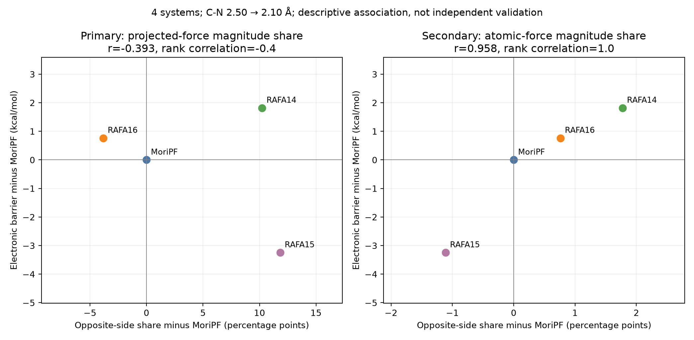
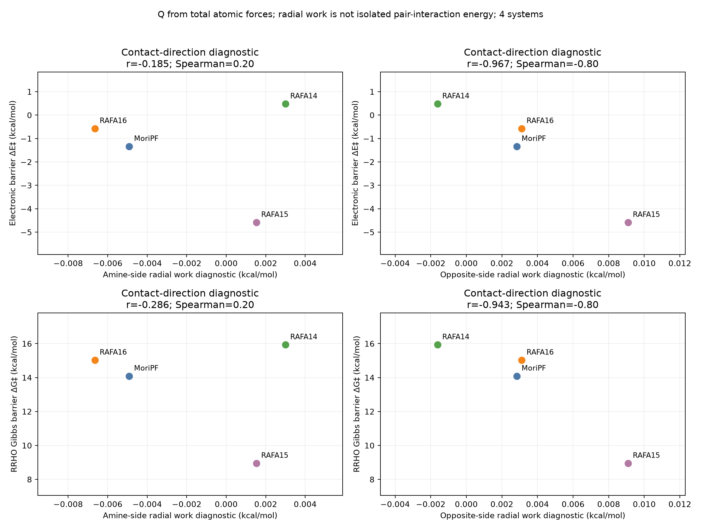

# 追加DFTを行わない、両側接触と障壁の評価方針

[図の見方・用語・全図の説明](figure_guide_ja.md)。各図の軸、点・線・色の意味はこちらでも確認できます。

調査・解析日：2026-10-17（JST）。対象：MoriPF、RAFA14、RAFA15、RAFA16。使用範囲は既存のIRC・opt・freq log。**新しいDFT、SAPT、EDA、電子密度の単点計算は実行も要求もしない。**

**追加検証：[分子内順位と他の接触との比較](contact_specificity_summary_ja.md)。下記の高相関を対照群と比べると、反対側接触は応答が大きい候補ではあるが、相関が唯一という主張は支持されなかった。**

## 推奨する量

今回の目的は厳密なペア相互作用エネルギーの決定ではなく、アミン側F···Hと反対側H/F···Oの影響を、既存logから再現できる間接指標で定量化すること。その条件なら、**原子別仕事を主指標、接触方向の仕事を補助指標、距離・角度を解釈の補助**とするのがよい。

比率に単位を付け直すのではなく、力と移動を積分した量に変更した。図15は横軸が各側の原子仕事（kcal/mol）、縦軸が各系のΔE‡・ΔG‡。MoriPFを引くゼロ合わせは廃止した。元の比率は再現性のため補足図17に無次元の実値として残す。

## 文献で確認したこと

| 文献 | 確認した内容 | 今回の使い方・適用範囲 |
| --- | --- | --- |
| Haas & Chu, JCP 2009, 131, 144105. [DOI: 10.1063/1.3243080](https://doi.org/10.1063/1.3243080)、[要旨](https://pubmed.ncbi.nlm.nih.gov/19831431/) | 経路上の各原子の力と移動から仕事を求め、原子・官能基のエネルギー寄与を調べる方法。 | 原子別仕事を使う直接の根拠。今回のIRCは電子エネルギー経路なので、Gibbs自由エネルギー分解とは呼ばない。 |
| Vöhringer-Martinez & Toro-Labbé, JPCA 2012, 116, 7419–7423. [DOI: 10.1021/jp303075k](https://doi.org/10.1021/jp303075k)、[要旨](https://pubmed.ncbi.nlm.nih.gov/22746292/) | Reaction Forceの枠組みで原子別の反応進行・エネルギー寄与を解析。 | 接触原子だけでなくO21や残りの原子も分けて調べる根拠。今回の原子選択・共通区間は本プロジェクト独自。 |
| Komorowski, Ordon & Jędrzejewski, PCCP 2016, 18, 32658–32663. [DOI: 10.1039/C6CP06519H](https://doi.org/10.1039/C6CP06519H)、[著者公開本文](https://www.komorowski.edu.pl/wp-content/uploads/2022/03/PCCP-2016-18-32658-63.pdf) | 原子の力と経路上の移動の内積による寄与を記述し、原子の移動自体が指標を強く左右することも指摘。論文の中心となるfragility spectrumはHessianの変化を使う。 | 原子仕事を「局所的な構造応答」と読む根拠。IRCの1次元微分から全Hessianを再構成できるとは考えず、fragility spectrumを計算したとは主張しない。 |
| Toro-Labbé et al., J Mol Model 2009, 15, 707–710. [DOI: 10.1007/s00894-008-0431-8](https://doi.org/10.1007/s00894-008-0431-8)、[要旨](https://pubmed.ncbi.nlm.nih.gov/19085021/) | 反応力と反応領域を用いた経路の記述。 | 既存のF、κ、区間仕事を補助に使う。αなどは系ごとに異なるので、局所接触の比較では共通C–N距離区間を優先。 |

以下の計算設計・推奨順位は、この文献と本データからの提案であり、論文が今回の4系やH/F···O仮説を検証したという意味ではない。2009・2012年論文は公開要旨、2016年論文は著者公開本文の式・議論を確認した。

## 今回実装・計算したもの

### 1. 原子別・両側の仕事：主指標

```text
W_g = −∫ Σ(i∈g) F_i · dr_i          [kcal/mol]
```

アミン側：C24上のF/Hと選択アミンH。反対側：C25上のF/HとクマリンO21。さらに4原子を個別に分け、残り53原子も保存した。全原子の和は同区間の電子エネルギー上昇と一致することを検証する。

力が大きくても原子がほとんど動かなければ仕事は小さい。したがって、力ノルムの割合よりも「この原子の動きが反応経路のエネルギー変化にどの程度関わるか」を説明しやすい。これは相互作用の強さではなく、全分子から受ける力とその原子の移動の応答である。

| 系 | アミン側W | 反対側W | ΔE‡ | ΔG‡（RRHO） |
| --- | ---: | ---: | ---: | ---: |
| MoriPF | 0.084632 | 0.042637 | −1.342 | 14.083 |
| RAFA14 | 0.098393 | 0.027057 | 0.476 | 15.928 |
| RAFA15 | 0.140664 | 0.140150 | −4.587 | 8.943 |
| RAFA16 | 0.095713 | 0.054366 | −0.579 | 15.023 |

単位はすべてkcal/mol。WはC–N 2.50→2.10 Åの区間仕事、障壁は各系の分離反応物（基質＋Lys）基準。ΔG‡は298.15 K・1 atmの既存RRHO値、RAFA15は微小虚振動のため暫定。

反対側WとΔE‡はr=−0.965、ΔG‡はr=−0.976、順位相関はともに−0.8。3区間で電子障壁とのrは約−0.959〜−0.967。反対側の原子はアミンHの選択に依存しないため、もう一方のアミンHを使って一致することは独立の頑健性検証ではない。4系中1系を外すと電子障壁とのrは約−0.999〜−0.642まで変わる。

**RAFA15は、4系の中で反対側の仕事Wが最も大きく、全障壁が最も低い。** 反対側のWの約98%はO21の移動に由来し、H56単独の仕事は約0.0029 kcal/mol。したがって「H···O結合が0.14 kcal/mol安定化した」という読み方ではなく、「低障壁の系ではO21を含む反応中心の局所応答が大きい」という仮説に使う。ユーザーの両側接触仮説と関連しうるが、この対応だけでH···O由来と特定はしない。



<!-- figure-explanation:start -->
**図15の読み方 — 両側の原子に割り当てた仕事と、活性化障壁の関係**

1点が1つの分子系。左列の横軸はアミン側XとアミンHの仕事の合計、右列は反対側XとO21の仕事の合計（kcal/mol）。どちらもC–N 2.50→2.10 Åの間で−∫Fᵢ·drᵢを計算した。上段の縦軸はΔE‡、下段はΔG‡（kcal/mol）。点の色は分子系、rはPearson相関、Spearmanは順位相関を表す。

右列は、仕事が大きい系ほど障壁が低いという負の相関を示す。ただし横軸は経路の一部分の仕事で、縦軸は分離反応物からTSまでの全障壁。仕事の大きさをそのまま接触の安定化エネルギーには読み替えられない。この図だけでは、他の接触より特別な相関かどうかは分からない。
<!-- figure-explanation:end -->


### 2. 接触方向の仕事：より局所的なad hoc指標

```text
Q_ab = 1/2 (F_b − F_a) · e_ab       [Hartree/Bohr]
W_radial,ab = −∫ Q_ab dr_ab        [kcal/mol]
```

接触が伸縮する方向の力と、その伸縮量を組み合わせる。本プロジェクト独自の診断定義であり、上記文献の標準ペア相互作用エネルギーではない。全原子仕事の部分和とも異なるため、両者を加算しない。

| 系 | アミン側の接触方向の仕事 | 反対側の接触方向の仕事 |
| --- | ---: | ---: |
| MoriPF | −0.004908 | 0.002836 |
| RAFA14 | 0.002996 | −0.001622 |
| RAFA15 | 0.001526 | 0.009085 |
| RAFA16 | −0.006649 | 0.003114 |

単位はkcal/mol。反対側はΔE‡とr=−0.967、ΔG‡とr=−0.943。電子障壁とのrは3区間で約−0.960〜−0.969、1系除外で約−0.998〜−0.885。一方、アミン側の主区間rは電子障壁で−0.185、Hの選択でも変わる。**現データでは「両側が同じ程度に障壁を説明する」という結果にはなっていない。**

この接触方向の仕事は最大でも約0.009 kcal/molで、数kcal/molの障壁差をエネルギー収支として説明する大きさではない。微小な接触応答を指標として使う候補である。丸められたGaussian原子力・距離微分の誤差を無視して細かな桁を解釈しない。追加DFTなしで数値頑健性を改善するなら、点の間引きや積分方法変更による再計算を次に行う。



<!-- figure-explanation:start -->
**図18の読み方 — 接触方向に限って計算した仕事と、障壁の関係**

1点が1系。左列はアミン側、右列は反対側の接触について、接触方向の力Qを距離変化に沿って積分した−∫Q dq（kcal/mol）を横軸に取る。上段はΔE‡、下段はΔG‡。集計区間はC–N 2.50→2.10 Å。

図15が2原子の全方向の力と移動を足した量なのに対し、図18は2原子を結ぶ方向の成分だけを使う。両者は別の量で、足し合わせない。反対側には負の相関があるが、横軸の値は0.01 kcal/mol未満であり、数kcal/molの障壁差をそのまま説明するエネルギーではない。
<!-- figure-explanation:end -->


### 3. 全障壁とのエネルギー収支：解釈の土台

```text
ΔE‡ = [E(c=2.50) − E_separated]
      + [E(c=2.10) − E(c=2.50)] + [E_TS − E(c=2.10)]
```

| 系 | 共通区間に入る時点のエネルギー | 共通区間内の上昇 | 区間後→TS | ΔE‡ |
| --- | ---: | ---: | ---: | ---: |
| MoriPF | −3.791 | 2.367 | 0.082 | −1.342 |
| RAFA14 | −2.913 | 3.148 | 0.242 | 0.476 |
| RAFA15 | −9.019 | 4.031 | 0.401 | −4.587 |
| RAFA16 | −3.326 | 2.628 | 0.120 | −0.579 |

これもすべてkcal/mol。RAFA15は反応前半の同じC–N距離で既に低エネルギーにある。その後の上昇が大きくても、全障壁は低くなる。原子仕事の負相関を「反発が弱くなった」と読むのではなく、この形状と併せて考える。入口のエネルギーは会合・配座変化などを含み、H···Oだけの安定化ではない。また上の収支は恒等関係なので、この構成項と全障壁の相関を独立予測の成功例には数えない。

## 次にlogだけで優先する確認

1. **微小な接触方向の仕事の数値頑健性。** 現在は共通区間3種類を計算済み。点間の直接線積分、1点おきの積分と比べ、原子力丸め誤差の上限も見積もる。強い相関が数値誤差より十分大きな差に支えられているかを確認する。
2. **原子仕事の座標合わせ依存性。** 今回は全57原子の重心を除去してTSへ剛体重ね合わせ。固定coumarin骨格での重ね合わせも比較する。全エネルギー差が不変でも各原子の配分は変わりうるため、O21に寄与が集中する結論が保たれるかを見る。
3. **幾何で理由を説明する。** 共通C–N距離上のH/F···O距離、C–X···O角、フェニル–coumarinの二面角、C20–O21変化を、原子仕事の累積曲線に重ねる。RAFA15のC–H···O角はTSで約90°なので、教科書的な直線水素結合の強さより、接触・環の向き・反応中心の応答として見る。
4. **TS虚振動の方向は補助。** 既存freqの固有ベクトルを使い、C–N形成に伴って両側の接触が伸びる／縮む方向を調べられる。固有ベクトルの任意符号をC–N短縮側に統一する。TS一点のモード変位だけを障壁予測の主指標にはしない。

1〜4は今後のlog限定の提案であり、今回全てを実行済みという意味ではない。現時点では原子仕事・接触方向の仕事、3区間・2通りのアミンH、全エネルギー収支を実装した。

## 現在のログでは優先しないもの

- **SAPT/EDA/activation strainの追加分解**：関連論文はあるが、既存logにない断片エネルギー・波動関数計算が必要になるため、今回の計画から外した。関連する [Derricotte 2019のSAPT反応力論文](https://doi.org/10.1021/acs.jpca.9b06865) は方法の違いを確認する参考にとどめる。
- **NBO、NCI/IGMH、IQAの新規実行**：現在保存されている17ログだけから全4系の均一な相互作用エネルギーを得る方法としては採用しない。NBO/NPAの出力はMoriPF・RAFA16のTSにはあるが、RAFA14・RAFA15には同じ出力が揃わない。
- **点電荷のq_i q_j/r**：ad hoc指標としては定義できるが、IRCのMulliken出力は各ログ1〜2ブロックで、全反応点の同条件電荷列ではない。TSの電荷を全経路へ固定してCoulombエネルギーと呼ぶと追加仮定が強いため、まずは全点に実値がある力・座標を使う。
- **全Hessianの逆算**：IRCに沿う力の変化から得られるのは経路方向の情報だけで、3N×3N全成分ではない。現時点で全点Hessianの記録を確認していないため、原子間force constantやfragility spectrumを得たと扱わない。
- **障壁に合う重みの探索**：4系しかないため、F···H、H/F···O、角度などの係数を回帰で都合よく調整しない。今回は21指標×3区間×2通りのH×2障壁を全て保存し、弱い相関も残す。

## 成果物と未確定点

[両側接触の解析結果](two_sided_contact_summary_ja.md)、[全指標CSV](../csv/two_sided_window_metrics.csv)、[全相関CSV](../csv/two_sided_correlations.csv)。原本ログを変更せず、既存Python解析から再生成できる。

この4系で最も使いやすい候補は **反対側原子仕事W** と **反対側接触の接触方向の仕事**。前者はエネルギー収支との対応が明瞭、後者は接触方向を限定できる。現段階では「RAFA15のH···Oが有利、F···Oが不利」を厳密に証明する必要はなく、この仮説に関連する応答が障壁とどう対応するかを、再現可能な間接指標として提示する。ただし高相関の主成分がO21であること、仕事の大小と障壁の大小が逆向きであることは、結果の説明に必ず含める。
