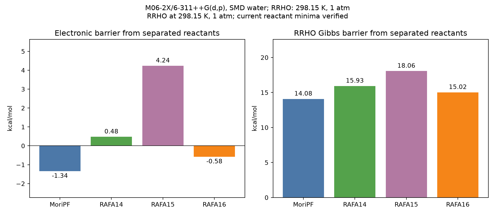
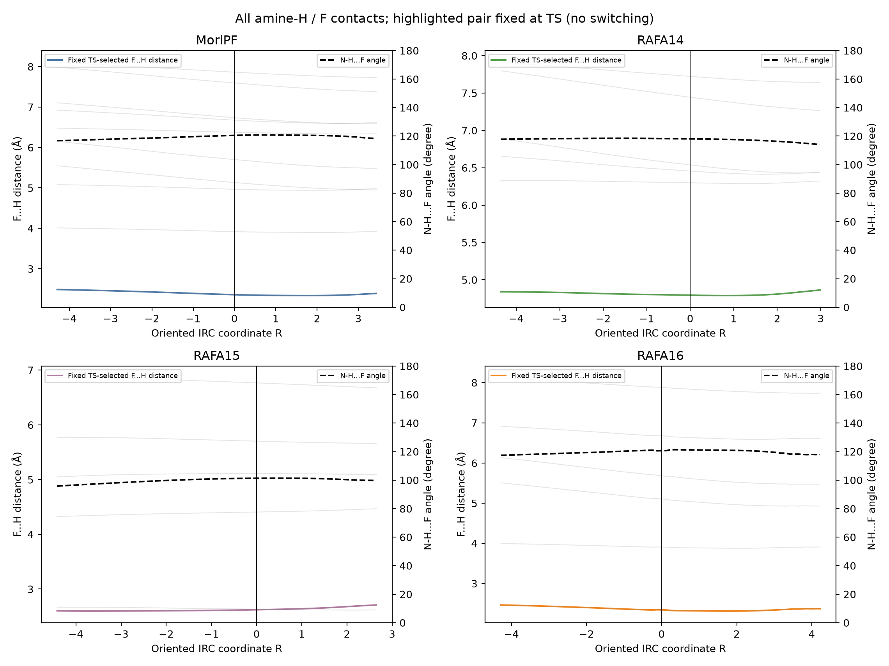
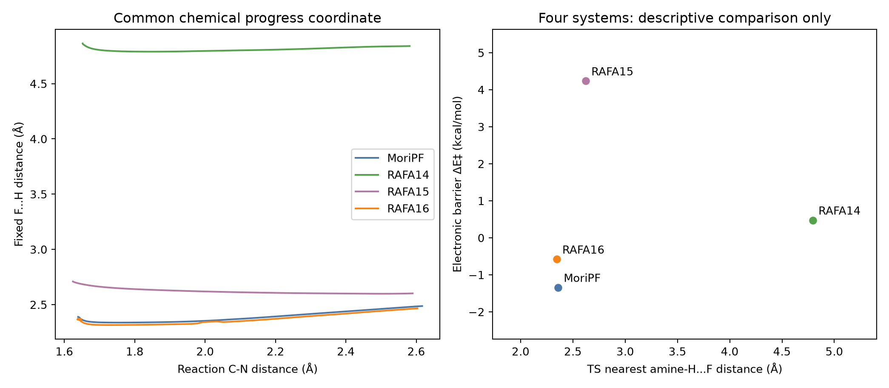
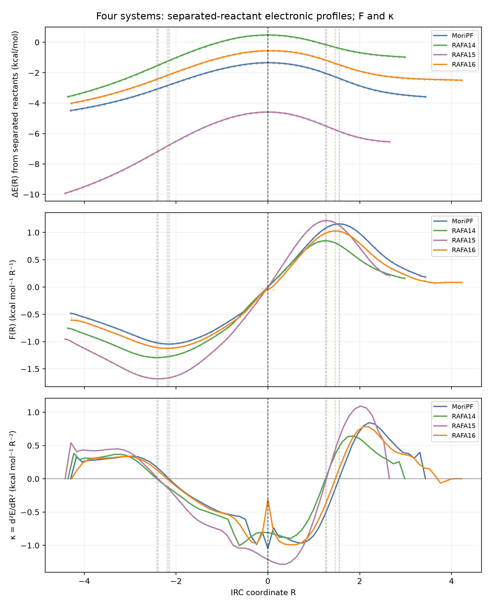

# 4分子系のIRC・反応力解析：結果と解釈

[図の見方・用語・全図の説明](figure_guide_ja.md)。各図の軸、点・線・色の意味はこちらでも確認できます。

実行日：2026-10-17（JST）。入力：完成.zip内の16ログと、同条件で再計算された `LYS (1).LOG`（保存名 `Lys.log`）。旧結果を上書き更新。既存の2系解析から独立した4系解析。

## 背景と問い

ユーザーの仮説は、フッ素置換フェニル基のortho Fが求核剤アミンのHと接触することで反応を促進し、ortho Fがない系では反応性が下がる、というもの。距離・角度、反応力、構造変化の同期性から間接的に検討する。ここで「Lys」は入力ファイルの名称であり、ログの実体はC3H9N（13原子）のアミンモデルである。

## 数値結果

電子障壁の低い順は **RAFA15 < MoriPF < RAFA16 < RAFA14**。各系の分離反応物（基質＋Lys）を基準とする障壁そのものを表示する。MoriPFを引く系間のゼロ合わせは行わない。生の全電子エネルギー（Hartree）も `energy_comparison.csv` に保持するが、組成の異なる系の全電子エネルギーの大小を反応性とは解釈しない。

| 系 | ortho F数 | ΔE‡ / kcal mol−1 | ΔG‡（RRHO） | TS F···H / Å | TS N–H···F / ° | α→TS / kcal mol−1 |
| --- | --- | --- | --- | --- | --- | --- |
| MoriPF | 2 | -1.342 | 14.083 | 2.358 | 120.526 | 1.468 |
| RAFA14 | 0 | 0.476 | 15.928 | 4.795 | 118.059 | 2.022 |
| RAFA15 | 1 | -4.587 | 8.943 | 2.622 | 101.335 | 2.578 |
| RAFA16 | 2 | -0.579 | 15.023 | 2.345 | 120.620 | 1.603 |

表の接触はTSで最短のF···Hを選び、その原子対をIRC全体で追跡した値。F位置はフェニル環C23をipsoとして判定した。

<!-- figure-explanation:start -->
**図02の読み方 — 活性化障壁と、αからTSまでのエネルギー上昇**

横軸は4つの分子系、棒の高さはkcal/mol単位のエネルギー。左から電子エネルギーによる障壁ΔE‡、熱・エントロピー補正を含むRRHOの自由エネルギー障壁ΔG‡、α→TSの区間仕事を示す。棒上の数字が各値。

最初の2つは各系の分離反応物からTSまで、右端はIRC上のαからTSまでを比べており、出発点が異なる。RAFA15は全障壁が低くてもα→TSの上昇は大きい。この区間仕事を、そのまま全障壁や接触の結合エネルギーと解釈しない。
<!-- figure-explanation:end -->

分離反応物基準の障壁・反応エネルギー（すべてkcal/mol）：

| 系 | ΔE‡ | ΔG‡（RRHO） | ΔE反応 | ΔG反応（RRHO） |
| --- | --- | --- | --- | --- |
| MoriPF | -1.342 | 14.083 | -5.386 | 11.347 |
| RAFA14 | 0.476 | 15.928 | -1.461 | 15.725 |
| RAFA15 | -4.587 | 8.943 | -2.837 | 12.233 |
| RAFA16 | -0.579 | 15.023 | -3.653 | 12.700 |

`ΔE‡ = E_TS − E_substrate − E_Lys`、`ΔG‡ = G_TS − G_substrate − G_Lys`。生成物についても同様に計算した。Lysの電子エネルギーは-174.451556589 Hartree、RRHO Gibbsエネルギーは-174.357693 Hartree。

電子障壁が負でも、分離した2分子の電子エネルギーよりTSが低いという意味であり、反応障壁が存在しないという意味ではない。RRHO Gibbs障壁は全系で正で、IRCの反応物側からTSへもエネルギー上昇がある。生成物側は与えられたopt構造についての値であり、特にRAFA15のIRCとの対応には後述の制限がある。

<!-- figure-explanation:start -->
**図03の読み方 — 分離反応物を基準とする活性化障壁**

左はΔE‡、右はΔG‡。横軸は分子系、縦軸はkcal/molで、棒の高さと数字は各系の障壁そのものを示す。図2の左・中央と同じ量を大きく表示した。

ΔE‡が負なのは、TSの電子エネルギーが分離した基質＋Lysより低いという意味。無障壁反応を意味しない。ΔG‡は全系で正である。RAFA15のΔG‡は反応物の小さな虚振動が残るため暫定値。
<!-- figure-explanation:end -->

<!-- thermochemistry:start -->
## 活性化障壁のエントロピー項

各系の分離反応物からTSまでの差（kcal/mol）。TΔS‡はfreqのH−Gから計算し、EとGの差は別の列に示す。

| 分子系 | ΔE‡ | ΔH‡ | ΔG‡ | TΔS‡ | −TΔS‡ | ΔG‡−ΔE‡ | ΔH‡−ΔE‡ |
| --- | --- | --- | --- | --- | --- | --- | --- |
| MoriPF | -1.342 | -0.505 | 14.083 | -14.588 | 14.588 | 15.425 | 0.837 |
| RAFA14 | 0.476 | 1.545 | 15.928 | -14.383 | 14.383 | 15.452 | 1.069 |
| RAFA15 | -4.587 | -2.880 | 8.943 | -11.822 | 11.822 | 13.530 | 1.707 |
| RAFA16 | -0.579 | 0.466 | 15.023 | -14.558 | 14.558 | 15.602 | 1.044 |

G−Eには熱的なエンタルピー補正も含まれるため、TΔSとは異なる。RAFA15はエントロピーによる障壁の押し上げ（−TΔS‡）が他の3系より小さい。微小虚振動による暫定値という扱いは維持する。

[3×3のE・G・TΔS図と、滑らかな接続の説明](thermochemistry_profiles_ja.md)
<!-- thermochemistry:end -->

## 仮説に対する解釈

**最新の対照検証：[分子内の強さ順位と、他の接触の相関](contact_specificity_summary_ja.md)。指定接触は局所応答として目立つ場合があるが、障壁と相関する接触は他にもあり、特異的な機構の証拠としては不十分。**

追加DFTなしの計算方針は [文献調査とlog限定の評価案](log_only_research_plan_ja.md) を参照。反対側ortho位置のH/F···Oまで含む追加定量化は、[両側接触・力と障壁の解析結果](two_sided_contact_summary_ja.md)を参照。従来の `interference_F` は最も近いFを選ぶ指標で、RAFA15の反対側H56···O21を表していないため、新解析では同じ環位置のF/Hを対応させた。以下はH···F単独の指標についての解釈であり、両側を組み合わせた仮説を否定するものではない。

**今回の結果は、ortho Fによる近接配置の形成とは整合するが、F···H接触だけで4系の障壁差を説明することはできない。**

- RAFA14（ortho Fなし）の最短F···Hは4.79 Å、電子障壁は0.48 kcal/mol。
- MoriPFとRAFA16は約2.35 Å、N–H···F角約120°の近接配置を持ち、電子障壁はそれぞれ-1.34、-0.58 kcal/mol。
- RAFA15は最短F···Hが2.62 Å、角度101.3°でも、電子障壁は-4.59 kcal/molと最も低い。接触の短さだけでは順位を説明できない。
- RAFA15のα→TS仕事は2.58 kcal/molと最大。分離反応物→αは-7.17 kcal/mol。この区間には会合・配座変化が含まれ、特定の接触の安定化には分解できない。

ortho Fの有無、F···H距離、N–H···F角度と障壁を合わせて評価する。短い接触や大きな相関係数だけでは、水素結合・安定化エネルギー・因果関係の証明にならない。F置換に伴う電子効果、分子の配向、立体効果、他の接触も同時に変わる。また、MoriPFはF数自体がRAFA14–16と異なるため、位置だけを比較する対照ではない。

全F×アミンHの距離と角度を `all_NH_F_contacts.csv` に保存した。RAFA15ではアミンの配向も異なり、同じ化学的位置のFが存在しないRAFA14との単一ペア比較には限界がある。固定ペアの距離と反応C–N距離を同じ横軸で比較した図も作成した。

<!-- figure-explanation:start -->
**図11の読み方 — アミンHとすべてのFの距離を確認する**

各小図が1系。横軸はR、左縦軸はF···H距離（Å）。灰色の線はすべてのFと2つのアミンHの組合せ、色付きの線はTSで最短だった原子対を経路全体で追跡したもの。黒い破線は、その原子対のN–H···F角度を右縦軸（度）で示す。

途中で最短の原子対に切り替えてはいない。色付きの線が灰色の別の線より長くなる場合もある。近さと角度を確認する図であり、灰色の線の数や高い相関を水素結合の数・強さとは解釈しない。
<!-- figure-explanation:end -->

<!-- figure-explanation:start -->
**図12の読み方 — C–N形成の進み具合とF···H距離、および障壁の比較**

左：横軸は反応C–N距離、縦軸はTSで選んだF···H距離（ともにÅ）。1本の線は1系の経路で、C–Nが短くなる左向きが反応の進行方向。右：横軸はTSでのF···H距離（Å）、縦軸はΔE‡（kcal/mol）で、1点が1系。

右図は「F···Hが短い系ほど障壁が低いか」を調べる。RAFA15は接触が最短ではないのに障壁が低く、距離だけでは4系の順位を説明できない。
<!-- figure-explanation:end -->

## Reaction Forceと仕事の分解

`F(R) = −dE/dR`。αは反応物側でFが最小となる点、β=0はTS、γは生成物側でFが最大となる点。エネルギーを平滑化スプラインで近似し、解析的な微分を用いた。極値は全域の細かい探索と局所最適化で求めた。

**反応力定数は参照論文の `κ = d²E/dR² = −dF/dR` を図に使用する。旧解析のκは逆符号だった。** CSVには論文規約を `kappa_paper_*` として保存し、旧規約の列も比較用に保持する。

`α→TS = E_TS − E(α)` は各IRC内部の遷移前半の仕事であり、分離反応物からの全障壁ではない。`IRC_left_to_alpha` は計算済み左端からαまでの区間で、系によってIRCの到達範囲が異なる。これをそのまま全構造準備コストの順位として扱わない。分離反応物からαまでの値は `separated_reactants_to_alpha_kcal_mol` に保存する。

| 分子系 | 分離反応物→α（kcal/mol） | α→TS（kcal/mol） | 電子障壁 ΔE‡（kcal/mol） |
| --- | --- | --- | --- |
| MoriPF | -2.810 | 1.468 | -1.342 |
| RAFA14 | -1.547 | 2.022 | 0.476 |
| RAFA15 | -7.165 | 2.578 | -4.587 |
| RAFA16 | -2.182 | 1.603 | -0.579 |

比較図・個別系の図ともに `ΔE(R) = E(R) − E_substrate − E_Lys` を使い、TSの高さはその系の電子障壁を表す。

<!-- figure-explanation:start -->
**図01の読み方 — 反応経路に沿ったエネルギー・反応力・反応力定数**

上段は電子エネルギーΔE(R)、中段は反応力F=−dE/dR、下段は反応力定数κ=d²E/dR²を描いた。横軸は反応の進み具合を表すIRC座標Rで、左が反応物側、R=0がTS、右が生成物側。ΔEの単位はkcal/mol、FとκはそれぞれIRC座標で1回、2回微分した単位になる。

上段のゼロは各系の分離反応物（基質＋Lys）のエネルギーであり、MoriPFのTSではない。点はログから読み取った値、滑らかな実線は補間・平滑化した曲線。中段には有限差分から求めた点も示す。黒い縦破線はTS、その他の縦破線はFの極値から決めたα・γ。個別図は1系、比較図は4系を重ねている。

この図は障壁の高さと経路の形を読むためのもの。Fは分子全体のエネルギー勾配で、F···HやH···Oの間に働く力そのものではない。
<!-- figure-explanation:end -->

`descriptive_correlations.csv` は全経路・反応物側・遷移領域・TS前後のPearson/Spearman相関を収録する。IRC点は時系列状に連続しており独立標本ではないため、p値による有意性を主張しない。距離同士の相関には共通の反応進行が混入するため、符号付き微分同士の相関も併記した。4系のみから機構を回帰的に確定しない。

遷移領域のF···H距離とC–N距離の記述相関：

| 分子系 | IRC点数 | Pearson相関 r | 順位相関 |
| --- | --- | --- | --- |
| MoriPF | 30 | 0.981 | 1.000 |
| RAFA14 | 30 | 0.975 | 0.982 |
| RAFA15 | 29 | -0.978 | -1.000 |
| RAFA16 | 30 | 0.979 | 0.998 |

遠い接触しかないRAFA14でも相関が約0.975に達する。これは「高相関そのものがH···F相互作用の証拠ではない」ことを、このデータ内で示す重要な対照である。RAFA15は負相関で、結合形成に伴って選択したF···Hがむしろ離れる方向に動く。

## IRC方向とTSの確認

全系でC20–求核N距離が長い側を負、短い側を正とした。MoriPF・RAFA15・RAFA16は元のparser座標を反転、RAFA14はそのままとした。RAFA16には最大0.0114 Åの局所的なC–N伸長があり、全点が厳密に単調減少するわけではないが、端点間の反応方向は明瞭である。元のGaussian出力は圧縮してバイト単位で保存し、解析用LOGを `outputs/oriented_logs/` に別途生成した。これは新規Gaussian計算ではなく、座標・エネルギー・力・反応座標を正規化した派生LOGである。解析はこのLOGを読み直して実施し、書き出し前後の値の一致を検証した。

| 分子系 | 反応座標に掛けた符号 | 反応物側C–N距離（Å） | 生成物側C–N距離（Å） | 全点でC–Nが単調減少 | IRC点数 | TS重ね合わせのRMSD（Å） |
| --- | --- | --- | --- | --- | --- | --- |
| MoriPF | -1 | 2.617 | 1.639 | はい | 64 | 0.000 |
| RAFA14 | 1 | 2.581 | 1.652 | はい | 60 | 0.000 |
| RAFA15 | -1 | 2.590 | 1.624 | はい | 57 | 0.000 |
| RAFA16 | -1 | 2.603 | 1.641 | いいえ | 71 | 0.000 |

TSは対応するfreqログの実座標・電子エネルギーを使用した。IRC内のTSエネルギーとの一致と、近傍構造への重ね合わせを確認した。全TSは虚振動1個。ただし虚振動固有ベクトルが反応C–N形成モードに対応するかの可視化確認はこの解析では実施していない。未収束末端点（反応座標の記録が欠ける点）は除外し、外挿しない。

## 計算条件・対応関係の制限

分子側の反応物・TS・生成物と新しいLysはすべてM06-2X/6-311++G(d,p)、SMD水。Lysはopt/freq正常終了、13原子・33振動モード・虚振動0個。組成、電荷、計算レベル、温度・圧力、熱化学の有無を確認してから絶対障壁を計算する。旧Lysに由来する異条件の算術値と警告は今回の出力から削除した。

ΔG‡はGaussian標準RRHO値による298.15 K・1 atmのモデル値であり、1 M標準状態補正や低振動数の準調和補正はしていない。1 atmから1 Mへの補正を行う場合、会合型反応の絶対値が変わるが、同一分子数変化の系間比較では共通項は相殺する。低振動数・配座差の誤差は残る。RAFA15反応物には−5.4036 cm⁻¹の小さな虚振動があり、この系のRRHO値は暫定としてフラグを残している。

`absolute_barrier_valid` は計算条件・組成が整合した算術値であることを示す。全反応物が厳密な極小であることや実験速度の再現を保証するフラグではない。別列 `reactant_minimum_verified` と `RRHO_G_provisional` を参照する。単一の与えられた配座・経路についての比較なので、速度定数や実験的反応性の順位は確定しない。

| 分子系 | 生成物optとIRC末端のRMSD（Å） | 生成物opt−IRC末端のエネルギー差（kcal/mol） | 生成物optのC–N距離（Å） | IRC生成物側のC–N距離（Å） | Lysを含めた組成が一致 |
| --- | --- | --- | --- | --- | --- |
| MoriPF | 0.774 | -1.804 | 1.582 | 1.639 | はい |
| RAFA14 | 0.393 | -0.489 | 1.622 | 1.652 | はい |
| RAFA15 | 2.111 | 3.708 | 1.584 | 1.624 | はい |
| RAFA16 | 1.071 | -1.160 | 1.588 | 1.641 | はい |

生成物optとIRC末端のRMSDは、原子番号をそのまま対応させた重ね合わせの診断値であり、対称等価原子の入れ替え探索はしていない。特にopt生成物がIRC末端より高エネルギーの場合、別配座／別経路の可能性がある。両者を滑らかな接続線で結ばない。

## 力・運動解析の検証

| 分子系 | IRC点数 | Pearson相関 r | 正規化した二乗平均平方根誤差 |
| --- | --- | --- | --- |
| MoriPF | 63 | 1.000 | 0.003 |
| RAFA14 | 59 | 1.000 | 0.002 |
| RAFA15 | 56 | 1.000 | 0.002 |
| RAFA16 | 70 | 1.000 | 0.023 |

`Σ F_i · dr_i/dR` とエネルギー由来反応力の一致を確認する診断。原子・断片の寄与や2原子の力射影は、H···F相互作用エネルギーの一意な分解ではない。平滑化への依存は `smoothing_sensitivity.csv` に記録した。

## 既存ログだけで次に確認できる点

- 原子の仕事を経路に沿って積み上げた曲線と、接触距離・角度・環の回転を比べ、RAFA15のO21で仕事が増える位置を調べる。
- 点を間引く、積分方法や座標の重ね合わせ方を変える、といった確認により、小さな仕事の値と順位がどの程度変わるかを調べる。

追加DFTを伴う配座探索やエネルギー分解は、現在の作業範囲に含めない。微小虚振動など、既存ログだけでは解消できない点は結果の制限として残す。

## 実行時の警告

- RAFA15 reactant: imaginary frequencies [-5.4036] cm^-1; minimum not fully verified
- MoriPF: omitted 1 unconverged terminal point(s); no extrapolated coordinates used
- RAFA15: omitted 1 unconverged terminal point(s); no extrapolated coordinates used
- RAFA15: supplied optimized product is higher than the IRC product-side endpoint; conformer/path correspondence needs checking
- RAFA16: local C-N increases up to 0.01138 A; overall orientation follows long-to-short endpoints

## 参照文献

- Toro-Labbé et al. (2009), *The reaction force and the transition region of a reaction*, J. Mol. Model. 15, 707–710. [DOI](https://doi.org/10.1007/s00894-008-0431-8)、[PubMed要旨（κの定義を確認）](https://pubmed.ncbi.nlm.nih.gov/19085021/)。構造準備／遷移領域という解釈の理論的背景。
- Dunitz & Taylor (1997), *Organic Fluorine Hardly Ever Accepts Hydrogen Bonds*, Chem. Eur. J. 3, 89–98. [DOI](https://doi.org/10.1002/chem.19970030115)。有機Fの水素結合受容性を距離だけで判断しないための背景資料。

## 再現方法

ルートで `python -m pip install -r requirements.txt`、続いて `python analysis4_force/run_analysis.py`。圧縮原本は自動展開し、manifestのSHA-256と照合する。原子対応表・全数値・図・この結果報告はスクリプトから生成する。
